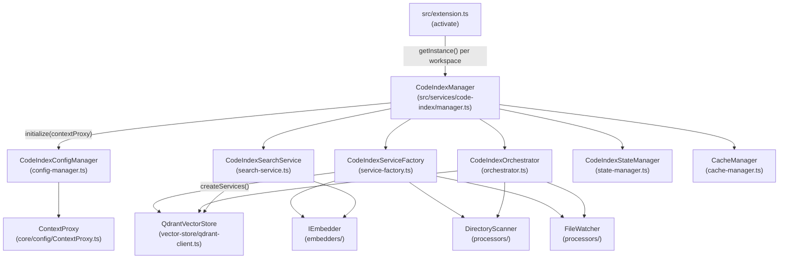
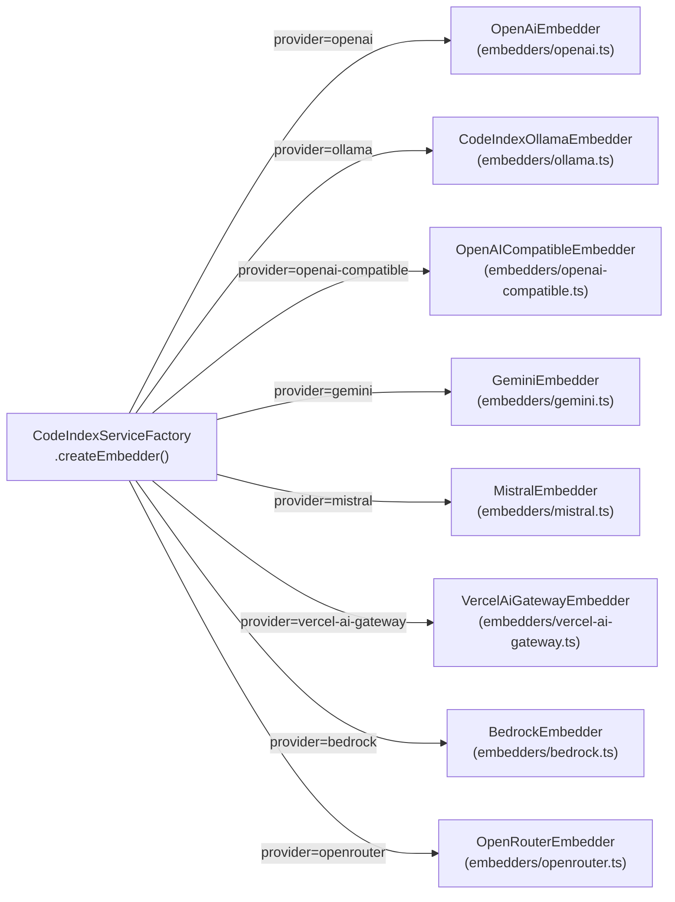
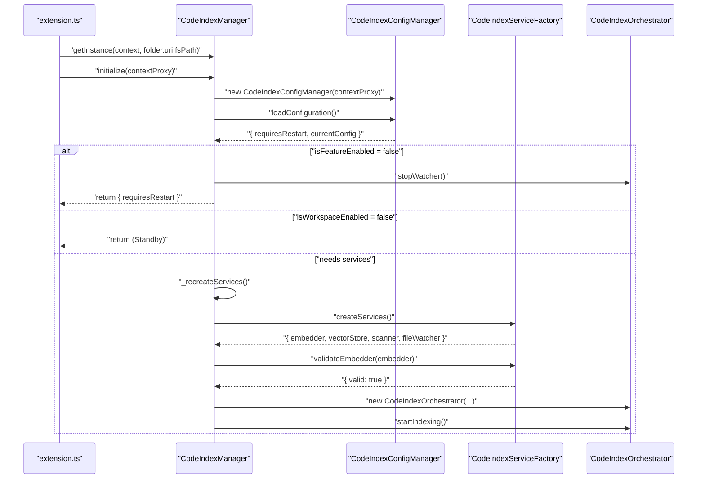
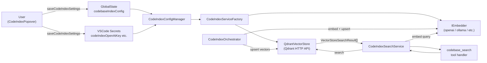

# Codebase Indexing Settings

Relevant source files

The following files were used as context for generating this wiki page:

- [packages/types/src/codebase-index.ts](packages/types/src/codebase-index.ts)
- [src/services/code-index/__tests__/config-manager.spec.ts](src/services/code-index/__tests__/config-manager.spec.ts)
- [src/services/code-index/__tests__/manager.spec.ts](src/services/code-index/__tests__/manager.spec.ts)
- [src/services/code-index/__tests__/orchestrator.spec.ts](src/services/code-index/__tests__/orchestrator.spec.ts)
- [src/services/code-index/__tests__/service-factory.spec.ts](src/services/code-index/__tests__/service-factory.spec.ts)
- [src/services/code-index/config-manager.ts](src/services/code-index/config-manager.ts)
- [src/services/code-index/embedders/__tests__/gemini.spec.ts](src/services/code-index/embedders/__tests__/gemini.spec.ts)
- [src/services/code-index/embedders/__tests__/ollama.spec.ts](src/services/code-index/embedders/__tests__/ollama.spec.ts)
- [src/services/code-index/embedders/__tests__/openai-compatible-rate-limit.spec.ts](src/services/code-index/embedders/__tests__/openai-compatible-rate-limit.spec.ts)
- [src/services/code-index/embedders/__tests__/openai-compatible.spec.ts](src/services/code-index/embedders/__tests__/openai-compatible.spec.ts)
- [src/services/code-index/embedders/__tests__/openai.spec.ts](src/services/code-index/embedders/__tests__/openai.spec.ts)
- [src/services/code-index/embedders/__tests__/openrouter.spec.ts](src/services/code-index/embedders/__tests__/openrouter.spec.ts)
- [src/services/code-index/embedders/bedrock.ts](src/services/code-index/embedders/bedrock.ts)
- [src/services/code-index/embedders/gemini.ts](src/services/code-index/embedders/gemini.ts)
- [src/services/code-index/embedders/ollama.ts](src/services/code-index/embedders/ollama.ts)
- [src/services/code-index/embedders/openai-compatible.ts](src/services/code-index/embedders/openai-compatible.ts)
- [src/services/code-index/embedders/openai.ts](src/services/code-index/embedders/openai.ts)
- [src/services/code-index/embedders/openrouter.ts](src/services/code-index/embedders/openrouter.ts)
- [src/services/code-index/interfaces/config.ts](src/services/code-index/interfaces/config.ts)
- [src/services/code-index/interfaces/vector-store.ts](src/services/code-index/interfaces/vector-store.ts)
- [src/services/code-index/manager.ts](src/services/code-index/manager.ts)
- [src/services/code-index/orchestrator.ts](src/services/code-index/orchestrator.ts)
- [src/services/code-index/service-factory.ts](src/services/code-index/service-factory.ts)
- [src/services/code-index/shared/validation-helpers.ts](src/services/code-index/shared/validation-helpers.ts)
- [src/services/code-index/vector-store/__tests__/qdrant-client.spec.ts](src/services/code-index/vector-store/__tests__/qdrant-client.spec.ts)
- [src/services/code-index/vector-store/qdrant-client.ts](src/services/code-index/vector-store/qdrant-client.ts)
- [src/shared/__tests__/embeddingModels.spec.ts](src/shared/__tests__/embeddingModels.spec.ts)
- [src/shared/embeddingModels.ts](src/shared/embeddingModels.ts)
- [webview-ui/src/components/chat/CodeIndexPopover.tsx](webview-ui/src/components/chat/CodeIndexPopover.tsx)

This page documents the codebase indexing feature: its configuration settings, the `CodeIndexManager` service, supported embedding providers, and how semantic search is configured and triggered. It covers the backend service layer in `src/services/code-index/` and the settings UI in the `CodeIndexPopover` component.

For the broader Context Management Settings page (max open tabs, max workspace files, etc.), see [11.4](). For the Core Services initialization sequence, see [2.2]().

---

## Overview

Codebase indexing provides semantic search over a workspace's source files. Files are embedded using a configurable embedding provider and stored in a [Qdrant](https://qdrant.tech/) vector database. When the AI issues a `codebase_search` tool call, the `CodeIndexSearchService` queries Qdrant with a vector representation of the query string and returns ranked code snippets. [src/services/code-index/manager.ts:19-28]()

The feature is off by default and requires:
1. A running Qdrant instance
2. Credentials for an embedding provider
3. Per-workspace opt-in [src/services/code-index/manager.ts:105-113]()

---

## Architecture

**Codebase Indexing Service Hierarchy**

Sources: [src/services/code-index/manager.ts:19-32](), [src/services/code-index/manager.ts:163-215]()

---

## Key Classes

| Class | File | Responsibility |
|---|---|---|
| `CodeIndexManager` | `manager.ts` | Singleton per workspace path; top-level orchestration [src/services/code-index/manager.ts:19-21]() |
| `CodeIndexConfigManager` | `config-manager.ts` | Loads/validates config from `ContextProxy`; detects restart-requiring changes [src/services/code-index/config-manager.ts:12-28]() |
| `CodeIndexServiceFactory` | `service-factory.ts` | Constructs `IEmbedder`, `QdrantVectorStore`, `DirectoryScanner`, `FileWatcher` [src/services/code-index/service-factory.ts:33-38]() |
| `CodeIndexOrchestrator` | `orchestrator.ts` | Runs initial scan and manages incremental file watcher [src/services/code-index/manager.ts:9]() |
| `CodeIndexSearchService` | `search-service.ts` | Executes vector search queries against Qdrant [src/services/code-index/manager.ts:8]() |
| `CodeIndexStateManager` | `state-manager.ts` | Tracks and broadcasts `IndexingState` [src/services/code-index/manager.ts:25]() |
| `CacheManager` | `cache-manager.ts` | Persists file hash cache to avoid redundant re-indexing [src/services/code-index/manager.ts:10]() |
| `QdrantVectorStore` | `vector-store/qdrant-client.ts` | Qdrant REST client wrapper with URL normalization and collection management [src/services/code-index/vector-store/qdrant-client.ts:13-19]() |

Sources: [src/services/code-index/manager.ts:19-93](), [src/services/code-index/service-factory.ts:33-111](), [src/services/code-index/vector-store/qdrant-client.ts:13-84]()

---

## Configuration Settings

### Global State Settings

All settings are stored under the `codebaseIndexConfig` key in VS Code global state (via `ContextProxy.getGlobalState("codebaseIndexConfig")`). [src/services/code-index/config-manager.ts:48-58]()

| Setting Key | Type | Default | Description |
|---|---|---|---|
| `codebaseIndexEnabled` | `boolean` | `false` | Master enable/disable for the feature [src/services/code-index/config-manager.ts:61]() |
| `codebaseIndexQdrantUrl` | `string` | `"http://localhost:6333"` | URL of the Qdrant instance [src/services/code-index/config-manager.ts:25]() |
| `codebaseIndexEmbedderProvider` | `EmbedderProvider` | `"openai"` | Embedding provider to use [src/services/code-index/config-manager.ts:14]() |
| `codebaseIndexEmbedderBaseUrl` | `string` | `""` | Base URL for Ollama provider [src/services/code-index/config-manager.ts:64]() |
| `codebaseIndexEmbedderModelId` | `string` | `""` | Model ID for the embedder [src/services/code-index/config-manager.ts:65]() |
| `codebaseIndexEmbedderModelDimension` | `number` | `undefined` | Vector dimension (required for `openai-compatible`) [src/services/code-index/config-manager.ts:91-104]() |
| `codebaseIndexSearchMinScore` | `number` | `0.4` | Minimum cosine similarity score for search results [src/services/code-index/config-manager.ts:66]() |
| `codebaseIndexSearchMaxResults` | `number` | `50` | Maximum results returned per search [src/services/code-index/config-manager.ts:67]() |
| `codebaseIndexOpenAiCompatibleBaseUrl` | `string` | `""` | Base URL for OpenAI-compatible provider [src/services/code-index/config-manager.ts:73]() |
| `codebaseIndexBedrockRegion` | `string` | `"us-east-1"` | AWS region for Bedrock [src/services/code-index/config-manager.ts:78]() |
| `codebaseIndexBedrockProfile` | `string` | `""` | AWS credential profile for Bedrock [src/services/code-index/config-manager.ts:79]() |
| `codebaseIndexOpenRouterSpecificProvider` | `string` | `""` | Optional specific provider for OpenRouter routing [src/services/code-index/config-manager.ts:81]() |

Sources: [src/services/code-index/config-manager.ts:46-151]()

### Secret Settings

API keys are stored separately in VS Code's encrypted secrets store. `CodeIndexConfigManager` reads them via `ContextProxy.getSecret()`. [src/services/code-index/config-manager.ts:70-80]()

| Secret Key | Provider |
|---|---|
| `codeIndexOpenAiKey` | OpenAI |
| `codeIndexQdrantApiKey` | Qdrant (optional) |
| `codebaseIndexOpenAiCompatibleApiKey` | OpenAI-compatible |
| `codebaseIndexGeminiApiKey` | Gemini |
| `codebaseIndexMistralApiKey` | Mistral |
| `codebaseIndexVercelAiGatewayApiKey` | Vercel AI Gateway |
| `codebaseIndexOpenRouterApiKey` | OpenRouter |

Sources: [src/services/code-index/config-manager.ts:70-80]()

---

## Per-Workspace Enablement

The feature has both a **global** enable toggle (`codebaseIndexEnabled`) and a **per-workspace** opt-in. This allows a user to enable the feature globally but selectively opt workspaces in or out. [src/services/code-index/manager.ts:105-113]()

| Property | Storage | Key Pattern |
|---|---|---|
| `isWorkspaceEnabled` | `workspaceState` | `codeIndexWorkspaceEnabled:${folderUri.toString(true)}` [src/services/code-index/manager.ts:102]() |
| `autoEnableDefault` | `globalState` | `codeIndexAutoEnableDefault` [src/services/code-index/manager.ts:116]() |

The `_workspaceEnabledKey()` method in `CodeIndexManager` constructs the key from the workspace folder's URI to prevent collisions between local and remote schemes. [src/services/code-index/manager.ts:101-103]()

When `isWorkspaceEnabled` has no explicit stored value, it falls back to `autoEnableDefault` (defaults to `true`). [src/services/code-index/manager.ts:106-108]()

Sources: [src/services/code-index/manager.ts:101-121]()

---

## Embedding Providers

**Embedding Provider Class Mapping**

Sources: [src/services/code-index/service-factory.ts:43-106]()

### Provider Configuration Requirements

Each provider is considered **configured** when `CodeIndexConfigManager.isFeatureConfigured` returns `true`. [src/services/code-index/manager.ts:145-147]()

| Provider | Implementation Class | Configuration Dependency |
|---|---|---|
| `openai` | `OpenAiEmbedder` | `openAiNativeApiKey` [src/services/code-index/service-factory.ts:48-57]() |
| `ollama` | `CodeIndexOllamaEmbedder` | `ollamaBaseUrl` [src/services/code-index/service-factory.ts:58-65]() |
| `openai-compatible` | `OpenAICompatibleEmbedder` | `baseUrl` + `apiKey` [src/services/code-index/service-factory.ts:66-74]() |
| `gemini` | `GeminiEmbedder` | `apiKey` [src/services/code-index/service-factory.ts:75-79]() |
| `mistral` | `MistralEmbedder` | `apiKey` [src/services/code-index/service-factory.ts:80-84]() |
| `vercel-ai-gateway` | `VercelAiGatewayEmbedder` | `apiKey` [src/services/code-index/service-factory.ts:85-89]() |
| `bedrock` | `BedrockEmbedder` | `region` [src/services/code-index/service-factory.ts:90-95]() |
| `openrouter` | `OpenRouterEmbedder` | `apiKey` [src/services/code-index/service-factory.ts:96-105]() |

### Model Profiles

Supported models and their vector dimensions are declared in `EMBEDDING_MODEL_PROFILES` in `src/shared/embeddingModels.ts`. [src/shared/embeddingModels.ts:8-90]()

| Provider | Model ID | Dimension | Score Threshold |
|---|---|---|---|
| `openai` | `text-embedding-3-small` | 1536 | 0.4 [src/shared/embeddingModels.ts:10]() |
| `openai` | `text-embedding-3-large` | 3072 | 0.4 [src/shared/embeddingModels.ts:11]() |
| `ollama` | `nomic-embed-text` | 768 | 0.4 [src/shared/embeddingModels.ts:15]() |
| `ollama` | `nomic-embed-code` | 3584 | 0.15 [src/shared/embeddingModels.ts:16-18]() |
| `gemini` | `gemini-embedding-001` | 3072 | 0.4 [src/shared/embeddingModels.ts:37]() |
| `mistral` | `codestral-embed-2505` | 1536 | 0.4 [src/shared/embeddingModels.ts:43]() |
| `bedrock` | `amazon.titan-embed-text-v2:0` | 1024 | 0.4 [src/shared/embeddingModels.ts:65]() |
| `openrouter` | `openai/text-embedding-3-large` | 3072 | 0.4 [src/shared/embeddingModels.ts:78]() |

The `getDefaultModelId(provider)`, `getModelDimension(provider, modelId)`, and `getModelScoreThreshold(provider, modelId)` utility functions are in `src/shared/embeddingModels.ts` and used by `CodeIndexConfigManager` and `CodeIndexServiceFactory`. [src/shared/embeddingModels.ts:98-155]()

---

## Vector Store: Qdrant Integration

The `QdrantVectorStore` implements `IVectorStore` and handles communication with the Qdrant server. [src/services/code-index/vector-store/qdrant-client.ts:13]()

### URL Normalization
The store handles various URL formats, including hostname-only inputs, and ensures correct protocol/port mapping (e.g., defaulting to 443 for HTTPS). [src/services/code-index/vector-store/qdrant-client.ts:29-67]()

### Collection Management
- **Naming**: Collection names are generated using a SHA-256 hash of the workspace path (`ws-${hash.substring(0, 16)}`). [src/services/code-index/vector-store/qdrant-client.ts:81-83]()
- **Initialization**: On startup, it checks if the collection exists. If the vector dimension has changed (e.g., due to a model switch), it recreates the collection. [src/services/code-index/vector-store/qdrant-client.ts:149-192]()
- **HNSW Config**: Uses `m: 64`, `ef_construct: 512`, and enables `on_disk: true` for both vectors and HNSW indexes to manage memory usage. [src/services/code-index/vector-store/qdrant-client.ts:156-166]()

Sources: [src/services/code-index/vector-store/qdrant-client.ts:13-215]()

---

## Initialization Sequence

**CodeIndexManager Initialization Flow**

Sources: [src/services/code-index/manager.ts:163-215]()

---

## Settings UI: CodeIndexPopover

The `CodeIndexPopover` React component (`webview-ui/src/components/chat/CodeIndexPopover.tsx`) exposes all indexing settings in a popover accessible from the chat input area. [webview-ui/src/components/chat/CodeIndexPopover.tsx:184-187]()

### Form Validation
Validation uses Zod via `createValidationSchema(provider, t)`, which constructs a provider-specific schema. [webview-ui/src/components/chat/CodeIndexPopover.tsx:87-182]()

- **OpenAI**: Requires `codeIndexOpenAiKey`. [webview-ui/src/components/chat/CodeIndexPopover.tsx:98-104]()
- **Ollama**: Requires `codebaseIndexEmbedderBaseUrl`. [webview-ui/src/components/chat/CodeIndexPopover.tsx:106-117]()
- **OpenAI Compatible**: Requires `baseUrl`, `apiKey`, and `modelDimension`. [webview-ui/src/components/chat/CodeIndexPopover.tsx:119-132]()
- **Bedrock**: Requires `codebaseIndexBedrockRegion`. [webview-ui/src/components/chat/CodeIndexPopover.tsx:160-167]()

Sources: [webview-ui/src/components/chat/CodeIndexPopover.tsx:87-201]()

---

## Data Flow Summary

Sources: [src/services/code-index/manager.ts:163-215](), [src/services/code-index/service-factory.ts:43-111](), [src/services/code-index/config-manager.ts:46-151]()