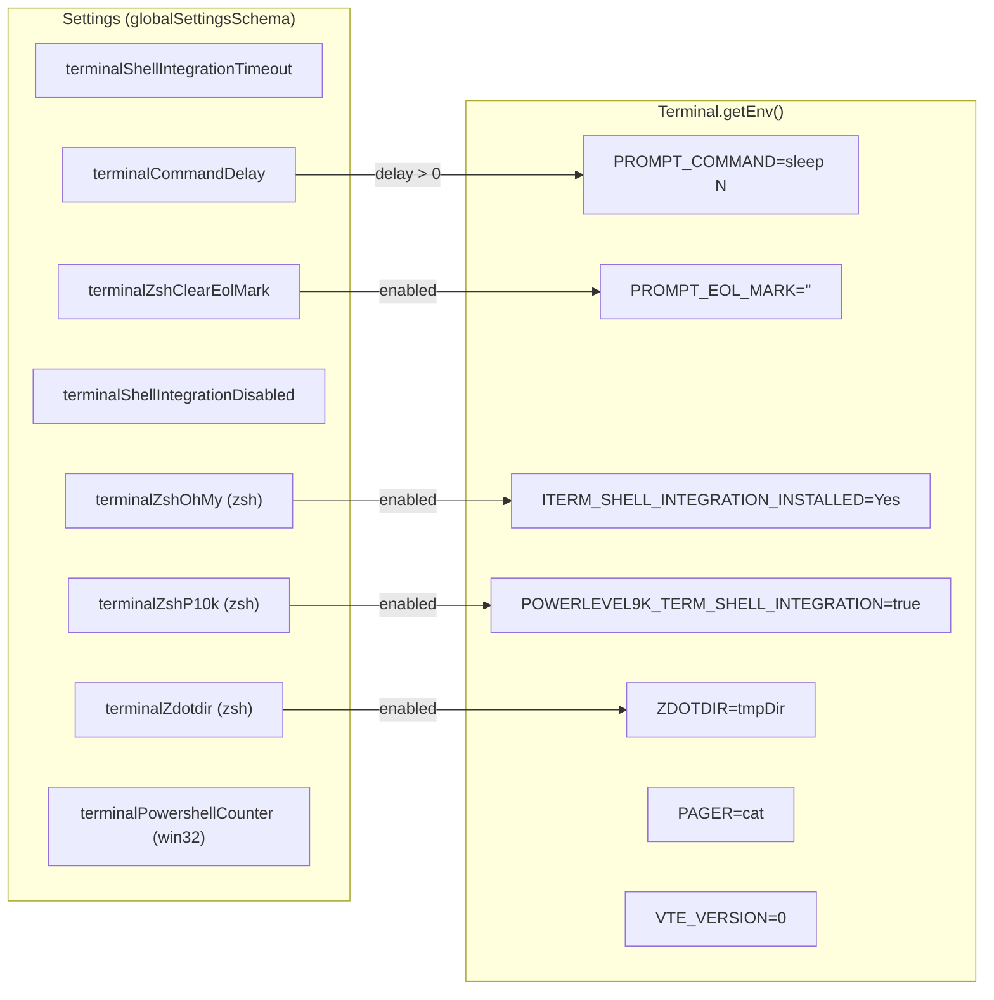
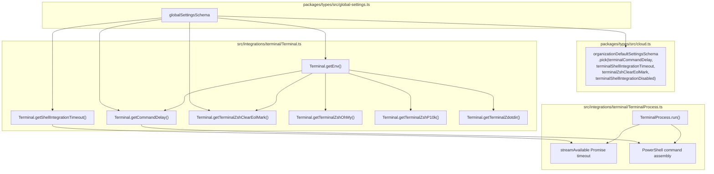
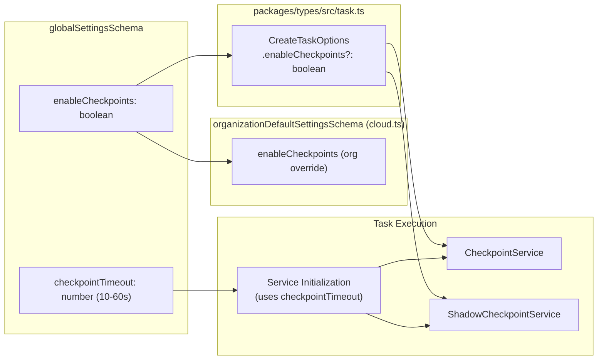
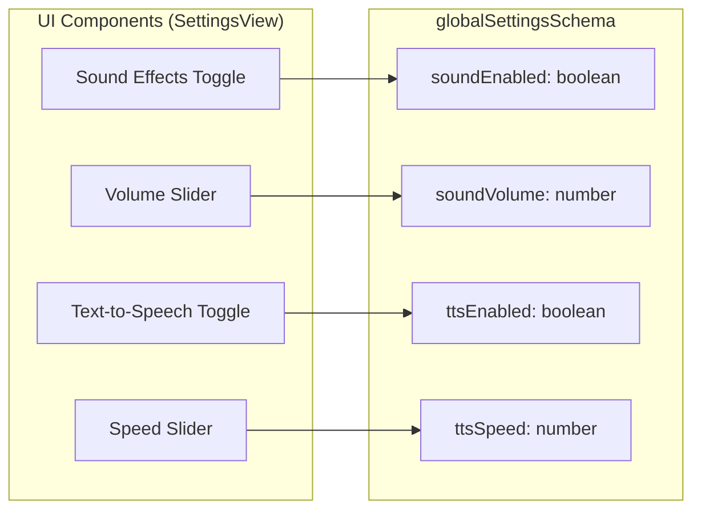

# Terminal, Checkpoint, and Notification Settings

<details>
<summary>Relevant source files</summary>

The following files were used as context for generating this wiki page:

- [src/integrations/terminal/Terminal.ts](src/integrations/terminal/Terminal.ts)
- [src/integrations/terminal/TerminalProcess.ts](src/integrations/terminal/TerminalProcess.ts)
- [src/integrations/terminal/TerminalRegistry.ts](src/integrations/terminal/TerminalRegistry.ts)
- [src/integrations/terminal/__tests__/TerminalProcess.test.ts](src/integrations/terminal/__tests__/TerminalProcess.test.ts)
- [src/integrations/terminal/__tests__/TerminalProcessExec.bash.spec.ts](src/integrations/terminal/__tests__/TerminalProcessExec.bash.spec.ts)
- [src/integrations/terminal/__tests__/TerminalRegistry.spec.ts](src/integrations/terminal/__tests__/TerminalRegistry.spec.ts)
- [webview-ui/src/components/chat/CommandExecution.tsx](webview-ui/src/components/chat/CommandExecution.tsx)
- [webview-ui/src/components/chat/CommandPatternSelector.tsx](webview-ui/src/components/chat/CommandPatternSelector.tsx)
- [webview-ui/src/components/chat/TerminalOutput.tsx](webview-ui/src/components/chat/TerminalOutput.tsx)
- [webview-ui/src/components/chat/__tests__/CommandExecution.spec.tsx](webview-ui/src/components/chat/__tests__/CommandExecution.spec.tsx)
- [webview-ui/src/components/chat/__tests__/CommandPatternSelector.spec.tsx](webview-ui/src/components/chat/__tests__/CommandPatternSelector.spec.tsx)
- [webview-ui/src/components/chat/__tests__/TerminalOutput.spec.tsx](webview-ui/src/components/chat/__tests__/TerminalOutput.spec.tsx)
- [webview-ui/src/components/common/__mocks__/CodeBlock.tsx](webview-ui/src/components/common/__mocks__/CodeBlock.tsx)
- [webview-ui/src/i18n/locales/ca/settings.json](webview-ui/src/i18n/locales/ca/settings.json)
- [webview-ui/src/i18n/locales/de/settings.json](webview-ui/src/i18n/locales/de/settings.json)
- [webview-ui/src/i18n/locales/en/settings.json](webview-ui/src/i18n/locales/en/settings.json)
- [webview-ui/src/i18n/locales/es/settings.json](webview-ui/src/i18n/locales/es/settings.json)
- [webview-ui/src/i18n/locales/fr/settings.json](webview-ui/src/i18n/locales/fr/settings.json)
- [webview-ui/src/i18n/locales/hi/settings.json](webview-ui/src/i18n/locales/hi/settings.json)
- [webview-ui/src/i18n/locales/it/settings.json](webview-ui/src/i18n/locales/it/settings.json)
- [webview-ui/src/i18n/locales/ja/settings.json](webview-ui/src/i18n/locales/ja/settings.json)
- [webview-ui/src/i18n/locales/ko/settings.json](webview-ui/src/i18n/locales/ko/settings.json)
- [webview-ui/src/i18n/locales/pl/settings.json](webview-ui/src/i18n/locales/pl/settings.json)
- [webview-ui/src/i18n/locales/pt-BR/settings.json](webview-ui/src/i18n/locales/pt-BR/settings.json)
- [webview-ui/src/i18n/locales/tr/settings.json](webview-ui/src/i18n/locales/tr/settings.json)
- [webview-ui/src/i18n/locales/vi/settings.json](webview-ui/src/i18n/locales/vi/settings.json)
- [webview-ui/src/i18n/locales/zh-CN/settings.json](webview-ui/src/i18n/locales/zh-CN/settings.json)

</details>


This page documents the user-configurable settings for terminal shell integration, task checkpoint behavior, and user notification preferences. These settings are stored in the global state schema and are surfaced in the extension's settings UI.

For the runtime behavior of the terminal execution system itself, see [6.5](). For the checkpoint save/restore mechanism, see [5.6](). For the overall settings UI architecture and how settings flow from the webview to the extension host, see [11.1](). For context management and workspace file settings, see [11.4]().

---

## Terminal Settings

Terminal settings control how Roo Code interacts with VS Code's integrated terminal, including shell integration reliability, timing adjustments, and shell-specific workarounds. These values are read by static methods on the `Terminal` class ([src/integrations/terminal/Terminal.ts]()) and `TerminalProcess` ([src/integrations/terminal/TerminalProcess.ts]()).

### How Settings Are Applied

When a new terminal is created, `Terminal.getEnv()` assembles an environment variable map that is injected into the terminal process. Several settings map directly to environment variables set at terminal launch to ensure consistent behavior across different shell environments.

**Terminal settings → environment variable mapping**



Sources: [src/integrations/terminal/Terminal.ts:153-192]()

### Output Limits

These settings control how much terminal output is captured and presented to the AI model, balancing context richness against token consumption. The UI for these settings is localized across multiple languages ([webview-ui/src/i18n/locales/en/settings.json:749-765](), [webview-ui/src/i18n/locales/zh-CN/settings.json:28-37]()).

#### Output Line Limit (`terminalOutputLineLimit`)

- **Type:** `number` (integer, positive)
- **Purpose:** Maximum number of output lines to preserve from command execution. When this limit is exceeded, Roo keeps the first and last lines and drops the middle, inserting a truncation placeholder.

#### Output Character Limit (`terminalOutputCharacterLimit`)

- **Type:** `number` (integer, positive)
- **Purpose:** Hard cap on total output size in characters. Overrides the line limit to prevent memory exhaustion from commands that produce extremely long lines.

#### Output Preview Size (`terminalOutputPreviewSize`)

- **Type:** `"small" | "medium" | "large"`
- **Purpose:** Controls how much command output Roo sees directly in the conversation context.

| Size | Approximate Limit | Use Case |
|---|---|---|
| `"small"` | ~5KB | Token-efficient, low context |
| `"medium"` | ~10KB | Balanced (default) |
| `"large"` | ~20KB | Full output visibility |

Sources: [webview-ui/src/i18n/locales/en/settings.json:749-765]()

### Shell Integration Timeout (`terminalShellIntegrationTimeout`)

- **Type:** `number` (integer, milliseconds, non-negative)
- **Purpose:** How long `Terminal.runCommand()` waits for VS Code's shell integration protocol sequence (`\x1b]633;A`) before declaring that shell integration is unavailable.

When a command is sent, `TerminalProcess.run()` creates a promise that rejects after this timeout ([src/integrations/terminal/TerminalProcess.ts:67-91]()):

```text
"VSCE shell integration stream did not start within N seconds. Terminal problem?"
```

If the timeout is reached, the process emits `no_shell_integration` and falls back to executing without output capture ([src/integrations/terminal/Terminal.ts:71-91]()).

Sources: [src/integrations/terminal/TerminalProcess.ts:67-91](), [src/integrations/terminal/Terminal.ts:71-91](), [webview-ui/src/i18n/locales/en/settings.json:766-769]()

### Command Delay (`terminalCommandDelay`)

- **Type:** `number` (integer, milliseconds, non-negative)
- **Purpose:** Adds a deliberate delay after command execution to work around race conditions where completion sequences arrive before output.

The delay is applied differently depending on the shell ([src/integrations/terminal/Terminal.ts:176-178]()):

| Shell | Mechanism |
|---|---|
| Bash/Zsh (Unix) | `PROMPT_COMMAND=sleep N` environment variable, where N = delay / 1000 |
| PowerShell (Windows) | `; start-sleep -milliseconds N` appended to each command string |

Sources: [src/integrations/terminal/Terminal.ts:176-178](), [src/integrations/terminal/TerminalProcess.ts:117-119]()

### Zsh-Specific Settings

These settings address compatibility with popular zsh plugins and prompt frameworks (like Oh My Zsh and Powerlevel10k) that interfere with VS Code's shell integration protocol.

| Setting Key | Type | Environment Effect | Description |
|---|---|---|---|
| `terminalZshClearEolMark` | `boolean` | `PROMPT_EOL_MARK=""` | Clears the zsh end-of-line mark character (`%`). |
| `terminalZshOhMy` | `boolean` | `ITERM_SHELL_INTEGRATION_INSTALLED=Yes` | Signals compatibility to Oh My Zsh. |
| `terminalZshP10k` | `boolean` | `POWERLEVEL9K_TERM_SHELL_INTEGRATION=true` | Enables Powerlevel10k compatibility mode. |
| `terminalZdotdir` | `boolean` | `ZDOTDIR=<tmpDir>` | Redirects zsh to use a managed temporary `ZDOTDIR`. |

Sources: [src/integrations/terminal/Terminal.ts:153-192]()

---

## Terminal Settings Code Map

The following diagram maps the settings schema to the runtime code entities that consume them, including organizational overrides defined in the cloud service.

**Settings consumption paths**



Sources: [src/integrations/terminal/Terminal.ts](), [src/integrations/terminal/TerminalProcess.ts](), [packages/types/src/cloud.ts:93-113]()

---

## Checkpoint Settings

The checkpoint system allows Roo Code to save and restore task state at discrete execution points. These settings are found under the `checkpoints` section in the UI ([webview-ui/src/i18n/locales/en/settings.json:35]()).

### Enable Checkpoints (`enableCheckpoints`)

- **Type:** `boolean`
- **Purpose:** Enables or disables the checkpoint mechanism globally. When disabled, checkpoint services are not activated for new tasks.

### Checkpoint Timeout (`checkpointTimeout`)

- **Type:** `number` (integer, seconds)
- **Range:** 10-60 seconds
- **Default:** 15 seconds
- **Purpose:** Maximum time to wait for checkpoint service initialization (e.g., git operations or shadow workspace setup) before timing out and continuing the task without checkpoints.

**Checkpoint setting flow**



Sources: [packages/types/src/cloud.ts:93-104](), [packages/types/src/task.ts:91-102](), [webview-ui/src/i18n/locales/en/settings.json:622-630]()

---

## Notification Settings

Notification settings control audible and visual alerts for task events, located in the `notifications` section of the settings UI ([webview-ui/src/i18n/locales/en/settings.json:36]()).

### Sound Effects
- **`soundEnabled`**: Enables audible notifications when tasks complete or require user input.
- **`soundVolume`**: Controls playback volume (0.0 to 1.0).

### Text-to-Speech (TTS)
- **`ttsEnabled`**: Enables narration of Roo Code's responses using the system's speech synthesis.
- **`ttsSpeed`**: Controls the rate of speech.

**Notification settings UI mapping**



Sources: [webview-ui/src/i18n/locales/en/settings.json:632-642](), [packages/types/src/global-settings.ts]()

---

## Summary Reference Table

| Setting Key | Type | Purpose | Org Override |
|---|---|---|---|
| `terminalShellIntegrationTimeout` | `number` (ms) | Timeout for shell integration detection | ✅ |
| `terminalCommandDelay` | `number` (ms) | Artificial delay after commands | ✅ |
| `terminalShellIntegrationDisabled` | `boolean` | Bypass shell integration entirely | ✅ |
| `terminalZshClearEolMark` | `boolean` | Fixes zsh prompt character pollution | ✅ |
| `enableCheckpoints` | `boolean` | Activates checkpoint services | ✅ |
| `checkpointTimeout` | `number` (s) | Max wait for checkpoint init | ❌ |
| `soundEnabled` | `boolean` | Audible completion alerts | ❌ |
| `ttsEnabled` | `boolean` | Narrate responses | ❌ |

Sources: [packages/types/src/cloud.ts:93-113](), [src/integrations/terminal/Terminal.ts:153-192](), [src/integrations/terminal/TerminalProcess.ts:67-124](), [packages/types/src/task.ts:91-102]()