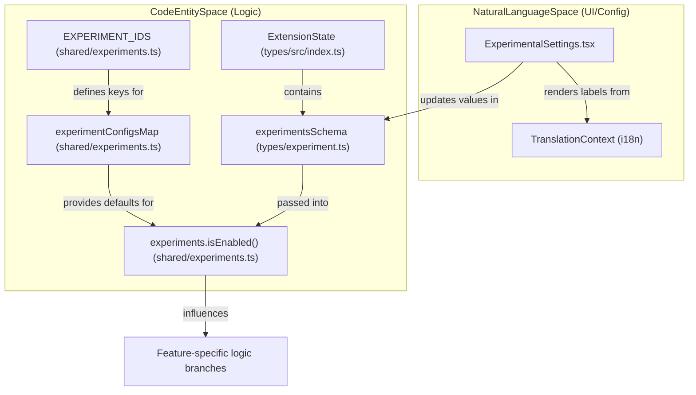
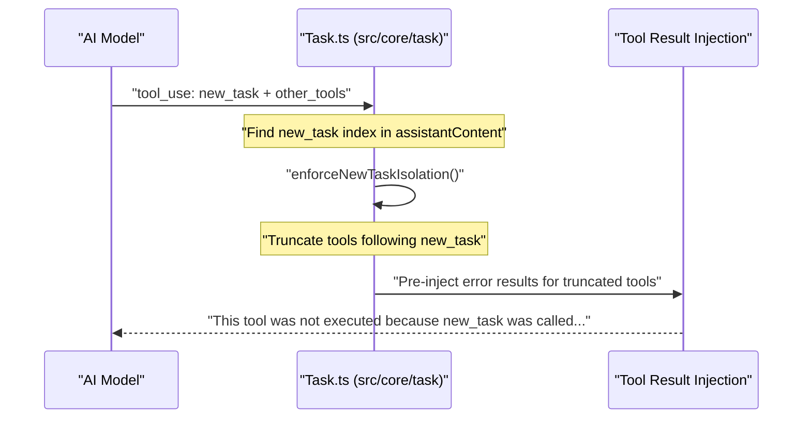

# Experimental Features

Relevant source files

The following files were used as context for generating this wiki page:

- [apps/cli/src/types/json-events.ts](apps/cli/src/types/json-events.ts)
- [packages/types/src/experiment.ts](packages/types/src/experiment.ts)
- [packages/types/src/image-generation.ts](packages/types/src/image-generation.ts)
- [packages/types/src/index.ts](packages/types/src/index.ts)
- [src/api/providers/utils/__tests__/image-generation.spec.ts](src/api/providers/utils/__tests__/image-generation.spec.ts)
- [src/api/providers/utils/image-generation.ts](src/api/providers/utils/image-generation.ts)
- [src/core/prompts/sections/__tests__/objective.spec.ts](src/core/prompts/sections/__tests__/objective.spec.ts)
- [src/core/prompts/sections/__tests__/tool-use-guidelines.spec.ts](src/core/prompts/sections/__tests__/tool-use-guidelines.spec.ts)
- [src/core/prompts/sections/__tests__/tool-use.spec.ts](src/core/prompts/sections/__tests__/tool-use.spec.ts)
- [src/core/prompts/sections/capabilities.ts](src/core/prompts/sections/capabilities.ts)
- [src/core/prompts/sections/modes.ts](src/core/prompts/sections/modes.ts)
- [src/core/prompts/sections/objective.ts](src/core/prompts/sections/objective.ts)
- [src/core/prompts/sections/rules.ts](src/core/prompts/sections/rules.ts)
- [src/core/prompts/sections/tool-use-guidelines.ts](src/core/prompts/sections/tool-use-guidelines.ts)
- [src/core/prompts/sections/tool-use.ts](src/core/prompts/sections/tool-use.ts)
- [src/core/prompts/tools/native-tools/new_task.ts](src/core/prompts/tools/native-tools/new_task.ts)
- [src/core/task/__tests__/new-task-isolation.spec.ts](src/core/task/__tests__/new-task-isolation.spec.ts)
- [src/core/tools/GenerateImageTool.ts](src/core/tools/GenerateImageTool.ts)
- [src/core/tools/__tests__/generateImageTool.test.ts](src/core/tools/__tests__/generateImageTool.test.ts)
- [src/shared/__tests__/experiments.spec.ts](src/shared/__tests__/experiments.spec.ts)
- [src/shared/experiments.ts](src/shared/experiments.ts)
- [webview-ui/src/components/settings/ExperimentalSettings.tsx](webview-ui/src/components/settings/ExperimentalSettings.tsx)
- [webview-ui/src/components/settings/ImageGenerationSettings.tsx](webview-ui/src/components/settings/ImageGenerationSettings.tsx)
- [webview-ui/src/components/settings/__tests__/ImageGenerationSettings.spec.tsx](webview-ui/src/components/settings/__tests__/ImageGenerationSettings.spec.tsx)
- [webview-ui/src/context/__tests__/ExtensionStateContext.spec.tsx](webview-ui/src/context/__tests__/ExtensionStateContext.spec.tsx)

## Purpose and Scope

This document describes the experimental features system in Roo Code, which allows functionality to be tested and refined before becoming part of the stable feature set. Experimental features are controlled through configuration settings in the extension's Settings UI under the "Experimental" section, enabling early access to new capabilities while maintaining the stability of core functionality.

Experimental features include enhanced file editing strategies, marketplace integrations, custom tools, image generation, and various performance optimizations. These features are defined as constants and managed through a centralized configuration map that determines their default enabled state.

**Sources:**
- [src/shared/experiments.ts:3-8]()
- [src/shared/experiments.ts:18-23]()
- [webview-ui/src/components/settings/ExperimentalSettings.tsx:48-51]()

---

## Experimental Features Architecture

Experimental features are governed by a set of unique identifiers defined in the `EXPERIMENT_IDS` object. The system uses a centralized mapping to track which features are enabled by default and provides utility functions to check the status of a feature against the current user configuration.

### Data Flow and System Integration

The following diagram illustrates how experimental flags move from the "Natural Language Space" (user settings) into the "Code Entity Space" (runtime logic).

**Sources:**
- [src/shared/experiments.ts:3-35]()
- [packages/types/src/experiment.ts:9-26]()
- [webview-ui/src/components/settings/ExperimentalSettings.tsx:52-122]()

---

## Core Experimental Identifiers

The system currently recognizes several primary experimental features. Each is identified by a specific string literal used across the frontend and backend.

| Constant Key | Experiment ID | Default State | Implementation File |
|--------------|---------------|---------------|---------------------|
| `PREVENT_FOCUS_DISRUPTION` | `"preventFocusDisruption"` | `false` | `src/shared/experiments.ts` |
| `IMAGE_GENERATION` | `"imageGeneration"` | `false` | `src/shared/experiments.ts` |
| `RUN_SLASH_COMMAND` | `"runSlashCommand"` | `false` | `src/shared/experiments.ts` |
| `CUSTOM_TOOLS` | `"customTools"` | `false` | `src/shared/experiments.ts` |

**Sources:**
- [src/shared/experiments.ts:3-8]()
- [src/shared/experiments.ts:18-23]()
- [packages/types/src/experiment.ts:9-13]()

---

## Feature Implementation Details

### 1. Image Generation (`IMAGE_GENERATION`)
This feature enables the model to request image creation. It requires complex UI configuration within the `ExperimentalSettings` component, including provider selection (Roo Code Cloud or OpenRouter) and API key management.

*   **UI Component**: `ImageGenerationSettings` [webview-ui/src/components/settings/ImageGenerationSettings.tsx:17-26]()
*   **Provider Logic**: Supports `roo` and `openrouter` providers. It includes backward compatibility logic via `getImageGenerationProvider` to default existing users to OpenRouter if a model was already selected [packages/types/src/image-generation.ts:52-57]().
*   **Model Selection**: Uses a filtered list from `IMAGE_GENERATION_MODELS` based on the selected provider [webview-ui/src/components/settings/ImageGenerationSettings.tsx:35-37]().

### 2. Custom Tools (`CUSTOM_TOOLS`)
Allows the extension to load user-defined tools from the filesystem (typically `.roo/tools`).
*   **UI Component**: `CustomToolsSettings` [webview-ui/src/components/settings/ExperimentalSettings.tsx:93-98]()
*   **Logic**: When enabled, the `customTools` flag is toggled via `setExperimentEnabled`, which allows the tool registry to include user-defined tools during prompt generation [webview-ui/src/components/settings/ExperimentalSettings.tsx:96]().

### 3. Prevent Focus Disruption (`PREVENT_FOCUS_DISRUPTION`)
A UX-focused experiment aimed at improving the developer's flow by minimizing editor jumps or focus shifts during automated file edits or terminal operations.
*   **Status**: Defined in `EXPERIMENT_IDS` [src/shared/experiments.ts:4]() and tracked in `experimentsSchema` [packages/types/src/experiment.ts:20]().

### 4. Run Slash Command (`RUN_SLASH_COMMAND`)
Enables the model to trigger predefined workflows or scripts using slash command syntax (e.g., `/test`).
*   **Status**: Defined in `EXPERIMENT_IDS` [src/shared/experiments.ts:6]() and integrated into the system configuration [src/shared/experiments.ts:21]().

---

## Tool-Use Guidelines and Constraints

Experimental features often interact with the core tool execution system. For example, the `new_task` tool (used for task delegation) has strict isolation requirements that prevent it from being called alongside other tools in the same message turn to prevent state corruption.

**Sources:**
- [src/core/prompts/tools/native-tools/new_task.ts:3-5]()
- [src/core/task/__tests__/new-task-isolation.spec.ts:20-55]()
- [src/core/prompts/sections/tool-use.ts:1-7]()

---

## State Management and Persistence

Experimental settings are part of the `ExtensionState` and are synchronized between the VS Code extension host and the Webview UI.

### Merging State
The `mergeExtensionState` function in `ExtensionStateContext.tsx` ensures that experimental flags are correctly updated when the extension sends new state to the UI. It performs a shallow merge of the `experiments` object to preserve existing flags while applying updates.

**Sources:**
- [webview-ui/src/context/ExtensionStateContext.tsx:186-228]()
- [packages/types/src/experiment.ts:19-26]()

### Testing Infrastructure
Experiments are validated using Vitest to ensure that `isEnabled` logic correctly handles missing keys by falling back to `experimentDefault` values defined in the shared experiments configuration.

**Sources:**
- [src/shared/__tests__/experiments.spec.ts:7-48]()
- [src/shared/experiments.ts:32-35]()

---

## Developer Guidelines: Adding an Experiment

To add a new experimental feature, a developer must follow these steps:

1.  **Define ID**: Add the new ID to the `experimentIds` array in `packages/types/src/experiment.ts` [packages/types/src/experiment.ts:9]().
2.  **Update Schema**: Add the boolean flag to the `experimentsSchema` Zod object [packages/types/src/experiment.ts:19-24]().
3.  **Register Constant**: Add the ID to the `EXPERIMENT_IDS` object in `src/shared/experiments.ts` [src/shared/experiments.ts:3-8]().
4.  **Set Default**: Add a default entry (usually `enabled: false`) to `experimentConfigsMap` [src/shared/experiments.ts:18-23]().
5.  **UI Implementation**: Update `ExperimentalSettings.tsx` to include a toggle or custom configuration sub-component within the `.map()` loop [webview-ui/src/components/settings/ExperimentalSettings.tsx:52-122]().
6.  **Logic Integration**: Use `experiments.isEnabled(config, id)` at the call site in the extension host or webview to branch behavior based on the user's setting [src/shared/experiments.ts:34]().

**Sources:**
- [src/shared/experiments.ts:3-35]()
- [packages/types/src/experiment.ts:9-26]()