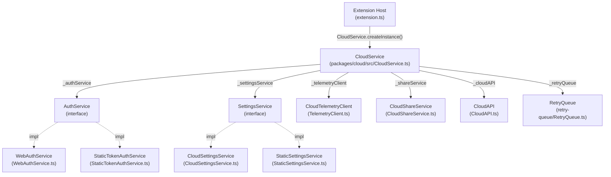
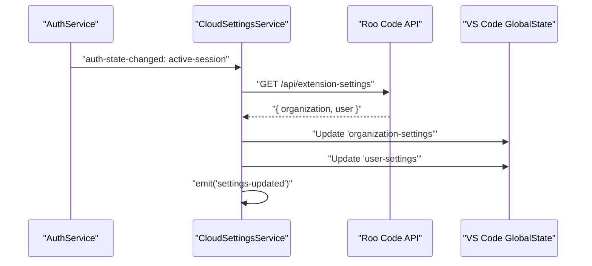

# Cloud Platform Integration

<details>
<summary>Relevant source files</summary>

The following files were used as context for generating this wiki page:

- [packages/cloud/src/CloudService.ts](packages/cloud/src/CloudService.ts)
- [packages/cloud/src/CloudSettingsService.ts](packages/cloud/src/CloudSettingsService.ts)
- [packages/cloud/src/StaticSettingsService.ts](packages/cloud/src/StaticSettingsService.ts)
- [packages/cloud/src/TelemetryClient.ts](packages/cloud/src/TelemetryClient.ts)
- [packages/cloud/src/__tests__/CloudService.test.ts](packages/cloud/src/__tests__/CloudService.test.ts)
- [packages/cloud/src/__tests__/CloudSettingsService.test.ts](packages/cloud/src/__tests__/CloudSettingsService.test.ts)
- [packages/cloud/src/__tests__/StaticSettingsService.test.ts](packages/cloud/src/__tests__/StaticSettingsService.test.ts)
- [packages/cloud/src/__tests__/TelemetryClient.test.ts](packages/cloud/src/__tests__/TelemetryClient.test.ts)
- [packages/cloud/src/index.ts](packages/cloud/src/index.ts)
- [packages/cloud/src/retry-queue/RetryQueue.ts](packages/cloud/src/retry-queue/RetryQueue.ts)
- [packages/cloud/src/retry-queue/__tests__/RetryQueue.test.ts](packages/cloud/src/retry-queue/__tests__/RetryQueue.test.ts)
- [packages/cloud/src/retry-queue/index.ts](packages/cloud/src/retry-queue/index.ts)
- [packages/cloud/src/retry-queue/types.ts](packages/cloud/src/retry-queue/types.ts)

</details>


This page covers the Roo Code Cloud integration layer: how the extension authenticates users, fetches organization settings, synchronizes task data, and manages reliable communication with the cloud backend. It describes the `@roo-code/cloud` package and the `CloudService` singleton that orchestrates these capabilities.

For the detailed service architecture and bridge orchestration, see page [Cloud Service Architecture](#12.1). For task sharing and synchronization specifics, see page [Task Sharing and Synchronization](#12.2). For authentication flows and MDM enforcement, see page [Authentication and MDM Integration](#12.3).

---

## System Overview

The cloud integration system manages three primary technical domains:

1.  **Authentication** — Managing user sessions, OAuth callbacks, and organization-switching via the `AuthService` interface.
2.  **Settings & Policy** — Fetching organization-level and user-level configuration (e.g., allowed models, terminal delays) from the cloud backend.
3.  **Telemetry & Sharing** — Synchronizing task metadata, sharing task URLs, and managing a `RetryQueue` for reliable data delivery.

**CloudService Component Relationships**



Sources: [packages/cloud/src/CloudService.ts:34-91](), [packages/cloud/src/CloudService.ts:122-172]()

---

## CloudService Singleton

`CloudService` is a singleton that aggregates all cloud sub-services. It is initialized during extension activation and thereafter accessed via its instance properties.

| Method / Property | Role | Source |
| :--- | :--- | :--- |
| `initialize()` | Selects `AuthService` and `SettingsService` based on environment variables. | [packages/cloud/src/CloudService.ts:113-177]() |
| `login()` / `logout()` | Delegates to the active `AuthService`. | [packages/cloud/src/CloudService.ts:181-189]() |
| `getAllowList()` | Returns `OrganizationAllowList` for model/provider filtering. | [packages/cloud/src/CloudService.ts:246-249]() |
| `getOrganizationId()` | Retrieves the active organization ID from user info. | [packages/cloud/src/CloudService.ts:211-215]() |
| `retryQueue` | Accesses the `RetryQueue` for managing failed network operations. | [packages/cloud/src/CloudService.ts:82-84]() |

Sources: [packages/cloud/src/CloudService.ts:34-324]()

---

## Authentication and Session Management

### Auth Service Selection
The extension detects if it is running as a "Cloud Agent" (e.g., in a CI/CD pipeline or remote job) by checking for `ROO_CODE_CLOUD_TOKEN`.

*   **StaticTokenAuthService**: Used when `ROO_CODE_CLOUD_TOKEN` is present. Sets `isCloudAgent = true`. [packages/cloud/src/CloudService.ts:122-126]()
*   **WebAuthService**: Standard OAuth flow for local VS Code users. [packages/cloud/src/CloudService.ts:128]()

Sources: [packages/cloud/src/CloudService.ts:122-129]()

### AuthState Machine
The `CloudService` listens for `auth-state-changed` events to manage internal state and the `RetryQueue`. For example, it provides fresh auth headers for retries by calling `getSessionToken()` on the `AuthService`. [packages/cloud/src/CloudService.ts:152-166]()

```mermaid
stateDiagram-v2
    [*] --> "logged-out"
    "logged-out" --> "active-session": login() Success
    "active-session" --> "logged-out": logout()
    "active-session" --> "active-session": Refresh Token
```

Sources: [packages/cloud/src/CloudService.ts:98-102](), [packages/cloud/src/CloudService.ts:156-165]()

---

## Settings and Organization Policy

The `SettingsService` fetches configuration from the Roo Code platform. It supports both organization-wide defaults and user-specific preferences.

### CloudSettingsService Refresh Flow
`CloudSettingsService` polls `/api/extension-settings` [packages/cloud/src/CloudSettingsService.ts:115]() and uses a `RefreshTimer` [packages/cloud/src/CloudSettingsService.ts:68-75]() to keep local state in sync.



Sources: [packages/cloud/src/CloudSettingsService.ts:86-105](), [packages/cloud/src/CloudSettingsService.ts:107-167]()

### Static vs. Cloud Settings
*   **StaticSettingsService**: Used when `ROO_CODE_CLOUD_ORG_SETTINGS` is set. It parses a base64 encoded JSON string. [packages/cloud/src/StaticSettingsService.ts:16-34]()
*   **CloudSettingsService**: Fetches settings dynamically and persists them to `globalState`. [packages/cloud/src/CloudSettingsService.ts:169-178]()

Sources: [packages/cloud/src/CloudService.ts:136-147](), [packages/cloud/src/StaticSettingsService.ts:12-19]()

---

## Telemetry and Reliability

The integration layer provides capabilities for capturing usage data and ensuring data delivery despite network issues.

*   **CloudTelemetryClient**: Captures `TelemetryEvent` data and sends it to `/api/events`. [packages/cloud/src/TelemetryClient.ts:186-189]() It filters events based on the `isEventCapturable` logic. [packages/cloud/src/TelemetryClient.ts:25-33]()
*   **RetryQueue**: A persistent FIFO queue that stores `QueuedRequest` objects in `workspaceState`. [packages/cloud/src/retry-queue/RetryQueue.ts:46-60]() It automatically retries failed telemetry or API calls when the network is available, handling 429 rate limits by pausing the queue. [packages/cloud/src/retry-queue/RetryQueue.ts:138-163]()

Sources: [packages/cloud/src/TelemetryClient.ts:87-100](), [packages/cloud/src/retry-queue/RetryQueue.ts:7-44]()

---

## Related Pages

*   [Cloud Service Architecture](#12.1): Deep dive into service initialization, the event system, and `TelemetryClient` registration.
*   [Task Sharing and Synchronization](#12.2): Details on task sharing (public/org), cloud storage, and cross-installation settings sync.
*   [Authentication and MDM Integration](#12.3): Comprehensive guide to OAuth flows, session management, and `MdmService` compliance.