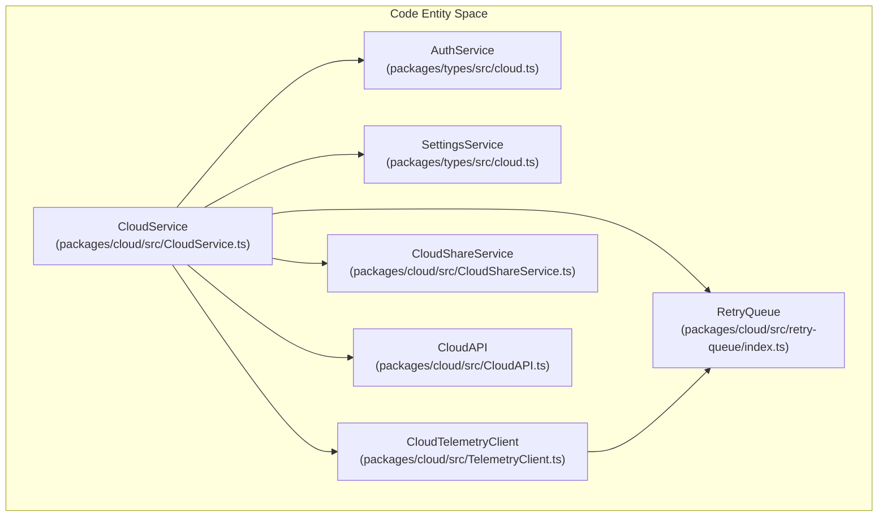
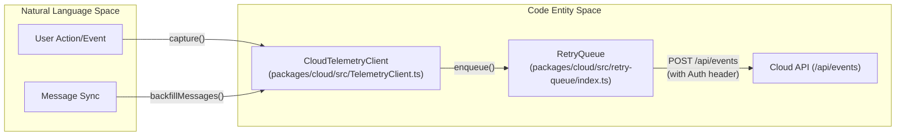

# Cloud Service Architecture

Relevant source files

The following files were used as context for generating this wiki page:

- [packages/cloud/src/CloudService.ts](packages/cloud/src/CloudService.ts)
- [packages/cloud/src/CloudSettingsService.ts](packages/cloud/src/CloudSettingsService.ts)
- [packages/cloud/src/StaticSettingsService.ts](packages/cloud/src/StaticSettingsService.ts)
- [packages/cloud/src/TelemetryClient.ts](packages/cloud/src/TelemetryClient.ts)
- [packages/cloud/src/__tests__/CloudService.test.ts](packages/cloud/src/__tests__/CloudService.test.ts)
- [packages/cloud/src/__tests__/CloudSettingsService.test.ts](packages/cloud/src/__tests__/CloudSettingsService.test.ts)
- [packages/cloud/src/__tests__/StaticSettingsService.test.ts](packages/cloud/src/__tests__/StaticSettingsService.test.ts)
- [packages/cloud/src/__tests__/TelemetryClient.test.ts](packages/cloud/src/__tests__/TelemetryClient.test.ts)
- [packages/cloud/src/index.ts](packages/cloud/src/index.ts)
- [packages/cloud/src/retry-queue/RetryQueue.ts](packages/cloud/src/retry-queue/RetryQueue.ts)
- [packages/cloud/src/retry-queue/__tests__/RetryQueue.test.ts](packages/cloud/src/retry-queue/__tests__/RetryQueue.test.ts)
- [packages/cloud/src/retry-queue/index.ts](packages/cloud/src/retry-queue/index.ts)
- [packages/cloud/src/retry-queue/types.ts](packages/cloud/src/retry-queue/types.ts)
- [packages/ipc/README.md](packages/ipc/README.md)
- [packages/ipc/src/ipc-client.ts](packages/ipc/src/ipc-client.ts)
- [packages/ipc/src/ipc-server.ts](packages/ipc/src/ipc-server.ts)
- [packages/types/npm/package.metadata.json](packages/types/npm/package.metadata.json)
- [packages/types/src/__tests__/cloud.test.ts](packages/types/src/__tests__/cloud.test.ts)
- [packages/types/src/__tests__/ipc.test.ts](packages/types/src/__tests__/ipc.test.ts)
- [packages/types/src/api.ts](packages/types/src/api.ts)
- [packages/types/src/cloud.ts](packages/types/src/cloud.ts)
- [packages/types/src/events.ts](packages/types/src/events.ts)
- [packages/types/src/ipc.ts](packages/types/src/ipc.ts)
- [packages/types/src/task.ts](packages/types/src/task.ts)
- [releases/3.31.1-release.png](releases/3.31.1-release.png)
- [src/extension/__tests__/api-delete-queued-message.spec.ts](src/extension/__tests__/api-delete-queued-message.spec.ts)
- [src/extension/__tests__/api-send-message.spec.ts](src/extension/__tests__/api-send-message.spec.ts)
- [src/extension/api.ts](src/extension/api.ts)

This page covers the architecture of the Roo Code Cloud integration layer: the classes that handle authentication, settings synchronization, and telemetry communication with the Roo Code Cloud backend. It focuses on the `@roo-code/cloud` package and the types in `@roo-code/types` that define the cloud contract.

---

## Service Composition

`CloudService` in [packages/cloud/src/CloudService.ts:34-34]() is the single entry point for all cloud operations. It is a singleton that composes several sub-services and exposes their operations through a unified facade. It implements the `Disposable` interface for cleanup.

**CloudService composition**

Sources: [packages/cloud/src/CloudService.ts:34-85]()

| Field | Type | Purpose |
|---|---|---|
| `_authService` | `AuthService` | Login/logout, session tokens, user info, and org membership. [packages/cloud/src/CloudService.ts:50-54]() |
| `_settingsService` | `SettingsService` | Organization and user settings, allow lists, and feature flags. [packages/cloud/src/CloudService.ts:56-60]() |
| `_telemetryClient` | `CloudTelemetryClient` | Captures telemetry events and handles message backfilling. [packages/cloud/src/CloudService.ts:62-66]() |
| `_shareService` | `CloudShareService` | Task sharing operations and visibility management. [packages/cloud/src/CloudService.ts:68-72]() |
| `_cloudAPI` | `CloudAPI` | Raw HTTP client for communicating with the Roo Code backend. [packages/cloud/src/CloudService.ts:74-78]() |
| `_retryQueue` | `RetryQueue` | Queues failed requests and retries with fresh auth headers. [packages/cloud/src/CloudService.ts:80-84]() |

`CloudService` is a singleton managed via `createInstance()`. It uses internal listeners (`authStateListener`, `authUserInfoListener`, `settingsListener`) to proxy events from sub-services to its own event emitter. [packages/cloud/src/CloudService.ts:98-111]()

---

## Initialization and Event System

The `initialize()` method sets up the concrete implementations based on the environment (e.g., standard VS Code vs. Cloud Agent).

### Initialization Logic
1. **Auth Selection**: If the `ROO_CODE_CLOUD_TOKEN` environment variable is present, it uses `StaticTokenAuthService` (setting `isCloudAgent = true`). Otherwise, it uses `WebAuthService`. [packages/cloud/src/CloudService.ts:122-129]()
2. **Settings Selection**: If `ROO_CODE_CLOUD_ORG_SETTINGS` is present, it uses `StaticSettingsService`. Otherwise, it uses `CloudSettingsService`. [packages/cloud/src/CloudService.ts:136-147]()
3. **Event Wiring**: Listeners are attached to sub-services to emit unified `CloudService` events. [packages/cloud/src/CloudService.ts:131-133]()

Sources: [packages/cloud/src/CloudService.ts:113-177]()

### Event System
`CloudService` emits three primary events defined in `CloudServiceEvents`:

| Event | Payload Type | Trigger |
|---|---|---|
| `auth-state-changed` | `AuthStateChangedPayload` | Fired when session status changes (e.g., login, logout, expiry). [packages/cloud/src/CloudService.ts:101]() |
| `user-info` | `CloudUserInfo` | Fired when user profile or organization data is updated. [packages/cloud/src/CloudService.ts:105]() |
| `settings-updated` | `SettingsPayload` | Fired when organization or user-level cloud settings change. [packages/cloud/src/CloudService.ts:109]() |

Sources: [packages/cloud/src/CloudService.ts:30-34](), [packages/cloud/src/CloudService.ts:98-111]()

---

## Cloud Profile Synchronization

The `CloudSettingsService` (and its static counterpart) manages the synchronization of organization policies and user preferences from the cloud backend.

### Data Models
The system uses Zod schemas to validate cloud-provided configurations:
- **Organization Settings**: `organizationSettingsSchema` includes `allowList` for providers/models, `cloudSettings` for task recording/sharing, and `defaultSettings` for extension behavior. [packages/types/src/cloud.ts:153-163]()
- **User Settings**: `userSettingsDataSchema` covers user-specific feature flags and synchronization preferences. [packages/types/src/cloud.ts:182-186]()

### Configuration Profiles
Organization settings can include `providerProfiles`, which are pre-configured AI provider settings (e.g., specific API keys or model endpoints) shared across the organization. [packages/types/src/cloud.ts:162-162]()

Sources: [packages/types/src/cloud.ts:153-189]()

---

## Telemetry Client Registration

The `CloudTelemetryClient` integrates with the extension to report usage and backfill task messages for synchronization.

### Registration and Flow
The `CloudService` initializes the `TelemetryClient` by passing references to the `AuthService`, `SettingsService`, and `RetryQueue`. [packages/cloud/src/CloudService.ts:168-168]()

**Telemetry data flow**

Sources: [packages/cloud/src/CloudService.ts:168](), [packages/cloud/src/TelemetryClient.ts:102-155](), [packages/cloud/src/TelemetryClient.ts:196-245]()

### Capture Logic
The client checks if telemetry is enabled and if the specific event is capturable based on the `TelemetryEventSubscription`. [packages/cloud/src/TelemetryClient.ts:158-164]() It automatically merges provider-level properties (app version, platform, etc.) with event-specific data. [packages/cloud/src/TelemetryClient.ts:43-68]()

---

## Retry Queue Coordination

The `RetryQueue` ensures that cloud-bound requests (like telemetry or task sync) are not lost during transient network issues or auth token expiration.

- **Auth Header Provider**: `CloudService` provides a closure to the `RetryQueue` that retrieves a fresh `Authorization: Bearer <token>` header for every retry attempt. [packages/cloud/src/CloudService.ts:156-165]()
- **State Handling**: The queue is automatically managed based on auth state changes. `handleAuthStateChangeForRetryQueue` pauses or resumes the queue based on whether an active session is available. [packages/cloud/src/CloudService.ts:98-102]()

Sources: [packages/cloud/src/CloudService.ts:152-167](), [packages/cloud/src/CloudService.ts:98-102]()