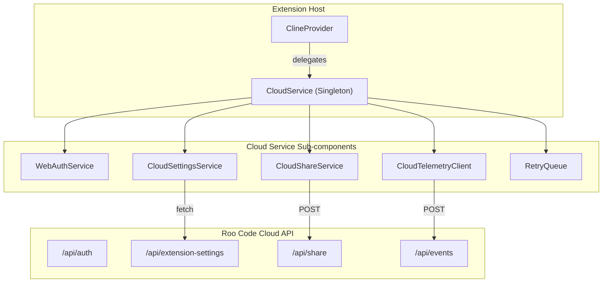
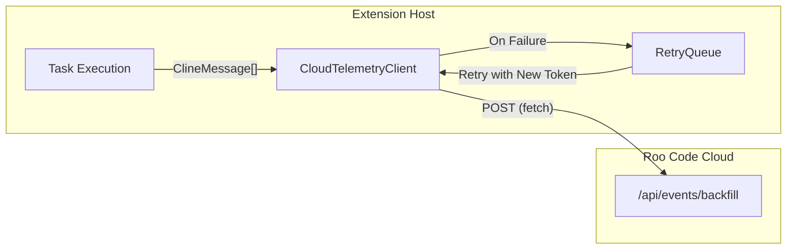

# Task Sharing and Synchronization

Relevant source files

The following files were used as context for generating this wiki page:

- [packages/cloud/src/CloudService.ts](packages/cloud/src/CloudService.ts)
- [packages/cloud/src/CloudSettingsService.ts](packages/cloud/src/CloudSettingsService.ts)
- [packages/cloud/src/CloudShareService.ts](packages/cloud/src/CloudShareService.ts)
- [packages/cloud/src/StaticSettingsService.ts](packages/cloud/src/StaticSettingsService.ts)
- [packages/cloud/src/TelemetryClient.ts](packages/cloud/src/TelemetryClient.ts)
- [packages/cloud/src/__tests__/CloudService.test.ts](packages/cloud/src/__tests__/CloudService.test.ts)
- [packages/cloud/src/__tests__/CloudSettingsService.test.ts](packages/cloud/src/__tests__/CloudSettingsService.test.ts)
- [packages/cloud/src/__tests__/StaticSettingsService.test.ts](packages/cloud/src/__tests__/StaticSettingsService.test.ts)
- [packages/cloud/src/__tests__/TelemetryClient.test.ts](packages/cloud/src/__tests__/TelemetryClient.test.ts)
- [packages/cloud/src/index.ts](packages/cloud/src/index.ts)
- [packages/cloud/src/retry-queue/RetryQueue.ts](packages/cloud/src/retry-queue/RetryQueue.ts)
- [packages/cloud/src/retry-queue/__tests__/RetryQueue.test.ts](packages/cloud/src/retry-queue/__tests__/RetryQueue.test.ts)
- [packages/cloud/src/retry-queue/index.ts](packages/cloud/src/retry-queue/index.ts)
- [packages/cloud/src/retry-queue/types.ts](packages/cloud/src/retry-queue/types.ts)
- [webview-ui/src/components/chat/ShareButton.tsx](webview-ui/src/components/chat/ShareButton.tsx)
- [webview-ui/src/components/chat/TaskActions.tsx](webview-ui/src/components/chat/TaskActions.tsx)
- [webview-ui/src/components/chat/__tests__/ShareButton.spec.tsx](webview-ui/src/components/chat/__tests__/ShareButton.spec.tsx)
- [webview-ui/src/components/chat/__tests__/TaskActions.spec.tsx](webview-ui/src/components/chat/__tests__/TaskActions.spec.tsx)
- [webview-ui/src/hooks/useCloudUpsell.ts](webview-ui/src/hooks/useCloudUpsell.ts)

This page documents the technical implementation of task sharing, cloud storage integration, and settings synchronization in Roo Code. It describes the data flow between the VS Code extension and Roo Code Cloud, the permission models governing data access, and the mechanisms for maintaining consistency across multiple installations.

---

## Overview

Roo Code provides a cloud-integrated experience for sharing task progress and synchronizing configuration across different development environments. The system architecture relies on a central `CloudService` that orchestrates authentication, settings management, and task sharing.

| Feature | Implementation | Description |
|:---|:---|:---|
| **Task Sharing** | `CloudShareService` | Generates shareable URLs with `organization` or `public` visibility. |
| **Settings Sync** | `CloudSettingsService` | Periodically fetches and caches organizational and user-level settings. |
| **Telemetry & Backfill** | `CloudTelemetryClient` | Records task lifecycle events and provides message backfilling for history. |
| **Task UI Actions** | `TaskActions.tsx` | Provides the webview interface for exporting, deleting, and sharing tasks. |

Sources: [packages/cloud/src/CloudService.ts:68-84](), [packages/cloud/src/CloudSettingsService.ts:53-60](), [packages/cloud/src/CloudShareService.ts:6-15](), [packages/cloud/src/TelemetryClient.ts:87-100]()

---

## Cloud Service Architecture

The `CloudService` acts as a singleton orchestrator for all cloud-related operations. It initializes specialized sub-services for authentication, settings, and sharing.

### Initialization and Dependency Injection
During activation, the extension initializes the `CloudService` which sets up the following components:
1.  **AuthService**: Handles session management using `WebAuthService` (browser-based) or `StaticTokenAuthService` (for headless/CI environments using `ROO_CODE_CLOUD_TOKEN`). [packages/cloud/src/CloudService.ts:122-129]()
2.  **SettingsService**: Manages configuration via `CloudSettingsService` or `StaticSettingsService` (if `ROO_CODE_CLOUD_ORG_SETTINGS` is provided). [packages/cloud/src/CloudService.ts:136-147]()
3.  **ShareService**: Orchestrates task sharing via `CloudShareService`. [packages/cloud/src/CloudService.ts:170-170]()
4.  **RetryQueue**: Manages failed API requests with exponential backoff and fresh auth header injection. [packages/cloud/src/CloudService.ts:152-166]()
5.  **TelemetryClient**: Handles event capturing and task message backfilling for cloud history. [packages/cloud/src/CloudService.ts:168-168]()

### System Entity Mapping

**Diagram: Cloud Integration Architecture**

Sources: [packages/cloud/src/CloudService.ts:113-177](), [packages/cloud/src/TelemetryClient.ts:114-114]()

---

## Task Sharing Implementation

Task sharing allows users to generate a link to a task's history. This is managed by the `CloudShareService` and exposed through the `ShareButton` component in the Webview UI.

### Visibility Levels
Sharing supports two visibility modes defined by `ShareVisibility`:
*   **`organization`**: Restricted to members of the user's current organization. [webview-ui/src/components/chat/ShareButton.tsx:182-198]()
*   **`public`**: Accessible to anyone with the link, provided public sharing is enabled in settings. [webview-ui/src/components/chat/ShareButton.tsx:199-213]()

### Sharing Data Flow
1.  **UI Trigger**: User clicks the `Share2Icon` in `TaskActions.tsx`. [webview-ui/src/components/chat/TaskActions.tsx:65-65](), [webview-ui/src/components/chat/ShareButton.tsx:156-162]()
2.  **Message Passing**: The Webview sends a `shareCurrentTask` message to the extension host. [webview-ui/src/components/chat/ShareButton.tsx:93-96]()
3.  **API Execution**: `CloudShareService` calls the `CloudAPI.shareTask` method to generate the share link. [packages/cloud/src/CloudShareService.ts:17-19]()
4.  **Clipboard Integration**: If successful, the share URL is automatically written to the VS Code clipboard. [packages/cloud/src/CloudShareService.ts:21-29]()
5.  **Success Feedback**: The extension sends a `shareTaskSuccess` message back to the webview to display a success indicator. [webview-ui/src/components/chat/ShareButton.tsx:62-75]()

Sources: [webview-ui/src/components/chat/TaskActions.tsx:65-65](), [webview-ui/src/components/chat/ShareButton.tsx:82-98](), [packages/cloud/src/CloudShareService.ts:17-40]()

---

## Settings Synchronization

The `CloudSettingsService` ensures that organizational policies and user preferences are synchronized across all extension installations.

### Fetching and Caching
*   **RefreshTimer**: Settings are periodically refreshed. The `successInterval` is set to 3,600,000ms (1 hour). [packages/cloud/src/CloudSettingsService.ts:68-75]()
*   **GlobalState Persistence**: Fetched settings are cached in VS Code's `globalState` using keys `organization-settings` and `user-settings`. [packages/cloud/src/CloudSettingsService.ts:25-26](), [packages/cloud/src/CloudSettingsService.ts:169-178]()
*   **Optimistic Locking**: When updating user settings via `PATCH /api/user-settings`, the service includes the current `version` to prevent overwriting concurrent changes. [packages/cloud/src/CloudSettingsService.ts:215-226]()

### Effective Settings Resolution
The service resolves settings with the following hierarchy:
1.  **Organization Settings**: Define the `allowList` for providers and mandatory features like `enableTaskSharing`. [packages/cloud/src/CloudSettingsService.ts:186-193](), [packages/cloud/src/CloudShareService.ts:42-49]()
2.  **User Settings**: Personal preferences for features like `taskSyncEnabled`. [packages/cloud/src/CloudSettingsService.ts:194-204]()

Sources: [packages/cloud/src/CloudSettingsService.ts:107-167](), [packages/cloud/src/CloudSettingsService.ts:206-236]()

---

## Telemetry and History Backfilling

The `CloudTelemetryClient` manages the transmission of task-related data to the cloud for persistence and analytics.

### Message Backfilling
To support cloud-based task history, the client provides a `backfillMessages` method:
1.  **Payload Preparation**: Messages are serialized into a JSON file and appended to a `FormData` object along with the `taskId`. [packages/cloud/src/TelemetryClient.ts:221-230]()
2.  **Authentication**: Requests include the session token in the `Authorization` header. [packages/cloud/src/TelemetryClient.ts:242-243]()
3.  **Endpoint**: Data is posted to `/api/events/backfill`. [packages/cloud/src/TelemetryClient.ts:238-238]()

### Reliability and Retries
The `RetryQueue` handles transient failures in telemetry delivery:
*   **Queuing**: Network failures (e.g., "fetch failed") or server errors (5xx, 429) trigger automatic queuing. [packages/cloud/src/TelemetryClient.ts:133-135](), [packages/cloud/src/TelemetryClient.ts:144-151]()
*   **Token Refresh**: When a request is retried, the `RetryQueue` calls a provider function to inject the latest session token. [packages/cloud/src/CloudService.ts:156-166]()

**Diagram: Telemetry Data Flow**

Sources: [packages/cloud/src/TelemetryClient.ts:102-155](), [packages/cloud/src/TelemetryClient.ts:196-246]()

---

## Task UI Actions Interface

The `TaskActions` component in the webview provides the primary interface for managing task persistence and cloud integration.

### Actions and Commands
*   **Export**: Sends `exportCurrentTask` to save history locally. [webview-ui/src/components/chat/TaskActions.tsx:31-31]()
*   **Delete**: Triggers `DeleteTaskDialog` or direct deletion via `deleteTaskWithId`. [webview-ui/src/components/chat/TaskActions.tsx:47-55]()
*   **Cloud Upsell**: If a user is unauthenticated, clicking the share button triggers `useCloudUpsell` to show a connection dialog. [webview-ui/src/components/chat/ShareButton.tsx:110-113](), [webview-ui/src/hooks/useCloudUpsell.ts]()
*   **Debug Views**: In `debug` mode, users can access raw history via `openDebugApiHistory` and `openDebugUiHistory`. [webview-ui/src/components/chat/TaskActions.tsx:68-78]()

Sources: [webview-ui/src/components/chat/TaskActions.tsx:28-81](), [webview-ui/src/components/chat/ShareButton.tsx:106-118]()