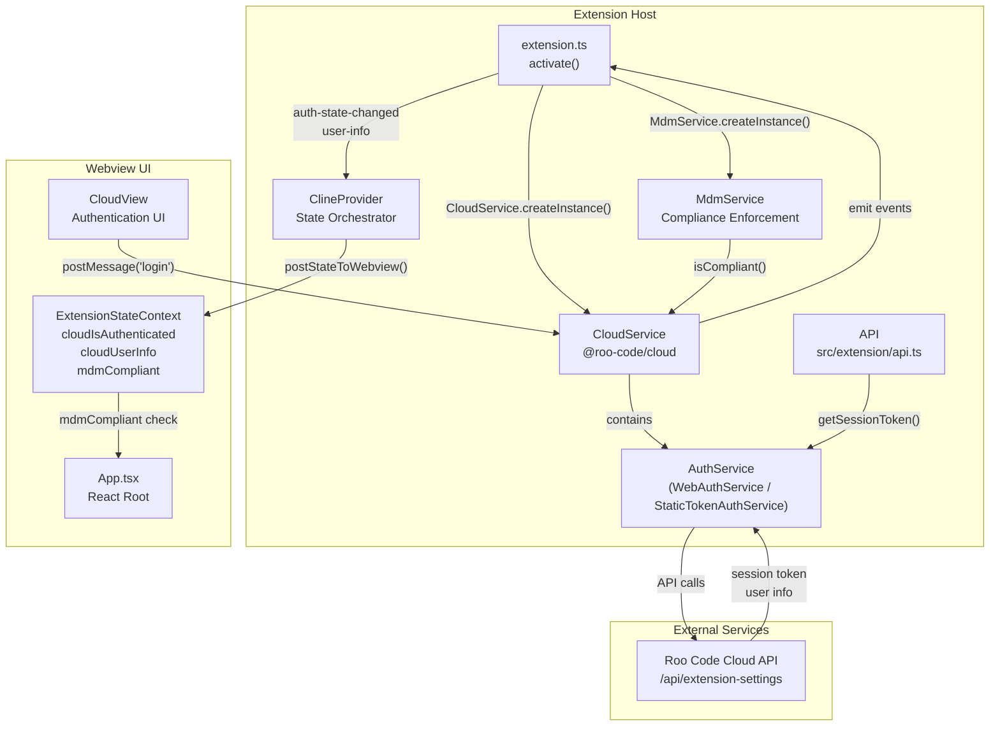
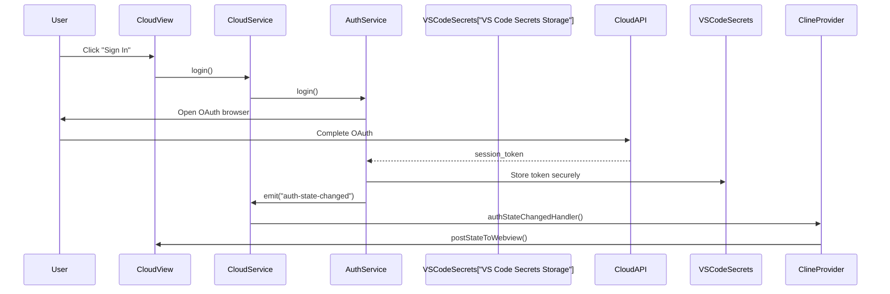
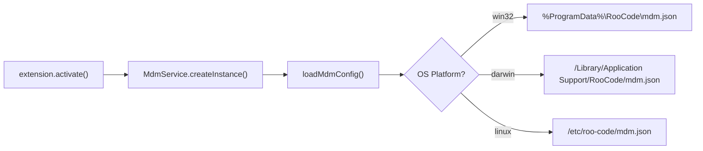
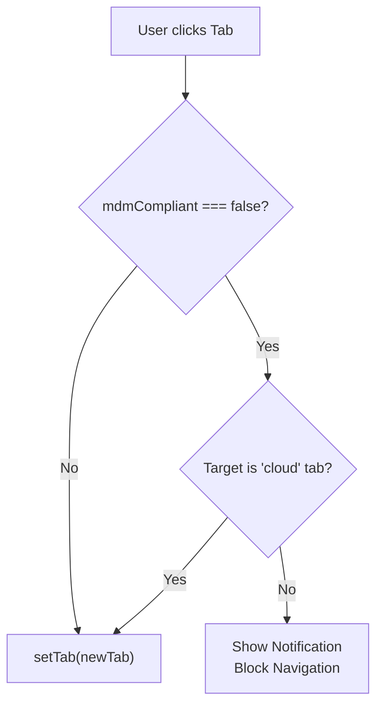

# Authentication and MDM Integration

<details>
<summary>Relevant source files</summary>

The following files were used as context for generating this wiki page:

- [packages/cloud/src/CloudService.ts](packages/cloud/src/CloudService.ts)
- [packages/cloud/src/CloudSettingsService.ts](packages/cloud/src/CloudSettingsService.ts)
- [packages/cloud/src/StaticSettingsService.ts](packages/cloud/src/StaticSettingsService.ts)
- [packages/cloud/src/TelemetryClient.ts](packages/cloud/src/TelemetryClient.ts)
- [packages/cloud/src/__tests__/CloudService.test.ts](packages/cloud/src/__tests__/CloudService.test.ts)
- [packages/cloud/src/__tests__/CloudSettingsService.test.ts](packages/cloud/src/__tests__/CloudSettingsService.test.ts)
- [packages/cloud/src/__tests__/StaticSettingsService.test.ts](packages/cloud/src/__tests__/StaticSettingsService.test.ts)
- [packages/cloud/src/__tests__/TelemetryClient.test.ts](packages/cloud/src/__tests__/TelemetryClient.test.ts)
- [packages/cloud/src/index.ts](packages/cloud/src/index.ts)
- [packages/cloud/src/retry-queue/RetryQueue.ts](packages/cloud/src/retry-queue/RetryQueue.ts)
- [packages/cloud/src/retry-queue/__tests__/RetryQueue.test.ts](packages/cloud/src/retry-queue/__tests__/RetryQueue.test.ts)
- [packages/cloud/src/retry-queue/index.ts](packages/cloud/src/retry-queue/index.ts)
- [packages/cloud/src/retry-queue/types.ts](packages/cloud/src/retry-queue/types.ts)
- [packages/ipc/README.md](packages/ipc/README.md)
- [packages/ipc/src/ipc-client.ts](packages/ipc/src/ipc-client.ts)
- [packages/ipc/src/ipc-server.ts](packages/ipc/src/ipc-server.ts)
- [packages/types/npm/package.metadata.json](packages/types/npm/package.metadata.json)
- [packages/types/src/__tests__/cloud.test.ts](packages/types/src/__tests__/cloud.test.ts)
- [packages/types/src/__tests__/ipc.test.ts](packages/types/src/__tests__/ipc.test.ts)
- [packages/types/src/api.ts](packages/types/src/api.ts)
- [packages/types/src/cloud.ts](packages/types/src/cloud.ts)
- [packages/types/src/events.ts](packages/types/src/events.ts)
- [packages/types/src/ipc.ts](packages/types/src/ipc.ts)
- [packages/types/src/task.ts](packages/types/src/task.ts)
- [releases/3.31.1-release.png](releases/3.31.1-release.png)
- [src/extension/__tests__/api-delete-queued-message.spec.ts](src/extension/__tests__/api-delete-queued-message.spec.ts)
- [src/extension/__tests__/api-send-message.spec.ts](src/extension/__tests__/api-send-message.spec.ts)
- [src/extension/api.ts](src/extension/api.ts)

</details>


## Purpose and Scope

This page documents the authentication system and Mobile Device Management (MDM) integration in Roo Code. It covers user authentication flows, session token management, organizational compliance enforcement via `MdmService`, and how MDM policies affect the user interface and cloud usage.

For information about cloud profile synchronization and task sharing features, see [Cloud Service Architecture (12.1)]().

---

## Authentication Architecture

The authentication system is built around the `CloudService` class from the `@roo-code/cloud` package, which manages authentication state, session tokens, and user information. The `MdmService` operates alongside `CloudService` to enforce organizational compliance policies.

### Component Overview



Sources: [src/extension/api.ts:143-145](), [packages/cloud/src/CloudService.ts:34-111](), [packages/types/src/cloud.ts:237-239]()

---

## Authentication Flows

### Session Token Management

Session tokens are managed by `CloudService.authService` and used to authenticate API requests to cloud services. The system supports two types of authentication services: `WebAuthService` for standard users and `StaticTokenAuthService` for headless/CI environments using the `ROO_CODE_CLOUD_TOKEN` environment variable.

#### Token Storage and Retrieval



Sources: [packages/cloud/src/CloudService.ts:122-133](), [packages/cloud/src/CloudService.ts:181-184](), [packages/types/src/cloud.ts:245-252]()

#### Session Token Usage

The session token is retrieved via `this.authService.getSessionToken()` and used in multiple contexts:

| Use Case | Implementation | File Reference |
|----------|---------------|----------------|
| **Cloud Settings Sync** | Token used in `Authorization: Bearer` header for `/api/extension-settings` | [packages/cloud/src/CloudService.ts:141-147]() |
| **Telemetry** | Token used for backfilling messages and capturing events | [packages/cloud/src/TelemetryClient.ts:107-112](), [packages/cloud/src/TelemetryClient.ts:208-213]() |
| **Retry Queue** | Token provided to `RetryQueue` for fresh headers during retries | [packages/cloud/src/CloudService.ts:151-166]() |
| **API Model Discovery** | Token used to fetch models from `api.roocode.com/proxy` | [src/extension/api.ts:140-146]() |

Sources: [packages/cloud/src/CloudService.ts:151-166](), [packages/cloud/src/TelemetryClient.ts:107-112](), [src/extension/api.ts:140-146]()

---

## MDM Service Integration

### MdmService Initialization

`MdmService` is a singleton service that loads configuration from platform-specific system locations. It is initialized during extension activation before other cloud services.



### Organizational Compliance Enforcement

The `MdmService` enforces policies defined in `mdm.json`, such as requiring cloud authentication or a specific organization ID.

#### Compliance Check Logic

The system evaluates the current state against the loaded `MdmConfig`. If the organization requires cloud authentication, `CloudService` must have an active session.

```typescript
// Compliance check pattern
const isAuthenticated = CloudService.instance.hasOrIsAcquiringActiveSession();
const orgId = CloudService.instance.getOrganizationId();
```

Sources: [packages/cloud/src/CloudService.ts:196-204](), [packages/cloud/src/CloudService.ts:211-215]()

---

## UI Enforcement and Tab Navigation

The Webview UI enforces MDM compliance by intercepting tab switching logic. If a user is non-compliant, they are restricted to the "Cloud" tab to resolve authentication issues.

### Tab Switch Interception

The UI checks the `mdmCompliant` state provided by the extension.



---

## Cloud Settings and Feature Flags

The `CloudSettingsService` fetches organization-level and user-level settings from the cloud API. These settings include feature flags and provider allow-lists.

### Refresh Lifecycle

1. **Initialization**: Loads settings during `CloudService.initialize()` ([packages/cloud/src/CloudService.ts:141-147]()).
2. **Auth-driven Refresh**: `CloudService` handles state changes to ensure settings are current when the user logs in ([packages/cloud/src/CloudService.ts:98-110]()).

### Settings Schema

The system uses `zod` to validate incoming settings:
- `OrganizationSettings`: Contains `allowList` for providers and models, and `defaultSettings` for workspace limits like `maxOpenTabsContext` and `maxWorkspaceFiles` ([packages/types/src/cloud.ts:153-163](), [packages/types/src/cloud.ts:93-104]()).
- `UserSettingsData`: Contains `features` (feature flags) and `settings` (synced user preferences like `taskSyncEnabled`) ([packages/types/src/cloud.ts:182-186]()).

Sources: [packages/types/src/cloud.ts:153-186](), [packages/types/src/cloud.ts:93-115]()

---

## Token and User Data Models

The codebase defines strict types for JWT payloads and user info to ensure data integrity across the extension and cloud services.

### JWT Payload Structure
The `JWTPayload` includes user and organization IDs, along with token types (`auth` or `cj` for cloud jobs).

| Field | Description |
|-------|-------------|
| `sub` | Subject - User ID or CloudJob ID |
| `r.u` | User ID (always present in valid tokens) |
| `r.o` | Organization ID (optional) |
| `r.t` | Token type: `auth` or `cj` |

Sources: [packages/types/src/cloud.ts:17-29]()

### Cloud User Info
The `CloudUserInfo` interface provides details about the authenticated user's identity and organizational role.

| Property | Type |
|----------|------|
| `id` | string |
| `email` | string |
| `organizationId` | string |
| `organizationRole` | string |
| `organizationName`| string |

Sources: [packages/types/src/cloud.ts:35-44]()