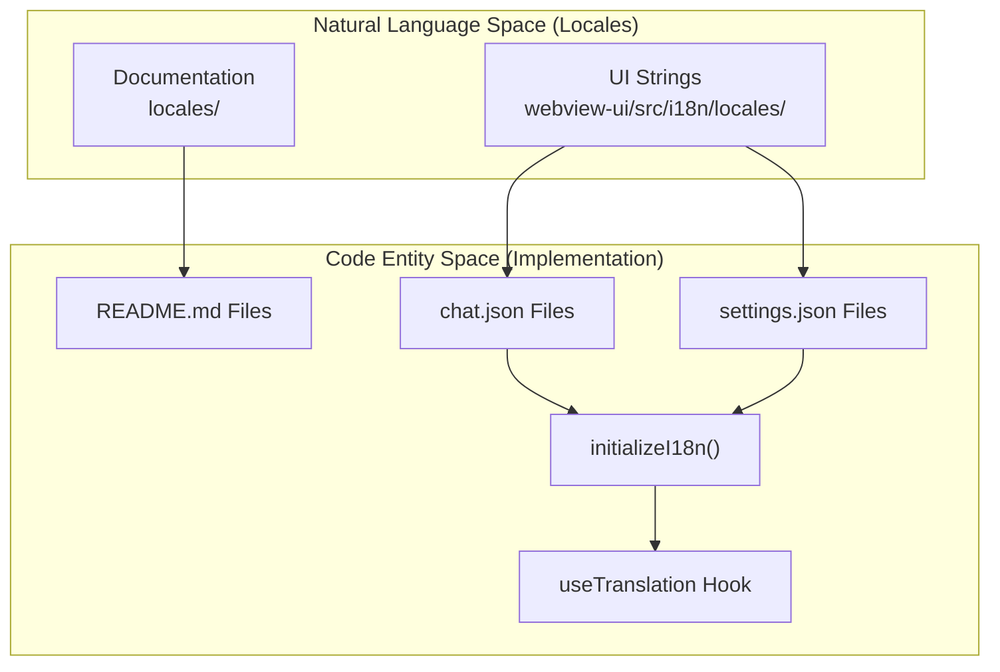
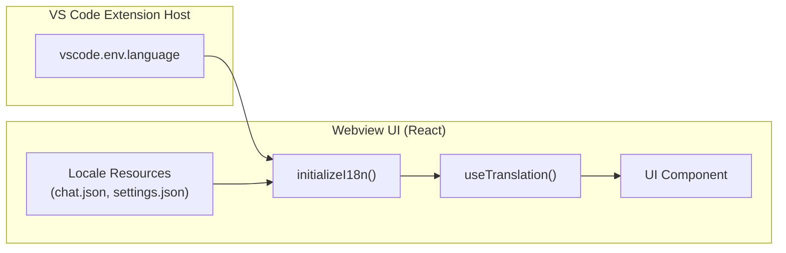

# Internationalization

Relevant source files

The following files were used as context for generating this wiki page:

- [locales/ca/README.md](locales/ca/README.md)
- [locales/de/README.md](locales/de/README.md)
- [locales/es/README.md](locales/es/README.md)
- [locales/fr/README.md](locales/fr/README.md)
- [locales/ja/README.md](locales/ja/README.md)
- [locales/ko/README.md](locales/ko/README.md)
- [locales/pl/README.md](locales/pl/README.md)
- [locales/pt-BR/README.md](locales/pt-BR/README.md)
- [locales/tr/README.md](locales/tr/README.md)
- [locales/vi/README.md](locales/vi/README.md)
- [locales/zh-CN/README.md](locales/zh-CN/README.md)
- [webview-ui/src/i18n/locales/ca/chat.json](webview-ui/src/i18n/locales/ca/chat.json)
- [webview-ui/src/i18n/locales/ca/settings.json](webview-ui/src/i18n/locales/ca/settings.json)
- [webview-ui/src/i18n/locales/de/chat.json](webview-ui/src/i18n/locales/de/chat.json)
- [webview-ui/src/i18n/locales/de/settings.json](webview-ui/src/i18n/locales/de/settings.json)
- [webview-ui/src/i18n/locales/en/settings.json](webview-ui/src/i18n/locales/en/settings.json)
- [webview-ui/src/i18n/locales/es/chat.json](webview-ui/src/i18n/locales/es/chat.json)
- [webview-ui/src/i18n/locales/es/settings.json](webview-ui/src/i18n/locales/es/settings.json)
- [webview-ui/src/i18n/locales/fr/chat.json](webview-ui/src/i18n/locales/fr/chat.json)
- [webview-ui/src/i18n/locales/fr/settings.json](webview-ui/src/i18n/locales/fr/settings.json)
- [webview-ui/src/i18n/locales/hi/chat.json](webview-ui/src/i18n/locales/hi/chat.json)
- [webview-ui/src/i18n/locales/hi/settings.json](webview-ui/src/i18n/locales/hi/settings.json)
- [webview-ui/src/i18n/locales/it/chat.json](webview-ui/src/i18n/locales/it/chat.json)
- [webview-ui/src/i18n/locales/it/settings.json](webview-ui/src/i18n/locales/it/settings.json)
- [webview-ui/src/i18n/locales/ja/chat.json](webview-ui/src/i18n/locales/ja/chat.json)
- [webview-ui/src/i18n/locales/ja/settings.json](webview-ui/src/i18n/locales/ja/settings.json)
- [webview-ui/src/i18n/locales/ko/chat.json](webview-ui/src/i18n/locales/ko/chat.json)
- [webview-ui/src/i18n/locales/ko/settings.json](webview-ui/src/i18n/locales/ko/settings.json)
- [webview-ui/src/i18n/locales/pl/chat.json](webview-ui/src/i18n/locales/pl/chat.json)
- [webview-ui/src/i18n/locales/pl/settings.json](webview-ui/src/i18n/locales/pl/settings.json)
- [webview-ui/src/i18n/locales/pt-BR/settings.json](webview-ui/src/i18n/locales/pt-BR/settings.json)
- [webview-ui/src/i18n/locales/tr/chat.json](webview-ui/src/i18n/locales/tr/chat.json)
- [webview-ui/src/i18n/locales/tr/settings.json](webview-ui/src/i18n/locales/tr/settings.json)
- [webview-ui/src/i18n/locales/vi/chat.json](webview-ui/src/i18n/locales/vi/chat.json)
- [webview-ui/src/i18n/locales/vi/settings.json](webview-ui/src/i18n/locales/vi/settings.json)
- [webview-ui/src/i18n/locales/zh-CN/chat.json](webview-ui/src/i18n/locales/zh-CN/chat.json)
- [webview-ui/src/i18n/locales/zh-CN/settings.json](webview-ui/src/i18n/locales/zh-CN/settings.json)
- [webview-ui/src/i18n/locales/zh-TW/chat.json](webview-ui/src/i18n/locales/zh-TW/chat.json)

## Purpose and Scope

This document explains Roo Code's internationalization (i18n) system, which provides multi-language support across documentation and the user interface. Roo Code currently supports 18+ languages including English, Spanish, French, German, Japanese, Chinese (Simplified and Traditional), Korean, Portuguese, Italian, Turkish, Polish, Vietnamese, Hindi, Dutch, Catalan, and Bahasa Indonesia.

For details on documentation structure, see [Documentation Localization](#13.1). For the UI translation implementation, see [UI String Localization](#13.2). For the technical initialization of the i18n system, see [i18n System Implementation](#13.3).

---

## System Architecture Overview

**Roo Code i18n Architecture**

Roo Code implements two-tier internationalization: markdown-based documentation in the `locales/` directory and JSON-based UI strings in `webview-ui/src/i18n/locales/`. The webview uses `i18next` with React's `useTranslation()` hook to access translations at runtime.

Sources: [locales/fr/README.md:21-43](), [locales/ja/README.md:21-43](), [webview-ui/src/i18n/locales/zh-TW/chat.json:1-31](), [webview-ui/src/i18n/locales/zh-CN/chat.json:1-31]()

---

## Documentation Localization (#13.1)

Roo Code maintains parallel `README.md` files for each supported language in the `locales/` directory. All localized READMEs follow an identical structure to the root English version, ensuring feature parity and consistent onboarding across different regions.

### README File Structure
Each language subdirectory (e.g., `fr/`, `ja/`, `tr/`) contains a translated `README.md` with identical sections:
- **Feature list**: Core capabilities like code generation from natural language and MCP usage [locales/fr/README.md:47-55]().
- **Modes**: Descriptions of Code, Architect, Ask, Debug, and Custom modes [locales/ja/README.md:57-67]().
- **Local setup**: Instructions for cloning the repository and running `pnpm install` [locales/tr/README.md:94-106]().
- **Latest Updates**: Version-specific change logs translated for local audiences (e.g., v3.52.0 updates regarding Poe and xAI) [locales/ko/README.md:16-20]().

For details, see [Documentation Localization](#13.1).

Sources: [locales/fr/README.md:1-177](), [locales/tr/README.md:1-136](), [locales/ja/README.md:1-177](), [locales/ko/README.md:16-20]()

---

## UI String Localization (#13.2)

The webview UI translations are organized in `webview-ui/src/i18n/locales/` using separate JSON files for different feature domains, primarily `chat.json` and `settings.json`.

### Translation Organization
- **chat.json**: Contains strings for task management (start, stop, resume), file operations (read, edit, create), and the mode selector [webview-ui/src/i18n/locales/zh-TW/chat.json:3-31](), [webview-ui/src/i18n/locales/zh-TW/chat.json:145-152]().
- **settings.json**: Localizes the configuration UI, including individual provider settings (Anthropic, OpenAI, etc.) and auto-approve rules.

### Key Features
- **Interpolation**: Supports dynamic values using `{{variable}}` syntax, such as `{{count}}` for file changes or `{{amount}}` for token space [webview-ui/src/i18n/locales/zh-TW/chat.json:35](), [webview-ui/src/i18n/locales/zh-TW/chat.json:54]().
- **Pluralization**: Handles linguistic variations for counts (e.g., `messagesRemoved` vs `messagesRemoved_other`) [webview-ui/src/i18n/locales/zh-TW/chat.json:220-222]().
- **Context Management**: Specific keys for token tracking, condensation, and truncation workflows to keep the AI within context limits [webview-ui/src/i18n/locales/zh-TW/chat.json:210-224]().

For details, see [UI String Localization](#13.2).

Sources: [webview-ui/src/i18n/locales/zh-TW/chat.json:1-260]()

---

## i18n System Implementation (#13.3)

The technical implementation bridges VS Code's environment settings with the React-based webview.

**i18n Data Flow**

### Core Mechanics
- **Language Selection**: The system detects the language from the VS Code environment to match the user's IDE preference.
- **Resource Loading**: Locale files are loaded as structured JSON resources into the `i18next` instance.
- **Error Mapping**: Detailed provider error messages (e.g., 401 Unauthorized, 402 Payment Required, 429 Rate Limit) are localized to provide actionable feedback in the user's native language [webview-ui/src/i18n/locales/zh-TW/chat.json:176-189]().
- **Fallback**: The system defaults to English (`en`) if a specific key is missing in the target locale.

For details, see [i18n System Implementation](#13.3).

Sources: [webview-ui/src/i18n/locales/zh-TW/chat.json:176-189](), [locales/fr/README.md:21-43]()