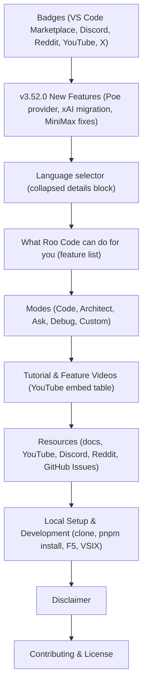
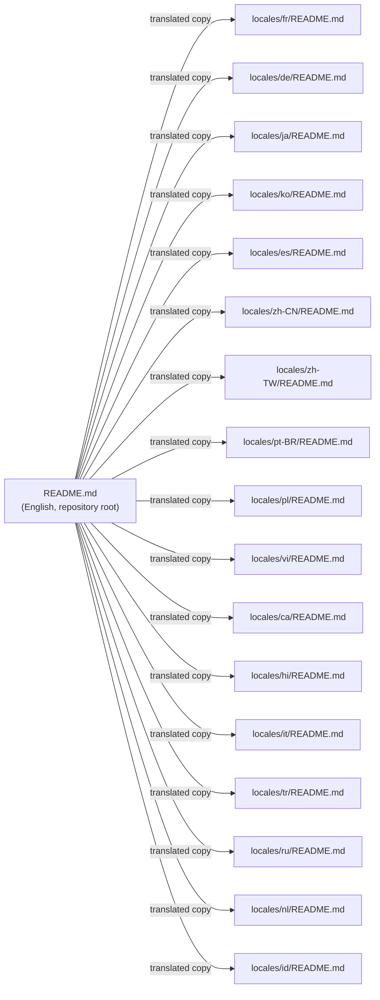

# Documentation Localization

<details>
<summary>Relevant source files</summary>

The following files were used as context for generating this wiki page:

- [locales/ca/README.md](locales/ca/README.md)
- [locales/de/README.md](locales/de/README.md)
- [locales/es/README.md](locales/es/README.md)
- [locales/fr/README.md](locales/fr/README.md)
- [locales/hi/README.md](locales/hi/README.md)
- [locales/id/README.md](locales/id/README.md)
- [locales/it/README.md](locales/it/README.md)
- [locales/ja/README.md](locales/ja/README.md)
- [locales/ko/README.md](locales/ko/README.md)
- [locales/nl/README.md](locales/nl/README.md)
- [locales/pl/README.md](locales/pl/README.md)
- [locales/pt-BR/README.md](locales/pt-BR/README.md)
- [locales/ru/README.md](locales/ru/README.md)
- [locales/tr/README.md](locales/tr/README.md)
- [locales/vi/README.md](locales/vi/README.md)
- [locales/zh-CN/README.md](locales/zh-CN/README.md)
- [locales/zh-TW/README.md](locales/zh-TW/README.md)

</details>


This page covers the localized README files stored in the `locales/` directory of the repository. These are static Markdown documents translated into multiple languages, each covering the same project introduction, feature set, and development instructions as the root `README.md`.

This documentation is distinct from the runtime UI translation system. For information about how the application's UI strings are translated at runtime, see [UI String Localization](13.2) and [i18n System Implementation](13.3).

---

## Purpose

The `locales/` directory provides translated versions of the project's main README for non-English-speaking contributors and users. Each file mirrors the same content as `README.md` at the repository root, expressed in its target language, ensuring that the onboarding process and feature descriptions are accessible globally.

---

## Directory Structure

Each locale's README lives under `locales/<language-code>/README.md`. All locales share an identical directory layout.

**Directory structure of `locales/`**

```mermaid
graph TD
  root["locales/"]
  root --> ca["ca/README.md"]
  root --> de["de/README.md"]
  root --> es["es/README.md"]
  root --> fr["fr/README.md"]
  root --> hi["hi/README.md"]
  root --> id["id/README.md"]
  root --> it["it/README.md"]
  root --> ja["ja/README.md"]
  root --> ko["ko/README.md"]
  root --> nl["nl/README.md"]
  root --> pl["pl/README.md"]
  root --> ptBR["pt-BR/README.md"]
  root --> ru["ru/README.md"]
  root --> tr["tr/README.md"]
  root --> vi["vi/README.md"]
  root --> zhCN["zh-CN/README.md"]
  root --> zhTW["zh-TW/README.md"]
```



Sources: [locales/zh-TW/README.md:25-42](), [locales/fr/README.md:25-42]()

---

## Supported Languages

| Language Code | Language Name | File Path |
|---|---|---|
| `ca` | Catalan | `locales/ca/README.md` |
| `de` | German (Deutsch) | `locales/de/README.md` |
| `es` | Spanish (Español) | `locales/es/README.md` |
| `fr` | French (Français) | `locales/fr/README.md` |
| `hi` | Hindi (हिंदी) | `locales/hi/README.md` |
| `id` | Indonesian (Bahasa Indonesia) | `locales/id/README.md` |
| `it` | Italian (Italiano) | `locales/it/README.md` |
| `ja` | Japanese (日本語) | `locales/ja/README.md` |
| `ko` | Korean (한국어) | `locales/ko/README.md` |
| `nl` | Dutch (Nederlands) | `locales/nl/README.md` |
| `pl` | Polish (Polski) | `locales/pl/README.md` |
| `pt-BR` | Brazilian Portuguese (Português BR) | `locales/pt-BR/README.md` |
| `ru` | Russian (Русский) | `locales/ru/README.md` |
| `tr` | Turkish (Türkçe) | `locales/tr/README.md` |
| `vi` | Vietnamese (Tiếng Việt) | `locales/vi/README.md` |
| `zh-CN` | Simplified Chinese (简体中文) | `locales/zh-CN/README.md` |
| `zh-TW` | Traditional Chinese (繁體中文) | `locales/zh-TW/README.md` |

The canonical English version is the root `README.md` at the repository root.

Sources: [locales/zh-TW/README.md:25-42](), [locales/fr/README.md:25-42]()

---

## Content Structure

Every localized README contains the same sections in the same order. The content is a direct translation of the root `README.md`, including updated feature notes for version 3.52.0.

**Section structure common to all locale README files**



Sources: [locales/fr/README.md:1-177](), [locales/ja/README.md:1-177](), [locales/de/README.md:1-177]()

---

## Language Selector Block

Each README includes a `<details>` element near the top that lists all available language versions with relative links. The links use the form `../../README.md` for English and `../<code>/README.md` for other locales, resolving relative to the file's own location under `locales/<code>/`.

For example, from `locales/zh-TW/README.md`:

```markdown
<details>
  <summary>🌐 支援語言</summary>

- [English](../../README.md)
- [Català](../ca/README.md)
- [Deutsch](../de/README.md)
...
</details>
```

[locales/zh-TW/README.md:22-44]()

This block is identical in structure across all locales; only the summary label is translated (e.g., "Langues disponibles" in French, "利用可能な言語" in Japanese).

Sources: [locales/fr/README.md:22-44](), [locales/ja/README.md:22-44](), [locales/ko/README.md:22-44]()

---

## Relationship to Root README

The localized READMEs are standalone translated copies; they are not generated from the root `README.md` by any automated tooling present in the repository. Each file is maintained independently by contributors.

**Relationship between root README and locale READMEs**



Sources: [locales/fr/README.md:25-42](), [locales/de/README.md:25-42]()

---

## Covered Content Summary

The following table maps each major README section to the specific content it describes, reflecting updates as of version 3.52.0:

| Section | Content |
|---|---|
| v3.52.0 Features | Poe AI provider added; xAI provider migration to Responses API and Grok-4.20 defaults; MiniMax model list fixes. |
| Capabilities | Natural language code generation, modes, refactoring, documentation, automation, MCP servers. |
| Modes | Code, Architect, Ask, Debug, Custom — with links to `docs.roocode.com`. |
| Tutorial Videos | Six YouTube videos: installing, configuring profiles, codebase indexing, custom modes, checkpoints, context management. |
| Local Setup | `git clone`, `pnpm install`, F5 dev mode, automated VSIX install (`pnpm install:vsix`), manual VSIX install. |
| Disclaimer | Liability disclaimer regarding code, models, and third-party tools provided "as is". |
| Contributing | Reference to `CONTRIBUTING.md`. |
| License | Apache 2.0. |

Sources: [locales/zh-TW/README.md:16-177](), [locales/fr/README.md:16-177](), [locales/ja/README.md:16-177]()

---

## Scope Notes

- These files are **documentation only** — they have no runtime effect on the extension's behavior.
- For the runtime i18n system that translates the VS Code extension's UI strings (chat messages, settings labels, etc.), see [UI String Localization](13.2).
- For the `i18next` setup and language detection logic used at runtime, see [i18n System Implementation](13.3).