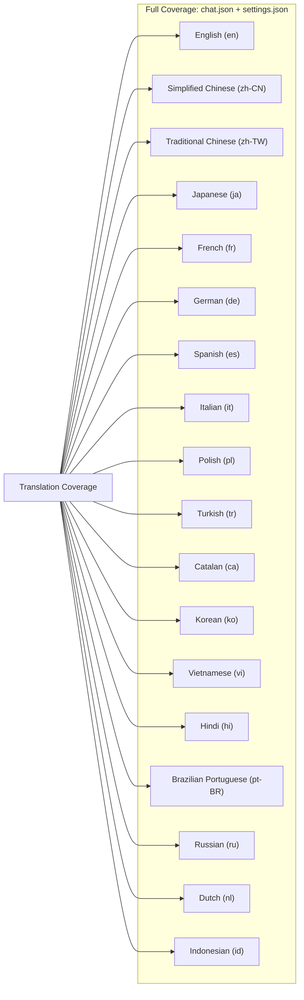

# UI String Localization

<details>
<summary>Relevant source files</summary>

The following files were used as context for generating this wiki page:

- [webview-ui/src/i18n/locales/ca/chat.json](webview-ui/src/i18n/locales/ca/chat.json)
- [webview-ui/src/i18n/locales/ca/settings.json](webview-ui/src/i18n/locales/ca/settings.json)
- [webview-ui/src/i18n/locales/de/chat.json](webview-ui/src/i18n/locales/de/chat.json)
- [webview-ui/src/i18n/locales/de/settings.json](webview-ui/src/i18n/locales/de/settings.json)
- [webview-ui/src/i18n/locales/en/chat.json](webview-ui/src/i18n/locales/en/chat.json)
- [webview-ui/src/i18n/locales/en/settings.json](webview-ui/src/i18n/locales/en/settings.json)
- [webview-ui/src/i18n/locales/es/chat.json](webview-ui/src/i18n/locales/es/chat.json)
- [webview-ui/src/i18n/locales/es/settings.json](webview-ui/src/i18n/locales/es/settings.json)
- [webview-ui/src/i18n/locales/fr/chat.json](webview-ui/src/i18n/locales/fr/chat.json)
- [webview-ui/src/i18n/locales/fr/settings.json](webview-ui/src/i18n/locales/fr/settings.json)
- [webview-ui/src/i18n/locales/hi/chat.json](webview-ui/src/i18n/locales/hi/chat.json)
- [webview-ui/src/i18n/locales/hi/settings.json](webview-ui/src/i18n/locales/hi/settings.json)
- [webview-ui/src/i18n/locales/id/chat.json](webview-ui/src/i18n/locales/id/chat.json)
- [webview-ui/src/i18n/locales/id/settings.json](webview-ui/src/i18n/locales/id/settings.json)
- [webview-ui/src/i18n/locales/it/chat.json](webview-ui/src/i18n/locales/it/chat.json)
- [webview-ui/src/i18n/locales/it/settings.json](webview-ui/src/i18n/locales/it/settings.json)
- [webview-ui/src/i18n/locales/ja/chat.json](webview-ui/src/i18n/locales/ja/chat.json)
- [webview-ui/src/i18n/locales/ja/settings.json](webview-ui/src/i18n/locales/ja/settings.json)
- [webview-ui/src/i18n/locales/ko/chat.json](webview-ui/src/i18n/locales/ko/chat.json)
- [webview-ui/src/i18n/locales/ko/settings.json](webview-ui/src/i18n/locales/ko/settings.json)
- [webview-ui/src/i18n/locales/nl/chat.json](webview-ui/src/i18n/locales/nl/chat.json)
- [webview-ui/src/i18n/locales/nl/settings.json](webview-ui/src/i18n/locales/nl/settings.json)
- [webview-ui/src/i18n/locales/pl/chat.json](webview-ui/src/i18n/locales/pl/chat.json)
- [webview-ui/src/i18n/locales/pl/settings.json](webview-ui/src/i18n/locales/pl/settings.json)
- [webview-ui/src/i18n/locales/pt-BR/chat.json](webview-ui/src/i18n/locales/pt-BR/chat.json)
- [webview-ui/src/i18n/locales/pt-BR/settings.json](webview-ui/src/i18n/locales/pt-BR/settings.json)
- [webview-ui/src/i18n/locales/ru/chat.json](webview-ui/src/i18n/locales/ru/chat.json)
- [webview-ui/src/i18n/locales/ru/settings.json](webview-ui/src/i18n/locales/ru/settings.json)
- [webview-ui/src/i18n/locales/tr/chat.json](webview-ui/src/i18n/locales/tr/chat.json)
- [webview-ui/src/i18n/locales/tr/settings.json](webview-ui/src/i18n/locales/tr/settings.json)
- [webview-ui/src/i18n/locales/vi/chat.json](webview-ui/src/i18n/locales/vi/chat.json)
- [webview-ui/src/i18n/locales/vi/settings.json](webview-ui/src/i18n/locales/vi/settings.json)
- [webview-ui/src/i18n/locales/zh-CN/chat.json](webview-ui/src/i18n/locales/zh-CN/chat.json)
- [webview-ui/src/i18n/locales/zh-CN/settings.json](webview-ui/src/i18n/locales/zh-CN/settings.json)
- [webview-ui/src/i18n/locales/zh-TW/chat.json](webview-ui/src/i18n/locales/zh-TW/chat.json)
- [webview-ui/src/i18n/locales/zh-TW/settings.json](webview-ui/src/i18n/locales/zh-TW/settings.json)

</details>


This document describes the localization system for the webview user interface, covering the JSON-based translation structure for the React-based chat interface and settings panel. For backend/extension localization implementation details, see [13.3](). For documentation localization (README translations), see [13.1]().

## Overview

The webview UI localization system provides translations for all user-facing strings in the Roo Code interface across 15+ languages. Translation files are organized as JSON resources in `webview-ui/src/i18n/locales/`, with separate files for different UI sections (`chat.json` for the main chat interface, `settings.json` for the settings panel).

## Localization File Structure

Translation files follow a hierarchical JSON structure organized by locale code:

```
webview-ui/src/i18n/locales/
├── en/
│   ├── chat.json
│   └── settings.json
├── zh-CN/
│   ├── chat.json
│   └── settings.json
├── zh-TW/
│   ├── chat.json
│   └── settings.json
├── ja/
│   ├── chat.json
│   └── settings.json
├── fr/
│   ├── chat.json
│   └── settings.json
├── de/
│   ├── chat.json
│   └── settings.json
├── es/
│   ├── chat.json
│   └── settings.json
├── it/
│   ├── chat.json
│   └── settings.json
├── pl/
│   ├── chat.json
│   └── settings.json
├── tr/
│   ├── chat.json
│   └── settings.json
├── ca/
│   ├── chat.json
│   └── settings.json
├── ko/
│   ├── chat.json
│   └── settings.json
├── vi/
│   ├── chat.json
│   └── settings.json
├── hi/
│   ├── chat.json
│   └── settings.json
├── ru/
│   ├── chat.json
│   └── settings.json
├── nl/
│   ├── chat.json
│   └── settings.json
├── id/
│   ├── chat.json
│   └── settings.json
└── pt-BR/
    ├── chat.json
    └── settings.json
```

**Locale Code Format:**
- Two-letter ISO 639-1 codes: `en`, `ja`, `fr`, `de`, `es`, `it`, `pl`, `tr`, `ca`, `ko`, `vi`, `hi`, `ru`, `nl`, `id` [[webview-ui/src/i18n/locales/en/chat.json:1-10](), [webview-ui/src/i18n/locales/ja/chat.json:1-10](), [webview-ui/src/i18n/locales/fr/chat.json:1-10](), [webview-ui/src/i18n/locales/de/chat.json:1-10]()]
- Regional variants use hyphenated format: `zh-CN` (Simplified Chinese), `zh-TW` (Traditional Chinese), `pt-BR` (Brazilian Portuguese) [[webview-ui/src/i18n/locales/zh-CN/chat.json:1-10](), [webview-ui/src/i18n/locales/zh-TW/chat.json:1-10]()]

**Sources:** [[webview-ui/src/i18n/locales/zh-TW/chat.json:1-31](), [webview-ui/src/i18n/locales/de/chat.json:1-31](), [webview-ui/src/i18n/locales/en/settings.json:1-45]()]

## chat.json Structure

### Hierarchical Organization

The `chat.json` file contains translations for the main chat interface, organized into logical groupings:

**Chat Interface Localization Schema**

```mermaid
graph TD
    ChatJSON["chat.json"]
    
    ChatJSON --> Greeting["greeting"]
    ChatJSON --> Task["task<br/>(title, expand, collapse,<br/>share, export, delete)"]
    ChatJSON --> Actions["Button Actions<br/>(retry, approve, reject,<br/>save, cancel, stop)"]
    ChatJSON --> FileOps["fileOperations<br/>(wantsToRead, wantsToEdit,<br/>wantsToCreate, didRead)"]
    ChatJSON --> DirOps["directoryOperations<br/>(wantsToViewTopLevel,<br/>wantsToViewRecursive)"]
    ChatJSON --> CommandExec["commandExecution<br/>(running, abort, pid,<br/>manageCommands)"]
    ChatJSON --> APIRequest["apiRequest<br/>(title, failed, streaming,<br/>errorMessage.400/401/429)"]
    ChatJSON --> Checkpoint["checkpoint<br/>(regular, menu.viewDiff,<br/>menu.restore)"]
    ChatJSON --> Modes["modes<br/>(wantsToSwitch,<br/>didSwitch)"]
    ChatJSON --> ContextManagement["contextManagement<br/>(condensation, truncation)"]
    ChatJSON --> RooTips["rooTips<br/>(customizableModes, modelAgnostic)"]
```


**Sources:** [[webview-ui/src/i18n/locales/zh-TW/chat.json:1-31](), [webview-ui/src/i18n/locales/en/chat.json:1-190](), [webview-ui/src/i18n/locales/en/chat.json:210-224]()]

### Key Categories in chat.json

#### Task Management

Task-related strings for task header and controls:

| Key Path | Description | Example (en) |
|----------|-------------|--------------|
| `task.title` | Task label | "Task" [[webview-ui/src/i18n/locales/en/chat.json:4]()] |
| `task.expand` | Expand task tooltip | "Expand task" [[webview-ui/src/i18n/locales/en/chat.json:5]()] |
| `task.collapse` | Collapse task tooltip | "Collapse task" [[webview-ui/src/i18n/locales/en/chat.json:6]()] |
| `task.tokens` | Tokens label | "Tokens" [[webview-ui/src/i18n/locales/en/chat.json:9]()] |
| `task.cache` | Cache label | "Cache" [[webview-ui/src/i18n/locales/en/chat.json:10]()] |
| `task.apiCost` | API cost label | "API Cost" [[webview-ui/src/i18n/locales/en/chat.json:11]()] |
| `task.closeAndStart` | Close and start new button | "Close task and start a new one" [[webview-ui/src/i18n/locales/en/chat.json:15]()] |
| `task.export` | Export button tooltip | "Export task history" [[webview-ui/src/i18n/locales/en/chat.json:16]()] |
| `task.delete` | Delete button tooltip | "Delete Task (Shift + Click to skip confirmation)" [[webview-ui/src/i18n/locales/en/chat.json:18]()] |
| `task.share` | Share task button | "Share task" [[webview-ui/src/i18n/locales/en/chat.json:17]()] |
| `task.backToParentTask` | Link to parent task | "Parent task" [[webview-ui/src/i18n/locales/en/chat.json:30]()] |

**Sources:** [[webview-ui/src/i18n/locales/en/chat.json:3-31](), [webview-ui/src/i18n/locales/zh-TW/chat.json:3-31]()]

#### File Operations

Strings for file read/write/edit operations shown in the chat interface:

| Key Path | Description | Example (en) |
|----------|-------------|--------------|
| `fileOperations.wantsToRead` | File read request | "Roo wants to read this file" [[webview-ui/src/i18n/locales/en/chat.json:233]()] |
| `fileOperations.wantsToEdit` | File edit request | "Roo wants to edit this file" [[webview-ui/src/i18n/locales/en/chat.json:238]()] |
| `fileOperations.wantsToCreate` | File create request | "Roo wants to create new file" [[webview-ui/src/i18n/locales/en/chat.json:246]()] |
| `fileOperations.didRead` | File read confirmation | "Roo read this file" [[webview-ui/src/i18n/locales/en/chat.json:237]()] |
| `fileOperations.wantsToReadMultiple` | Batch read request | "Roo wants to read multiple files" [[webview-ui/src/i18n/locales/en/chat.json:234]()] |
| `fileOperations.wantsToApplyBatchChanges` | Batch edit request | "Roo wants to apply changes to multiple files" [[webview-ui/src/i18n/locales/en/chat.json:241]()] |
| `fileOperations.wantsToInsert` | Content insertion request | "Roo wants to insert content in this file" [[webview-ui/src/i18n/locales/en/chat.json:247]()] |

**Sources:** [[webview-ui/src/i18n/locales/en/chat.json:232-250](), [webview-ui/src/i18n/locales/zh-CN/chat.json:191-211]()]

#### Command Execution

Strings for terminal command execution and management:

| Key Path | Description | Example (en) |
|----------|-------------|--------------|
| `commandExecution.running` | Running status | "Running" [[webview-ui/src/i18n/locales/en/chat.json:274]()] |
| `commandExecution.abort` | Abort button | "Abort" [[webview-ui/src/i18n/locales/en/chat.json:275]()] |
| `commandExecution.pid` | Process ID display | "PID: {{pid}}" [[webview-ui/src/i18n/locales/en/chat.json:276]()] |
| `commandExecution.exitStatus` | Exit status message | "Exited with status {{exitCode}}" [[webview-ui/src/i18n/locales/en/chat.json:277]()] |
| `commandExecution.manageCommands` | Command management header | "Manage Command Permissions" [[webview-ui/src/i18n/locales/en/chat.json:278]()] |

**Sources:** [[webview-ui/src/i18n/locales/en/chat.json:273-289](), [webview-ui/src/i18n/locales/zh-CN/chat.json:228-243]()]

#### API Error Messages

Comprehensive error message translations for API failures, including specific HTTP status code handling:

| Key Path | Description | HTTP Code |
|----------|-------------|-----------|
| `apiRequest.errorMessage.400` | Bad request | 400 [[webview-ui/src/i18n/locales/en/chat.json:178]()] |
| `apiRequest.errorMessage.401` | Authentication failed | 401 [[webview-ui/src/i18n/locales/en/chat.json:179]()] |
| `apiRequest.errorMessage.402` | Payment required | 402 [[webview-ui/src/i18n/locales/en/chat.json:180]()] |
| `apiRequest.errorMessage.403` | Forbidden | 403 [[webview-ui/src/i18n/locales/en/chat.json:181]()] |
| `apiRequest.errorMessage.429` | Rate limit exceeded | 429 [[webview-ui/src/i18n/locales/en/chat.json:182]()] |
| `apiRequest.errorMessage.500` | Server error | 500 [[webview-ui/src/i18n/locales/en/chat.json:183]()] |
| `apiRequest.errorMessage.claudeCodeNotAuthenticated` | Claude Code Auth | N/A [[webview-ui/src/i18n/locales/en/chat.json:188]()] |

**Sources:** [[webview-ui/src/i18n/locales/en/chat.json:169-189](), [webview-ui/src/i18n/locales/zh-CN/chat.json:147-167]()]

### String Interpolation Patterns

Localization strings support variable interpolation using `{{variable}}` syntax:

**Token Usage Pattern:**
```json
{
  "tokenProgress": {
    "availableSpace": "Available space: {{amount}} tokens",
    "tokensUsed": "Tokens used: {{used}} of {{total}}",
    "reservedForResponse": "Reserved for model response: {{amount}} tokens"
  }
}
```
[[webview-ui/src/i18n/locales/en/chat.json:54-56]()]

**Context Management Pattern:**
```json
{
  "contextManagement": {
    "truncation": {
      "messagesRemoved": "Removed {{count}} message",
      "messagesRemoved_other": "Removed {{count}} messages"
    }
  }
}
```
[[webview-ui/src/i18n/locales/en/chat.json:220-221]()]

**Sources:** [[webview-ui/src/i18n/locales/en/chat.json:53-60](), [webview-ui/src/i18n/locales/en/chat.json:210-224]()]

## settings.json Structure

### Hierarchical Organization

**Settings Panel Localization Schema**

```mermaid
graph TD
    SettingsJSON["settings.json"]
    
    SettingsJSON --> Common["common<br/>(save, done, cancel,<br/>reset, select, add, remove)"]
    SettingsJSON --> Header["header<br/>(title, saveButtonTooltip,<br/>doneButtonTooltip)"]
    SettingsJSON --> Search["search<br/>(placeholder, noResults)"]
    SettingsJSON --> Sections["sections<br/>(providers, modes, mcp,<br/>autoApprove, terminal, etc)"]
    SettingsJSON --> Providers["providers<br/>(addProfile, modelPicker,<br/>anthropic, openai, etc)"]
    SettingsJSON --> Modes["modes<br/>(description, addMode,<br/>roleDefinition, toolGroups)"]
    SettingsJSON --> MCP["mcp<br/>(description, addServer,<br/>serverConfig)"]
    SettingsJSON --> AutoApprove["autoApprove<br/>(description, read, write,<br/>commands, mcpTools)"]
    SettingsJSON --> Context["contextManagement<br/>(description, sources,<br/>condensing, fileLimits)"]
    SettingsJSON --> Terminal["terminal<br/>(description, shell,<br/>shellIntegration)"]
```


**Sources:** [[webview-ui/src/i18n/locales/en/settings.json:1-45]()]

### Key Categories in settings.json

#### Provider Configuration

Extensive provider-specific strings for API configuration:

**Provider Keys:**
- `providers.openai.*` - OpenAI configuration [[webview-ui/src/i18n/locales/en/settings.json:182]()]
- `providers.ollama.*` - Ollama configuration [[webview-ui/src/i18n/locales/en/settings.json:183]()]
- `providers.gemini.*` - Google Gemini configuration [[webview-ui/src/i18n/locales/en/settings.json:184]()]
- `providers.openrouter.*` - OpenRouter configuration [[webview-ui/src/i18n/locales/en/settings.json:181]()]

**Sources:** [[webview-ui/src/i18n/locales/en/settings.json:171-186]()]

#### Auto-Approve Configuration

Detailed strings for auto-approve settings covering different tool types:

| Key Path | Description |
|----------|-------------|
| `sections.autoApprove` | Auto-Approve section title [[webview-ui/src/i18n/locales/en/settings.json:34]()] |
| `autoApprove.read` | Auto-approve read operations |
| `autoApprove.write` | Auto-approve write operations |
| `autoApprove.commands` | Auto-approve shell commands |
| `autoApprove.mcpTools` | Auto-approve MCP tool calls |

**Sources:** [[webview-ui/src/i18n/locales/en/settings.json:28-45]()]

## Translation Coverage

**Locale Support Matrix**


**Translation Status:**
- All 18+ supported languages include complete `chat.json` and `settings.json` translations.
- Regional variants like `zh-CN` and `zh-TW` are maintained separately to ensure accurate terminology (e.g., "Token" in TW vs "Token 用量" in CN). [[webview-ui/src/i18n/locales/zh-TW/chat.json:9](), [webview-ui/src/i18n/locales/zh-CN/chat.json:9]()]

**Sources:** [[webview-ui/src/i18n/locales/en/chat.json:1-10](), [webview-ui/src/i18n/locales/zh-CN/chat.json:1-10](), [webview-ui/src/i18n/locales/zh-TW/chat.json:1-10](), [webview-ui/src/i18n/locales/ja/chat.json:1-10](), [webview-ui/src/i18n/locales/de/chat.json:1-10]()]

## Special String Formatting

### Rich Text Content

Some strings support embedded HTML-like tags for rich formatting:

**Markdown-style Links:**
```json
{
  "docs": "Check our <DocsLink>docs</DocsLink> to get started"
}
```
[[webview-ui/src/i18n/locales/en/chat.json:128]()]

**Inline Code Tags:**
```json
{
  "checkpoint.initializingWarning": "Still initializing checkpoint... If this takes too long, you can disable checkpoints in <settingsLink>settings</settingsLink> and restart your task."
}
```
[[webview-ui/src/i18n/locales/en/chat.json:193]()]

**Sources:** [[webview-ui/src/i18n/locales/en/chat.json:127-129](), [webview-ui/src/i18n/locales/zh-CN/chat.json:100-102]()]

### Key Combination Display

Keyboard shortcut strings use interpolation for platform-specific key combinations:

```json
{
  "pressToSend": "Press {{keyCombination}} to send"
}
```
[[webview-ui/src/i18n/locales/en/chat.json:156]()]

**Sources:** [[webview-ui/src/i18n/locales/en/chat.json:155-156](), [webview-ui/src/i18n/locales/zh-TW/chat.json:155-156]()]