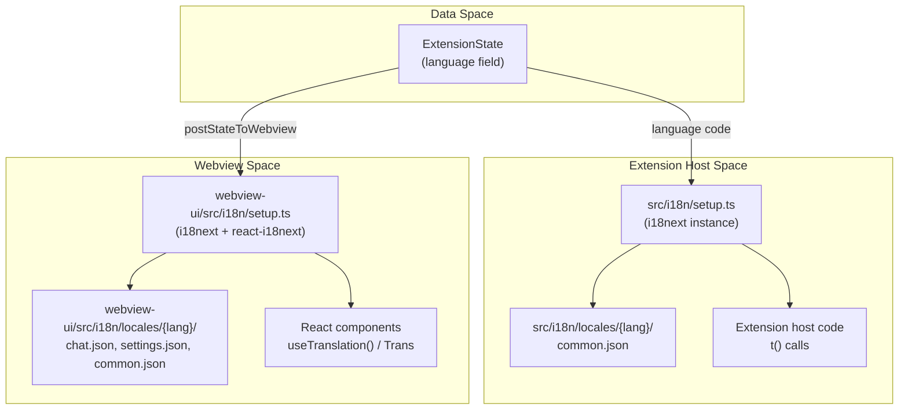
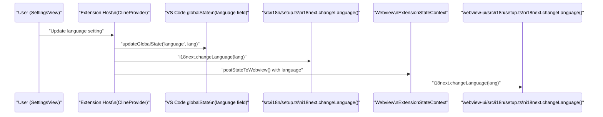
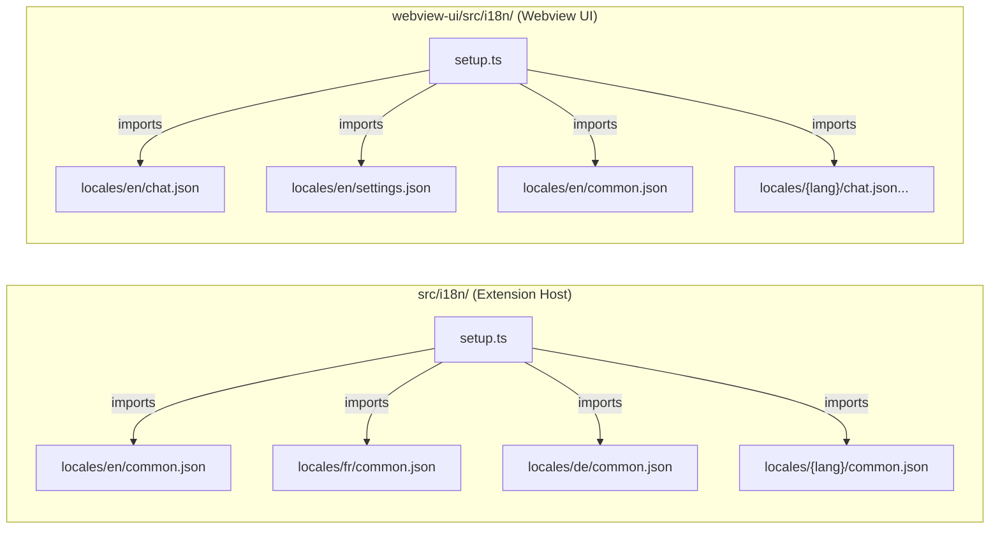

# i18n System Implementation

<details>
<summary>Relevant source files</summary>

The following files were used as context for generating this wiki page:

- [src/i18n/locales/ca/common.json](src/i18n/locales/ca/common.json)
- [src/i18n/locales/de/common.json](src/i18n/locales/de/common.json)
- [src/i18n/locales/fr/common.json](src/i18n/locales/fr/common.json)
- [src/i18n/locales/hi/common.json](src/i18n/locales/hi/common.json)
- [src/i18n/locales/it/common.json](src/i18n/locales/it/common.json)
- [src/i18n/locales/ja/common.json](src/i18n/locales/ja/common.json)
- [src/i18n/locales/ko/common.json](src/i18n/locales/ko/common.json)
- [src/i18n/locales/pl/common.json](src/i18n/locales/pl/common.json)
- [src/i18n/locales/pt-BR/common.json](src/i18n/locales/pt-BR/common.json)
- [src/i18n/locales/tr/common.json](src/i18n/locales/tr/common.json)
- [src/i18n/locales/vi/common.json](src/i18n/locales/vi/common.json)
- [src/package.nls.ca.json](src/package.nls.ca.json)
- [src/package.nls.de.json](src/package.nls.de.json)
- [src/package.nls.es.json](src/package.nls.es.json)
- [src/package.nls.fr.json](src/package.nls.fr.json)
- [src/package.nls.hi.json](src/package.nls.hi.json)
- [src/package.nls.it.json](src/package.nls.it.json)
- [src/package.nls.ja.json](src/package.nls.ja.json)
- [src/package.nls.ko.json](src/package.nls.ko.json)
- [src/package.nls.nl.json](src/package.nls.nl.json)
- [src/package.nls.pl.json](src/package.nls.pl.json)
- [src/package.nls.pt-BR.json](src/package.nls.pt-BR.json)
- [webview-ui/src/i18n/locales/ca/common.json](webview-ui/src/i18n/locales/ca/common.json)
- [webview-ui/src/i18n/locales/de/common.json](webview-ui/src/i18n/locales/de/common.json)
- [webview-ui/src/i18n/locales/es/common.json](webview-ui/src/i18n/locales/es/common.json)
- [webview-ui/src/i18n/locales/fr/common.json](webview-ui/src/i18n/locales/fr/common.json)
- [webview-ui/src/i18n/locales/hi/common.json](webview-ui/src/i18n/locales/hi/common.json)
- [webview-ui/src/i18n/locales/it/common.json](webview-ui/src/i18n/locales/it/common.json)
- [webview-ui/src/i18n/locales/ja/common.json](webview-ui/src/i18n/locales/ja/common.json)
- [webview-ui/src/i18n/locales/ko/common.json](webview-ui/src/i18n/locales/ko/common.json)
- [webview-ui/src/i18n/locales/pl/common.json](webview-ui/src/i18n/locales/pl/common.json)
- [webview-ui/src/i18n/locales/pt-BR/common.json](webview-ui/src/i18n/locales/pt-BR/common.json)
- [webview-ui/src/i18n/locales/tr/common.json](webview-ui/src/i18n/locales/tr/common.json)

</details>


This page documents the technical implementation of internationalization (i18n) in Roo Code: the i18next library setup, locale file loading, translation function usage, and how the language selection from extension state propagates through the system.

For information on the locale JSON file contents and supported language coverage, see [UI String Localization (13.2)](). For documentation-level localization (README files), see [Documentation Localization (13.1)]().

---

## System Overview

Roo Code maintains **two separate i18n instances**, one for each runtime context:

| Context | Root Directory | Library | Namespaces |
|---|---|---|---|
| Extension host | `src/i18n/` | `i18next` | `common` |
| Webview UI | `webview-ui/src/i18n/` | `i18next` + `react-i18next` | `chat`, `settings`, `common` |

These run in separate processes and are initialized independently. Both are configured from the same user language setting stored in extension state.

**Two i18n System Contexts**



Sources: [src/i18n/locales/fr/common.json:1-10](), [src/i18n/locales/it/common.json:1-10]()

---

## Extension Host i18n

### Initialization (`initializeI18n`)

The extension host i18n system is initialized during the `activate` sequence in `src/extension.ts`. The `initializeI18n` function is called with the language preference retrieved from `globalState` or detected from the VS Code environment via `vscode.env.language`.

- **Call Site**: `initializeI18n(context.globalState.get("language") ?? formatLanguage(vscode.env.language))` [src/extension.ts:152-153]()
- **Language Detection**: The `formatLanguage` utility ensures the VS Code environment language code is compatible with the extension's locale folder structure [src/extension.ts:30]().

### Setup (`src/i18n/setup.ts`)

The extension host initializes a dedicated i18next instance. The setup file imports locale JSON files for all supported languages and registers them under the `common` namespace.

The initialization call configures:
- `lng` — set from the language value in extension global state.
- `fallbackLng` — defaults to `"en"`.
- `resources` — all locale bundles loaded statically.
- `interpolation.escapeValue: false` — safe because strings are not rendered in HTML in this context.

### Locale File Location

Each language has one file in the core extension:

```
src/i18n/locales/
├── en/common.json
├── fr/common.json
├── de/common.json
├── ja/common.json
├── ko/common.json
├── zh-CN/common.json
├── zh-TW/common.json
├── pt-BR/common.json
├── pl/common.json
├── hi/common.json
├── tr/common.json
└── ...
```

Sources: [src/i18n/locales/fr/common.json:1-35](), [src/i18n/locales/de/common.json:1-20](), [src/i18n/locales/ko/common.json:1-20]()

### `common` Namespace Key Groups

The `common.json` file for each language is organized into functional key groups used by the extension host for system messages, errors, and confirmations.

| Key group | Example keys | Purpose |
|---|---|---|
| `extension` | `name`, `description` | Extension metadata [src/i18n/locales/fr/common.json:2-5]() |
| `number_format` | `thousand_suffix`, `million_suffix` | Locale-specific number abbreviations [src/i18n/locales/fr/common.json:6-10]() |
| `confirmation` | `reset_state`, `delete_config_profile` | Confirmation dialog text [src/i18n/locales/fr/common.json:17-21]() |
| `errors` | `invalid_data_uri`, `checkpoint_failed` | Extension-level error messages [src/i18n/locales/fr/common.json:22-30]() |
| `input` | `task_prompt`, `task_placeholder` | Input field labels [src/i18n/locales/pt-BR/common.json:2-5]() |
| `items` | `zero`, `one`, `other` | Plural form example strings [src/i18n/locales/fr/common.json:12-16]() |

Sources: [src/i18n/locales/fr/common.json:1-35](), [src/i18n/locales/pt-BR/common.json:1-20]()

---

## Webview UI i18n

### Setup (`webview-ui/src/i18n/setup.ts`)

The webview initializes its own i18next instance during React app bootstrap. It uses `react-i18next` for component-level integration. The `TranslationProvider` wraps the application in `webview-ui/src/App.tsx` to provide translation context to all components.

- **Provider**: `TranslationProvider` [webview-ui/src/App.tsx:7]()
- **Hook**: `useAppTranslation` is the standard way to access `t` in the UI [webview-ui/src/components/chat/Announcement.tsx:25]()

Key configuration:
- `lng` — sourced from `ExtensionStateContext` (synchronized from extension state via `postStateToWebview`).
- `fallbackLng: "en"`.
- Namespaces: `chat`, `settings`, `common`.

### Locale File Structure

Each supported language has multiple namespace files in the webview project:

```
webview-ui/src/i18n/locales/
├── en/
│   ├── chat.json
│   ├── settings.json
│   └── common.json
├── fr/
│   ├── chat.json
│   ├── settings.json
│   └── common.json
└── ...
```

Sources: [webview-ui/src/App.tsx:7](), [webview-ui/src/components/chat/Announcement.tsx:7]()

### UI Component Localization

UI strings in the webview are often organized by functional area, such as Mermaid diagram controls or file error handling.

| Key group | Example keys | Purpose |
|---|---|---|
| `mermaid` | `loading`, `render_error`, `zoom` | Controls for Mermaid diagram rendering [webview-ui/src/i18n/locales/it/common.json:26-38]() |
| `file.errors` | `pathNotExists`, `couldNotOpen` | File system operation feedback [webview-ui/src/i18n/locales/it/common.json:58-65]() |
| `confirmation` | `deleteWarning`, `restoreToCheckpoint` | Chat interaction confirmations [webview-ui/src/i18n/locales/it/common.json:70-82]() |
| `time_ago` | `seconds_ago`, `minutes_ago` | Relative time formatting [webview-ui/src/i18n/locales/it/common.json:83-98]() |

Sources: [webview-ui/src/i18n/locales/it/common.json:22-114]()

---

## Interpolation and Plural Forms

Both i18n instances use standard i18next syntax for dynamic content.

### Variable Interpolation

Double-brace syntax: `{{variable}}`. Examples from locale files:

```json
"welcome": "Bienvenue, {{name}} ! Vous avez {{count}} notification(s).",
"command_timeout": "L'exécution de la commande a expiré après {{seconds}} secondes",
"url_fetch_failed": "Échec de récupération du contenu de l'URL : {{error}}"
```

Sources: [src/i18n/locales/fr/common.json:11](), [src/i18n/locales/fr/common.json:72](), [src/i18n/locales/fr/common.json:74]()

### Plural Forms

The extension host `common.json` uses nested objects for plurals, allowing different strings based on the `count` variable:

```json
"items": {
  "zero": "Aucun élément",
  "one": "Un élément",
  "other": "{{count}} éléments"
}
```

Sources: [src/i18n/locales/fr/common.json:13-16]()

### Trans Component (Webview Only)

Some strings contain inline component placeholders for `react-i18next`'s `<Trans>` component. These are used in the UI for complex translations involving links or specific formatting.

```tsx
<Trans 
  i18nKey="chat:announcement.support" 
  components={{ githubLink: <GitHubLink /> }} 
/>
```

Sources: [webview-ui/src/components/chat/Announcement.tsx:73](), [webview-ui/src/components/chat/Announcement.tsx:78-84]()

---

## Language Setting and Propagation

The user's language preference is a critical piece of state that must be synchronized between the Extension Host and the Webview.

**Language setting data flow**



Sources: [src/extension.ts:152-153](), [webview-ui/src/App.tsx:181-184]()

---

## File and Module Map

**i18n module locations and relationships**



Sources: [src/i18n/locales/fr/common.json:1-5](), [src/i18n/locales/de/common.json:1-5](), [src/i18n/locales/it/common.json:1-5]()

---

## Supported Languages

Both the extension host and webview locales cover the same set of languages. Additionally, VS Code specific translations for the `package.json` (menus, commands) are stored in `package.nls.{lang}.json` files.

| Language | Code | Common (ext) | Package NLS |
|---|---|---|---|
| English | `en` | ✓ | ✓ |
| French | `fr` | ✓ [src/i18n/locales/fr/common.json:1-5]() | ✓ [src/package.nls.fr.json]() |
| German | `de` | ✓ [src/i18n/locales/de/common.json:1-5]() | ✓ [src/package.nls.de.json]() |
| Japanese | `ja` | ✓ [src/i18n/locales/ja/common.json:1-5]() | ✓ [src/package.nls.ja.json]() |
| Korean | `ko` | ✓ [src/i18n/locales/ko/common.json:1-5]() | ✓ [src/package.nls.ko.json]() |
| Portuguese (Brazil) | `pt-BR` | ✓ [src/i18n/locales/pt-BR/common.json:1-5]() | ✓ [src/package.nls.pt-BR.json]() |
| Hindi | `hi` | ✓ [src/i18n/locales/hi/common.json:1-5]() | ✓ [src/package.nls.hi.json]() |
| Spanish | `es` | ✓ | ✓ [src/package.nls.es.json]() |
| Polish | `pl` | ✓ [src/i18n/locales/pl/common.json:1-5]() | ✓ [src/package.nls.pl.json]() |
| Turkish | `tr` | ✓ [src/i18n/locales/tr/common.json:1-5]() | ✓ |
| Vietnamese | `vi` | ✓ [src/i18n/locales/vi/common.json:1-5]() | ✓ |
| Italian | `it` | ✓ [src/i18n/locales/it/common.json:1-5]() | ✓ [src/package.nls.it.json]() |
| Catalan | `ca` | ✓ [src/i18n/locales/ca/common.json:1-5]() | ✓ [src/package.nls.ca.json]() |

Sources: [src/i18n/locales/fr/common.json:1-2](), [src/i18n/locales/de/common.json:1-2](), [src/i18n/locales/pt-BR/common.json:1-2](), [src/i18n/locales/ja/common.json:1-2](), [src/i18n/locales/ko/common.json:1-2]()