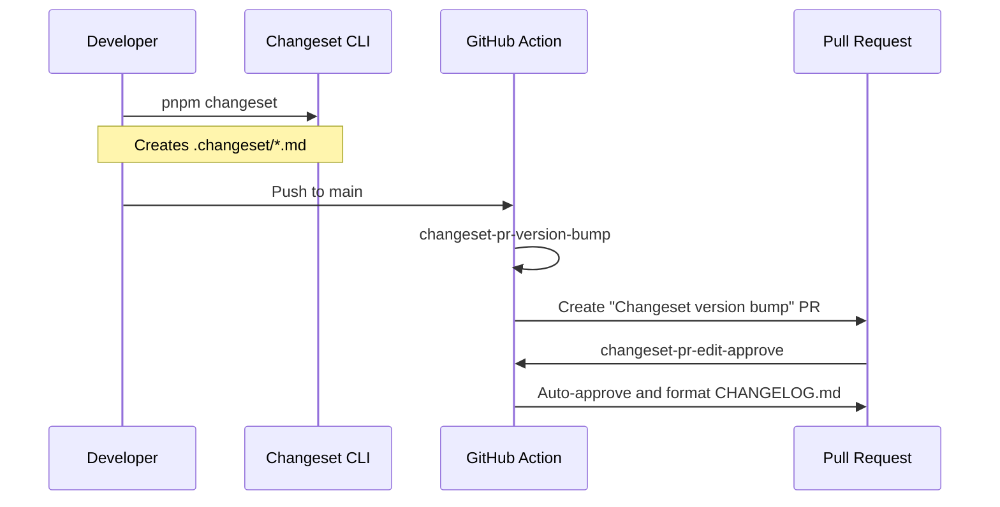
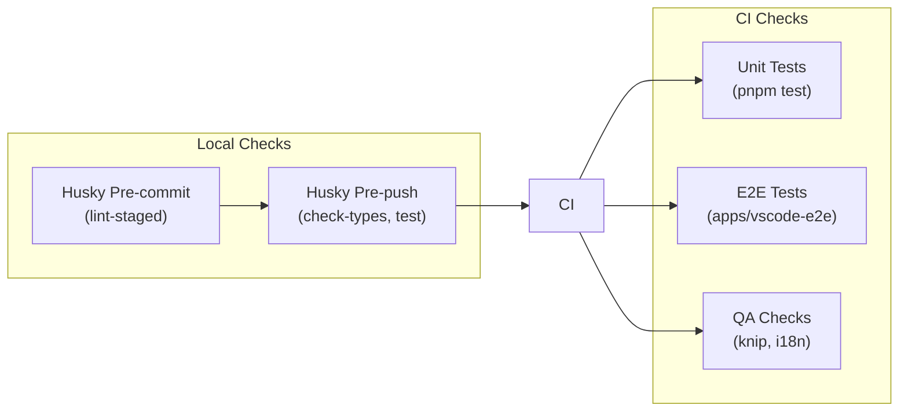

# Development and Deployment

<details>
<summary>Relevant source files</summary>

The following files were used as context for generating this wiki page:

- [.changeset/README.md](.changeset/README.md)
- [.changeset/changelog-config.js](.changeset/changelog-config.js)
- [.changeset/config.json](.changeset/config.json)
- [.github/actions/setup-node-pnpm/action.yml](.github/actions/setup-node-pnpm/action.yml)
- [.github/actions/slack-notify/action.yml](.github/actions/slack-notify/action.yml)
- [.github/workflows/changeset-release.yml](.github/workflows/changeset-release.yml)
- [.github/workflows/code-qa.yml](.github/workflows/code-qa.yml)
- [.github/workflows/marketplace-publish.yml](.github/workflows/marketplace-publish.yml)
- [.github/workflows/nightly-publish.yml](.github/workflows/nightly-publish.yml)
- [.github/workflows/update-contributors.yml](.github/workflows/update-contributors.yml)
- [.gitignore](.gitignore)
- [.husky/pre-commit](.husky/pre-commit)
- [.husky/pre-push](.husky/pre-push)
- [.nvmrc](.nvmrc)
- [.tool-versions](.tool-versions)
- [.vscode/launch.json](.vscode/launch.json)
- [.vscode/tasks.json](.vscode/tasks.json)
- [apps/vscode-e2e/src/runTest.ts](apps/vscode-e2e/src/runTest.ts)
- [apps/vscode-nightly/esbuild.mjs](apps/vscode-nightly/esbuild.mjs)
- [apps/vscode-nightly/package.nightly.json](apps/vscode-nightly/package.nightly.json)
- [apps/vscode-nightly/turbo.json](apps/vscode-nightly/turbo.json)
- [apps/web-evals/next.config.ts](apps/web-evals/next.config.ts)
- [apps/web-evals/turbo.json](apps/web-evals/turbo.json)
- [apps/web-roo-code/turbo.json](apps/web-roo-code/turbo.json)
- [knip.json](knip.json)
- [scripts/find-missing-translations.js](scripts/find-missing-translations.js)
- [src/esbuild.mjs](src/esbuild.mjs)

</details>


This page documents the local development workflow, build system architecture, and deployment processes for Roo Code. It covers setting up a development environment, understanding the monorepo build pipeline, configuring the webview, packaging the extension as VSIX, and running tests.

For information about the extension's runtime architecture and activation, see [Extension Activation and Lifecycle](#2.1). For webview-specific UI development patterns, see [Webview UI Architecture](#3.3).

---

## Purpose and Scope

This documentation provides a comprehensive guide to developing and deploying the Roo Code extension. It covers:

- Setting up a local development environment with hot reload and F5 debugging.
- Understanding the pnpm workspace and Turbo build orchestration across multiple apps and packages.
- Configuring Vite for webview compilation and integration with VS Code's theme system.
- Building and installing VSIX packages for local testing and production distribution.
- Running unit, integration, and E2E tests using Vitest and Playwright/VS Code Test Electron.

---

## Local Development Setup

### Repository Structure

The Roo Code repository is organized as a pnpm workspace monorepo, managing multiple applications and shared packages.

```mermaid
graph TB
    Root["Root<br/>(pnpm workspace)"]
    
    subgraph "Applications"
        CLI["apps/cli<br/>(Standalone CLI)"]
        E2E["apps/vscode-e2e<br/>(E2E tests)"]
        Nightly["apps/vscode-nightly<br/>(Nightly build config)"]
        WebEvals["apps/web-evals<br/>(Evals dashboard)"]
        WebRoo["apps/web-roo-code<br/>(Web version)"]
    end
    
    subgraph "Packages"
        Build["packages/build<br/>(Shared build logic)"]
        Core["packages/core<br/>(Core agent logic)"]
        Types["packages/types<br/>(Shared TS types)"]
        VSCodeShim["packages/vscode-shim<br/>(Headless shim)"]
    end
    
    subgraph "Extension Source"
        Src["src<br/>(Extension host code)"]
        WebviewUI["webview-ui<br/>(React UI)"]
    end
    
    Root --> CLI
    Root --> E2E
    Root --> Nightly
    Root --> WebEvals
    Root --> WebRoo
    Root --> Build
    Root --> Core
    Root --> Types
    Root --> VSCodeShim
    Root --> Src
    Root --> WebviewUI
```



**Sources:** [apps/vscode-nightly/esbuild.mjs:6-45](), [apps/web-evals/next.config.ts:1-5](), [apps/web-roo-code/turbo.json:1-10](), [.gitignore:1-58]()

### Initial Setup

Clone the repository and install dependencies using pnpm. The project requires Node.js (version specified in `.nvmrc`) and pnpm.

```bash
git clone https://github.com/RooCodeInc/Roo-Code.git
cd Roo-Code
pnpm install
```

Development is typically performed using the `watch` task in VS Code, which orchestrates three concurrent processes: `watch:webview` (Vite), `watch:bundle` (Turbo/esbuild), and `watch:tsc` (TypeScript type checking) [.vscode/tasks.json:5-16]().

For details, see [Local Development Setup](#14.1).

---

## Build System and Monorepo Management

### Workspace and Turbo Orchestration

The repository uses `pnpm` workspaces for dependency management and `turbo` for high-performance task execution. Tasks like `watch:bundle` and `watch:tsc` are delegated to Turbo to handle package interdependencies efficiently [.vscode/tasks.json:40-72]().

### Versioning with Changesets

Roo Code uses `changesets` for version management and automated changelog generation. The `Changeset Release` workflow handles creating version bump PRs and updating the `CHANGELOG.md` [.github/workflows/changeset-release.yml:1-54]().



**Sources:** [.github/workflows/changeset-release.yml:15-54](), [.changeset/config.json:1-12](), [.changeset/changelog-config.js:1-18]()

For details, see [Build System and Monorepo Management](#14.2).

---

## Webview Build Pipeline

The webview UI is a React application located in `webview-ui/`, built using Vite.

### Build Artifacts and Assets

The build pipeline ensures that the React application is compiled into the `extension/webview-ui/build` directory, while assets like audio files (`celebration.wav`) and icons are correctly positioned for the extension to load them via `WebviewViewProvider` [.github/workflows/marketplace-publish.yml:46-49]().

### Nightly Customization

The `vscode-nightly` app provides a specialized build script that overrides the standard `package.json` with `package.nightly.json` and injects the current Git SHA into the environment variables `process.env.PKG_SHA` [apps/vscode-nightly/esbuild.mjs:17-40]().

For details, see [Webview Build Pipeline](#14.3).

---

## VSIX Packaging and Distribution

### Packaging Workflow

The extension is packaged into a `.vsix` file using the `pnpm vsix` command. The `Publish Extension` workflow verifies the integrity of the VSIX by checking for critical files like `extension.js`, `package.nls.json`, and `.env` before publishing [.github/workflows/marketplace-publish.yml:34-53]().

### Distribution Channels

- **VS Code Marketplace:** Published using `vsce publish` [.github/workflows/marketplace-publish.yml:60-67]().
- **Open VSX Registry:** Published using `ovsx publish` [.github/workflows/nightly-publish.yml:49-52]().
- **GitHub Releases:** Automated creation of releases with attached VSIX artifacts and changelog notes [.github/workflows/marketplace-publish.yml:68-92]().

For details, see [VSIX Packaging and Distribution](#14.4).

---

## Testing Infrastructure

### Quality Assurance (QA)

The `Code QA` workflow runs several static analysis tools:
- **knip:** Detects unused files, dependencies, and exports [.github/workflows/code-qa.yml:22-30]().
- **Translation Check:** Ensures all i18n keys are present in localized files using `scripts/find-missing-translations.js` [.github/workflows/code-qa.yml:12-20]().
- **Linting & Type-checking:** Standard `pnpm lint` and `pnpm check-types` [.github/workflows/code-qa.yml:32-43]().

### Test Execution

Roo Code employs a multi-platform testing strategy, running unit tests on both `ubuntu-latest` and `windows-latest` [.github/workflows/code-qa.yml:44-53]().



**Sources:** [.husky/pre-commit:1-28](), [.husky/pre-push:1-32](), [.github/workflows/code-qa.yml:1-61]()

For details, see [Testing Infrastructure](#14.5).