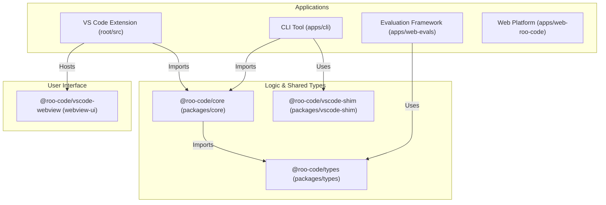
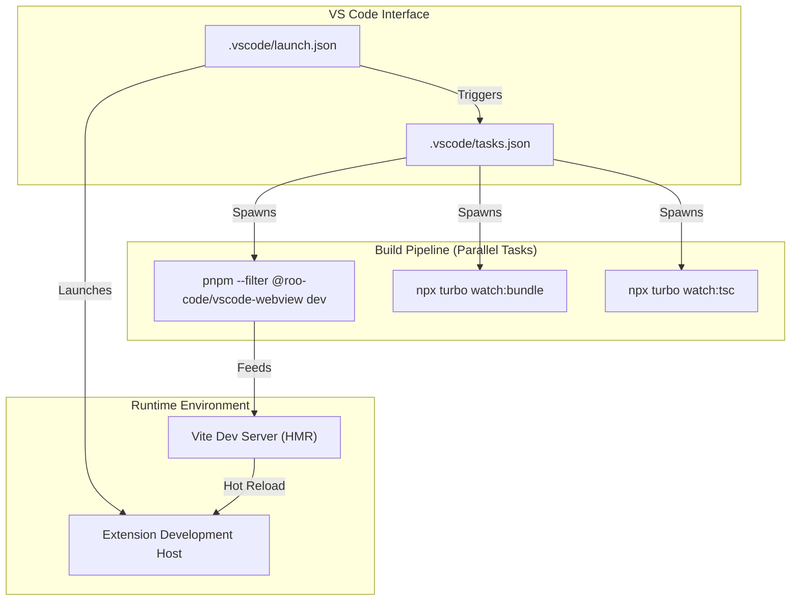

# Local Development Setup

<details>
<summary>Relevant source files</summary>

The following files were used as context for generating this wiki page:

- [.git-blame-ignore-revs](.git-blame-ignore-revs)
- [.gitconfig](.gitconfig)
- [.github/ISSUE_TEMPLATE/bug_report.yml](.github/ISSUE_TEMPLATE/bug_report.yml)
- [.github/ISSUE_TEMPLATE/config.yml](.github/ISSUE_TEMPLATE/config.yml)
- [.github/ISSUE_TEMPLATE/feature_request.yml](.github/ISSUE_TEMPLATE/feature_request.yml)
- [.github/pull_request_template.md](.github/pull_request_template.md)
- [.gitignore](.gitignore)
- [.husky/pre-commit](.husky/pre-commit)
- [.husky/pre-push](.husky/pre-push)
- [.vscode/launch.json](.vscode/launch.json)
- [.vscode/tasks.json](.vscode/tasks.json)
- [CODE_OF_CONDUCT.md](CODE_OF_CONDUCT.md)
- [CONTRIBUTING.md](CONTRIBUTING.md)
- [README.md](README.md)
- [apps/web-roo-code/src/components/homepage/option-overview-section.tsx](apps/web-roo-code/src/components/homepage/option-overview-section.tsx)
- [packages/evals/ADDING-EVALS.md](packages/evals/ADDING-EVALS.md)

</details>


This document provides technical instructions for setting up Roo Code for local development. It covers the monorepo structure, dependency management, and the integrated debugging workflow using VS Code's extension development host.

---

## Prerequisites

Development requires the following toolchain:

| Tool | Requirement | Purpose |
|------|-------------|---------|
| **Node.js** | v18.x+ | Runtime for the extension and build scripts |
| **pnpm** | v9.0+ | Monorepo package management and workspace linking [[pnpm-lock.yaml:1-1]()] |
| **Git** | Latest | Version control and sub-module management |
| **VS Code** | Latest | Primary IDE for development and F5 debugging |

Sources: [README.md:94-106](), [pnpm-lock.yaml:1-1]()

---

## Repository Setup

### Cloning and Installation

The project is a monorepo. Use `pnpm` to ensure workspace dependencies are correctly symlinked.

```bash
# Clone the repository
git clone https://github.com/RooCodeInc/Roo-Code.git
cd Roo-Code

# Install all workspace dependencies
pnpm install
```

The `pnpm install` command triggers a recursive installation across all packages in the workspace, including `@roo-code/types`, `@roo-code/core`, and the VS Code extension root [[pnpm-lock.yaml:19-97]()].

### Monorepo Structure

The codebase is organized into logic packages and application entry points.

**System Component to Code Entity Map**



Sources: [pnpm-lock.yaml:84-230](), [README.md:12-68]()

---

## Development Workflow

### F5 Debugging with Hot Reload

The primary development method uses VS Code's `extensionHost` launcher. This setup allows for simultaneous debugging of the extension backend (Node.js) and the webview frontend (React).

**Debug Architecture and Task Flow**



**Execution Details:**
1. **Launch Configuration**: The `Run Extension` config in `.vscode/launch.json` sets `VSCODE_DEBUG_MODE` to `true` and points to the compiled output in `src/dist/**/*.js` [[.vscode/launch.json:8-27]()].
2. **Pre-launch Tasks**: It depends on the `watch` task in `.vscode/tasks.json`, which orchestrates parallel build watchers [[.vscode/tasks.json:7-16]()]:
    - `watch:webview`: Starts the Vite development server for the React UI [[.vscode/tasks.json:18-38]()].
    - `watch:bundle`: Uses `turbo` to run `esbuild` on the extension source, watching for changes in logic [[.vscode/tasks.json:40-60]()].
    - `watch:tsc`: Runs the TypeScript compiler in watch mode to catch type errors across the monorepo [[.vscode/tasks.json:62-72]()].

Sources: [.vscode/launch.json:1-30](), [.vscode/tasks.json:1-74](), [README.md:113-121]()

---

## Environment and Safety

### Git Hooks and Quality Control

The repository uses Husky to enforce code quality before code reaches the remote.

- **Pre-commit**: Runs `lint-staged` and `pnpm lint` to ensure style consistency [[.husky/pre-commit:26-27]()]. It also prevents direct commits to the `main` branch [[.husky/pre-commit:3-6]()].
- **Pre-push**: Runs `pnpm run check-types` and, if configured via `RUN_TESTS_ON_PUSH` in `.env.local`, executes the test suite [[.husky/pre-push:19-32]()]. It also checks for the presence of a `changeset` for version tracking [[.husky/pre-push:35-42]()].

### Configuration Files

- **.env**: Local environment variables for API keys or feature flags should be placed here. This file is ignored by Git [[.gitignore:31-33]()].
- **.vite-port**: Vite writes the current webview dev server port to this file, allowing the extension to dynamically connect to the HMR server [[.gitignore:40-40]()].

Sources: [.husky/pre-commit:1-28](), [.husky/pre-push:1-43](), [.gitignore:1-58]()

---

## Alternative Installation Methods

### Automated VSIX Build

To test the extension as a production package in different editors (VS Code, Cursor, etc.):

```bash
pnpm install:vsix [-y] [--editor=<command>]
```

This script automates the process of:
1. Uninstalling existing versions of the extension [[README.md:133-133]()].
2. Building a fresh `.vsix` package [[README.md:134-134]()].
3. Installing the package into the target editor [[README.md:135-135]()].

Sources: [README.md:122-142]()

---

## Troubleshooting

| Symptom | Cause | Resolution |
|---------|-------|------------|
| `Push to main blocked` | Husky `pre-push` check | Create a feature branch; direct pushes to `main` are restricted [[.husky/pre-push:3-6]()]. |
| `Changeset missing` | Versioning requirement | Run `pnpm changeset` to document your changes for the release notes [[.husky/pre-push:38-42]()]. |
| Extension not updating | `watch:bundle` failure | Check the terminal output for `esbuild` errors in the `watch:bundle` task [[.vscode/tasks.json:40-60]()]. |

Sources: [.husky/pre-push:1-43](), [.vscode/tasks.json:40-60]()