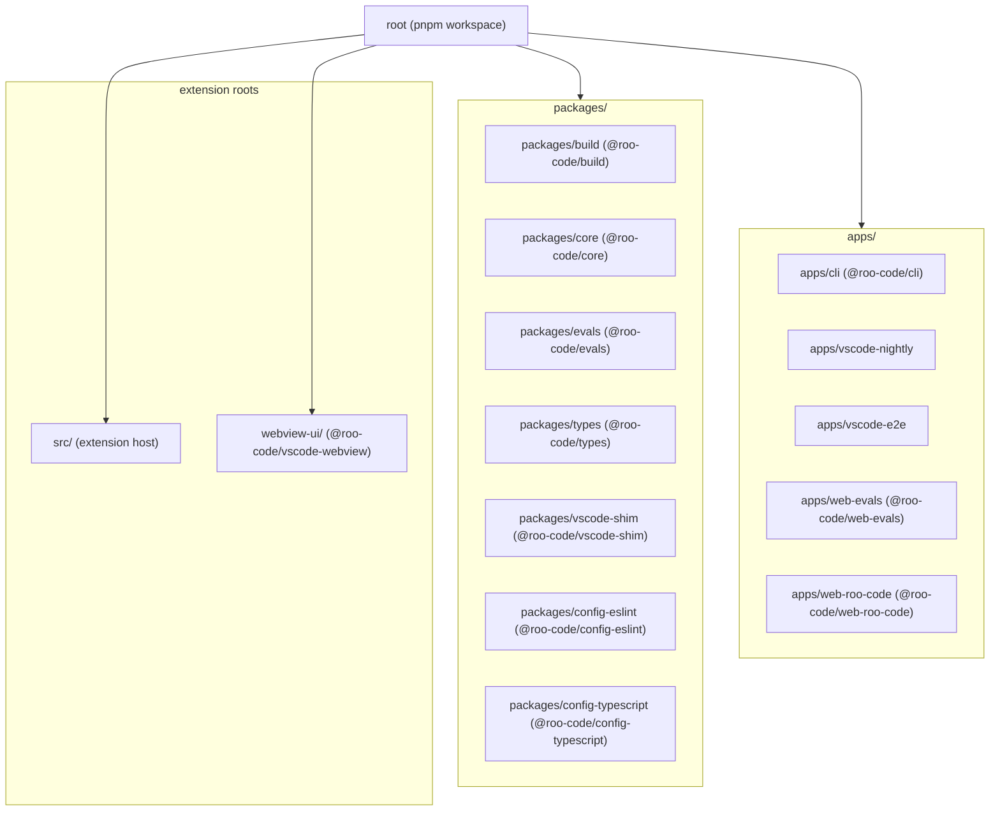
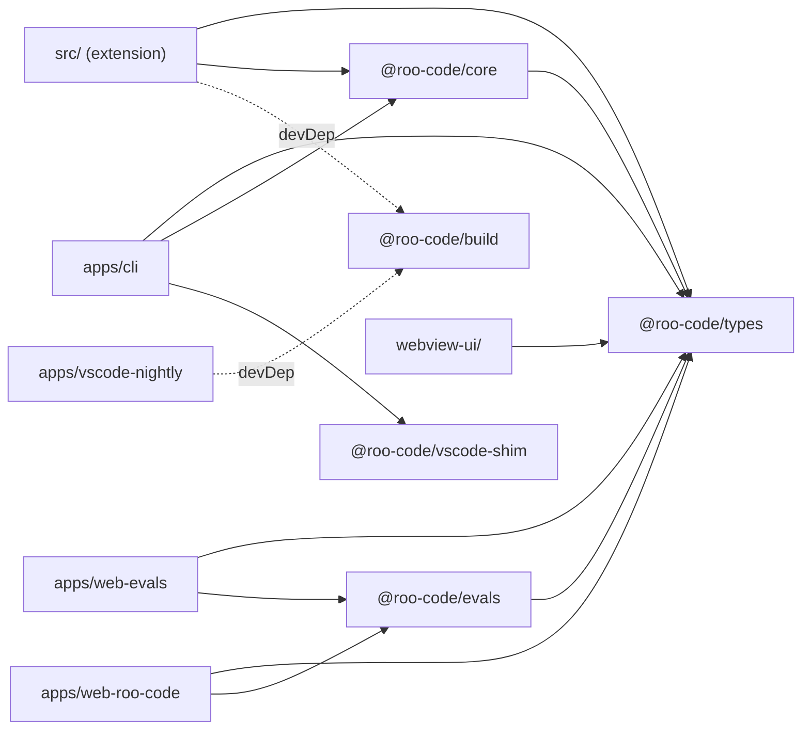
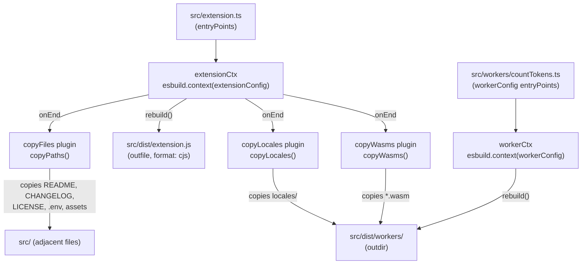
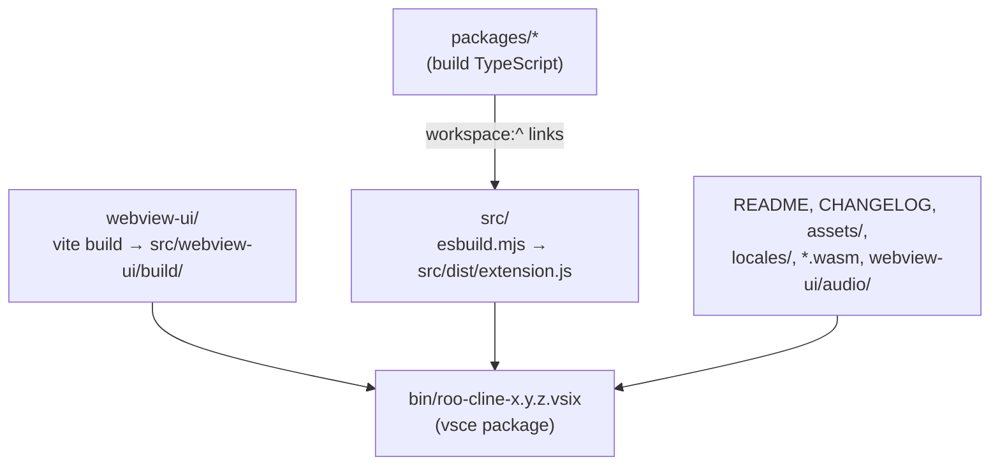

# Build System and Monorepo Management

Relevant source files

The following files were used as context for generating this wiki page:

- [.changeset/README.md](.changeset/README.md)
- [.changeset/changelog-config.js](.changeset/changelog-config.js)
- [.changeset/config.json](.changeset/config.json)
- [.github/actions/setup-node-pnpm/action.yml](.github/actions/setup-node-pnpm/action.yml)
- [.github/actions/slack-notify/action.yml](.github/actions/slack-notify/action.yml)
- [.github/workflows/changeset-release.yml](.github/workflows/changeset-release.yml)
- [.github/workflows/code-qa.yml](.github/workflows/code-qa.yml)
- [.github/workflows/marketplace-publish.yml](.github/workflows/marketplace-publish.yml)
- [.github/workflows/nightly-publish.yml](.github/workflows/nightly-publish.yml)
- [.github/workflows/update-contributors.yml](.github/workflows/update-contributors.yml)
- [.nvmrc](.nvmrc)
- [.tool-versions](.tool-versions)
- [CHANGELOG.md](CHANGELOG.md)
- [apps/vscode-e2e/src/runTest.ts](apps/vscode-e2e/src/runTest.ts)
- [apps/vscode-nightly/esbuild.mjs](apps/vscode-nightly/esbuild.mjs)
- [apps/vscode-nightly/package.nightly.json](apps/vscode-nightly/package.nightly.json)
- [apps/vscode-nightly/turbo.json](apps/vscode-nightly/turbo.json)
- [apps/web-evals/next.config.ts](apps/web-evals/next.config.ts)
- [apps/web-evals/package.json](apps/web-evals/package.json)
- [apps/web-evals/turbo.json](apps/web-evals/turbo.json)
- [apps/web-roo-code/package.json](apps/web-roo-code/package.json)
- [apps/web-roo-code/src/components/ui/navigation-menu.tsx](apps/web-roo-code/src/components/ui/navigation-menu.tsx)
- [apps/web-roo-code/turbo.json](apps/web-roo-code/turbo.json)
- [knip.json](knip.json)
- [package.json](package.json)
- [packages/build/tsconfig.json](packages/build/tsconfig.json)
- [pnpm-lock.yaml](pnpm-lock.yaml)
- [scripts/find-missing-translations.js](scripts/find-missing-translations.js)
- [src/esbuild.mjs](src/esbuild.mjs)
- [src/extension.ts](src/extension.ts)
- [src/package.json](src/package.json)
- [webview-ui/package.json](webview-ui/package.json)
- [webview-ui/src/components/common/MermaidBlock.tsx](webview-ui/src/components/common/MermaidBlock.tsx)
- [webview-ui/src/index.tsx](webview-ui/src/index.tsx)
- [webview-ui/tsconfig.json](webview-ui/tsconfig.json)
- [webview-ui/vite.config.ts](webview-ui/vite.config.ts)

This page covers the pnpm workspace layout, Turborepo task orchestration, the esbuild-based extension bundler, and how internal packages are built and linked together. For the webview-specific Vite build pipeline, see [14.3](). For VSIX packaging and CI/CD publishing workflows, see [14.4]().

---

## Monorepo Layout

The repository is a pnpm workspace containing applications (`apps/`), shared libraries (`packages/`), and two special roots: `src/` (the VS Code extension host code) and `webview-ui/` (the React webview).

**Monorepo Workspace Structure**

Sources: [pnpm-lock.yaml:19-215](), [apps/cli/package.json:2-2](), [webview-ui/package.json:2-2](), [apps/web-roo-code/package.json:2-2]()

---

## pnpm Workspace Configuration

All workspaces are declared in the root configuration. pnpm resolves `workspace:^` version specifiers to local symlinks at install time, so changes in one package are immediately visible to dependents without a publish step.

The lock file enforces several global dependency overrides to ensure version consistency across the monorepo:

| Override | Pinned version |
|---|---|
| `esbuild` | `>=0.25.0` |
| `zod` | `3.25.76` |
| `@types/react` | `^18.3.23` |
| `@types/react-dom` | `^18.3.5` |
| `tar-fs` | `>=3.1.1` |
| `undici` | `>=5.29.0` |
| `glob` | `>=11.1.0` |

These overrides prevent version conflicts across the workspace by hoisting a single resolution [pnpm-lock.yaml:7-17](). CI environments use the `setup-node-pnpm` action to ensure consistent environments [.github/actions/setup-node-pnpm/action.yml:1-1]().

Sources: [pnpm-lock.yaml:1-18](), [pnpm-lock.yaml:29-31](), [pnpm-lock.yaml:41-43](), [package.json:57-73]()

---

## Package Dependency Graph

**Internal `workspace:^` dependencies**

Sources: [apps/cli/package.json:89-97](), [webview-ui/package.json:33-33](), [apps/web-evals/package.json:29-30](), [apps/web-roo-code/package.json:20-21](), [apps/vscode-nightly/package.nightly.json:1-6](), [pnpm-lock.yaml:84-156]()

---

## Turborepo Task Orchestration

Turborepo (`turbo` v2.5.6) orchestrates build tasks across the workspace in dependency order, caching outputs and skipping unchanged packages [package.json:49-49]().

**Build task chain examples**:

- **Webview Pre-test**: The webview runs `turbo run bundle --cwd ..` before testing to ensure dependencies are available [webview-ui/package.json:8-8]().
- **Global Build**: The root `build` script executes `turbo build` across all packages [package.json:16-16]().
- **VSIX Generation**: The `vsix` script triggers a workspace-wide bundled build before packaging [package.json:19-19]().

Key scripts from the root and apps:

| pnpm script | Location | Purpose |
|---|---|---|
| `pnpm lint` | root | ESLint across all workspaces via Turbo [package.json:12-12]() |
| `pnpm check-types` | root | TypeScript type checking across the monorepo [package.json:13-13]() |
| `pnpm build` | webview-ui | Vite-based build for the React UI [webview-ui/package.json:12-12]() |
| `pnpm vsix` | root | Packages the extension into a VSIX file [package.json:19-19]() |
| `pnpm evals` | root | Launches the evaluation framework using Docker Compose [package.json:27-27]() |

Sources: [package.json:7-29](), [webview-ui/package.json:5-16](), [apps/web-evals/package.json:5-13](), [apps/web-roo-code/package.json:5-15]()

---

## Extension Host Bundle — `src/esbuild.mjs`

The VS Code extension host is bundled by esbuild into a single CommonJS file [src/package.json:52-52]().

**esbuild build pipeline**

The `vscode` module is excluded from the bundle because it is provided by the VS Code extension host environment at runtime [src/esbuild.mjs:106-106]().

Sources: [src/esbuild.mjs:1-136](), [src/esbuild.mjs:101-106](), [src/esbuild.mjs:114-115]()

---

## Nightly Extension Bundle — `apps/vscode-nightly/esbuild.mjs`

The nightly build uses a specialized esbuild script that leverages the `@roo-code/build` package to customize the extension for the "Nightly" distribution channel.

- **Package Customization**: Reads `package.nightly.json` to override the extension name and version [apps/vscode-nightly/esbuild.mjs:17-19]().
- **Git Metadata**: Calls `getGitSha()` to embed the commit hash into `process.env.PKG_SHA` [apps/vscode-nightly/esbuild.mjs:21-22]().
- **Manifest Generation**: Uses `generatePackageJson` to swap `roo-cline` for `roo-code-nightly` and merge nightly-specific strings [apps/vscode-nightly/esbuild.mjs:83-122]().
- **Environment Defines**: Sets `PKG_OUTPUT_CHANNEL` to `"Roo-Code-Nightly"` for logging differentiation [apps/vscode-nightly/esbuild.mjs:38-38]().

Sources: [apps/vscode-nightly/esbuild.mjs:1-174](), [apps/vscode-nightly/package.nightly.json:1-6]()

---

## Shared Build Package — `@roo-code/build`

`packages/build` exports reusable utilities consumed by build scripts across the monorepo to ensure consistent asset handling and manifest generation.

| Export | Purpose |
|---|---|
| `copyPaths(paths, src, dest)` | Copies files/directories like README, LICENSE, and assets after a build [apps/vscode-nightly/esbuild.mjs:64-78]() |
| `copyWasms(src, dist)` | Finds and copies `.wasm` files (e.g., for token counting) into the distribution folder [apps/vscode-nightly/esbuild.mjs:124-128]() |
| `copyLocales(src, dist)` | Copies the `locales/` directory containing UI translations [apps/vscode-nightly/esbuild.mjs:130-134]() |
| `getGitSha()` | Retrieves the current HEAD SHA via `git rev-parse` [apps/vscode-nightly/esbuild.mjs:6-6]() |
| `generatePackageJson(...)` | Merges base `package.json` with nightly overrides and performs string substitutions [apps/vscode-nightly/esbuild.mjs:88-92]() |

Sources: [apps/vscode-nightly/esbuild.mjs:6-6](), [packages/build/tsconfig.json:1-9](), [src/esbuild.mjs:8-8]()

---

## Changesets for Version Management

The repository uses `@changesets/cli` to manage versioning and changelogs. The release process is automated via GitHub Actions.

- **Changeset CLI**: Installed as a root dev dependency to track changes across the monorepo [package.json:31-31]().
- **Version Bumping**: The root script `changeset:version` copies the root `CHANGELOG.md` to `src/`, runs the changeset versioning, and then restores the root changelog [package.json:25-25]().
- **CI Integration**: The `changeset-release.yml` workflow automates the creation of version bump PRs when changesets are merged to `main` [.github/workflows/changeset-release.yml:15-54]().

Sources: [package.json:25-31](), [CHANGELOG.md:1-19](), [.github/workflows/changeset-release.yml:1-133]()

---

## Complete Build Flow Summary

**From source to VSIX artifact**

The ordering is enforced by dependency constraints: package `build` tasks run first, then the webview `build` and extension `bundle` tasks run, followed by `vsce package` to assemble the VSIX.

Sources: [webview-ui/package.json:12-12](), [apps/vscode-nightly/esbuild.mjs:43-54](), [src/esbuild.mjs:33-40](), [package.json:16-20]()