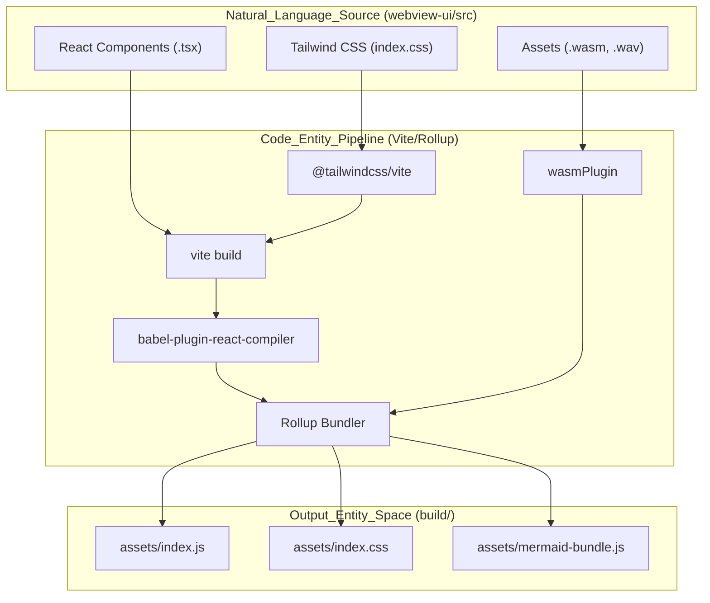
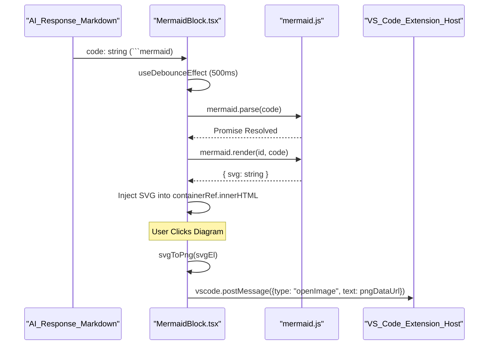

# Webview Build Pipeline

<details>
<summary>Relevant source files</summary>

The following files were used as context for generating this wiki page:

- [CHANGELOG.md](CHANGELOG.md)
- [apps/web-evals/package.json](apps/web-evals/package.json)
- [apps/web-roo-code/package.json](apps/web-roo-code/package.json)
- [apps/web-roo-code/src/components/ui/navigation-menu.tsx](apps/web-roo-code/src/components/ui/navigation-menu.tsx)
- [package.json](package.json)
- [packages/build/tsconfig.json](packages/build/tsconfig.json)
- [pnpm-lock.yaml](pnpm-lock.yaml)
- [src/extension.ts](src/extension.ts)
- [src/package.json](src/package.json)
- [webview-ui/package.json](webview-ui/package.json)
- [webview-ui/src/components/common/MermaidBlock.tsx](webview-ui/src/components/common/MermaidBlock.tsx)
- [webview-ui/src/components/ui/autosize-textarea.tsx](webview-ui/src/components/ui/autosize-textarea.tsx)
- [webview-ui/src/components/ui/button.tsx](webview-ui/src/components/ui/button.tsx)
- [webview-ui/src/components/ui/command.tsx](webview-ui/src/components/ui/command.tsx)
- [webview-ui/src/components/ui/dropdown-menu.tsx](webview-ui/src/components/ui/dropdown-menu.tsx)
- [webview-ui/src/components/ui/popover.tsx](webview-ui/src/components/ui/popover.tsx)
- [webview-ui/src/components/ui/select.tsx](webview-ui/src/components/ui/select.tsx)
- [webview-ui/src/components/ui/textarea.tsx](webview-ui/src/components/ui/textarea.tsx)
- [webview-ui/src/index.css](webview-ui/src/index.css)
- [webview-ui/src/index.tsx](webview-ui/src/index.tsx)
- [webview-ui/tsconfig.json](webview-ui/tsconfig.json)
- [webview-ui/vite.config.ts](webview-ui/vite.config.ts)

</details>


This document describes the build pipeline for the Roo Code webview UI, a React application bundled with Vite. The webview provides the chat interface, settings UI, and specialized views (History, Marketplace, Cloud) that render inside VS Code's webview panels.

---

## Build System Architecture

The webview UI is located in the `webview-ui/` directory and functions as a standalone React project within the monorepo. It uses Vite as its build tool and orchestrator for the frontend asset pipeline.

### Core Build Scripts
The `package.json` defines several key build targets:

| Script | Command | Purpose |
|--------|---------|---------|
| `build` | `tsc -b && vite build` | Standard production build with type checking [webview-ui/package.json:12]() |
| `build:nightly` | `tsc -b && vite build --mode nightly` | Build for the nightly extension version [webview-ui/package.json:13]() |
| `dev` | `vite` | Starts the Vite development server with HMR [webview-ui/package.json:11]() |
| `clean` | `rimraf ../src/webview-ui ...` | Removes previous build artifacts [webview-ui/package.json:15]() |

**Sources:** [webview-ui/package.json:5-16]()

### Data Flow: From Source to Extension
The build process transforms React/TypeScript source code into optimized static assets that are then consumed by the VS Code extension host.

**Build Pipeline Orchestration**


**Sources:** [webview-ui/vite.config.ts:84-94](), [webview-ui/vite.config.ts:105-148](), [webview-ui/vite.config.ts:23-35]()

---

## Tailwind CSS & VS Code Theme Integration

Roo Code uses Tailwind CSS v4 for styling, deeply integrated with VS Code's theme system via CSS variables.

### Theme Variable Mapping
The `index.css` file maps Tailwind theme tokens to VS Code's internal CSS variables using the `@theme` block. This ensures the UI automatically adapts to the user's active VS Code theme (Light, Dark, High Contrast).

```css
@theme {
	--font-display: var(--vscode-font-family);
	--text-base: var(--vscode-font-size);
	--color-background: var(--vscode-editor-background);
	--color-foreground: var(--vscode-editor-foreground);
	--color-primary: var(--vscode-button-background);
    /* ... maps many more like dropdown, input, and sideBar variables */
}
```

**Sources:** [webview-ui/src/index.css:25-151]()

### Custom Preflight
Standard Tailwind "preflight" (CSS reset) is disabled and replaced with a custom `preflight.css` to avoid breaking VS Code's default webview styling. This is achieved by importing specific Tailwind layers manually.

**Sources:** [webview-ui/src/index.css:1-20]()

---

## Asset Bundling & Optimization

The Vite configuration handles complex bundling requirements, including large dependencies and WASM modules.

### Rollup Configuration
The pipeline enforces specific output patterns to simplify asset loading within the VS Code webview:

1.  **Single CSS Bundle**: `cssCodeSplit: false` ensures all styles are in one `index.css` file [webview-ui/vite.config.ts:114]().
2.  **Mermaid Optimization**: Large libraries like `mermaid` and `dagre` are split into a dedicated `mermaid-bundle.js` using `manualChunks` to prevent bloating the main entry point [webview-ui/vite.config.ts:125-131](), [webview-ui/vite.config.ts:149-173]().
3.  **Predictable Naming**: Entry files use fixed names (`[name].js`) instead of hashes to make them easier for the extension host to locate [webview-ui/vite.config.ts:124]().

### Plugin System
-   **React Compiler**: Uses `babel-plugin-react-compiler` for optimized React 18 performance [webview-ui/vite.config.ts:85-89]().
-   **WASM Plugin**: A custom `wasmPlugin` handles `.wasm` files (e.g., for `vscode-oniguruma`), exporting them as `WebAssembly.Module` [webview-ui/vite.config.ts:23-35]().
-   **Port Persistence**: The `persistPortPlugin` writes the Vite dev server port to a `.vite-port` file in the root, allowing the extension host to dynamically connect for HMR during development [webview-ui/vite.config.ts:37-52]().

**Sources:** [webview-ui/vite.config.ts:84-94](), [webview-ui/vite.config.ts:23-35]()

---

## Mermaid Diagram Rendering

The webview includes a specialized `MermaidBlock` component for rendering AI-generated diagrams.

### Rendering Data Flow
**Mermaid Rendering Sequence**


**Sources:** [webview-ui/src/components/common/MermaidBlock.tsx:105-152](), [webview-ui/src/components/common/MermaidBlock.tsx:226-231]()

### Theme Synchronization
Mermaid is initialized with a custom `MERMAID_THEME` object that maps diagram colors to dark-mode values and VS Code font variables (`--vscode-font-family`) [webview-ui/src/components/common/MermaidBlock.tsx:15-84]().

---

## Development Workflow Integration

The webview build is integrated into the extension's `F5` debug flow.

1.  **HMR**: Vite provides Hot Module Replacement. When the webview code changes, Vite updates the browser context inside the VS Code webview panel immediately [webview-ui/vite.config.ts:176-180]().
2.  **Environment Variables**: The build process injects package metadata (name, version, SHA) into the webview environment using Vite's `define` configuration [webview-ui/vite.config.ts:61-68]().
3.  **Nightly Builds**: A specific mode handles builds for the `vscode-nightly` application, directing output to a different directory and updating package names [webview-ui/vite.config.ts:72-82]().

**Sources:** [webview-ui/vite.config.ts:176-186](), [webview-ui/vite.config.ts:61-82]()