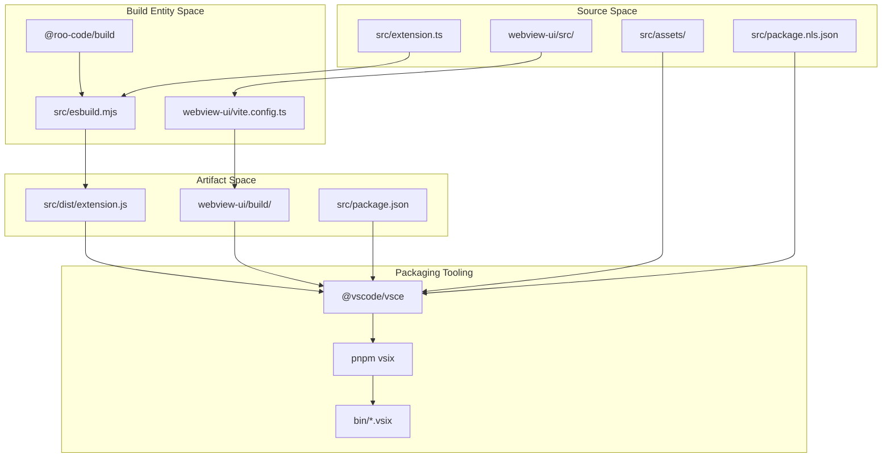
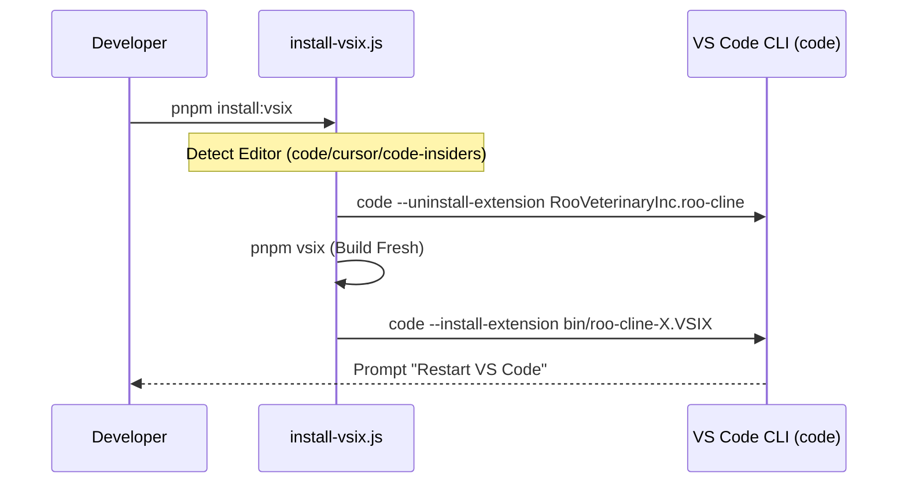

# VSIX Packaging and Distribution

<details>
<summary>Relevant source files</summary>

The following files were used as context for generating this wiki page:

- [.changeset/README.md](.changeset/README.md)
- [.changeset/changelog-config.js](.changeset/changelog-config.js)
- [.changeset/config.json](.changeset/config.json)
- [.github/actions/setup-node-pnpm/action.yml](.github/actions/setup-node-pnpm/action.yml)
- [.github/actions/slack-notify/action.yml](.github/actions/slack-notify/action.yml)
- [.github/workflows/changeset-release.yml](.github/workflows/changeset-release.yml)
- [.github/workflows/code-qa.yml](.github/workflows/code-qa.yml)
- [.github/workflows/marketplace-publish.yml](.github/workflows/marketplace-publish.yml)
- [.github/workflows/nightly-publish.yml](.github/workflows/nightly-publish.yml)
- [.github/workflows/update-contributors.yml](.github/workflows/update-contributors.yml)
- [.nvmrc](.nvmrc)
- [.tool-versions](.tool-versions)
- [README.md](README.md)
- [apps/vscode-e2e/src/runTest.ts](apps/vscode-e2e/src/runTest.ts)
- [apps/vscode-nightly/esbuild.mjs](apps/vscode-nightly/esbuild.mjs)
- [apps/vscode-nightly/package.nightly.json](apps/vscode-nightly/package.nightly.json)
- [apps/vscode-nightly/turbo.json](apps/vscode-nightly/turbo.json)
- [apps/web-evals/next.config.ts](apps/web-evals/next.config.ts)
- [apps/web-evals/turbo.json](apps/web-evals/turbo.json)
- [apps/web-roo-code/turbo.json](apps/web-roo-code/turbo.json)
- [knip.json](knip.json)
- [scripts/find-missing-translations.js](scripts/find-missing-translations.js)
- [src/esbuild.mjs](src/esbuild.mjs)

</details>


This document describes how Roo Code is packaged into distributable VSIX files and the various distribution mechanisms available for installation. This covers the build pipeline, packaging tools, installation workflows, and marketplace publishing.

For information about the general build system and monorepo management, see **14.2 Build System and Monorepo Management**. For webview build specifics, see **14.3 Webview Build Pipeline**.

---

## Overview

Roo Code is distributed as a `.vsix` file, the standard packaging format for Visual Studio Code extensions. The packaging process involves:

1.  **Bundling** the extension host code and webview UI.
2.  **Packaging** the bundled artifacts into a VSIX archive using `vsce`.
3.  **Installing** the VSIX locally for development or publishing to marketplaces.
4.  **Managing** separate stable and nightly build variants.

The build system uses `@vscode/vsce` for VSIX creation and supports both manual and automated installation workflows.

**Sources:** [README.md:121-152](), [src/package.json:1-10]()

---

## VSIX Packaging Pipeline

The packaging process follows a strict sequence to ensure all assets (extension code, webview, audio, and icons) are correctly bundled. The `esbuild.mjs` script in the `src` directory orchestrates the collection of these assets into a `dist` folder before `vsce` creates the archive.

### Code Entity Space to Distribution Flow

The following diagram maps code entities (scripts and configuration files) to the packaging lifecycle.

**Packaging Flow Architecture**



**Implementation Details:**
- **Bundling:** The extension uses `esbuild` for the extension host and `vite` for the webview UI [README.md:118-120](). The `src/esbuild.mjs` script utilizes `copyPaths`, `copyWasms`, and `copyLocales` from `@roo-code/build` to assemble the distribution [src/esbuild.mjs:8-9]().
- **Required Assets:** A valid VSIX must contain `extension/package.json`, `extension/package.nls.json`, `extension/dist/extension.js`, and specific assets like `celebration.wav` and `codicon.ttf` [/.github/workflows/marketplace-publish.yml:43-49]().
- **Environment:** The `.env` file containing API keys (like `POSTHOG_API_KEY`) is bundled into the VSIX during the packaging step in CI to enable telemetry and cloud features [/.github/workflows/marketplace-publish.yml:32-33](), [/.github/workflows/marketplace-publish.yml:50-50]().

**Sources:** [/.github/workflows/marketplace-publish.yml:32-50](), [src/esbuild.mjs:45-76](), [README.md:121-135]()

---

## VSIX Generation Commands

### Standard Build
The primary command for generating a production-ready VSIX is `pnpm vsix`. This command is used in the CI pipeline to generate the artifact for marketplace distribution.

```bash
pnpm vsix
```

The build process in CI extracts the version from `src/package.json` and runs the packaging command, saving the output to a `bin/` directory [/.github/workflows/marketplace-publish.yml:36-37]().

### Nightly Build
Roo Code maintains a separate nightly distribution triggered on every push to the `main` branch. This uses a numeric versioning strategy to ensure updates are always recognized by VS Code.

```bash
pnpm vsix:nightly
```

The nightly build uses a specialized manifest in `apps/vscode-nightly/package.nightly.json` and a dedicated build script `apps/vscode-nightly/esbuild.mjs` which performs string substitutions (e.g., replacing `roo-cline` with `roo-code-nightly`) [apps/vscode-nightly/esbuild.mjs:88-92]().

**Sources:** [/.github/workflows/marketplace-publish.yml:36-37](), [/.github/workflows/nightly-publish.yml:43-44](), [apps/vscode-nightly/esbuild.mjs:11-41]()

---

## Automated Installation (pnpm install:vsix)

The `pnpm install:vsix` command provides an automated "build and install" loop for developers to test the extension in a real VS Code environment.

**Automated Installation Logic**



**Key Features:**
- **Editor Selection:** Supports `code`, `cursor`, and `code-insiders` via the `--editor` flag [README.md:131-140]().
- **Clean State:** Automatically uninstalls any existing version of the extension before installing the new build to prevent version conflicts [README.md:132-133]().
- **Skip Prompts:** Use the `-y` flag to skip all confirmation prompts and use defaults [README.md:139-140]().

**Sources:** [README.md:121-141]()

---

## Marketplace Publishing

Publishing is orchestrated via GitHub Actions using `vsce` and `ovsx` for the Open VSX Registry.

### CI/CD Workflow
The `marketplace-publish.yml` workflow handles the production release when a "Changeset version bump" PR is merged to `main`.

1.  **Packaging:** Runs `pnpm vsix` and verifies the integrity of the generated file by checking for required internal paths like `extension/dist/extension.js` [/.github/workflows/marketplace-publish.yml:34-53]().
2.  **Tagging:** Creates a Git tag `v${version}` and pushes it to the repository [/.github/workflows/marketplace-publish.yml:54-59]().
3.  **Marketplace Upload:** Uses `VSCE_PAT` and `OVSX_PAT` secrets to publish to the VS Code Marketplace and Open VSX Registry [/.github/workflows/marketplace-publish.yml:60-67]().
4.  **GitHub Release:** Creates a GitHub Release using the `gh` CLI, extracts the relevant section from `CHANGELOG.md` for release notes, and attaches the VSIX binary [/.github/workflows/marketplace-publish.yml:68-92]().

**Sources:** [/.github/workflows/marketplace-publish.yml:1-93]()

---

## Nightly Distribution Workflow

The `nightly-publish.yml` workflow automates daily releases to the marketplace's "Pre-release" track.

**Nightly Versioning Logic**
- **Numeric Versioning:** A numeric version is generated by adding the GitHub `run_number` to a base offset (5500) to ensure strictly increasing versions for the marketplace [/.github/workflows/nightly-publish.yml:24-28]().
- **Manifest Patching:** The script dynamically updates `apps/vscode-nightly/package.nightly.json` with the new version string before building [/.github/workflows/nightly-publish.yml:29-42]().
- **Multi-Registry Publish:** Publishes the resulting VSIX to both the VS Code Marketplace and Open VSX [/.github/workflows/nightly-publish.yml:45-53]().

**Sources:** [/.github/workflows/nightly-publish.yml:1-53](), [apps/vscode-nightly/package.nightly.json:1-10]()

---

## Quality Assurance and Testing

Before packaging, the codebase undergoes several automated checks to ensure distribution quality. These are defined in the `code-qa.yml` workflow.

| Check | Tool / Command | Description |
| :--- | :--- | :--- |
| **Translations** | `scripts/find-missing-translations.js` | Verifies that all i18n keys are present in localized files [/.github/workflows/code-qa.yml:19-20](). |
| **Dead Code** | `pnpm knip` | Checks for unused files, dependencies, and exports [/.github/workflows/code-qa.yml:29-30](). |
| **Linting** | `pnpm lint` | Enforces code style and best practices [/.github/workflows/code-qa.yml:39-40](). |
| **Types** | `pnpm check-types` | Ensures TypeScript compilation succeeds without errors [/.github/workflows/code-qa.yml:41-42](). |
| **Unit Tests** | `pnpm test` | Runs the test suite across Ubuntu and Windows runners [/.github/workflows/code-qa.yml:44-60](). |

**Sources:** [/.github/workflows/code-qa.yml:11-61](), [knip.json:1-14]()