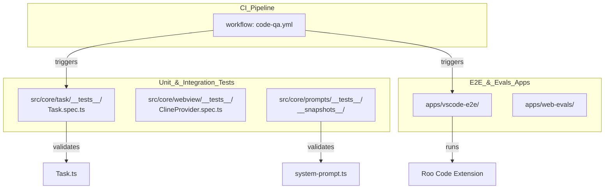
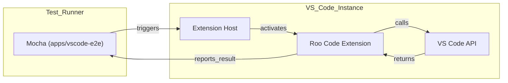

# Testing Infrastructure

Relevant source files

The following files were used as context for generating this wiki page:

- [.changeset/README.md](.changeset/README.md)
- [.changeset/changelog-config.js](.changeset/changelog-config.js)
- [.changeset/config.json](.changeset/config.json)
- [.github/actions/setup-node-pnpm/action.yml](.github/actions/setup-node-pnpm/action.yml)
- [.github/actions/slack-notify/action.yml](.github/actions/slack-notify/action.yml)
- [.github/workflows/changeset-release.yml](.github/workflows/changeset-release.yml)
- [.github/workflows/code-qa.yml](.github/workflows/code-qa.yml)
- [.github/workflows/marketplace-publish.yml](.github/workflows/marketplace-publish.yml)
- [.github/workflows/nightly-publish.yml](.github/workflows/nightly-publish.yml)
- [.github/workflows/update-contributors.yml](.github/workflows/update-contributors.yml)
- [.nvmrc](.nvmrc)
- [.tool-versions](.tool-versions)
- [apps/vscode-e2e/src/runTest.ts](apps/vscode-e2e/src/runTest.ts)
- [apps/vscode-e2e/src/suite/index.ts](apps/vscode-e2e/src/suite/index.ts)
- [apps/vscode-e2e/src/suite/subtasks.test.ts](apps/vscode-e2e/src/suite/subtasks.test.ts)
- [apps/vscode-e2e/src/suite/tools/apply-diff.test.ts](apps/vscode-e2e/src/suite/tools/apply-diff.test.ts)
- [apps/vscode-e2e/src/suite/tools/execute-command.test.ts](apps/vscode-e2e/src/suite/tools/execute-command.test.ts)
- [apps/vscode-e2e/src/suite/tools/list-files.test.ts](apps/vscode-e2e/src/suite/tools/list-files.test.ts)
- [apps/vscode-e2e/src/suite/tools/read-file.test.ts](apps/vscode-e2e/src/suite/tools/read-file.test.ts)
- [apps/vscode-e2e/src/suite/tools/search-files.test.ts](apps/vscode-e2e/src/suite/tools/search-files.test.ts)
- [apps/vscode-e2e/src/suite/tools/use-mcp-tool.test.ts](apps/vscode-e2e/src/suite/tools/use-mcp-tool.test.ts)
- [apps/vscode-e2e/src/suite/tools/write-to-file.test.ts](apps/vscode-e2e/src/suite/tools/write-to-file.test.ts)
- [apps/vscode-nightly/esbuild.mjs](apps/vscode-nightly/esbuild.mjs)
- [apps/vscode-nightly/package.nightly.json](apps/vscode-nightly/package.nightly.json)
- [apps/vscode-nightly/turbo.json](apps/vscode-nightly/turbo.json)
- [apps/web-evals/next.config.ts](apps/web-evals/next.config.ts)
- [apps/web-evals/turbo.json](apps/web-evals/turbo.json)
- [apps/web-roo-code/turbo.json](apps/web-roo-code/turbo.json)
- [knip.json](knip.json)
- [scripts/find-missing-translations.js](scripts/find-missing-translations.js)
- [src/core/prompts/__tests__/__snapshots__/add-custom-instructions/architect-mode-prompt.snap](src/core/prompts/__tests__/__snapshots__/add-custom-instructions/architect-mode-prompt.snap)
- [src/core/prompts/__tests__/__snapshots__/add-custom-instructions/mcp-server-creation-disabled.snap](src/core/prompts/__tests__/__snapshots__/add-custom-instructions/mcp-server-creation-disabled.snap)
- [src/core/prompts/__tests__/__snapshots__/system-prompt/consistent-system-prompt.snap](src/core/prompts/__tests__/__snapshots__/system-prompt/consistent-system-prompt.snap)
- [src/core/prompts/__tests__/__snapshots__/system-prompt/with-computer-use-support.snap](src/core/prompts/__tests__/__snapshots__/system-prompt/with-computer-use-support.snap)
- [src/core/prompts/__tests__/__snapshots__/system-prompt/with-diff-enabled-false.snap](src/core/prompts/__tests__/__snapshots__/system-prompt/with-diff-enabled-false.snap)
- [src/core/prompts/__tests__/__snapshots__/system-prompt/with-diff-enabled-true.snap](src/core/prompts/__tests__/__snapshots__/system-prompt/with-diff-enabled-true.snap)
- [src/core/prompts/__tests__/__snapshots__/system-prompt/with-diff-enabled-undefined.snap](src/core/prompts/__tests__/__snapshots__/system-prompt/with-diff-enabled-undefined.snap)
- [src/core/prompts/__tests__/__snapshots__/system-prompt/with-different-viewport-size.snap](src/core/prompts/__tests__/__snapshots__/system-prompt/with-different-viewport-size.snap)
- [src/core/prompts/__tests__/__snapshots__/system-prompt/with-mcp-hub-provided.snap](src/core/prompts/__tests__/__snapshots__/system-prompt/with-mcp-hub-provided.snap)
- [src/core/prompts/__tests__/__snapshots__/system-prompt/with-undefined-mcp-hub.snap](src/core/prompts/__tests__/__snapshots__/system-prompt/with-undefined-mcp-hub.snap)
- [src/esbuild.mjs](src/esbuild.mjs)

## Purpose and Scope

This document describes the testing infrastructure for Roo Code, focusing on test organization, coverage areas, and execution patterns. The codebase uses a multi-layered testing strategy to ensure the reliability of its AI-powered features, ranging from unit tests for core logic to sophisticated E2E testing and snapshot-based prompt validation.

**Test Coverage Areas:**
- **Core Task execution logic**: Validating the agentic loop and tool orchestration in `Task.ts`.
- **Provider orchestration**: Testing `ClineProvider.ts` for webview state management and lifecycle.
- **Webview message handling**: Ensuring the bidirectional bridge between the Extension Host and React UI functions correctly.
- **Snapshot testing**: Verifying the integrity and composition of system prompts across different modes and configurations [[src/core/prompts/__tests__/__snapshots__/system-prompt/consistent-system-prompt.snap:1-5]]().
- **E2E and Evals**: Automated testing of the extension in a real VS Code environment (`apps/vscode-e2e`) and performance benchmarking against coding exercises (`apps/web-evals`).

---

## Test Organization and Location

Tests are co-located with source code in `__tests__/` directories using the `.spec.ts` or `.test.ts` naming convention. The monorepo also contains dedicated applications for E2E and evaluation.

### Testing Architecture Diagram

Sources: [[.github/workflows/code-qa.yml:44-60]](), [[src/core/prompts/__tests__/__snapshots__/system-prompt/consistent-system-prompt.snap:1-10]](), [[apps/vscode-e2e/src/runTest.ts:1-10]]()

---

## CI/CD Integration

The testing infrastructure is integrated into GitHub Actions via the `code-qa.yml` workflow. This workflow ensures code quality across Ubuntu and Windows platforms [[.github/workflows/code-qa.yml:45-53]]().

**Key Pipeline Jobs:**
- **check-translations**: Runs `scripts/find-missing-translations.js` to ensure i18n coverage across all supported locales [[.github/workflows/code-qa.yml:12-20]]().
- **knip**: Performs unused dependency and export analysis using `knip.json` configuration [[.github/workflows/code-qa.yml:22-30]]().
- **compile**: Executes `pnpm lint` and `pnpm check-types` [[.github/workflows/code-qa.yml:32-42]]().
- **unit-test**: Executes the Vitest suite across the workspace [[.github/workflows/code-qa.yml:44-60]]().

Sources: [[.github/workflows/code-qa.yml:1-61]](), [[knip.json:1-10]](), [[scripts/find-missing-translations.js:1-12]]()

---

## Snapshot Testing for Prompts

A significant portion of the testing infrastructure is dedicated to snapshot testing of the `SYSTEM_PROMPT`. This ensures that changes to the prompt logic do not inadvertently alter the agent's behavior or instructions.

**Snapshot Categories:**
- **Mode-Specific Prompts**: Validating instructions for Architect, Code, and Ask modes [[src/core/prompts/__tests__/__snapshots__/add-custom-instructions/architect-mode-prompt.snap:1-10]]().
- **Feature Toggles**: Snapshots for scenarios with `diff-enabled` set to true vs false [[src/core/prompts/__tests__/__snapshots__/system-prompt/with-diff-enabled-true.snap:1-10]]() and [[src/core/prompts/__tests__/__snapshots__/system-prompt/with-diff-enabled-false.snap:1-5]]().
- **Environment Context**: Verifying how MCP servers, computer use support, and viewport sizes are injected into the prompt [[src/core/prompts/__tests__/__snapshots__/system-prompt/with-mcp-hub-provided.snap:30-33]](), [[src/core/prompts/__tests__/__snapshots__/system-prompt/with-computer-use-support.snap:1-10]]().

Sources: [[src/core/prompts/__tests__/__snapshots__/system-prompt/consistent-system-prompt.snap:1-20]](), [[src/core/prompts/__tests__/__snapshots__/add-custom-instructions/mcp-server-creation-disabled.snap:1-15]]()

---

## E2E Testing with apps/vscode-e2e

The `apps/vscode-e2e` package provides a robust framework for testing tool execution in a real VS Code environment.

**Core E2E Test Suites:**
- **Tool Execution**: Individual tests for `read_file`, `write_to_file`, `apply_diff`, and `execute_command` [[apps/vscode-e2e/src/suite/tools/read-file.test.ts:1-5]](), [[apps/vscode-e2e/src/suite/tools/execute-command.test.ts:1-5]]().
- **MCP Integration**: Validating `use_mcp_tool` functionality [[apps/vscode-e2e/src/suite/tools/use-mcp-tool.test.ts:1-5]]().
- **Task Orchestration**: Testing complex flows like subtasks and file searching [[apps/vscode-e2e/src/suite/subtasks.test.ts:1-5]](), [[apps/vscode-e2e/src/suite/tools/search-files.test.ts:1-5]]().

### E2E Flow Diagram

Sources: [[apps/vscode-e2e/src/runTest.ts:1-20]](), [[apps/vscode-e2e/src/suite/index.ts:1-10]]()

---

## Evaluation Framework (apps/web-evals)

The evaluation framework is used for automated testing of AI capabilities against programming exercises.

- **Infrastructure**: Uses Docker-based services including PostgreSQL and Redis [[apps/web-evals/turbo.json:1-10]]().
- **Web UI**: A Next.js application at `localhost:3446` for managing and viewing evaluation runs [[apps/web-evals/next.config.ts:1-10]]().
- **Execution**: Benchmarks model performance across various providers by running standardized coding tasks and verifying the output.

Sources: [[apps/web-evals/next.config.ts:1-12]](), [[apps/web-evals/turbo.json:1-15]]()

---

## Summary of Testing Stack

| Layer | Tooling | Target |
|-------|---------|--------|
| **Unit/Integration** | Vitest | Core logic, API handlers, Task lifecycle |
| **Snapshot** | Vitest Snapshots | System prompts, Mode configurations |
| **i18n Validation** | Custom Node.js scripts | Locale file coverage and key matching |
| **Static Analysis** | Knip, ESLint, TypeScript | Dead code, linting, and type safety |
| **E2E** | Mocha + VS Code Extension Host | Tool execution, Command flow, Subtasks |
| **Evaluations** | Next.js + Docker + Postgres | AI capability benchmarking |

Sources: [[.github/workflows/code-qa.yml:1-61]](), [[knip.json:1-27]](), [[apps/vscode-e2e/src/suite/index.ts:1-15]]()