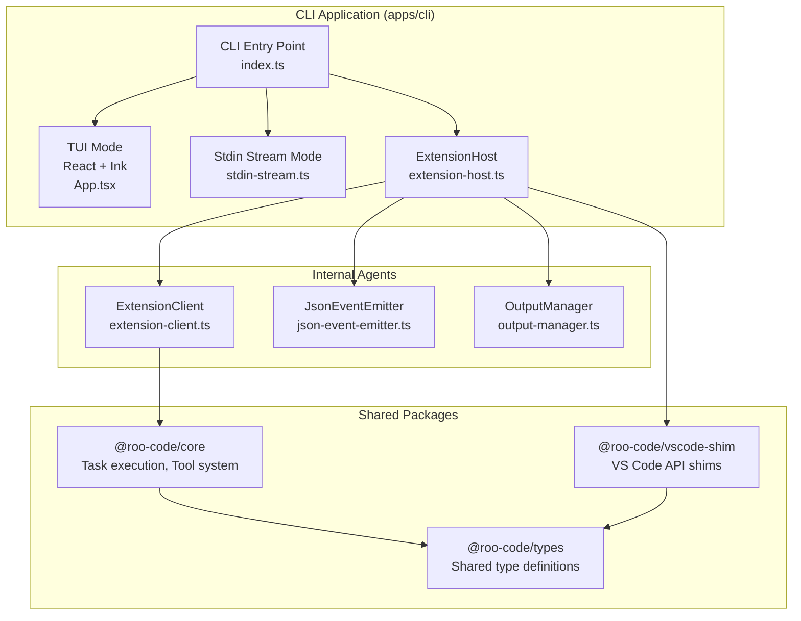
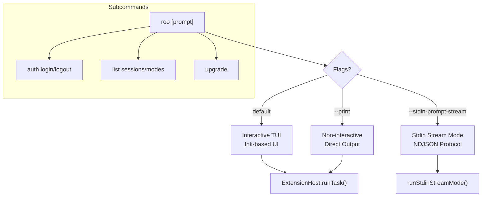
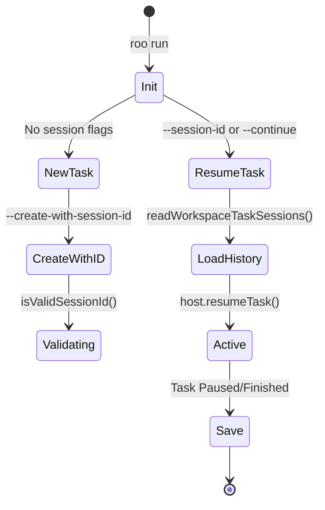

# CLI Application

Relevant source files

The following files were used as context for generating this wiki page:

- [apps/cli/CHANGELOG.md](apps/cli/CHANGELOG.md)
- [apps/cli/README.md](apps/cli/README.md)
- [apps/cli/docs/AGENT_LOOP.md](apps/cli/docs/AGENT_LOOP.md)
- [apps/cli/package.json](apps/cli/package.json)
- [apps/cli/src/agent/__tests__/extension-client.test.ts](apps/cli/src/agent/__tests__/extension-client.test.ts)
- [apps/cli/src/agent/__tests__/extension-host.test.ts](apps/cli/src/agent/__tests__/extension-host.test.ts)
- [apps/cli/src/agent/extension-client.ts](apps/cli/src/agent/extension-client.ts)
- [apps/cli/src/agent/extension-host.ts](apps/cli/src/agent/extension-host.ts)
- [apps/cli/src/agent/state-store.ts](apps/cli/src/agent/state-store.ts)
- [apps/cli/src/commands/cli/run.ts](apps/cli/src/commands/cli/run.ts)
- [apps/cli/src/index.ts](apps/cli/src/index.ts)
- [apps/cli/src/lib/storage/__tests__/settings.test.ts](apps/cli/src/lib/storage/__tests__/settings.test.ts)
- [apps/cli/src/lib/utils/__tests__/shell.test.ts](apps/cli/src/lib/utils/__tests__/shell.test.ts)
- [apps/cli/src/lib/utils/shell.ts](apps/cli/src/lib/utils/shell.ts)
- [apps/cli/src/types/constants.ts](apps/cli/src/types/constants.ts)
- [apps/cli/src/types/types.ts](apps/cli/src/types/types.ts)
- [apps/cli/src/ui/App.tsx](apps/cli/src/ui/App.tsx)
- [apps/cli/src/ui/hooks/useExtensionHost.ts](apps/cli/src/ui/hooks/useExtensionHost.ts)
- [packages/evals/src/cli/__tests__/messageLogDeduper.test.ts](packages/evals/src/cli/__tests__/messageLogDeduper.test.ts)
- [packages/evals/src/cli/runTaskInCli.ts](packages/evals/src/cli/runTaskInCli.ts)
- [packages/evals/src/cli/runTaskInVscode.ts](packages/evals/src/cli/runTaskInVscode.ts)
- [packages/evals/src/cli/types.ts](packages/evals/src/cli/types.ts)

This page documents the standalone CLI application (`@roo-code/cli`) that enables headless execution of Roo Code outside of VS Code. It shares core logic with the VS Code extension through workspace packages, using a shim layer to provide VS Code API compatibility in headless environments.

---

## Architecture Overview

The CLI application is located in `apps/cli` and follows a layered architecture that reuses extension components through carefully designed abstraction boundaries. It leverages the `@roo-code/vscode-shim` to mock the VS Code environment.

### System Components Diagram

The following diagram bridges the CLI command space to the underlying code entities.

**Sources:** [apps/cli/package.json:23-39](), [apps/cli/src/agent/extension-host.ts:1-9](), [apps/cli/src/agent/extension-host.ts:147-170](), [apps/cli/src/index.ts:1-70]()

### Package Dependencies

The CLI application depends on the following workspace packages:

| Package | Purpose |
|---------|---------|
| `@roo-code/core` | Task execution logic, tool system, and provider handlers. |
| `@roo-code/types` | Shared type definitions for messages, state, and API configurations. |
| `@roo-code/vscode-shim` | Provides headless implementations of VS Code APIs and `setRuntimeConfigValues`. |

**Sources:** [apps/cli/package.json:25-27]()

### VS Code Shim Architecture

The `@roo-code/vscode-shim` package provides mock implementations of VS Code APIs. The CLI sets `process.env.ROO_CLI_RUNTIME = "1"` to signal to the core logic that it is running in a headless environment.

**Sources:** [apps/cli/src/agent/extension-host.ts:26-27](), [apps/cli/src/agent/extension-host.ts:181-182]()

---

## CLI Execution Modes

The CLI supports multiple execution modes, configured via flags in the entry point.

### Mode Selection

The main entry point uses `commander` to define options and subcommands.

**Sources:** [apps/cli/src/index.ts:19-70](), [apps/cli/src/commands/cli/run.ts:110-170]()

### Stdin Stream Mode

The stdin stream mode enables programmatic control via NDJSON-formatted messages. It uses a structured protocol for `start`, `message`, `cancel`, `ping`, and `shutdown` commands.

- **Parser:** `parseStdinStreamCommand` validates incoming JSON against `RooCliInputCommand` types.
- **Orchestrator:** `runStdinStreamMode` manages the asynchronous generator `readCommandsFromStdinNdjson` that reads from `process.stdin`.

**Sources:** [apps/cli/src/commands/cli/run.ts:36](), [apps/cli/CHANGELOG.md:169-170](), [apps/cli/CHANGELOG.md:64-66]()

---

## Session and Task Management

The CLI implements persistent session management to support task resumption across process restarts.

### Session Lifecycle

Sessions are identified by UUIDs. The CLI can create a task with a specific ID or resume an existing one from the workspace history.

**Sources:** [apps/cli/src/commands/cli/run.ts:129-168](), [apps/cli/src/lib/utils/session-id.ts:1-10](), [apps/cli/src/lib/task-history/index.ts:25](), [apps/cli/CHANGELOG.md:11-13]()

---

## Output and Communication

The CLI communicates internal extension events to the user (or a parent process) using the `JsonEventEmitter`.

### JsonEventEmitter

This component transforms `ClineMessage` objects and state changes into structured JSON. It supports:
- **`stream-json`**: NDJSON format for real-time streaming of tool use and text deltas.
- **`json`**: A single accumulated JSON object at the end of execution.

**Sources:** [apps/cli/src/agent/json-event-emitter.ts:1-15](), [apps/cli/src/agent/json-event-emitter.ts:97-106]()

### Delta Streaming

To improve efficiency, the CLI streams deltas for tool use and command output rather than full snapshots. The `JsonEventEmitter` tracks `previousContent` and `previousToolUseContent` to compute these deltas.

**Sources:** [apps/cli/src/agent/json-event-emitter.ts:108-115](), [apps/cli/CHANGELOG.md:145-147]()

---

## Configuration and Safety

The CLI manages settings through a local storage layer and environment variables.

### Provider Configuration

The CLI supports multiple providers (Anthropic, OpenAI, Gemini, etc.). It resolves settings with the following priority:
1. CLI Flags (e.g., `--api-key`)
2. Settings file (`~/.config/roo/settings.json`)
3. Environment variables (e.g., `OPENROUTER_API_KEY`)

**Sources:** [apps/cli/src/commands/cli/run.ts:179-194](), [apps/cli/src/lib/utils/provider.ts:27]()

### Safety Limits

- **Consecutive Mistake Limit:** Configurable via `--consecutive-mistake-limit` to prevent the agent from looping on errors.
- **Approval Mode:** Use `--require-approval` to force manual confirmation for tool and command execution.
- **Shell Selection:** The `--terminal-shell` flag allows specifying the shell used for command execution.

**Sources:** [apps/cli/src/commands/cli/run.ts:189-193](), [apps/cli/CHANGELOG.md:111-112](), [apps/cli/CHANGELOG.md:21-23]()

---

## Details and Child Pages

For deeper technical documentation on specific CLI subsystems, refer to the following pages:

- [CLI Architecture and Modes](#15.1) — Details on the `ExtensionHost` implementation, `vscode-shim` mechanics, and TUI vs. Stdin stream mode logic.
- [CLI Execution and Task Management](#15.2) — Deep dive into the `ExtensionClient` state machine, `JsonEventEmitter` schema, and NDJSON protocol details.
- [CLI Build and Release](#15.3) — Documentation of the `tsup` build pipeline and packaging for different platforms.