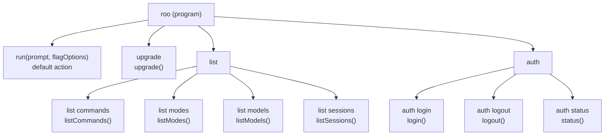
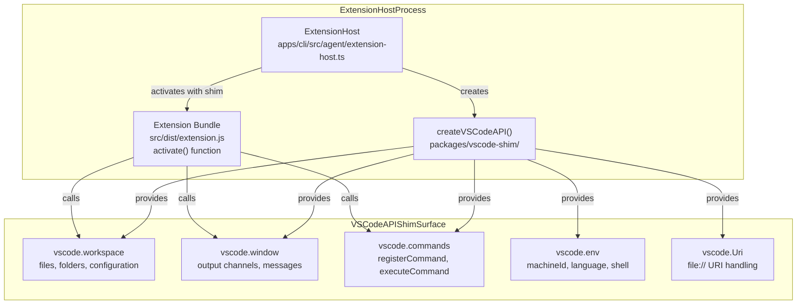
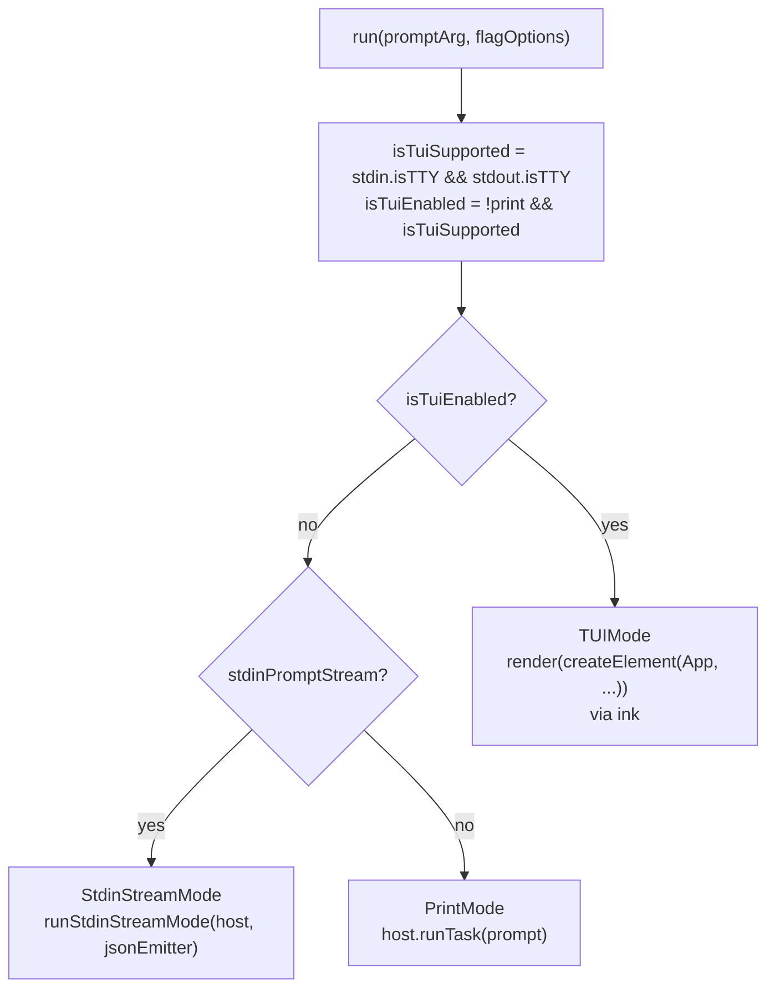
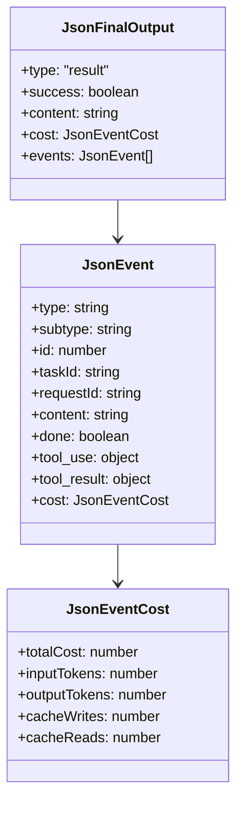
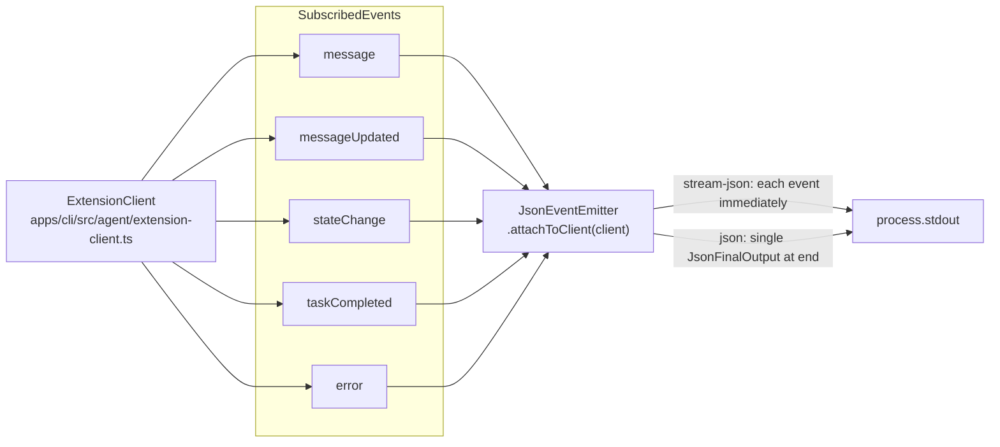
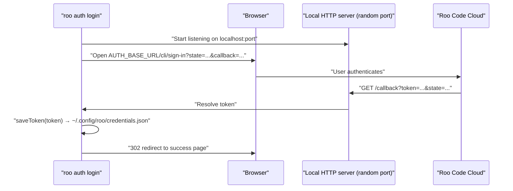
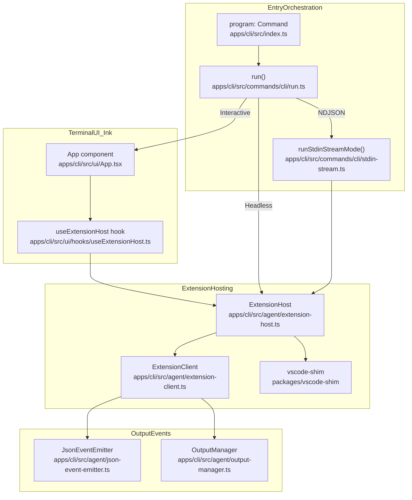

# CLI Architecture and Modes

Relevant source files

The following files were used as context for generating this wiki page:

- [apps/cli/CHANGELOG.md](apps/cli/CHANGELOG.md)
- [apps/cli/README.md](apps/cli/README.md)
- [apps/cli/docs/AGENT_LOOP.md](apps/cli/docs/AGENT_LOOP.md)
- [apps/cli/package.json](apps/cli/package.json)
- [apps/cli/src/agent/__tests__/extension-client.test.ts](apps/cli/src/agent/__tests__/extension-client.test.ts)
- [apps/cli/src/agent/__tests__/extension-host.test.ts](apps/cli/src/agent/__tests__/extension-host.test.ts)
- [apps/cli/src/agent/extension-client.ts](apps/cli/src/agent/extension-client.ts)
- [apps/cli/src/agent/extension-host.ts](apps/cli/src/agent/extension-host.ts)
- [apps/cli/src/agent/state-store.ts](apps/cli/src/agent/state-store.ts)
- [apps/cli/src/commands/cli/run.ts](apps/cli/src/commands/cli/run.ts)
- [apps/cli/src/index.ts](apps/cli/src/index.ts)
- [apps/cli/src/lib/storage/__tests__/settings.test.ts](apps/cli/src/lib/storage/__tests__/settings.test.ts)
- [apps/cli/src/lib/utils/__tests__/shell.test.ts](apps/cli/src/lib/utils/__tests__/shell.test.ts)
- [apps/cli/src/lib/utils/shell.ts](apps/cli/src/lib/utils/shell.ts)
- [apps/cli/src/types/constants.ts](apps/cli/src/types/constants.ts)
- [apps/cli/src/types/types.ts](apps/cli/src/types/types.ts)
- [apps/cli/src/ui/App.tsx](apps/cli/src/ui/App.tsx)
- [apps/cli/src/ui/hooks/useExtensionHost.ts](apps/cli/src/ui/hooks/useExtensionHost.ts)
- [packages/evals/src/cli/__tests__/messageLogDeduper.test.ts](packages/evals/src/cli/__tests__/messageLogDeduper.test.ts)
- [packages/evals/src/cli/runTaskInCli.ts](packages/evals/src/cli/runTaskInCli.ts)
- [packages/evals/src/cli/runTaskInVscode.ts](packages/evals/src/cli/runTaskInVscode.ts)
- [packages/evals/src/cli/types.ts](packages/evals/src/cli/types.ts)

This page covers the `@roo-code/cli` package: its entry point, command structure, execution modes, and output formats. The CLI enables running the Roo Code agent from the terminal without VS Code, using a Node.js shim to host the same extension bundle.

For the `ExtensionHost` class, agent state machine, and message processing internals, see [15.2](). For build scripts and release workflow, see [15.3]().

---

## Package Structure

The CLI is located in the `apps/cli` directory within the monorepo. Key structural components:

| Directory/File | Purpose |
|---|---|
| `apps/cli/src/index.ts` | Entry point, command registration via `commander` |
| `apps/cli/src/commands/` | Command implementations (run, auth, list, upgrade) |
| `apps/cli/src/agent/` | Extension host, client, output management, and event emitters |
| `apps/cli/src/ui/` | Terminal UI components (Ink/React) |
| `apps/cli/src/types/` | TypeScript types, constants, and JSON schemas |
| `packages/vscode-shim/` | VS Code API shim for headless operation |

Sources: [apps/cli/package.json:1-50](), [apps/cli/src/index.ts:1-15]()

## Entry Point and Command Structure

The CLI is defined in [apps/cli/src/index.ts]() using the `commander` library. The binary name is `roo` (set via `package.json` `bin` field).

**Commander command tree:**

Sources: [apps/cli/src/index.ts:17-168](), [apps/cli/package.json:8-10]()

The root command accepts a positional `[prompt]` argument plus all flag options. All top-level flags are defined in [apps/cli/src/index.ts:27-69]() and collected into a `FlagOptions` object before being handed to `run()`.

---

## VS Code Shim for Headless Operation

The CLI runs the same Roo Code extension bundle that powers the VS Code extension, but without an actual VS Code instance. This is achieved through the `@roo-code/vscode-shim` package, which provides a minimal implementation of the VS Code API surface that the extension depends on.

**Shim Architecture:**

The `ExtensionHost` class in [apps/cli/src/agent/extension-host.ts]() coordinates the shim. It creates the mock VS Code API via `createVSCodeAPI` [apps/cli/src/agent/extension-host.ts:26]() and loads the extension bundle using a Node.js `require` shim [apps/cli/src/agent/extension-host.ts:11](). It marks the process as a CLI runtime by setting `process.env.ROO_CLI_RUNTIME = "1"` [apps/cli/src/agent/extension-host.ts:182]().

Sources: [apps/cli/src/agent/extension-host.ts:1-26](), [apps/cli/src/agent/extension-host.ts:175-191]()

---

## Execution Modes

The `run` function in [apps/cli/src/commands/cli/run.ts]() selects one of three execution modes based on flags and TTY availability.

**Mode selection logic:**

| Condition | Mode |
|---|---|
| `process.stdin.isTTY && process.stdout.isTTY && !flagOptions.print` | Interactive TUI |
| `flagOptions.print && !flagOptions.stdinPromptStream` | Print (single prompt) |
| `flagOptions.print && flagOptions.stdinPromptStream` | Stdin stream (NDJSON protocol) |

Sources: [apps/cli/src/commands/cli/run.ts:175-189](), [apps/cli/src/commands/cli/run.ts:300-366]()

### Interactive TUI Mode

When both stdin and stdout are TTYs and `--print` is not set, the CLI renders the terminal UI using [Ink](https://github.com/vadimdemedes/ink) (React for terminals). The root component is `App` in [apps/cli/src/ui/App.tsx](). This mode:

- Renders the full TUI with autocomplete, scroll area, and tool display components.
- Handles tool executions and commands with auto-approval by default [apps/cli/README.md:91-94]().
- Uses `useExtensionHost` hook to manage the lifecycle of the `ExtensionHost` [apps/cli/src/ui/hooks/useExtensionHost.ts]().

Sources: [apps/cli/src/commands/cli/run.ts:300-323](), [apps/cli/README.md:73-95]()

### Print Mode

When `--print` is set (or no TTY is available), the CLI:

1. Constructs an `ExtensionHost` directly [apps/cli/src/commands/cli/run.ts:241]().
2. Calls `host.activate()` to load the extension bundle.
3. Calls `host.runTask(prompt)` which resolves when the task completes [apps/cli/src/agent/extension-host.ts:112]().
4. Exits upon completion if `--oneshot` or `--print` is specified [apps/cli/src/commands/cli/run.ts:190]().

Sources: [apps/cli/src/commands/cli/run.ts:325-405]()

### Stdin Stream Mode

Enabled with `--print --stdin-prompt-stream`. Reads NDJSON commands from stdin, one per line. The protocol supports these commands:

| Command | Purpose |
|---|---|
| `start` | Begin a new task with a prompt and optional `taskId` or `configuration` |
| `message` | Send a follow-up message (optionally with images) to the running task |
| `cancel` | Cancel the current task |
| `ping` | Heartbeat / connection check |
| `shutdown` | Shut down the CLI process |

Each command carries a `requestId` for correlation. The CLI emits `ack`, `done`, and `error` control events back on stdout via `JsonEventEmitter`. Implemented in `runStdinStreamMode` [apps/cli/src/commands/cli/stdin-stream.ts:230]().

Sources: [apps/cli/src/commands/cli/stdin-stream.ts:4-127](), [apps/cli/src/commands/cli/run.ts:36-37]()

---

## Output Formats

The `--output-format` flag (only applicable with `--print`) controls how task events are written to stdout.

| Format | Behavior | Type |
|---|---|---|
| `text` | Human-readable text output via `OutputManager` | Default |
| `json` | Single JSON object emitted at task completion | `JsonFinalOutput` |
| `stream-json` | NDJSON — one JSON object per line as events occur | `JsonEvent` stream |

Sources: [apps/cli/src/index.ts:66-69](), [apps/cli/src/agent/json-event-emitter.ts:7-15]()

**JSON output schema diagram:**

Sources: [apps/cli/src/agent/json-event-emitter.ts:19-23](), [apps/cli/src/agent/json-event-emitter.ts:57-76](), [packages/types/src/cli.ts:174-182]()

---

## `ExtensionClient` and `JsonEventEmitter`

The `ExtensionClient` in [apps/cli/src/agent/extension-client.ts]() serves as the single source of truth for agent loop state in the CLI context. `JsonEventEmitter` in [apps/cli/src/agent/json-event-emitter.ts]() transforms internal `ClineMessage` and state change events into the structured output format by attaching to the client.

Key behaviors:
- **Streaming Deltas**: Tool use ask messages (command, tool, mcp) are streamed as structured deltas instead of full snapshots for improved efficiency [apps/cli/CHANGELOG.md:145-146]().
- **Cost Tracking**: Parses API request cost information from `api_req_started` message text [apps/cli/src/agent/json-event-emitter.ts:60-76]().
- **Skip List**: Internal message types like `checkpoint_saved` or `api_req_finished` are suppressed from the output [apps/cli/src/agent/json-event-emitter.ts:79-89]().

Sources: [apps/cli/src/agent/json-event-emitter.ts:96-166](), [apps/cli/src/agent/json-event-emitter.ts:219-286](), [apps/cli/src/agent/extension-client.ts:1-50]()

---

## Authentication and Cloud Integration

`roo auth login/logout/status` are implemented in [apps/cli/src/commands/auth/login.ts]() and equivalent files.

**Login flow:**

The CLI uses the `CloudService` (via the extension host) for settings synchronization and cloud profile management. Authentication tokens are valid for 90 days [apps/cli/README.md:154]().

Sources: [apps/cli/src/commands/auth/login.ts:26-121](), [apps/cli/README.md:133-175]()

---

## Mode and Session Support

The CLI supports the full range of modes (Code, Architect, Ask, Debug) and custom modes.

- **Mode Selection**: Specified via `--mode` or persisted in settings [apps/cli/src/index.ts:50]().
- **Session Resumption**: The `--resume <taskId>` flag (or `--session-id`) allows continuing a previous session [apps/cli/CHANGELOG.md:127]().
- **Session ID Support**: The `--create-with-session-id` flag allows specifying a custom UUID session ID when creating tasks [apps/cli/CHANGELOG.md:12]().
- **Workspace Scoping**: The `list sessions` command and `--resume` flag only show and resume sessions from the current workspace directory [apps/cli/CHANGELOG.md:114-116]().
- **Skills as Slash Commands**: Skills are exposed as slash commands in the CLI context, allowing direct invocation via command-style input [apps/cli/CHANGELOG.md:44-46]().

Sources: [apps/cli/src/commands/cli/run.ts:129-169](), [apps/cli/src/lib/task-history/index.ts:25](), [apps/cli/CHANGELOG.md:43-54]()

---

## CLI-Specific Configuration

The CLI maintains tiers of configuration: CLI flags > settings file > `DEFAULT_FLAGS`.

**Default flags defined in [apps/cli/src/types/constants.ts]():**
- `mode`: "code"
- `model`: "anthropic/claude-opus-4.6" [apps/cli/src/types/constants.ts:6]()
- `reasoningEffort`: "medium" [apps/cli/src/types/constants.ts:5]()

**Custom Shell Selection**: The `--terminal-shell` flag allows specifying the shell used for inline command execution, which is validated at the CLI layer and passed to the extension host [apps/cli/CHANGELOG.md:21-23]().

Sources: [apps/cli/src/commands/cli/run.ts:180-194](), [apps/cli/src/types/constants.ts:3-7](), [apps/cli/src/lib/utils/shell.ts:29]()

---

## Overall Architecture Diagram

This diagram maps the natural-language components to actual code entities in the CLI package.

Sources: [apps/cli/src/index.ts](), [apps/cli/src/commands/cli/run.ts](), [apps/cli/src/agent/extension-host.ts](), [apps/cli/src/agent/json-event-emitter.ts](), [apps/cli/src/ui/App.tsx]()