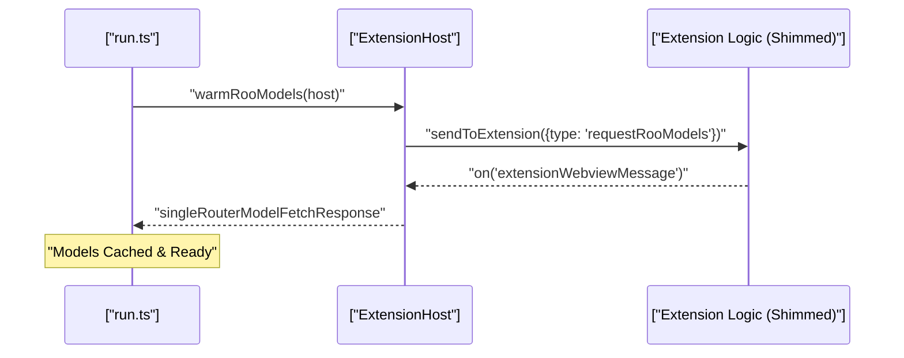
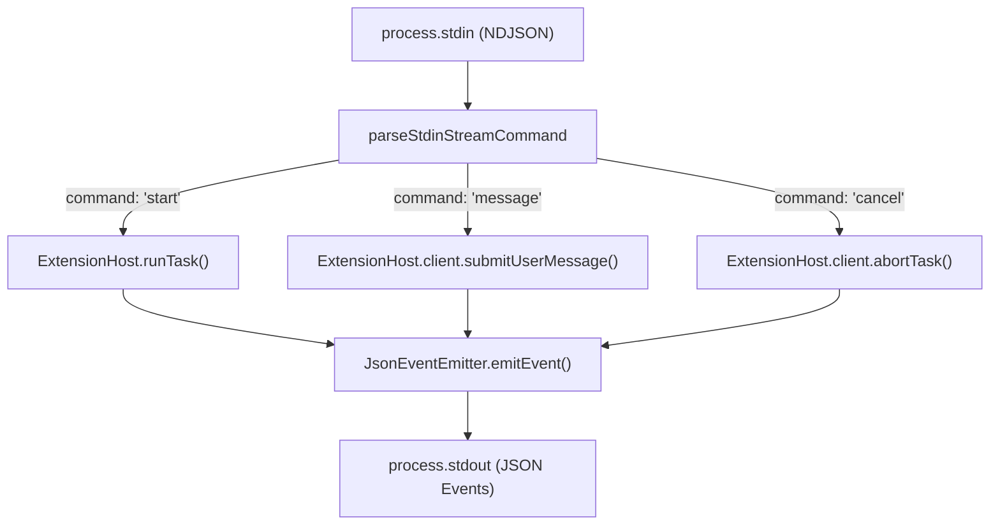
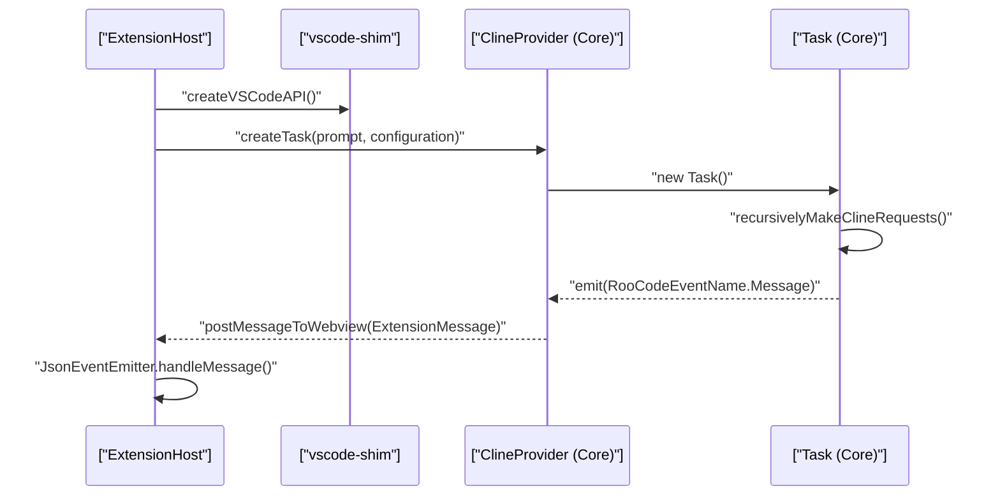

# CLI Execution and Task Management

Relevant source files

The following files were used as context for generating this wiki page:

- [apps/cli/CHANGELOG.md](apps/cli/CHANGELOG.md)
- [apps/cli/docs/AGENT_LOOP.md](apps/cli/docs/AGENT_LOOP.md)
- [apps/cli/install.sh](apps/cli/install.sh)
- [apps/cli/package.json](apps/cli/package.json)
- [apps/cli/scripts/integration/cases/create-with-session-id-resume-loads-correct-session.ts](apps/cli/scripts/integration/cases/create-with-session-id-resume-loads-correct-session.ts)
- [apps/cli/src/agent/__tests__/extension-client.test.ts](apps/cli/src/agent/__tests__/extension-client.test.ts)
- [apps/cli/src/agent/__tests__/json-event-emitter-streaming.test.ts](apps/cli/src/agent/__tests__/json-event-emitter-streaming.test.ts)
- [apps/cli/src/agent/extension-client.ts](apps/cli/src/agent/extension-client.ts)
- [apps/cli/src/agent/json-event-emitter.ts](apps/cli/src/agent/json-event-emitter.ts)
- [apps/cli/src/agent/output-manager.ts](apps/cli/src/agent/output-manager.ts)
- [apps/cli/src/agent/state-store.ts](apps/cli/src/agent/state-store.ts)
- [apps/cli/src/commands/cli/__tests__/list.test.ts](apps/cli/src/commands/cli/__tests__/list.test.ts)
- [apps/cli/src/commands/cli/__tests__/parse-stdin-command.test.ts](apps/cli/src/commands/cli/__tests__/parse-stdin-command.test.ts)
- [apps/cli/src/commands/cli/__tests__/upgrade.test.ts](apps/cli/src/commands/cli/__tests__/upgrade.test.ts)
- [apps/cli/src/commands/cli/index.ts](apps/cli/src/commands/cli/index.ts)
- [apps/cli/src/commands/cli/list.ts](apps/cli/src/commands/cli/list.ts)
- [apps/cli/src/commands/cli/stdin-stream.ts](apps/cli/src/commands/cli/stdin-stream.ts)
- [apps/cli/src/commands/cli/upgrade.ts](apps/cli/src/commands/cli/upgrade.ts)
- [apps/cli/src/lib/task-history/__tests__/index.test.ts](apps/cli/src/lib/task-history/__tests__/index.test.ts)
- [apps/cli/src/lib/task-history/index.ts](apps/cli/src/lib/task-history/index.ts)
- [apps/cli/src/lib/utils/session-id.ts](apps/cli/src/lib/utils/session-id.ts)
- [packages/core/src/custom-tools/__tests__/format-native.spec.ts](packages/core/src/custom-tools/__tests__/format-native.spec.ts)
- [packages/core/src/custom-tools/format-native.ts](packages/core/src/custom-tools/format-native.ts)
- [packages/evals/src/cli/__tests__/messageLogDeduper.test.ts](packages/evals/src/cli/__tests__/messageLogDeduper.test.ts)
- [packages/evals/src/cli/runTaskInCli.ts](packages/evals/src/cli/runTaskInCli.ts)
- [packages/evals/src/cli/runTaskInVscode.ts](packages/evals/src/cli/runTaskInVscode.ts)
- [packages/evals/src/cli/types.ts](packages/evals/src/cli/types.ts)
- [packages/types/src/__tests__/cli.test.ts](packages/types/src/__tests__/cli.test.ts)
- [packages/types/src/cli.ts](packages/types/src/cli.ts)
- [src/core/task/__tests__/ask-queued-message-drain.spec.ts](src/core/task/__tests__/ask-queued-message-drain.spec.ts)

This document describes how the Roo Code CLI executes tasks in a headless environment, manages task lifecycle, handles user input, formats output, and communicates with extension components. The CLI is built as a standalone Node.js application that leverages a VS Code shim to run the core extension logic.

## Purpose and Scope

The CLI provides a standalone execution environment for Roo Code tasks without requiring VS Code. It implements headless task management, supports multiple input modes (interactive TUI and NDJSON stream), provides formatted console output, and integrates with the extension's core services. This enables automation workflows, CI/CD integration, and terminal-based AI interactions.

---

## Task Creation and Initialization

### Session-Based Task Management

The CLI uses UUID session IDs to manage task instances. Each session represents a unique conversation context persisted to the filesystem.

**Session Creation and Resume Logic:**

| Flag | Description | Code Entity |
|------|-------------|-------------|
| `--create-with-session-id <uuid>` | Creates a new task with a specific UUID. | `flagOptions.createWithSessionId` [apps/cli/src/commands/cli/run.ts:130]() |
| `--session-id <uuid>` | Resumes a specific existing task. | `flagOptions.sessionId` [apps/cli/src/commands/cli/run.ts:129]() |
| `--continue` | Resumes the most recent task in the workspace. | `flagOptions.continue` [apps/cli/src/commands/cli/run.ts:131]() |

The CLI validates that session IDs are valid UUIDs before proceeding [apps/cli/src/commands/cli/run.ts:144-152](). It prevents conflicting flags, such as using a prompt while attempting to resume a session [apps/cli/src/commands/cli/run.ts:164-169]().

**Sources:** [apps/cli/src/commands/cli/run.ts:120-169](), [apps/cli/src/lib/utils/session-id.ts:1-10](), [apps/cli/CHANGELOG.md:12-13]()

### Model Warming

On startup, the CLI can perform a "warmup" of Roo models to ensure the provider is ready. This is handled by `warmRooModels`, which sends a `requestRooModels` message to the extension host and waits for a `singleRouterModelFetchResponse` [apps/cli/src/commands/cli/run.ts:57-108]().

**Diagram: Model Cache Warming Flow**

**Sources:** [apps/cli/src/commands/cli/run.ts:57-108](), [apps/cli/src/commands/cli/list.ts:218-239]()

---

## Input Modes

### Interactive Mode (TUI)

By default, if the environment is a TTY and not in "print" mode, the CLI runs in an interactive Terminal User Interface (TUI) [apps/cli/src/commands/cli/run.ts:175-177](). In this mode:
- Tool executions are typically auto-approved unless `--require-approval` is set [apps/cli/src/commands/cli/run.ts:186-189]().
- The `PromptManager` handles collecting user input via readline [apps/cli/src/agent/extension-host.ts:203-206]().

### Stdin Stream Mode

For programmatic control, the CLI supports `--stdin-prompt-stream`. This mode reads NDJSON (Newline Delimited JSON) commands from stdin [apps/cli/src/commands/cli/stdin-stream.ts:133-154]().

**Supported Stdin Commands:**
- `start`: Begins a new task with an optional `taskId`, `images`, and `configuration` [apps/cli/src/commands/cli/stdin-stream.ts:83-116]().
- `message`: Sends a follow-up message to an active task, supporting images [apps/cli/src/commands/cli/stdin-stream.ts:118-124]().
- `cancel`: Aborts the current task [apps/cli/src/commands/cli/stdin-stream.ts:126]().
- `ping` / `shutdown`: Lifecycle management [apps/cli/src/commands/cli/stdin-stream.ts:126]().

**Diagram: Stdin Stream Message Processing**

**Sources:** [apps/cli/src/commands/cli/stdin-stream.ts:32-154](), [apps/cli/src/agent/json-event-emitter.ts:130-142](), [packages/types/src/cli.ts:27-69]()

---

## Execution Architecture

### ExtensionHost Orchestration

The `ExtensionHost` class is the central coordinator for the CLI's headless operation. It initializes the `vscode-shim`, loads the extension bundle, and manages several sub-managers [apps/cli/src/agent/extension-host.ts:1-9]().

| Component | Role | Code Entity |
|-----------|------|-------------|
| **ExtensionClient** | Single source of truth for agent loop state. | `this.client` [apps/cli/src/agent/extension-host.ts:151]() |
| **OutputManager** | Handles CLI output and stream tracking. | `this.outputManager` [apps/cli/src/agent/extension-host.ts:157]() |
| **PromptManager** | Manages user input collection (readline). | `this.promptManager` [apps/cli/src/agent/extension-host.ts:163]() |
| **AskDispatcher** | Routes "ask" events (tool approval, etc.) to handlers. | `this.askDispatcher` [apps/cli/src/agent/extension-host.ts:169]() |
| **JsonEventEmitter** | Transforms internal events into structured JSON for stdout. | `JsonEventEmitter` [apps/cli/src/agent/json-event-emitter.ts:96]() |

**Sources:** [apps/cli/src/agent/extension-host.ts:118-210](), [apps/cli/src/agent/json-event-emitter.ts:17-41]()

### Headless Task Execution Flow

The CLI executes tasks by invoking the shimmed `ClineProvider`.

**Diagram: CLI Headless Execution Flow**

**Sources:** [apps/cli/src/agent/extension-host.ts:118-210](), [src/extension/api.ts:177-218]()

---

## Output and Event Management

### JsonEventEmitter

The `JsonEventEmitter` is responsible for producing machine-readable output when the `--output-format` is set to `json` or `stream-json` [apps/cli/src/agent/json-event-emitter.ts:28-41](). It supports two modes: `stream-json` (NDJSON) for real-time streaming and `json` for a single final object [apps/cli/src/agent/json-event-emitter.ts:8-10]().

**Event Types Emitted:**
- `system:init`: Emitted when the task starts, including protocol version and capabilities [apps/cli/src/agent/json-event-emitter.ts:158-165]().
- `say`: Represents AI communication, including text deltas and tool use [apps/cli/src/agent/json-event-emitter.ts:108-111]().
- `tool_use`: Streamed as structured deltas instead of full snapshots for efficiency [apps/cli/CHANGELOG.md:146-147]().
- `tool_result`: Includes an `exitCode` field for command executions [apps/cli/src/agent/json-event-emitter.ts:126]().
- `status`: Tracks the agent's state (e.g., `running`, `awaiting_user`) [apps/cli/src/agent/agent-state.ts:14-25]().
- `cost`: Reports token usage and API costs parsed from `api_req_started` messages [apps/cli/src/agent/json-event-emitter.ts:60-76]().

**Sources:** [apps/cli/src/agent/json-event-emitter.ts:47-165](), [apps/cli/src/agent/agent-state.ts:14-25](), [packages/types/src/cli.ts:83-94]()

### Command Output Streaming

The CLI handles command execution output by tracking the `activeCommandToolUseId`. It computes deltas for terminal output to ensure that real-time streaming is efficient and ensures full output is streamed before the `done` event [apps/cli/src/agent/json-event-emitter.ts:112-120](), [apps/cli/CHANGELOG.md:38-39]().

**Sources:** [apps/cli/src/agent/json-event-emitter.ts:112-122](), [apps/cli/CHANGELOG.md:38-39]()

---

## IPC Communication

When running in an environment where the VS Code extension is active, the CLI can communicate via an IPC (Inter-Process Communication) server [src/extension/api.ts:36-44]().

### IPC Server in Extension

The `API` class in the extension host initializes an `IpcServer` if a `socketPath` is provided [src/extension/api.ts:65-66](). It listens for `TaskCommand` messages and maps them to extension actions.

| IPC Command | Extension Action |
|-------------|------------------|
| `StartNewTask` | Calls `this.startNewTask()` [src/extension/api.ts:81-86]() |
| `CancelTask` | Calls `this.cancelCurrentTask()` [src/extension/api.ts:87-90]() |
| `ResumeTask` | Calls `this.resumeTask()` [src/extension/api.ts:96-105]() |
| `GetModes` | Fetches available modes from `sidebarProvider` [src/extension/api.ts:129-137]() |
| `GetModels` | Fetches models via `getModels` fetcher [src/extension/api.ts:138-153]() |

**Sources:** [src/extension/api.ts:65-165](), [packages/types/src/ipc.ts:1-20]()

### Event Broadcasting

The extension's `API` class overrides `emit` to broadcast task events (like `TaskCreated`, `TaskCompleted`) over the IPC socket to any connected CLI clients [src/extension/api.ts:168-175]().

**Sources:** [src/extension/api.ts:168-175](), [packages/types/src/events.ts:1-30]()

---

## Error Handling and Safety

### Consecutive Mistake Limit

The CLI enforces a `consecutiveMistakeLimit` to prevent the agent from getting stuck in loops or repeating errors. This value is passed via the `--mistake-limit` flag [apps/cli/CHANGELOG.md:111-112](). If the limit is reached, the agent pauses for intervention [apps/cli/src/commands/cli/run.ts:191-193]().

**Sources:** [apps/cli/src/commands/cli/run.ts:191-193](), [apps/cli/CHANGELOG.md:111-112]()

### Quiet Mode and Console Suppression

To prevent the extension's internal `console.log` calls from corrupting the CLI's stdout (especially in JSON mode), the `ExtensionHost` implements "Quiet Mode." It captures the original `console` methods and replaces them with no-ops during extension execution [apps/cli/src/agent/extension-host.ts:189-191]().

**Sources:** [apps/cli/src/agent/extension-host.ts:129-137](), [apps/cli/src/agent/extension-host.ts:189-191]()