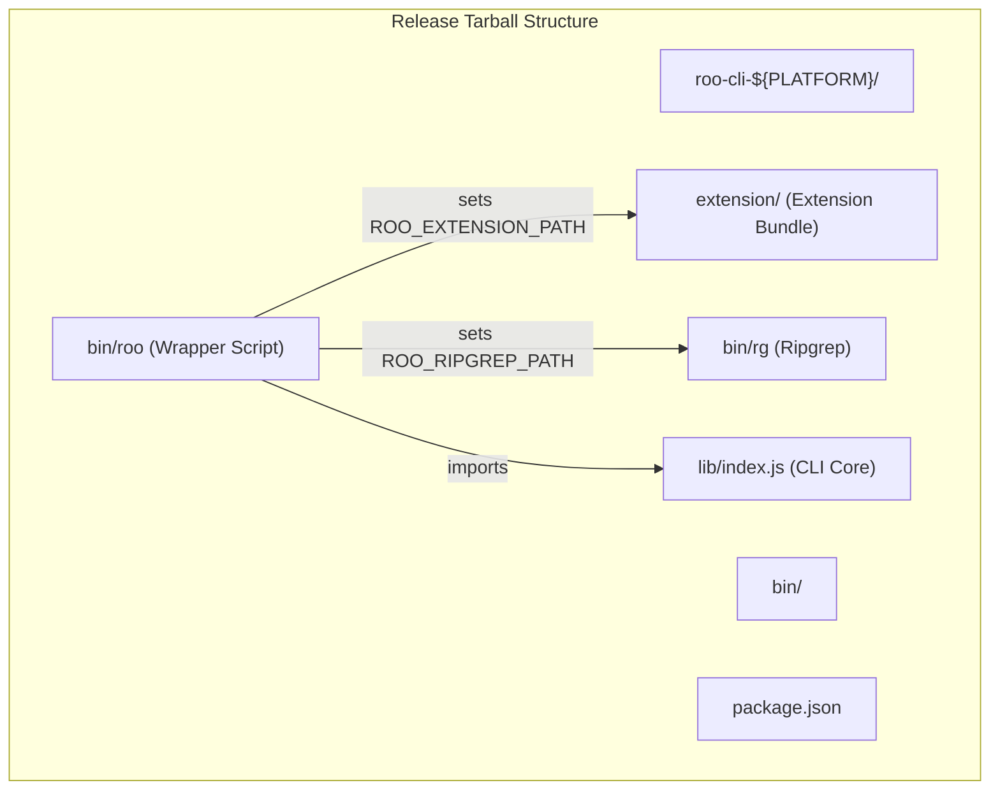
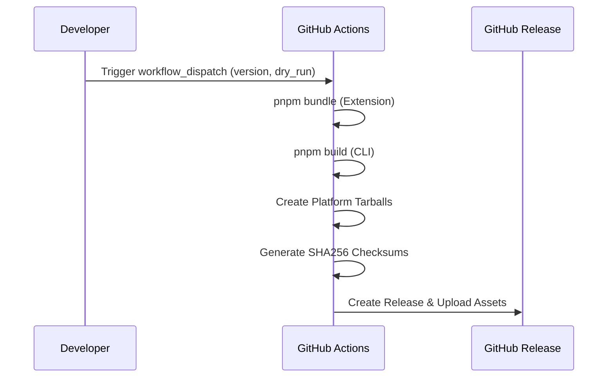

# CLI Build and Release

<details>
<summary>Relevant source files</summary>

The following files were used as context for generating this wiki page:

- [.github/workflows/cli-release.yml](.github/workflows/cli-release.yml)
- [apps/cli/README.md](apps/cli/README.md)
- [apps/cli/scripts/build.sh](apps/cli/scripts/build.sh)
- [apps/cli/src/agent/__tests__/extension-host.test.ts](apps/cli/src/agent/__tests__/extension-host.test.ts)
- [apps/cli/src/agent/extension-host.ts](apps/cli/src/agent/extension-host.ts)
- [apps/cli/src/commands/cli/run.ts](apps/cli/src/commands/cli/run.ts)
- [apps/cli/src/index.ts](apps/cli/src/index.ts)
- [apps/cli/src/lib/storage/__tests__/settings.test.ts](apps/cli/src/lib/storage/__tests__/settings.test.ts)
- [apps/cli/src/lib/utils/__tests__/shell.test.ts](apps/cli/src/lib/utils/__tests__/shell.test.ts)
- [apps/cli/src/lib/utils/shell.ts](apps/cli/src/lib/utils/shell.ts)
- [apps/cli/src/types/constants.ts](apps/cli/src/types/constants.ts)
- [apps/cli/src/types/types.ts](apps/cli/src/types/types.ts)
- [apps/cli/src/ui/App.tsx](apps/cli/src/ui/App.tsx)
- [apps/cli/src/ui/hooks/useExtensionHost.ts](apps/cli/src/ui/hooks/useExtensionHost.ts)
- [src/core/task-persistence/TaskHistoryStore.ts](src/core/task-persistence/TaskHistoryStore.ts)
- [src/core/task-persistence/__tests__/TaskHistoryStore.crossInstance.spec.ts](src/core/task-persistence/__tests__/TaskHistoryStore.crossInstance.spec.ts)
- [src/core/task-persistence/__tests__/TaskHistoryStore.spec.ts](src/core/task-persistence/__tests__/TaskHistoryStore.spec.ts)
- [src/core/task-persistence/index.ts](src/core/task-persistence/index.ts)
- [src/core/task/__tests__/Task.persistence.spec.ts](src/core/task/__tests__/Task.persistence.spec.ts)
- [src/core/webview/__tests__/ClineProvider.apiHandlerRebuild.spec.ts](src/core/webview/__tests__/ClineProvider.apiHandlerRebuild.spec.ts)
- [src/core/webview/__tests__/ClineProvider.lockApiConfig.spec.ts](src/core/webview/__tests__/ClineProvider.lockApiConfig.spec.ts)
- [src/core/webview/__tests__/ClineProvider.sticky-mode.spec.ts](src/core/webview/__tests__/ClineProvider.sticky-mode.spec.ts)
- [src/core/webview/__tests__/ClineProvider.sticky-profile.spec.ts](src/core/webview/__tests__/ClineProvider.sticky-profile.spec.ts)
- [src/core/webview/__tests__/ClineProvider.taskHistory.spec.ts](src/core/webview/__tests__/ClineProvider.taskHistory.spec.ts)
- [src/core/webview/__tests__/webviewMessageHandler.lockApiConfig.spec.ts](src/core/webview/__tests__/webviewMessageHandler.lockApiConfig.spec.ts)
- [src/i18n/setup.ts](src/i18n/setup.ts)
- [src/shared/globalFileNames.ts](src/shared/globalFileNames.ts)

</details>


This document describes the build pipeline, packaging process, and release workflow for the standalone Roo Code CLI application. The CLI shares core logic with the VS Code extension but requires separate build and distribution infrastructure to support headless execution across multiple platforms.

---

## Build System Overview

The CLI application is built as a standalone Node.js executable. While it resides in the same monorepo as the VS Code extension, it utilizes a distinct build pipeline centered around `tsup` and `esbuild`.

### Monorepo Structure and Dependencies

The CLI architecture relies on a "shimmed" environment to execute code originally designed for the VS Code Extension Host.

```mermaid
graph TD
    subgraph "apps/cli"
        [index.ts] --> [run.ts]
        [run.ts] --> [ExtensionHost]
        [ExtensionHost] --> [ExtensionClient]
    end
    
    subgraph "Shared Packages"
        Core["@roo-code/core<br/>Task Execution Logic"]
        Types["@roo-code/types<br/>Shared Type Definitions"]
        VscodeShim["@roo-code/vscode-shim<br/>Headless VS Code API"]
    end
    
    subgraph "Build Tools"
        Tsup["tsup<br/>TypeScript Bundler"]
        Esbuild["esbuild<br/>Bundling Engine"]
    end
    
    [ExtensionHost] --> Core
    [ExtensionHost] --> VscodeShim
    [ExtensionClient] --> Types
    
    Tsup --> Esbuild
```

**Sources:** [apps/cli/src/agent/extension-host.ts:2-9](), [apps/cli/src/agent/extension-host.ts:26-27](), [apps/cli/README.md:5-8]()

The CLI's build process is designed to produce a portable distribution. Key scripts in the CLI environment include:

| Script | Command | Purpose |
|---------|---------|---------|
| `build` | `pnpm --filter @roo-code/cli build` | Compiles and bundles the CLI into `dist/` |
| `bundle` | `pnpm --filter roo-cline bundle` | Bundles the main extension logic required by the CLI |
| `test` | `pnpm --filter @roo-code/cli test` | Runs unit and integration tests using Vitest |

**Sources:** [apps/cli/README.md:60-69](), [apps/cli/src/agent/__tests__/extension-host.test.ts:1-1]()

---

## Release Pipeline and Platform Packaging

The CLI release process is automated via GitHub Actions, targeting multiple operating systems and architectures.

### Multi-Platform Build Strategy

The release workflow `cli-release.yml` utilizes a build matrix to generate artifacts for major platforms.

| OS | Platform Identifier | Architecture |
|----|---------------------|--------------|
| macOS Latest | `darwin-arm64` | Apple Silicon |
| Ubuntu Latest | `linux-x64` | Intel/AMD 64-bit |
| Ubuntu 24.04 ARM | `linux-arm64` | ARM 64-bit |

**Sources:** [.github/workflows/cli-release.yml:18-31]()

### Release Artifact Assembly

The release workflow assembles a distribution tarball with a specific directory structure to ensure the CLI can locate its dependencies (like `ripgrep`) and the extension bundle.



**Sources:** [.github/workflows/cli-release.yml:75-112](), [.github/workflows/cli-release.yml:130-146]()

**Key Assembly Steps:**
1. **Extension Bundling**: The extension core is bundled using `pnpm bundle` and copied to the `extension/` directory within the release package [[.github/workflows/cli-release.yml:56-57](), [.github/workflows/cli-release.yml:108-109]()].
2. **Ripgrep Inclusion**: The workflow locates the `@vscode/ripgrep` binary and includes it directly in the `bin/` path to ensure search capabilities work without a local VS Code installation [[.github/workflows/cli-release.yml:115-127]()].
3. **Wrapper Script**: A Node.js wrapper script is generated. It defines critical environment variables like `ROO_CLI_ROOT`, `ROO_EXTENSION_PATH`, and `ROO_RIPGREP_PATH` before executing the bundled CLI logic [[.github/workflows/cli-release.yml:130-148]()].

---

## Version Management and Distribution

### Independent Versioning

The CLI maintains its own versioning, which can be overridden during the manual release process or defaulted to the version in `apps/cli/package.json`.

**Sources:** [apps/cli/src/index.ts:22-22](), [.github/workflows/cli-release.yml:44-55]()

### Distribution Workflow

The release is triggered manually via `workflow_dispatch`, allowing for dry runs or specific version overrides.



**Sources:** [.github/workflows/cli-release.yml:4-15](), [.github/workflows/cli-release.yml:160-168]()

---

## Verification and Testing

### Unit and Integration Testing

The CLI includes a robust test suite using Vitest. `ExtensionHost` is tested by mocking the `vscode-shim` and verifying that the host correctly initializes managers and handles the extension lifecycle.

- **Mocking**: `vi.mock("@roo-code/vscode-shim", ...)` is used to simulate the VS Code API environment [[apps/cli/src/agent/__tests__/extension-host.test.ts:14-19]()].
- **State Validation**: Tests ensure the `ROO_CLI_RUNTIME` environment variable is set to `"1"` to signal to the core extension that it is running in a CLI context [[apps/cli/src/agent/__tests__/extension-host.test.ts:156-160]()].

### Tarball Validation

The release workflow includes a `Verify tarball` step that extracts the generated archive and confirms the existence of critical files:
- `bin/roo`: The entry wrapper.
- `lib/index.js`: The compiled CLI logic.
- `package.json`: Runtime metadata.
- `extension/`: The directory containing the core extension bundle.

**Sources:** [.github/workflows/cli-release.yml:171-195]()

---

## Summary of Build Artifacts

| Artifact | Path in Release | Role |
|----------|-----------------|------|
| **CLI Wrapper** | `bin/roo` | Executable script that sets up the environment and launches the CLI [[.github/workflows/cli-release.yml:131-148]()] |
| **CLI Core** | `lib/index.js` | The main CLI application logic bundled into a single file [[.github/workflows/cli-release.yml:82-82]()] |
| **Extension Bundle** | `extension/` | The `@roo-code/core` logic bundled for Node.js compatibility [[.github/workflows/cli-release.yml:108-109]()] |
| **Ripgrep** | `bin/rg` | Platform-specific binary for fast file searching [[.github/workflows/cli-release.yml:123-124]()] |
| **Settings** | `cli-settings.json` | Persistent configuration stored in the user's config directory [[apps/cli/src/lib/storage/settings.js:21-22]()] |

**Sources:** [.github/workflows/cli-release.yml:76-148](), [apps/cli/src/lib/storage/__tests__/settings.test.ts:28-28]()