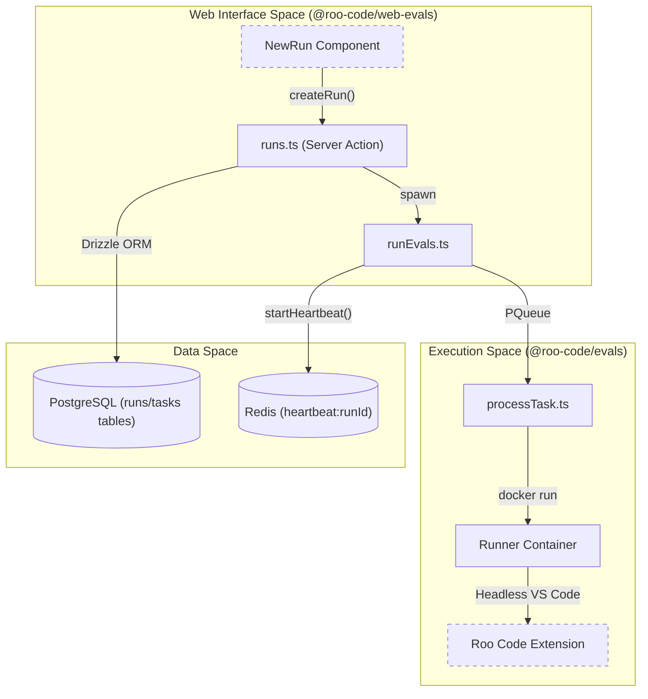
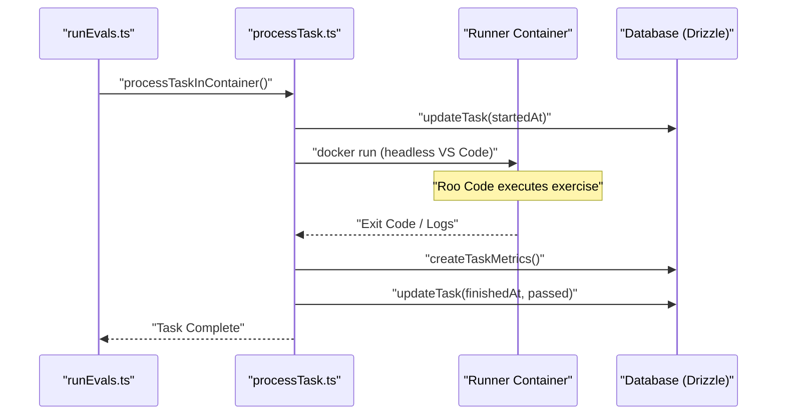

# Evaluation Framework

Relevant source files

The following files were used as context for generating this wiki page:

- [.dockerignore](.dockerignore)
- [apps/web-evals/src/actions/runs.ts](apps/web-evals/src/actions/runs.ts)
- [apps/web-evals/src/app/runs/new/new-run.tsx](apps/web-evals/src/app/runs/new/new-run.tsx)
- [apps/web-evals/src/lib/schemas.ts](apps/web-evals/src/lib/schemas.ts)
- [packages/evals/.docker/entrypoints/runner.sh](packages/evals/.docker/entrypoints/runner.sh)
- [packages/evals/.env.development](packages/evals/.env.development)
- [packages/evals/.env.test](packages/evals/.env.test)
- [packages/evals/Dockerfile.runner](packages/evals/Dockerfile.runner)
- [packages/evals/Dockerfile.web](packages/evals/Dockerfile.web)
- [packages/evals/README.md](packages/evals/README.md)
- [packages/evals/docker-compose.yml](packages/evals/docker-compose.yml)
- [packages/evals/scripts/setup.sh](packages/evals/scripts/setup.sh)
- [packages/evals/src/cli/index.ts](packages/evals/src/cli/index.ts)
- [packages/evals/src/cli/processTask.ts](packages/evals/src/cli/processTask.ts)
- [packages/evals/src/cli/runCi.ts](packages/evals/src/cli/runCi.ts)
- [packages/evals/src/cli/runEvals.ts](packages/evals/src/cli/runEvals.ts)
- [packages/evals/src/cli/runUnitTest.ts](packages/evals/src/cli/runUnitTest.ts)
- [packages/evals/src/cli/utils.ts](packages/evals/src/cli/utils.ts)
- [packages/evals/src/db/migrations/0005_strong_skrulls.sql](packages/evals/src/db/migrations/0005_strong_skrulls.sql)
- [packages/evals/src/db/migrations/meta/0005_snapshot.json](packages/evals/src/db/migrations/meta/0005_snapshot.json)
- [packages/evals/src/db/migrations/meta/_journal.json](packages/evals/src/db/migrations/meta/_journal.json)
- [packages/evals/src/db/schema.ts](packages/evals/src/db/schema.ts)

The Roo Code Evaluation Framework is a specialized infrastructure designed to automate the testing of AI capabilities against a standardized suite of programming exercises. It provides a reproducible environment for measuring the performance, accuracy, and tool-use efficiency of the Roo Code system across various LLM providers and configurations.

The system operates by executing VS Code headlessly within Docker containers, running tasks against the [Roo-Code-Evals](https://github.com/RooCodeInc/Roo-Code-Evals) repository, and collecting metrics on pass rates, token usage, and costs.

### System Overview

The framework bridges the gap between high-level AI instructions and low-level code execution by orchestrating a complex stack of services:

- **Web Interface**: A Next.js application (`apps/web-evals`) for configuring and monitoring evaluation runs [apps/web-evals/src/app/runs/new/new-run.tsx:106]().
- **Controller**: A CLI-based orchestrator (`packages/evals/src/cli/runEvals.ts`) that manages task distribution and concurrency [packages/evals/src/cli/runEvals.ts:10]().
- **Runners**: Specialized Docker containers (`packages/evals/Dockerfile.runner`) that host the headless VS Code environment and the Roo Code extension [packages/evals/Dockerfile.runner:1-7]().
- **Data Persistence**: A PostgreSQL database for storing run results and a Redis instance for real-time heartbeats and task queuing [packages/evals/docker-compose.yml:17-47]().

#### System Component Relationships

This diagram illustrates how the evaluation system components interact, mapping the user-facing web interface to the underlying code entities and infrastructure.

"Evaluation Framework Component Mapping"

Sources: [apps/web-evals/src/app/runs/new/new-run.tsx:106-150](), [apps/web-evals/src/actions/runs.ts:31-128](), [packages/evals/src/cli/runEvals.ts:10-88](), [packages/evals/src/db/schema.ts:18-79]()

---

## Evals Architecture and Setup

The evaluation framework relies on a multi-container Docker architecture defined in `packages/evals/docker-compose.yml`. This setup ensures that evaluations are performed in an isolated environment with all necessary language runtimes (Node.js, Python, Go, Rust, Java) pre-installed via `mise`.

- **Infrastructure**: Uses `evals-db` (PostgreSQL 15) and `evals-redis` (Redis 7) for state management [packages/evals/docker-compose.yml:17-47]().
- **Web UI**: Accessible at `localhost:3446` (default), it allows users to trigger runs and view real-time logs [packages/evals/README.md:32-38](), [packages/evals/docker-compose.yml:55]().
- **Runner Environment**: The `evals-runner` image includes a full suite of VS Code extensions and programming language tools to support diverse exercise types [packages/evals/Dockerfile.runner:7-90]().

For details, see [Evals Architecture and Setup](#16.1).

Sources: [packages/evals/docker-compose.yml:1-88](), [packages/evals/Dockerfile.runner:1-176](), [packages/evals/README.md:1-150]()

---

## Running and Configuring Evals

Evaluations can be triggered via the web UI or the CLI. A "Run" consists of multiple "Tasks," where each task represents a single programming exercise iteration.

- **Execution Methods**: Supports running via the standard VS Code extension host (`vscode`) or a standalone CLI shim (`cli`) [packages/evals/src/db/schema.ts:12-13](), [apps/web-evals/src/app/runs/new/new-run.tsx:112]().
- **Configuration**: Users can configure concurrency limits, timeouts, and specific exercise suites (full vs. partial) [apps/web-evals/src/app/runs/new/new-run.tsx:136-150]().
- **Settings Import**: Advanced users can import their `roo_code_settings.json` to test specific custom modes or instructions against the benchmark [packages/evals/README.md:40-42]().
- **Metrics Collection**: The system tracks `tokensIn`, `tokensOut`, `cost`, and `duration` for every task, persisting them in the `taskMetrics` table [packages/evals/src/db/schema.ts:96-107]().

#### Task Execution Flow

This diagram maps the logical flow of an evaluation task to the specific code functions responsible for each step.

"Task Execution Entity Mapping"

Sources: [packages/evals/src/cli/runEvals.ts:43-53](), [packages/evals/src/cli/processTask.ts:1-100](), [packages/evals/src/db/schema.ts:55-107]()

For details, see [Running and Configuring Evals](#16.2).

Sources: [apps/web-evals/src/actions/runs.ts:31-83](), [apps/web-evals/src/app/runs/new/new-run.tsx:185-248](), [packages/evals/src/cli/index.ts:11-45]()