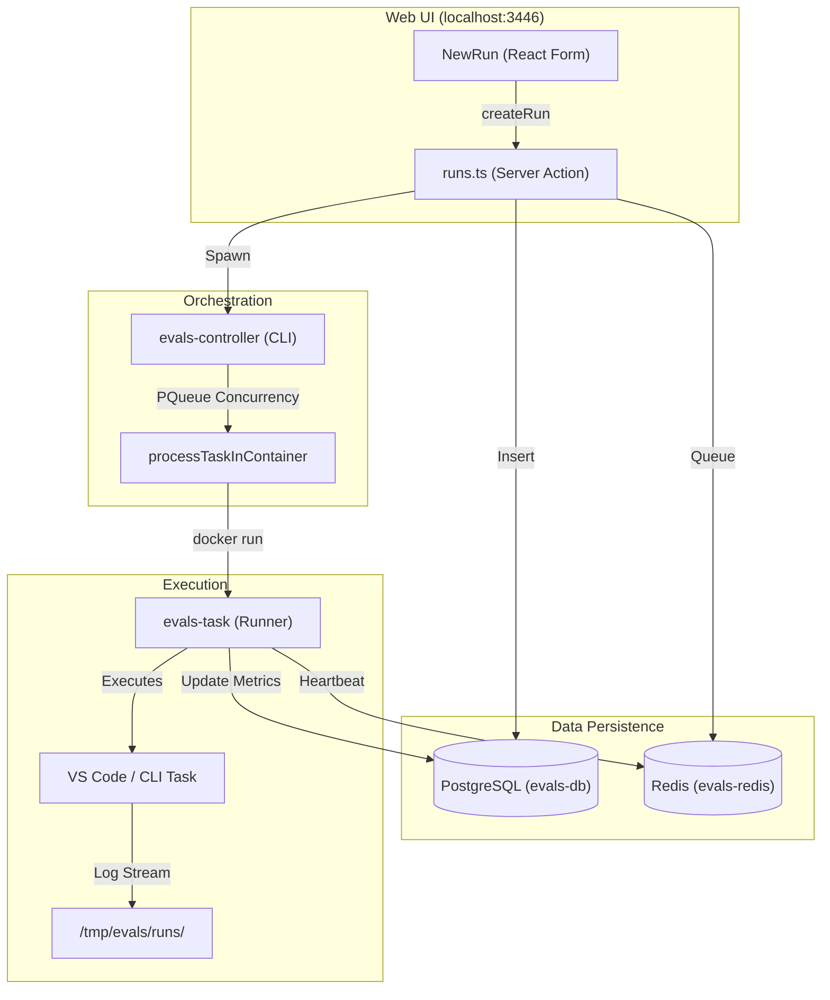
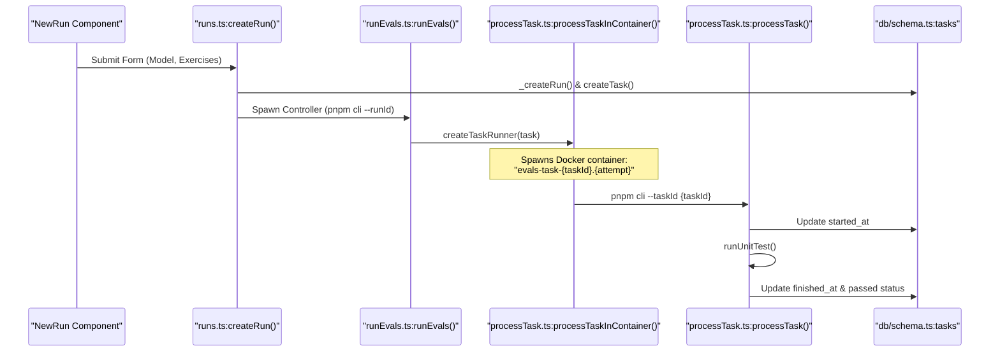

# Evals Architecture and Setup

Relevant source files

The following files were used as context for generating this wiki page:

- [.dockerignore](.dockerignore)
- [apps/web-evals/src/actions/runs.ts](apps/web-evals/src/actions/runs.ts)
- [apps/web-evals/src/app/runs/new/new-run.tsx](apps/web-evals/src/app/runs/new/new-run.tsx)
- [apps/web-evals/src/lib/schemas.ts](apps/web-evals/src/lib/schemas.ts)
- [packages/evals/.docker/entrypoints/runner.sh](packages/evals/.docker/entrypoints/runner.sh)
- [packages/evals/.env.development](packages/evals/.env.development)
- [packages/evals/.env.test](packages/evals/.env.test)
- [packages/evals/Dockerfile.runner](packages/evals/Dockerfile.runner)
- [packages/evals/Dockerfile.web](packages/evals/Dockerfile.web)
- [packages/evals/README.md](packages/evals/README.md)
- [packages/evals/docker-compose.yml](packages/evals/docker-compose.yml)
- [packages/evals/scripts/setup.sh](packages/evals/scripts/setup.sh)
- [packages/evals/src/cli/index.ts](packages/evals/src/cli/index.ts)
- [packages/evals/src/cli/processTask.ts](packages/evals/src/cli/processTask.ts)
- [packages/evals/src/cli/runCi.ts](packages/evals/src/cli/runCi.ts)
- [packages/evals/src/cli/runEvals.ts](packages/evals/src/cli/runEvals.ts)
- [packages/evals/src/cli/runUnitTest.ts](packages/evals/src/cli/runUnitTest.ts)
- [packages/evals/src/cli/utils.ts](packages/evals/src/cli/utils.ts)
- [packages/evals/src/db/migrations/0005_strong_skrulls.sql](packages/evals/src/db/migrations/0005_strong_skrulls.sql)
- [packages/evals/src/db/migrations/meta/0005_snapshot.json](packages/evals/src/db/migrations/meta/0005_snapshot.json)
- [packages/evals/src/db/migrations/meta/_journal.json](packages/evals/src/db/migrations/meta/_journal.json)
- [packages/evals/src/db/schema.ts](packages/evals/src/db/schema.ts)

The Roo Code Evaluation Framework is a specialized infrastructure designed to measure the performance of AI agents against a standardized suite of programming exercises. It leverages a containerized environment to ensure reproducible results, executing tasks in isolated VS Code or CLI environments and providing a real-time Web UI for monitoring and analysis.

## System Infrastructure

The framework operates as a multi-container system orchestrated via Docker Compose. It separates the orchestration logic (Controller), the execution environment (Runner), and the visualization layer (Web UI).

### Core Services
- **PostgreSQL**: Stores run configurations, task statuses, performance metrics, and tool errors using the Drizzle ORM schema [packages/evals/src/db/schema.ts:18-143]().
- **Redis**: Manages real-time heartbeats and task synchronization between the controller and active runners [packages/evals/src/cli/redis.ts:7-7]().
- **Web UI (`web-evals`)**: A Next.js application providing a dashboard for triggering runs and inspecting results [apps/web-evals/src/app/runs/new/new-run.tsx:106-118]().
- **Controller**: A CLI-based orchestrator that manages the task queue and spawns runners [packages/evals/src/cli/runEvals.ts:10-88]().
- **Runner**: Specialized containers (based on `debian:bookworm-slim`) pre-configured with VS Code, language runtimes (Node.js, Python, Go, Rust, Java), and the Roo Code extension [packages/evals/Dockerfile.runner:7-175]().

### Data Flow Diagram
The following diagram illustrates how an evaluation request flows from the UI through the database to the execution containers.

Sources: [apps/web-evals/src/app/runs/new/new-run.tsx:32-33](), [apps/web-evals/src/actions/runs.ts:31-128](), [packages/evals/src/cli/runEvals.ts:38-68](), [packages/evals/src/db/schema.ts:18-107]()

## Database Schema and Entities

The evaluation system uses a relational model to track the lifecycle of every AI interaction.

| Table | Purpose | Key Fields |
| :--- | :--- | :--- |
| `runs` | Top-level container for an evaluation session. | `model`, `concurrency`, `settings` (JSONB), `task_metrics_id` [packages/evals/src/db/schema.ts:18-39]() |
| `tasks` | Individual programming exercises within a run. | `language`, `exercise`, `iteration`, `passed` (boolean) [packages/evals/src/db/schema.ts:55-79]() |
| `taskMetrics` | Performance data for completed tasks. | `tokens_in`, `tokens_out`, `cost`, `duration`, `tool_usage` [packages/evals/src/db/schema.ts:96-107]() |
| `toolErrors` | Logs of specific tool failures during execution. | `tool_name`, `error` [packages/evals/src/db/schema.ts:119-126]() |

Sources: [packages/evals/src/db/schema.ts:1-143]()

## Execution Architecture

The framework supports two primary execution methods: `vscode` (headless VS Code extension) and `cli` (direct CLI interaction) [packages/evals/src/db/schema.ts:12-12]().

### Task Lifecycle Entity Mapping
This diagram bridges the high-level task concepts to the specific code functions that handle them.

Sources: [apps/web-evals/src/actions/runs.ts:31-128](), [packages/evals/src/cli/runEvals.ts:10-88](), [packages/evals/src/cli/processTask.ts:13-65](), [packages/evals/src/cli/processTask.ts:67-150](), [packages/evals/src/db/schema.ts:55-79]()

## Setup and Configuration

### Docker Environment
The system is managed via `packages/evals/docker-compose.yml`. By default, it uses specific ports to avoid conflicts:
- **PostgreSQL**: Port `5432` (Internal) / `EVALS_DB_PORT` (External, default `5432`) [packages/evals/docker-compose.yml:17-21]().
- **Redis**: Port `6379` (Internal) / `EVALS_REDIS_PORT` (External, default `6379`) [packages/evals/docker-compose.yml:38-42]().
- **Web Service**: Port `3446` [packages/evals/docker-compose.yml:49-55]().

### Setup Process
1. **Clone Repositories**: Clone the main `Roo-Code` repo [packages/evals/README.md:11-16]().
2. **Environment Configuration**: Create `packages/evals/.env.local` and add `OPENROUTER_API_KEY` [packages/evals/README.md:18-22]().
3. **Initialize Services**: Run `pnpm evals` to build and start the server profile (db, redis, web) [packages/evals/README.md:24-30]().
4. **Access UI**: Navigate to `http://localhost:3446` to configure and launch runs [packages/evals/README.md:38-40]().

### Local (Non-Docker) Setup
For macOS debugging, a `setup.sh` script is provided to install local dependencies:
- **Language Management**: Uses `mise` to manage Node.js (20.19.2), Python (3.13.2), Go (1.24.2), Rust (1.85.1), and Java (17) [packages/evals/scripts/setup.sh:141-214]().
- **Extension Building**: Compiles the `.vsix` from source and installs it into the local VS Code instance [packages/evals/scripts/setup.sh:3-7]().

Sources: [packages/evals/README.md:1-131](), [packages/evals/docker-compose.yml:1-88](), [packages/evals/scripts/setup.sh:1-216]()

## Runtime Management

### Concurrency and Resources
Evaluation runs are resource-intensive. The framework uses `p-queue` to manage concurrency [packages/evals/src/cli/runEvals.ts:38-38](). The system adds tasks with a staggered delay of 5000ms when concurrency is greater than 1 [packages/evals/src/cli/runEvals.ts:40-65]().

Recommended resource allocation:
- **Memory**: `3GB * concurrency`
- **CPU**: `2 * concurrency`

Sources: [packages/evals/README.md:50-59](), [packages/evals/src/cli/runEvals.ts:38-65]()

### Killing Runs
Stopping a run involves a specific sequence to prevent orphaned containers:
1. **Kill Controller**: `docker kill evals-controller-{runId}` [apps/web-evals/src/actions/runs.ts:159-168]().
2. **Grace Period**: Wait 10 seconds for the controller to stop spawning new tasks [apps/web-evals/src/actions/runs.ts:170-172]().
3. **Kill Runners**: Find and kill all containers matching `evals-task-{runId}-` [apps/web-evals/src/actions/runs.ts:174-202]().
4. **Cleanup Redis**: Delete heartbeat and runner keys from Redis [apps/web-evals/src/actions/runs.ts:204-216]().

Sources: [apps/web-evals/src/actions/runs.ts:152-230]()