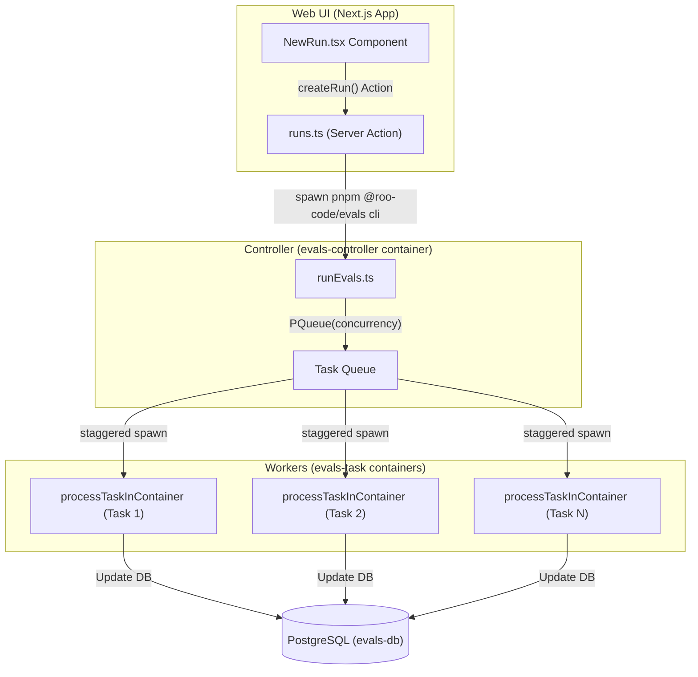
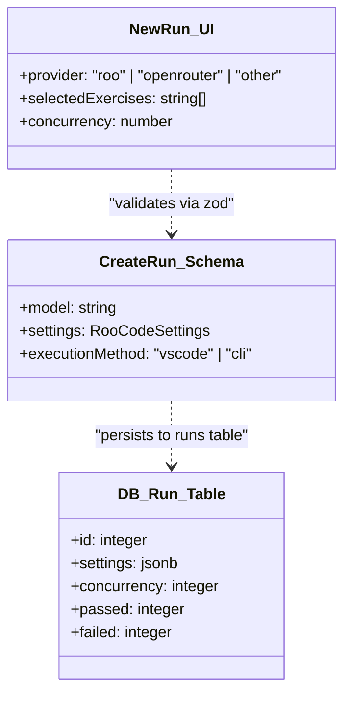

# Running and Configuring Evals

Relevant source files

The following files were used as context for generating this wiki page:

- [.dockerignore](.dockerignore)
- [apps/cli/CHANGELOG.md](apps/cli/CHANGELOG.md)
- [apps/cli/docs/AGENT_LOOP.md](apps/cli/docs/AGENT_LOOP.md)
- [apps/cli/package.json](apps/cli/package.json)
- [apps/cli/src/agent/__tests__/extension-client.test.ts](apps/cli/src/agent/__tests__/extension-client.test.ts)
- [apps/cli/src/agent/extension-client.ts](apps/cli/src/agent/extension-client.ts)
- [apps/cli/src/agent/state-store.ts](apps/cli/src/agent/state-store.ts)
- [apps/web-evals/src/actions/runs.ts](apps/web-evals/src/actions/runs.ts)
- [apps/web-evals/src/app/runs/new/new-run.tsx](apps/web-evals/src/app/runs/new/new-run.tsx)
- [apps/web-evals/src/lib/schemas.ts](apps/web-evals/src/lib/schemas.ts)
- [packages/evals/.docker/entrypoints/runner.sh](packages/evals/.docker/entrypoints/runner.sh)
- [packages/evals/.env.development](packages/evals/.env.development)
- [packages/evals/.env.test](packages/evals/.env.test)
- [packages/evals/Dockerfile.runner](packages/evals/Dockerfile.runner)
- [packages/evals/Dockerfile.web](packages/evals/Dockerfile.web)
- [packages/evals/README.md](packages/evals/README.md)
- [packages/evals/docker-compose.yml](packages/evals/docker-compose.yml)
- [packages/evals/scripts/setup.sh](packages/evals/scripts/setup.sh)
- [packages/evals/src/cli/__tests__/messageLogDeduper.test.ts](packages/evals/src/cli/__tests__/messageLogDeduper.test.ts)
- [packages/evals/src/cli/index.ts](packages/evals/src/cli/index.ts)
- [packages/evals/src/cli/processTask.ts](packages/evals/src/cli/processTask.ts)
- [packages/evals/src/cli/runCi.ts](packages/evals/src/cli/runCi.ts)
- [packages/evals/src/cli/runEvals.ts](packages/evals/src/cli/runEvals.ts)
- [packages/evals/src/cli/runTaskInCli.ts](packages/evals/src/cli/runTaskInCli.ts)
- [packages/evals/src/cli/runTaskInVscode.ts](packages/evals/src/cli/runTaskInVscode.ts)
- [packages/evals/src/cli/runUnitTest.ts](packages/evals/src/cli/runUnitTest.ts)
- [packages/evals/src/cli/types.ts](packages/evals/src/cli/types.ts)
- [packages/evals/src/cli/utils.ts](packages/evals/src/cli/utils.ts)
- [packages/evals/src/db/migrations/0005_strong_skrulls.sql](packages/evals/src/db/migrations/0005_strong_skrulls.sql)
- [packages/evals/src/db/migrations/meta/0005_snapshot.json](packages/evals/src/db/migrations/meta/0005_snapshot.json)
- [packages/evals/src/db/migrations/meta/_journal.json](packages/evals/src/db/migrations/meta/_journal.json)
- [packages/evals/src/db/schema.ts](packages/evals/src/db/schema.ts)

The Roo Code Evaluation Framework is a specialized testing infrastructure designed to measure the performance of AI agents against real-world programming exercises. It utilizes a containerized environment to ensure reproducibility and provides a web-based dashboard for orchestrating runs and analyzing results.

## Execution and Command Interface

The primary entry point for the evaluation system is the `pnpm evals` command, which initializes the Docker-based infrastructure.

### Command Workflow
1.  **Initialization**: Running `pnpm evals` from the root directory triggers the `docker-compose --profile server up` command [packages/evals/docker-compose.yml:5]().
2.  **Service Startup**: This launches the PostgreSQL database (`evals-db`), Redis cache (`evals-redis`), and the Next.js web application (`evals-web`) [packages/evals/docker-compose.yml:17-67]().
3.  **Access**: Once running, the Web UI is accessible at `http://localhost:3446` [packages/evals/README.md:38]().

### The CLI Orchestrator
While the Web UI is the primary interface, the underlying execution is managed by the `@roo-code/evals` CLI.
- **Run Execution**: `pnpm --filter @roo-code/evals cli --runId <id>` starts a "controller" that manages a queue of tasks [apps/web-evals/src/actions/runs.ts:99]().
- **Task Execution**: The `runEvals` function in the CLI package handles the lifecycle of a run, including heartbeat management and task distribution [packages/evals/src/cli/runEvals.ts:10-38]().

**Sources:** [packages/evals/README.md:29-38](), [packages/evals/docker-compose.yml:5-67](), [apps/web-evals/src/actions/runs.ts:99-103](), [packages/evals/src/cli/runEvals.ts:10-38]()

## Exercise Selection and Suites

Evals are organized into "Suites" and "Exercises" sourced from the [Roo-Code-Evals](https://github.com/RooCodeInc/Roo-Code-Evals) repository.

### Selection Modes
In the `NewRun` component, users can choose between two primary selection modes:
-   **Full Suite**: Executes all exercises across all supported languages (Python, Go, Java, Node.js, Rust) [apps/web-evals/src/actions/runs.ts:65-83]().
-   **Partial Suite**: Allows granular selection of specific exercises via a multi-select interface [apps/web-evals/src/app/runs/new/new-run.tsx:134-142]().

### Exercise Data Flow
The system fetches available exercises using the `getExercises` action, which scans the cloned `evals` directory [apps/web-evals/src/app/runs/new/new-run.tsx:33](). Exercises are categorized by language (e.g., `python/binary-search`).

| Entity | Description | Code Reference |
| :--- | :--- | :--- |
| `ExerciseLanguage` | Supported languages: `python`, `go`, `java`, `javascript`, `rust` | [packages/evals/src/db/schema.ts:6]() |
| `getExercisesForLanguage` | Function to list exercises in a language directory | [apps/web-evals/src/actions/runs.ts:67]() |
| `createTask` | DB function to persist a specific exercise attempt | [apps/web-evals/src/actions/runs.ts:56]() |

**Sources:** [apps/web-evals/src/app/runs/new/new-run.tsx:106-150](), [apps/web-evals/src/actions/runs.ts:31-83](), [packages/evals/src/db/schema.ts:55-79]()

## Concurrency and Resource Configuration

The evaluation framework is designed for high-parallelism execution using `p-queue` and Docker.

### Concurrency Settings
Concurrency is configured via the `concurrency` slider in the `NewRun` UI, which defaults to `2` and can be scaled based on host resources [apps/web-evals/src/app/runs/new/new-run.tsx:144]().

-   **Controller Logic**: The `runEvals` function initializes a `PQueue` with the specified concurrency [packages/evals/src/cli/runEvals.ts:38]().
-   **Staggered Start**: To prevent API rate-limiting and CPU spikes, tasks are started with a 5-second (`STAGGER_DELAY_MS`) delay [packages/evals/src/cli/runEvals.ts:40-69]().

### Docker Resource Management
Because each task runs in a separate `evals-task` container, resource limits must be adjusted in Docker Desktop:
-   **Memory**: ~3GB per concurrent task [packages/evals/README.md:57]().
-   **CPU**: ~2 cores per concurrent task [packages/evals/README.md:58]().

### Task Flow Diagram
This diagram shows how the `runEvals` orchestrator manages concurrent `processTask` executions.

**Sources:** [apps/web-evals/src/app/runs/new/new-run.tsx:144-200](), [packages/evals/src/cli/runEvals.ts:38-71](), [packages/evals/README.md:50-63](), [apps/web-evals/src/actions/runs.ts:87-128]()

## Settings Import and Provider Configuration

A key feature of the eval system is the ability to test specific Roo Code configurations by importing settings from the VS Code extension.

### Settings Integration
Users can import a `roo_code_settings.json` file. The `NewRun` component parses this into `ImportedSettings`, allowing the evaluation to use custom modes, custom instructions, and specific API configurations [apps/web-evals/src/app/runs/new/new-run.tsx:88-92]().

-   **Global Settings**: Imported via `globalSettingsSchema` [apps/web-evals/src/app/runs/new/new-run.tsx:25-30]().
-   **Provider Settings**: Includes API keys and model preferences [apps/web-evals/src/app/runs/new/new-run.tsx:89]().
-   **Persistence**: The UI uses `localStorage` to remember the last used model selection and concurrency settings for faster re-runs [apps/web-evals/src/app/runs/new/new-run.tsx:190-248]().

### Data Entity Mapping
The following diagram maps UI configuration entities to their corresponding TypeScript types and database columns.

**Sources:** [apps/web-evals/src/app/runs/new/new-run.tsx:88-150](), [packages/evals/src/db/schema.ts:18-39](), [apps/web-evals/src/lib/schemas.ts:38-48]()

## Result Interpretation and UI

The Web UI provides real-time feedback as the `evals-controller` updates the database.

### Result Metrics
The system tracks several key performance indicators (KPIs) stored in the `taskMetrics` table [packages/evals/src/db/schema.ts:96-107]():
-   **Pass/Fail**: Boolean status of the exercise's unit tests.
-   **Token Usage**: `tokensIn`, `tokensOut`, and `cacheReads`/`cacheWrites` for cost analysis.
-   **Duration**: Time taken for the agent to complete the task.
-   **Tool Usage**: A JSON breakdown of which tools (e.g., `write_to_file`, `execute_command`) were used [packages/evals/src/db/schema.ts:105]().

### Log Access
Logs are stored on the host at `/tmp/evals/runs/{runId}` and mounted into the `evals-web` container as read-only [packages/evals/docker-compose.yml:61-62](). This allows the UI to display:
1.  **Controller Logs**: High-level orchestration events [packages/evals/src/cli/runEvals.ts:27]().
2.  **Task Logs**: Detailed trace of the AI's thoughts and tool calls.
3.  **Tool Errors**: Specific failures encountered during tool execution, stored in the `toolErrors` table [packages/evals/src/db/schema.ts:119-126]().

### Stopping a Run
To terminate an active run, the `killRun` action is used. It follows a strict sequence:
1.  **Kill Controller**: Stops the `evals-controller-{runId}` container first to prevent new tasks from starting [apps/web-evals/src/actions/runs.ts:159-168]().
2.  **Wait Period**: A 10-second pause allows active tasks to attempt graceful shutdown [apps/web-evals/src/actions/runs.ts:171-172]().
3.  **Kill Runners**: Forcefully kills all remaining `evals-task-{runId}-*` containers [apps/web-evals/src/actions/runs.ts:174-202]().
4.  **Cleanup**: Clears heartbeat and runner metadata from Redis [apps/web-evals/src/actions/runs.ts:205-216]().

**Sources:** [packages/evals/src/db/schema.ts:96-143](), [apps/web-evals/src/actions/runs.ts:143-230](), [packages/evals/docker-compose.yml:50-62](), [packages/evals/src/cli/runEvals.ts:25-31]()