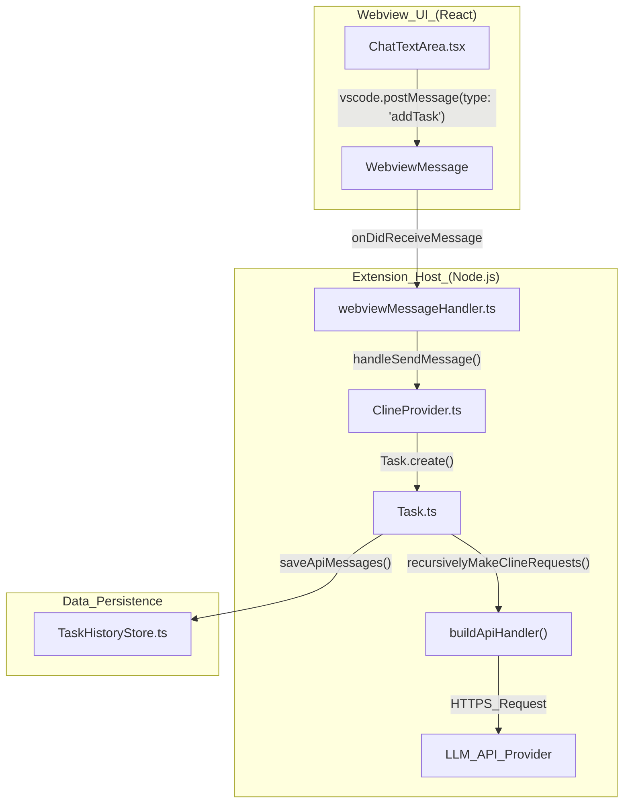
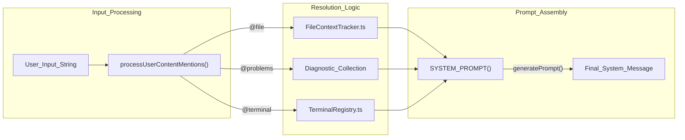

# Glossary

Relevant source files

The following files were used as context for generating this wiki page:

- [CHANGELOG.md](CHANGELOG.md)
- [apps/cli/CHANGELOG.md](apps/cli/CHANGELOG.md)
- [apps/cli/docs/AGENT_LOOP.md](apps/cli/docs/AGENT_LOOP.md)
- [apps/cli/package.json](apps/cli/package.json)
- [apps/cli/src/agent/__tests__/extension-client.test.ts](apps/cli/src/agent/__tests__/extension-client.test.ts)
- [apps/cli/src/agent/extension-client.ts](apps/cli/src/agent/extension-client.ts)
- [apps/cli/src/agent/state-store.ts](apps/cli/src/agent/state-store.ts)
- [apps/web-evals/package.json](apps/web-evals/package.json)
- [apps/web-roo-code/package.json](apps/web-roo-code/package.json)
- [apps/web-roo-code/src/components/ui/navigation-menu.tsx](apps/web-roo-code/src/components/ui/navigation-menu.tsx)
- [package.json](package.json)
- [packages/build/tsconfig.json](packages/build/tsconfig.json)
- [packages/cloud/src/__tests__/CloudSettingsService.parsing.test.ts](packages/cloud/src/__tests__/CloudSettingsService.parsing.test.ts)
- [packages/evals/src/cli/__tests__/messageLogDeduper.test.ts](packages/evals/src/cli/__tests__/messageLogDeduper.test.ts)
- [packages/evals/src/cli/runTaskInCli.ts](packages/evals/src/cli/runTaskInCli.ts)
- [packages/evals/src/cli/runTaskInVscode.ts](packages/evals/src/cli/runTaskInVscode.ts)
- [packages/evals/src/cli/types.ts](packages/evals/src/cli/types.ts)
- [packages/types/src/tool-params.ts](packages/types/src/tool-params.ts)
- [packages/types/src/vscode-extension-host.ts](packages/types/src/vscode-extension-host.ts)
- [pnpm-lock.yaml](pnpm-lock.yaml)
- [src/__tests__/command-mentions.spec.ts](src/__tests__/command-mentions.spec.ts)
- [src/api/index.ts](src/api/index.ts)
- [src/api/providers/anthropic.ts](src/api/providers/anthropic.ts)
- [src/api/providers/deepseek.ts](src/api/providers/deepseek.ts)
- [src/api/providers/fetchers/modelCache.ts](src/api/providers/fetchers/modelCache.ts)
- [src/api/providers/mistral.ts](src/api/providers/mistral.ts)
- [src/api/providers/openai.ts](src/api/providers/openai.ts)
- [src/api/providers/openrouter.ts](src/api/providers/openrouter.ts)
- [src/api/providers/requesty.ts](src/api/providers/requesty.ts)
- [src/api/providers/unbound.ts](src/api/providers/unbound.ts)
- [src/core/assistant-message/__tests__/NativeToolCallParser.spec.ts](src/core/assistant-message/__tests__/NativeToolCallParser.spec.ts)
- [src/core/mentions/__tests__/processUserContentMentions.spec.ts](src/core/mentions/__tests__/processUserContentMentions.spec.ts)
- [src/core/mentions/index.ts](src/core/mentions/index.ts)
- [src/core/mentions/processUserContentMentions.ts](src/core/mentions/processUserContentMentions.ts)
- [src/core/prompts/tools/__tests__/filter-tools-for-mode.spec.ts](src/core/prompts/tools/__tests__/filter-tools-for-mode.spec.ts)
- [src/core/prompts/tools/filter-tools-for-mode.ts](src/core/prompts/tools/filter-tools-for-mode.ts)
- [src/core/prompts/tools/native-tools/__tests__/read_file.spec.ts](src/core/prompts/tools/native-tools/__tests__/read_file.spec.ts)
- [src/core/prompts/tools/native-tools/read_file.ts](src/core/prompts/tools/native-tools/read_file.ts)
- [src/core/task/Task.ts](src/core/task/Task.ts)
- [src/core/task/__tests__/Task.spec.ts](src/core/task/__tests__/Task.spec.ts)
- [src/core/task/build-tools.ts](src/core/task/build-tools.ts)
- [src/core/tools/RunSlashCommandTool.ts](src/core/tools/RunSlashCommandTool.ts)
- [src/core/tools/SkillTool.ts](src/core/tools/SkillTool.ts)
- [src/core/tools/__tests__/runSlashCommandTool.spec.ts](src/core/tools/__tests__/runSlashCommandTool.spec.ts)
- [src/core/tools/__tests__/validateToolUse.spec.ts](src/core/tools/__tests__/validateToolUse.spec.ts)
- [src/core/tools/validateToolUse.ts](src/core/tools/validateToolUse.ts)
- [src/core/webview/ClineProvider.ts](src/core/webview/ClineProvider.ts)
- [src/core/webview/__tests__/ClineProvider.spec.ts](src/core/webview/__tests__/ClineProvider.spec.ts)
- [src/core/webview/__tests__/webviewMessageHandler.spec.ts](src/core/webview/__tests__/webviewMessageHandler.spec.ts)
- [src/core/webview/webviewMessageHandler.ts](src/core/webview/webviewMessageHandler.ts)
- [src/extension.ts](src/extension.ts)
- [src/package.json](src/package.json)
- [src/services/skills/__tests__/skillInvocation.spec.ts](src/services/skills/__tests__/skillInvocation.spec.ts)
- [src/shared/WebviewMessage.ts](src/shared/WebviewMessage.ts)
- [src/shared/__tests__/modes.spec.ts](src/shared/__tests__/modes.spec.ts)
- [src/shared/api.ts](src/shared/api.ts)
- [src/shared/modes.ts](src/shared/modes.ts)
- [webview-ui/package.json](webview-ui/package.json)
- [webview-ui/src/components/chat/ChatRow.tsx](webview-ui/src/components/chat/ChatRow.tsx)
- [webview-ui/src/components/chat/ChatView.tsx](webview-ui/src/components/chat/ChatView.tsx)
- [webview-ui/src/components/common/MermaidBlock.tsx](webview-ui/src/components/common/MermaidBlock.tsx)
- [webview-ui/src/components/settings/ApiOptions.tsx](webview-ui/src/components/settings/ApiOptions.tsx)
- [webview-ui/src/components/settings/SettingsView.tsx](webview-ui/src/components/settings/SettingsView.tsx)
- [webview-ui/src/context/ExtensionStateContext.tsx](webview-ui/src/context/ExtensionStateContext.tsx)
- [webview-ui/src/i18n/locales/ca/chat.json](webview-ui/src/i18n/locales/ca/chat.json)
- [webview-ui/src/i18n/locales/de/chat.json](webview-ui/src/i18n/locales/de/chat.json)
- [webview-ui/src/i18n/locales/es/chat.json](webview-ui/src/i18n/locales/es/chat.json)
- [webview-ui/src/i18n/locales/fr/chat.json](webview-ui/src/i18n/locales/fr/chat.json)
- [webview-ui/src/i18n/locales/hi/chat.json](webview-ui/src/i18n/locales/hi/chat.json)
- [webview-ui/src/i18n/locales/it/chat.json](webview-ui/src/i18n/locales/it/chat.json)
- [webview-ui/src/i18n/locales/ja/chat.json](webview-ui/src/i18n/locales/ja/chat.json)
- [webview-ui/src/i18n/locales/ko/chat.json](webview-ui/src/i18n/locales/ko/chat.json)
- [webview-ui/src/i18n/locales/pl/chat.json](webview-ui/src/i18n/locales/pl/chat.json)
- [webview-ui/src/i18n/locales/tr/chat.json](webview-ui/src/i18n/locales/tr/chat.json)
- [webview-ui/src/i18n/locales/vi/chat.json](webview-ui/src/i18n/locales/vi/chat.json)
- [webview-ui/src/i18n/locales/zh-CN/chat.json](webview-ui/src/i18n/locales/zh-CN/chat.json)
- [webview-ui/src/i18n/locales/zh-TW/chat.json](webview-ui/src/i18n/locales/zh-TW/chat.json)
- [webview-ui/src/index.tsx](webview-ui/src/index.tsx)
- [webview-ui/src/utils/validate.ts](webview-ui/src/utils/validate.ts)
- [webview-ui/tsconfig.json](webview-ui/tsconfig.json)
- [webview-ui/vite.config.ts](webview-ui/vite.config.ts)

This page provides definitions for codebase-specific terms, abbreviations, and domain concepts used throughout the Roo Code project. It serves as a reference for engineers to understand the internal nomenclature and how these concepts map to the implementation.

## Core Domain Concepts

### Task
A **Task** represents a single, autonomous session where the AI works towards a specific objective. It manages the lifecycle of the conversation, tool execution, and state persistence.
*   **Implementation**: Defined in the `Task` class [src/core/task/Task.ts:162-162]().
*   **Data Flow**: Initialized via `ClineProvider` [src/core/webview/ClineProvider.ts:96-96](), it maintains an `apiConversationHistory` and `clineMessages` [src/core/task/Task.ts:111-115]().

### Cline / Roo
"Cline" was the original name of the project. While rebranded to **Roo Code**, the codebase still extensively uses `Cline` as a prefix for classes, types, and variables (e.g., `ClineProvider`, `ClineMessage`).
*   **Implementation**: `ClineProvider` acts as the primary VS Code `WebviewViewProvider` [src/core/webview/ClineProvider.ts:126-129]().

### Mode
A **Mode** defines a specific persona or configuration for the AI, including its role definition, allowed tools, and custom instructions. Default modes include `Code`, `Architect`, `Ask`, and `Debug`.
*   **Implementation**: Managed by `CustomModesManager` [src/core/webview/ClineProvider.ts:95-95]() and defined in `shared/modes` [src/shared/modes.ts:58-58]().
*   **Configuration**: Each mode has a `ModeConfig` structure that maps to specific tool groups [src/shared/modes.ts:72-72]().

### MCP (Model Context Protocol)
An open standard that enables AI models to interact with external tools and data sources. Roo Code acts as an MCP Host.
*   **Implementation**: Managed by `McpHub` [src/core/webview/ClineProvider.ts:71-71]() and `McpServerManager` [src/core/webview/ClineProvider.ts:72-72]().
*   **Usage**: Tools are invoked via `use_mcp_tool` [src/core/task/Task.ts:77-78]().

---

## Technical Jargon & Abbreviations

| Term | Definition | Code Pointer |
| :--- | :--- | :--- |
| **Ask/Say** | The communication pattern between the Task and the UI. `say` provides updates; `ask` requires user intervention. | [src/core/task/Task.ts:30-31]() |
| **ApiHandler** | A unified interface for interacting with various LLM providers (Anthropic, OpenAI, etc.). | [src/api/index.ts:61-61]() |
| **Context Window** | The maximum number of tokens the LLM can process in one request. | [src/core/task/Task.ts:119-119]() |
| **Condensation** | The process of summarizing old messages to fit within the context window. | [src/core/task/Task.ts:129-129]() |
| **Checkpoint** | A snapshot of the workspace state (usually via Git) that allows "rewinding" the task. | [src/core/task/Task.ts:121-127]() |
| **Shadow Git** | An internal Git repository used to track file changes for the checkpoint system without affecting the user's main Git history. | [src/services/checkpoints/ShadowCheckpointService.ts]() |
| **Webview Message** | The JSON protocol used for IPC between the VS Code Extension Host and the React Webview. | [src/shared/WebviewMessage.ts:61-61]() |
| **Monorepo Packages** | Roo Code uses a monorepo structure with shared packages like `@roo-code/types`, `@roo-code/telemetry`, and `@roo-code/cloud`. | [package.json:28-49]() |

---

## Code Entity Mapping

The following diagrams bridge the gap between natural language concepts and the specific code entities that implement them.

### Task Execution Flow
This diagram shows how a user prompt moves from the UI through the `ClineProvider` to the `Task` orchestrator and out to an `ApiHandler`.

**Sources**: [src/core/webview/ClineProvider.ts:98-98](), [src/core/task/Task.ts:162-162](), [src/core/webview/webviewMessageHandler.ts](), [src/api/index.ts:90-90]()

### Context & Mention Resolution
How the system processes `@` mentions like `@file` or `@problems` into context for the LLM.

**Sources**: [src/core/mentions/processUserContentMentions.ts:128-128](), [src/core/task/Task.ts:102-102](), [src/core/task/Task.ts:96-96](), [src/integrations/terminal/TerminalRegistry.ts:85-85]()

---

## Provider-Specific Terms

*   **Reasoning Budget**: A parameter for models (like DeepSeek or OpenAI o1) that specifies how many "thinking" tokens to allocate.
    *   **Implementation**: `shouldUseReasoningBudget` [src/shared/api.ts:44-50]().
*   **Reasoning Effort**: A model-specific setting (e.g., for OpenAI o3-mini) to control the intensity of reasoning.
    *   **Implementation**: `shouldUseReasoningEffort` [src/shared/api.ts:52-58]().
*   **Dynamic Provider**: Providers that fetch their model lists at runtime (e.g., OpenRouter, Ollama) rather than using a hardcoded list.
    *   **Implementation**: `isDynamicProvider` [src/shared/api.ts:7-7]().
*   **Native Tool Calling**: Using the LLM provider's built-in tool/function calling API rather than parsing XML or JSON blocks from text.
    *   **Implementation**: `NativeToolCallParser` [src/core/assistant-message/NativeToolCallParser.ts:106-106]().

## State & Persistence

*   **GlobalState**: VS Code's persistent storage for extension-wide settings (e.g., API keys, custom modes).
    *   **Implementation**: Accessed via `ContextProxy` [src/core/webview/ClineProvider.ts:93-93]().
*   **TaskHistoryStore**: File-based storage for individual task conversations, located in the extension's global storage directory.
    *   **Implementation**: `TaskHistoryStore` [src/core/task-persistence/index.ts:100-100]().
*   **clineMessagesSeq**: A monotonic counter used to prevent "stale" state updates in the Webview when multiple messages are in flight.
    *   **Implementation**: `clineMessagesSeq` [src/core/webview/ClineProvider.ts:168-168]().

**Sources**: [src/core/webview/ClineProvider.ts:153-156](), [src/core/config/ContextProxy.ts:31-31](), [src/shared/api.ts:105-115]()