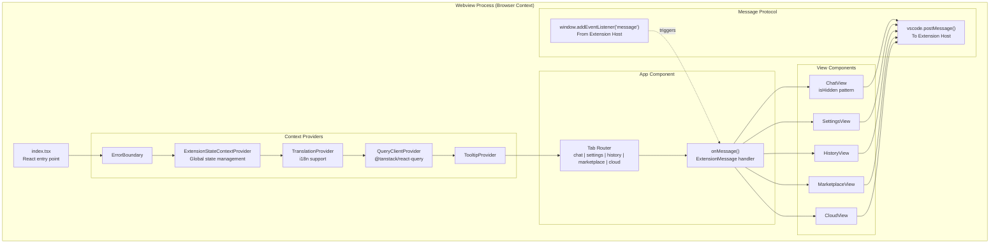
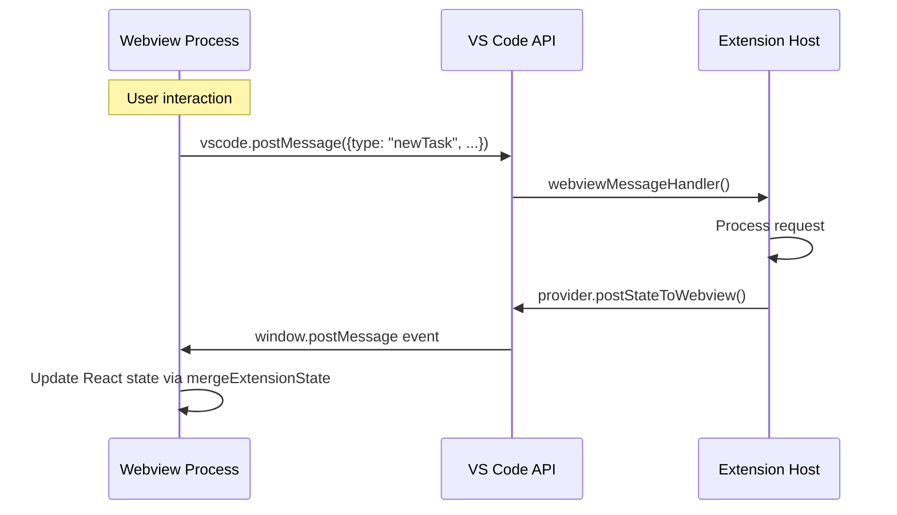
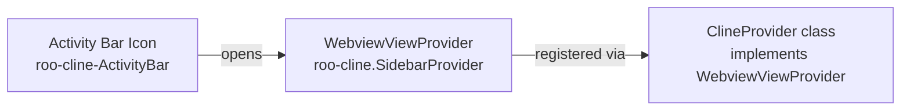
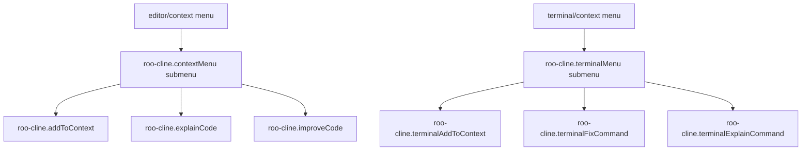
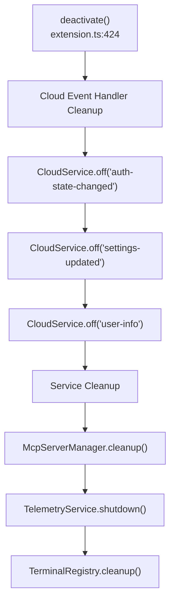

# Extension Architecture

Relevant source files

The following files were used as context for generating this wiki page:

- [CHANGELOG.md](CHANGELOG.md)
- [apps/web-evals/package.json](apps/web-evals/package.json)
- [apps/web-roo-code/package.json](apps/web-roo-code/package.json)
- [apps/web-roo-code/src/components/ui/navigation-menu.tsx](apps/web-roo-code/src/components/ui/navigation-menu.tsx)
- [package.json](package.json)
- [packages/build/tsconfig.json](packages/build/tsconfig.json)
- [packages/telemetry/src/BaseTelemetryClient.ts](packages/telemetry/src/BaseTelemetryClient.ts)
- [packages/telemetry/src/PostHogTelemetryClient.ts](packages/telemetry/src/PostHogTelemetryClient.ts)
- [packages/telemetry/src/TelemetryService.ts](packages/telemetry/src/TelemetryService.ts)
- [packages/telemetry/src/__tests__/PostHogTelemetryClient.test.ts](packages/telemetry/src/__tests__/PostHogTelemetryClient.test.ts)
- [packages/types/src/__tests__/telemetry.test.ts](packages/types/src/__tests__/telemetry.test.ts)
- [packages/types/src/telemetry.ts](packages/types/src/telemetry.ts)
- [packages/types/src/vscode.ts](packages/types/src/vscode.ts)
- [pnpm-lock.yaml](pnpm-lock.yaml)
- [src/activate/registerCommands.ts](src/activate/registerCommands.ts)
- [src/extension.ts](src/extension.ts)
- [src/package.json](src/package.json)
- [src/utils/focusPanel.ts](src/utils/focusPanel.ts)
- [webview-ui/package.json](webview-ui/package.json)
- [webview-ui/src/components/common/MermaidBlock.tsx](webview-ui/src/components/common/MermaidBlock.tsx)
- [webview-ui/src/components/ui/hooks/index.ts](webview-ui/src/components/ui/hooks/index.ts)
- [webview-ui/src/components/ui/hooks/useNonInteractiveClick.ts](webview-ui/src/components/ui/hooks/useNonInteractiveClick.ts)
- [webview-ui/src/index.tsx](webview-ui/src/index.tsx)
- [webview-ui/tsconfig.json](webview-ui/tsconfig.json)
- [webview-ui/vite.config.ts](webview-ui/vite.config.ts)

## Purpose and Scope

This document provides an overview of the Roo Code VS Code extension's architecture, covering its dual-process design, lifecycle management, core services initialization, and integration points with VS Code APIs. For detailed information about specific subsystems, see:
- Extension activation sequence and service initialization: [Extension Activation and Lifecycle](#2.1)
- Individual service implementations: [Core Services](#2.2)
- State persistence mechanisms: [State Management and Storage](#2.3)
- VS Code command and UI integration: [Commands and VS Code Integration](#2.4)

The Roo Code extension follows VS Code's standard extension architecture, operating across two separate JavaScript execution contexts: the Extension Host process (Node.js environment) and the Webview process (browser-like environment). This separation enables isolation, security, and leverages VS Code's webview infrastructure for rich UI rendering.

---

## Dual-Process Architecture

The extension operates in two distinct processes that communicate via VS Code's `postMessage` protocol:

### Extension Host Process Architecture

```mermaid
graph TB
    subgraph ExtensionHost["Extension Host Process (Node.js)"]
        activate["activate()<br/>src/extension.ts:120"]
        
        subgraph CoreInit["Core Initialization"]
            dotenv["dotenvx.config()<br/>Load .env"]
            migrate["migrateSettings()<br/>Settings migration"]
            telemetry["TelemetryService<br/>createInstance()"]
            mdm["MdmService<br/>createInstance()"]
            i18n["initializeI18n()"]
            terminal["TerminalRegistry<br/>.initialize()"]
            oauth["openAiCodexOAuthManager<br/>.initialize()"]
        end
        
        subgraph StateLayer["State & Storage Layer"]
            contextProxy["ContextProxy<br/>.getInstance()"]
            globalState["vscode.ExtensionContext<br/>.globalState"]
        end
        
        subgraph CoreServices["Core Services"]
            codeIndex["CodeIndexManager[]<br/>Per-workspace instances"]
            cloud["CloudService<br/>.createInstance()"]
        end
        
        subgraph ProviderLayer["Provider & Orchestration"]
            clineProvider["ClineProvider<br/>Main orchestrator"]
            webviewReg["registerWebviewViewProvider()<br/>VS Code API"]
        end
        
        subgraph VSCodeIntegration["VS Code Integration"]
            commands["registerCommands()"]
            codeActions["registerCodeActions()"]
            terminalActions["registerTerminalActions()"]
            uriHandler["registerUriHandler()"]
            diffProvider["TextDocumentContentProvider<br/>DIFF_VIEW_URI_SCHEME"]
        end
        
        activate --> dotenv
        dotenv --> migrate
        migrate --> telemetry
        telemetry --> mdm
        mdm --> i18n
        i18n --> terminal
        terminal --> oauth
        oauth --> contextProxy
        contextProxy --> codeIndex
        codeIndex --> clineProvider
        clineProvider --> cloud
        cloud --> webviewReg
        webviewReg --> commands
        commands --> codeActions
        codeActions --> terminalActions
        terminalActions --> uriHandler
        uriHandler --> diffProvider
    end
    
    globalState -.->|persists| contextProxy
```

**Sources:** [src/extension.ts:120-421]()

### Webview Process Architecture

The Webview UI is a React application bundled using Vite. It utilizes a single combined CSS bundle and shared assets to maintain consistency across different webview instances (sidebar vs. editor tab).

**Sources:** [webview-ui/package.json:17-85](), [webview-ui/vite.config.ts:105-114](), [src/extension.ts:53-59]()

### Message-Passing Protocol

The two processes communicate exclusively through structured messages. The extension host handles incoming messages via a centralized handler:

**Sources:** [src/extension.ts:184-185](), [src/activate/registerCommands.ts:84-84](), [src/activate/registerCommands.ts:184-184]()

---

## Extension Manifest and Contribution Points

The `src/package.json` defines all VS Code integration points using the contributions API:

### View Containers and Views

| Contribution | ID | Purpose |
|-------------|-----|---------|
| `viewsContainers.activitybar` | `roo-cline-ActivityBar` | Sidebar icon in Activity Bar |
| `views["roo-cline-ActivityBar"]` | `roo-cline.SidebarProvider` | Webview panel in sidebar |

**Sources:** [src/package.json:54-70]()

### Commands Registration

The extension registers numerous commands through `package.json` contributions and runtime registration in `registerCommands.ts`:

| Command ID | Purpose | Registration |
|-----------|---------|--------------|
| `roo-cline.plusButtonClicked` | New task | Toolbar button |
| `roo-cline.settingsButtonClicked` | Open settings | Toolbar button |
| `roo-cline.historyButtonClicked` | Task history | Toolbar menu |
| `roo-cline.marketplaceButtonClicked` | Marketplace | Toolbar button |
| `roo-cline.cloudButtonClicked` | Cloud features | Toolbar button |
| `roo-cline.openInNewTab` | Open in editor tab | Command palette |
| `roo-cline.explainCode` | Explain selection | Context menu |
| `roo-cline.fixCode` | Fix selected code | Context menu |
| `roo-cline.addToContext` | Add to context | Context menu + keybinding |
| `roo-cline.focusInput` | Focus chat input | Keybinding |
| `roo-cline.toggleAutoApprove` | Toggle auto-approve | Keybinding |

**Sources:** [src/package.json:72-172](), [src/activate/registerCommands.ts:73-198]()

### Context Menus and Submenus

**Sources:** [src/package.json:174-214]()

---

## Service Initialization Sequence

The extension follows a strict initialization order in `extension.ts` to satisfy service dependencies:

```mermaid
graph TB
    Start["Extension Activation<br/>extension.ts:activate()"]
    
    EnvSetup["Environment Setup"]
    EnvLoad["Load .env file<br/>dotenvx.config()"]
    ProxyInit["initializeNetworkProxy()<br/>Debug mode only"]
    ToolRegistry["customToolRegistry<br/>.setExtensionPath()"]
    
    SettingsMigration["Settings Migration<br/>migrateSettings()"]
    
    CoreServices["Core Services Init"]
    Telemetry["TelemetryService<br/>.createInstance()"]
    PostHog["PostHogTelemetryClient<br/>.register()"]
    MDM["MdmService<br/>.createInstance()"]
    I18N["initializeI18n()"]
    Terminal["TerminalRegistry<br/>.initialize()"]
    OAuth["openAiCodexOAuthManager<br/>.initialize()"]
    
    StateInit["State Layer Init"]
    ContextProxy["ContextProxy<br/>.getInstance()"]
    
    WorkspaceServices["Workspace Services"]
    CodeIndex["CodeIndexManager<br/>per workspace folder"]
    
    OrchestratorInit["Orchestrator Init"]
    Provider["ClineProvider<br/>constructor"]
    
    CloudInit["Cloud Service Init"]
    Cloud["CloudService<br/>.createInstance()"]
    CloudEvents["Register event handlers<br/>auth-state-changed<br/>settings-updated<br/>user-info"]
    
    VSCodeReg["VS Code Registration"]
    WebviewReg["registerWebviewViewProvider()"]
    CommandsReg["registerCommands()"]
    ActionsReg["registerCodeActions()"]
    TerminalActionsReg["registerTerminalActions()"]
    DiffProviderReg["TextDocumentContentProvider<br/>DIFF_VIEW_URI_SCHEME"]
    UriHandlerReg["registerUriHandler()"]
    
    Start --> EnvSetup
    EnvSetup --> EnvLoad
    EnvLoad --> ProxyInit
    ProxyInit --> ToolRegistry
    ToolRegistry --> SettingsMigration
    SettingsMigration --> CoreServices
    
    CoreServices --> Telemetry
    Telemetry --> PostHog
    PostHog --> MDM
    MDM --> I18N
    I18N --> Terminal
    Terminal --> OAuth
    
    OAuth --> StateInit
    StateInit --> ContextProxy
    
    ContextProxy --> WorkspaceServices
    WorkspaceServices --> CodeIndex
    
    CodeIndex --> OrchestratorInit
    OrchestratorInit --> Provider
    
    Provider --> CloudInit
    CloudInit --> Cloud
    Cloud --> CloudEvents
    
    CloudEvents --> VSCodeReg
    VSCodeReg --> WebviewReg
    WebviewReg --> CommandsReg
    CommandsReg --> ActionsReg
    ActionsReg --> TerminalActionsReg
    TerminalActionsReg --> DiffProviderReg
    DiffProviderReg --> UriHandlerReg
```

**Sources:** [src/extension.ts:120-421]()

---

## Extension Lifecycle Management

### Activation

The `activate()` function is the extension's entry point, called by VS Code when the extension is first needed based on `activationEvents` in `package.json`. It also includes logic to handle auto-opening the sidebar when switching worktrees.

**Sources:** [src/extension.ts:120](), [src/extension.ts:73-116](), [src/package.json:48-51]()

### Deactivation

The `deactivate()` function handles cleanup when the extension is disabled or VS Code closes:

**Sources:** [src/extension.ts:424-452]()

---

## VS Code API Integration Points

### Text Document Content Provider

The extension registers a custom URI scheme `roo-cline-diff` for diff view functionality, allowing virtual readonly documents to be created from encoded content.

**Sources:** [src/extension.ts:33](), [src/extension.ts:336-344]()

### URI Handler

Registers a custom URI handler to enable deep linking via `vscode://RooVeterinaryInc.roo-cline/...` URLs.

**Sources:** [src/extension.ts:44](), [src/extension.ts:346]()

### Code Actions and Terminal Actions

Registers quick fixes and code actions through `CodeActionProvider` and specialized terminal action handlers.

**Sources:** [src/extension.ts:46-49](), [src/extension.ts:349-353]()

---

## Summary

The Roo Code extension architecture is a dual-process system bridging the VS Code Extension Host and a React-based Webview. It features a strict service initialization sequence, comprehensive lifecycle management, and deep integration with VS Code APIs through commands, menus, and custom providers.

For details on the specific services initialized during activation, see [Core Services](#2.2). For state persistence mechanisms, see [State Management and Storage](#2.3). For the complete command reference, see [Commands and VS Code Integration](#2.4).