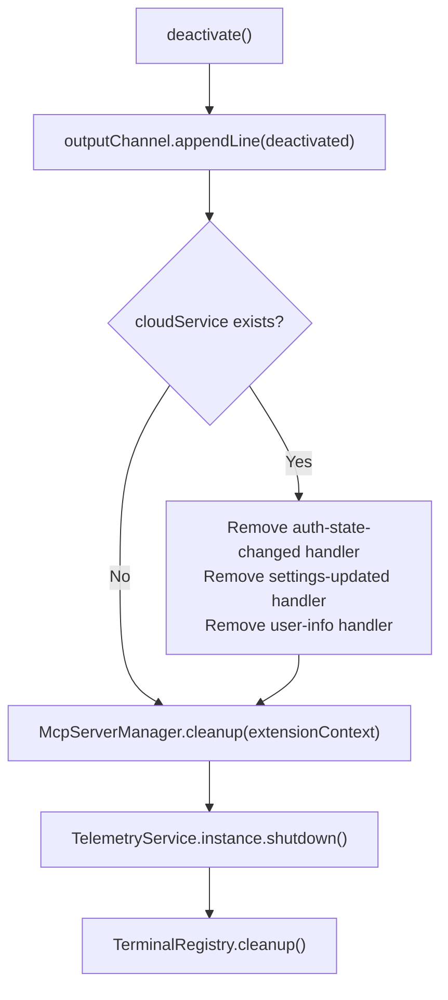

# Extension Activation and Lifecycle

<details>
<summary>Relevant source files</summary>

The following files were used as context for generating this wiki page:

- [CHANGELOG.md](CHANGELOG.md)
- [apps/web-evals/package.json](apps/web-evals/package.json)
- [apps/web-roo-code/package.json](apps/web-roo-code/package.json)
- [apps/web-roo-code/src/components/ui/navigation-menu.tsx](apps/web-roo-code/src/components/ui/navigation-menu.tsx)
- [package.json](package.json)
- [packages/build/tsconfig.json](packages/build/tsconfig.json)
- [packages/telemetry/src/BaseTelemetryClient.ts](packages/telemetry/src/BaseTelemetryClient.ts)
- [packages/telemetry/src/PostHogTelemetryClient.ts](packages/telemetry/src/PostHogTelemetryClient.ts)
- [packages/telemetry/src/TelemetryService.ts](packages/telemetry/src/TelemetryService.ts)
- [packages/telemetry/src/__tests__/PostHogTelemetryClient.test.ts](packages/telemetry/src/__tests__/PostHogTelemetryClient.test.ts)
- [packages/types/src/__tests__/telemetry.test.ts](packages/types/src/__tests__/telemetry.test.ts)
- [packages/types/src/telemetry.ts](packages/types/src/telemetry.ts)
- [packages/types/src/vscode.ts](packages/types/src/vscode.ts)
- [pnpm-lock.yaml](pnpm-lock.yaml)
- [src/activate/CodeActionProvider.ts](src/activate/CodeActionProvider.ts)
- [src/activate/__tests__/CodeActionProvider.spec.ts](src/activate/__tests__/CodeActionProvider.spec.ts)
- [src/activate/handleTask.ts](src/activate/handleTask.ts)
- [src/activate/index.ts](src/activate/index.ts)
- [src/activate/registerCodeActions.ts](src/activate/registerCodeActions.ts)
- [src/activate/registerCommands.ts](src/activate/registerCommands.ts)
- [src/activate/registerTerminalActions.ts](src/activate/registerTerminalActions.ts)
- [src/extension.ts](src/extension.ts)
- [src/package.json](src/package.json)
- [src/shared/support-prompt.ts](src/shared/support-prompt.ts)
- [src/utils/focusPanel.ts](src/utils/focusPanel.ts)
- [webview-ui/package.json](webview-ui/package.json)
- [webview-ui/src/components/common/MermaidBlock.tsx](webview-ui/src/components/common/MermaidBlock.tsx)
- [webview-ui/src/components/ui/hooks/index.ts](webview-ui/src/components/ui/hooks/index.ts)
- [webview-ui/src/components/ui/hooks/useNonInteractiveClick.ts](webview-ui/src/components/ui/hooks/useNonInteractiveClick.ts)
- [webview-ui/src/index.tsx](webview-ui/src/index.tsx)
- [webview-ui/tsconfig.json](webview-ui/tsconfig.json)
- [webview-ui/vite.config.ts](webview-ui/vite.config.ts)

</details>


This page documents the extension entry point [src/extension.ts:1-452](), the ordered initialization sequence of services during activation, and the `API` class returned to other VS Code extensions. It covers the complete lifecycle from the moment VS Code calls `activate()` to when `deactivate()` performs cleanup.

---

## Activation Events

The extension declares activation events in its manifest to control when the VS Code Extension Host loads the code.

| Activation Event | Meaning |
|---|---|
| `onLanguage` | Activates when any language file is opened in the editor. |
| `onStartupFinished` | Activates after VS Code has finished its internal startup sequence. |

The `main` entry point is `./dist/extension.js`, which is the bundled output of `src/extension.ts`.

Sources: [src/package.json:48-52]()

---

## The `activate()` Function

`activate()` is the single exported async function called by VS Code. It initializes the core dependency graph and returns an `API` instance that implements the `RooCodeAPI` interface for cross-extension communication.

**Activation sequence diagram:**

```mermaid
flowchart TD
    A["activate(context)"] --> B["Create outputChannel\n(vscode.window.createOutputChannel)"]
    B --> C["initializeNetworkProxy()"]
    C --> D["customToolRegistry.setExtensionPath()"]
    D --> E["migrateSettings()"]
    E --> F["TelemetryService.createInstance()\n+ PostHogTelemetryClient"]
    F --> G["MdmService.createInstance()"]
    G --> H["initializeI18n()"]
    H --> I["TerminalRegistry.initialize()"]
    I --> J["openAiCodexOAuthManager.initialize()"]
    J --> K["ContextProxy.getInstance()"]
    K --> L["CodeIndexManager.getInstance() per workspace folder\n(background, non-blocking)"]
    L --> M["new ClineProvider(context, outputChannel, 'sidebar',\ncontextProxy, mdmService)"]
    M --> N["CloudService.createInstance()\n+ event handlers wired"]
    N --> O["provider.initializeCloudProfileSyncWhenReady()"]
    O --> P["vscode.window.registerWebviewViewProvider\n(ClineProvider.sideBarId)"]
    P --> Q["checkWorktreeAutoOpen()"]
    Q --> R["autoImportSettings()"]
    R --> S["registerCommands() / registerCodeActions()\nregisterTerminalActions()"]
    S --> T["Register TextDocumentContentProvider\n(DIFF_VIEW_URI_SCHEME)"]
    T --> U["Register URI handler\nRegister CodeActionProvider"]
    U --> V["executeCommand('roo-cline.activationCompleted')"]
    V --> W["initializeModelCacheRefresh()"]
    W --> X["return new API(outputChannel, provider, socketPath, enableLogging)"]
```



Sources: [src/extension.ts:120-421]()

---

## Initialization Order Details

### 1. Environment and Proxy Setup
The extension first attempts to load an optional `.env` file using `dotenvx.config()` [src/extension.ts:10-18](). It then initializes the network proxy via `initializeNetworkProxy()` to route HTTP/HTTPS traffic during debug sessions [src/extension.ts:129](). The `customToolRegistry` is updated with the extension path to locate the bundled `esbuild` binary [src/extension.ts:132]().

### 2. State and Telemetry
`migrateSettings()` runs to ensure legacy configuration keys are mapped to the current schema [src/extension.ts:135](). The `TelemetryService` is initialized and a `PostHogTelemetryClient` is registered to track extension usage and errors [src/extension.ts:138-144]().

### 3. Core Services Initialization
- **MDM Service**: `MdmService.createInstance()` is called to enforce organizational policies [src/extension.ts:150]().
- **i18n**: `initializeI18n()` sets the UI language based on global state or VS Code's locale [src/extension.ts:153]().
- **Terminal**: `TerminalRegistry.initialize()` sets up shell integration handlers [src/extension.ts:156]().
- **ContextProxy**: `ContextProxy.getInstance(context)` provides a unified interface for `globalState`, `workspaceState`, and `secrets` [src/extension.ts:169]().
- **Code Indexing**: For every workspace folder, a `CodeIndexManager` is retrieved and its `initialize()` method is called in the background (non-blocking) [src/extension.ts:172-192]().

### 4. ClineProvider and Cloud Integration
`ClineProvider` (the main orchestrator) is instantiated [src/extension.ts:195](). Subsequently, `CloudService.createInstance()` is called with listeners for `auth-state-changed`, `settings-updated`, and `user-info` [src/extension.ts:198-282](). These listeners trigger state updates in the webview and manage model cache flushes on login/logout [src/extension.ts:222-229]().

### 5. UI Registration
The `ClineProvider` is registered as a `WebviewViewProvider` with `retainContextWhenHidden: true`, ensuring the React app in the sidebar stays alive when the user switches tabs [src/extension.ts:296-300]().

### 6. Command Registration
The extension registers multiple integration points:
- **Commands**: Registered via `registerCommands()` [src/extension.ts:318]().
- **Code Actions**: Quick fixes registered via `registerCodeActions()` [src/extension.ts:319]().
- **Terminal Actions**: Context menu items for the terminal [src/extension.ts:320]().
- **Diff Provider**: A `TextDocumentContentProvider` for the `DIFF_VIEW_URI_SCHEME` [src/extension.ts:325-331]().

Sources: [src/extension.ts:120-356](), [src/activate/registerCommands.ts:64-71]()

---

## The `deactivate()` Function

When VS Code shuts down or the extension is disabled, `deactivate()` ensures clean teardown of external resources.



While most disposables are handled by `context.subscriptions`, explicit cleanup is performed for:
1. **Cloud Service**: Removing event listeners to prevent memory leaks [src/extension.ts:430-440]().
2. **MCP Servers**: Calling `McpServerManager.cleanup()` to terminate child processes [src/extension.ts:443]().
3. **Telemetry**: Flushing any remaining events via `shutdown()` [src/extension.ts:446]().
4. **Terminal**: Cleaning up the `TerminalRegistry` [src/extension.ts:449]().

Sources: [src/extension.ts:424-452]()

---

## The `API` Class

The `API` class acts as the bridge between the Extension Host and external consumers (CLI, other extensions). It implements the `RooCodeAPI` interface.

**Class relationships:**

```mermaid
classDiagram
    class "RooCodeAPI" {
        <<interface>>
        +startNewTask()
        +resumeTask()
        +cancelCurrentTask()
        +sendMessage()
        +getConfiguration()
        +setConfiguration()
        +getProfiles()
        +createProfile()
        +updateProfile()
        +upsertProfile()
        +deleteProfile()
        +setActiveProfile()
        +isReady()
    }

    class "API" {
        -outputChannel "OutputChannel"
        -sidebarProvider "ClineProvider"
        -context "ExtensionContext"
        -ipc "IpcServer"
        +startNewTask()
        +resumeTask()
        +cancelCurrentTask()
        +sendMessage()
        +deleteQueuedMessage()
        +getConfiguration()
        +setConfiguration()
        -registerListeners()
    }

    class "ClineProvider" {
        +postMessageToWebview()
        +createTask()
        +getCurrentTask()
        +cancelTask()
    }

    class "IpcServer" {
        +listen()
        +broadcast()
        +send()
    }

    "API" ..|> "RooCodeAPI"
    "API" --> "ClineProvider"
    "API" --> "IpcServer"
```

### IPC and Task Lifecycle
If the `ROO_CODE_IPC_SOCKET_PATH` environment variable is detected, the `API` starts an `IpcServer` [src/extension.ts:417-420](). This allows the CLI to send commands like `StartNewTask` or `SendMessage` [src/extension/api.ts:65-166](). The `API` class also registers listeners on the `ClineProvider` to intercept task events (e.g., `TaskCreated`, `TaskCompleted`) and broadcast them to IPC clients [src/extension/api.ts:315-424]().

Sources: [src/extension/api.ts:32-570](), [src/extension.ts:362-420]()

---

## Startup State Management

The extension manages several pieces of state during the activation window:

| Key | File Reference | Usage |
|---|---|---|
| `language` | [src/extension.ts:153]() | Determines the locale for `i18next` initialization. |
| `allowedCommands` | [src/extension.ts:162-167]() | Initialized from `package.json` defaults if not present in `globalState`. |
| `worktreeAutoOpenPath` | [src/extension.ts:78-96]() | Used to automatically reopen the sidebar after a worktree switch. |
| `roo-provider-model` | [src/extension.ts:231-245]() | A temporary cloud-synced setting applied to the local configuration upon login. |

Sources: [src/extension.ts:73-245]()