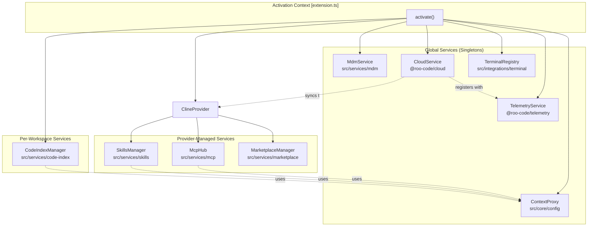
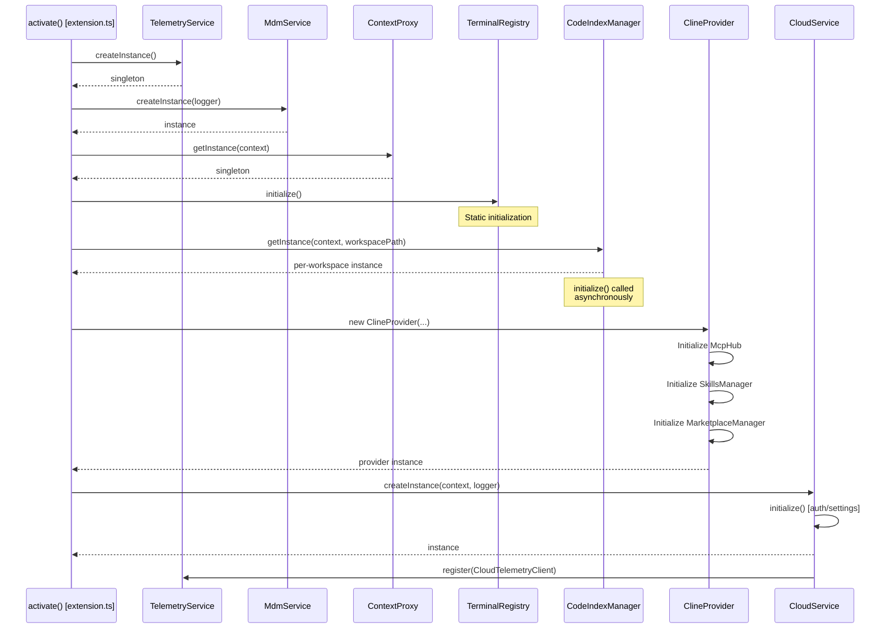
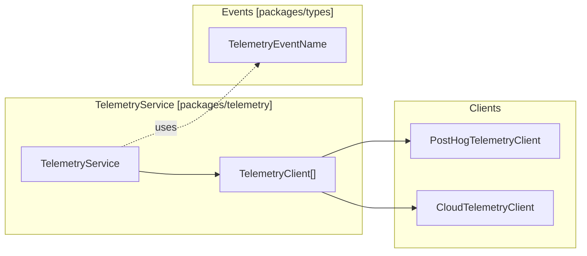
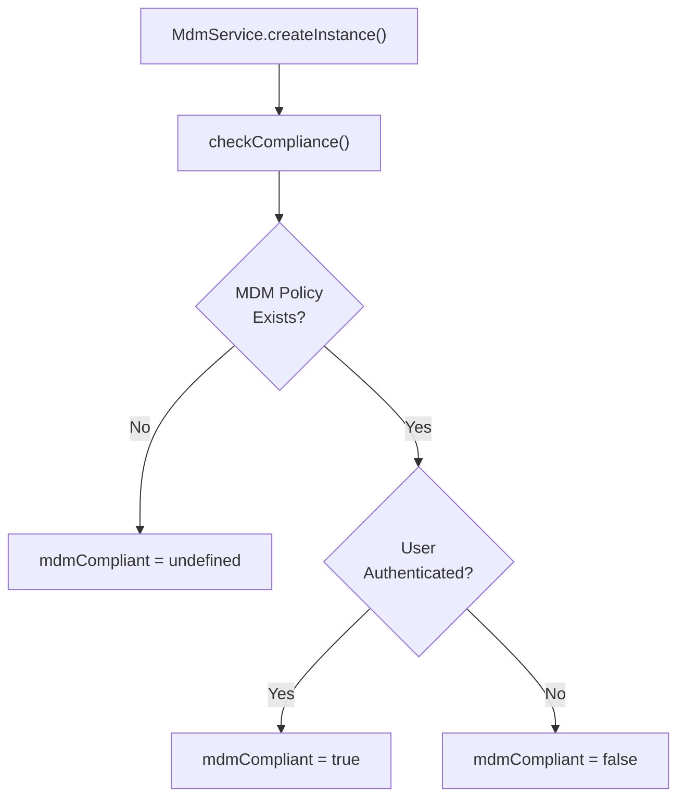
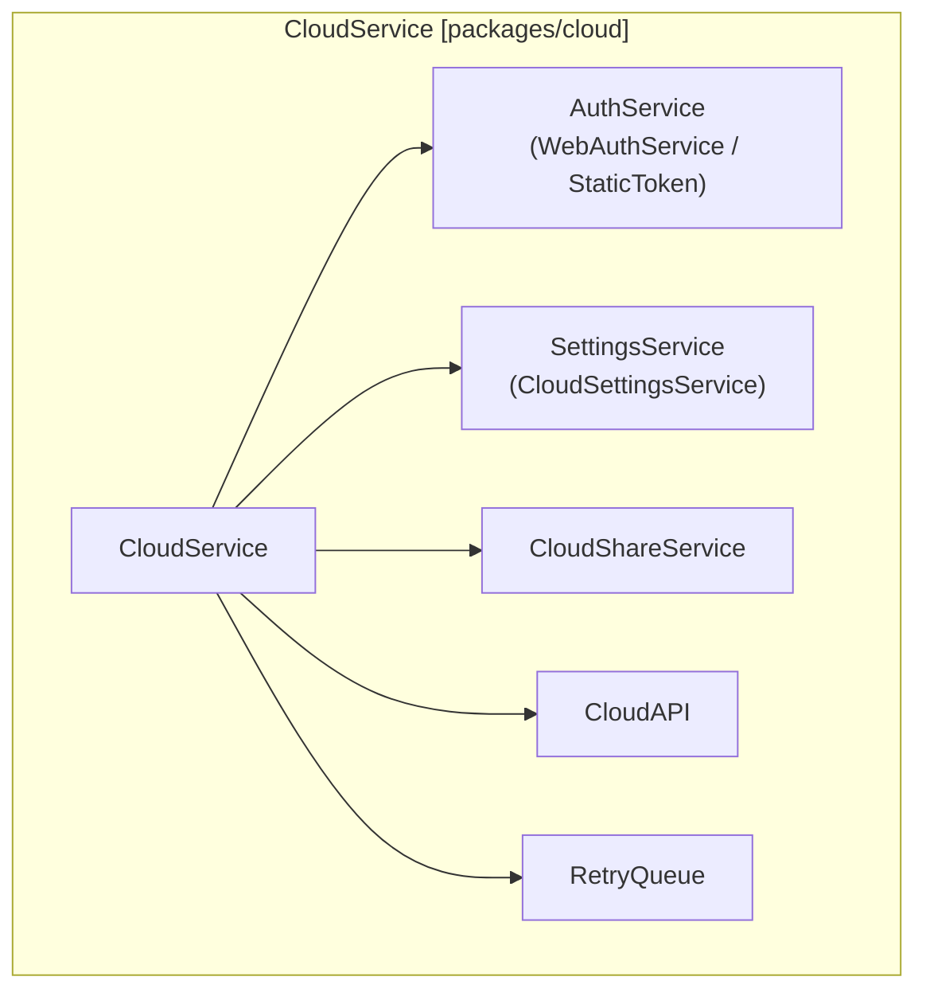
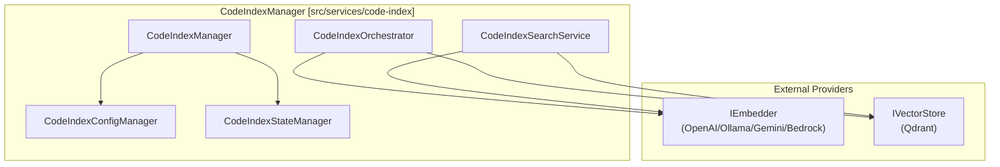
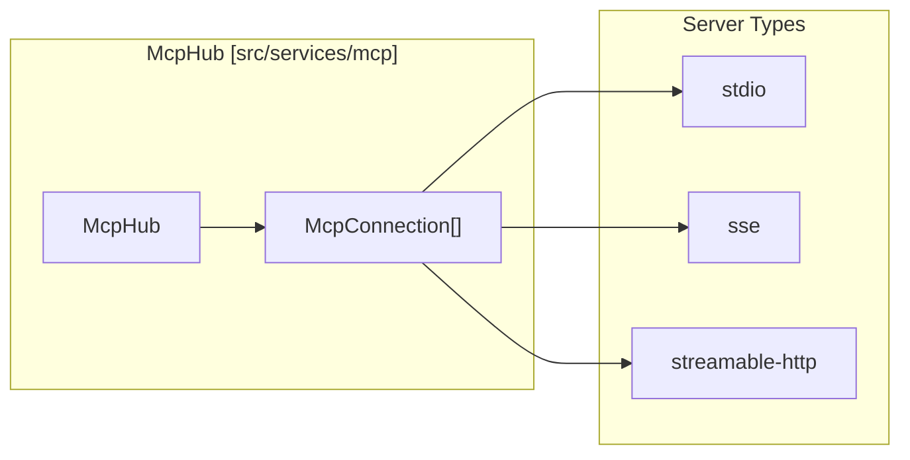
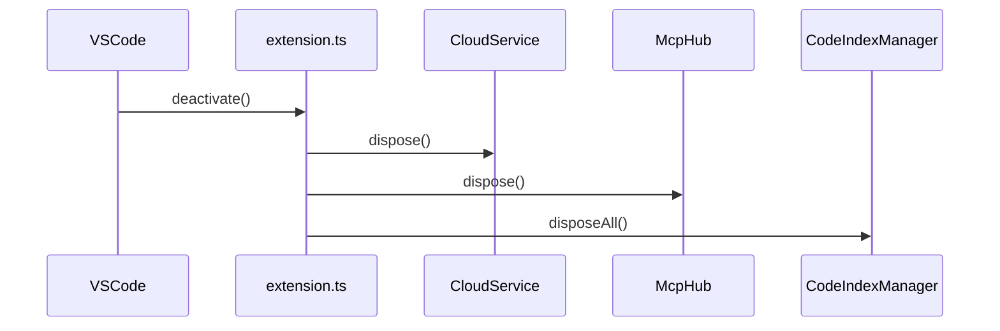

# Core Services

Relevant source files

The following files were used as context for generating this wiki page:

- [packages/cloud/src/CloudService.ts](packages/cloud/src/CloudService.ts)
- [packages/cloud/src/CloudSettingsService.ts](packages/cloud/src/CloudSettingsService.ts)
- [packages/cloud/src/StaticSettingsService.ts](packages/cloud/src/StaticSettingsService.ts)
- [packages/cloud/src/TelemetryClient.ts](packages/cloud/src/TelemetryClient.ts)
- [packages/cloud/src/__tests__/CloudService.test.ts](packages/cloud/src/__tests__/CloudService.test.ts)
- [packages/cloud/src/__tests__/CloudSettingsService.test.ts](packages/cloud/src/__tests__/CloudSettingsService.test.ts)
- [packages/cloud/src/__tests__/StaticSettingsService.test.ts](packages/cloud/src/__tests__/StaticSettingsService.test.ts)
- [packages/cloud/src/__tests__/TelemetryClient.test.ts](packages/cloud/src/__tests__/TelemetryClient.test.ts)
- [packages/cloud/src/index.ts](packages/cloud/src/index.ts)
- [packages/cloud/src/retry-queue/RetryQueue.ts](packages/cloud/src/retry-queue/RetryQueue.ts)
- [packages/cloud/src/retry-queue/__tests__/RetryQueue.test.ts](packages/cloud/src/retry-queue/__tests__/RetryQueue.test.ts)
- [packages/cloud/src/retry-queue/index.ts](packages/cloud/src/retry-queue/index.ts)
- [packages/cloud/src/retry-queue/types.ts](packages/cloud/src/retry-queue/types.ts)
- [packages/telemetry/src/BaseTelemetryClient.ts](packages/telemetry/src/BaseTelemetryClient.ts)
- [packages/telemetry/src/PostHogTelemetryClient.ts](packages/telemetry/src/PostHogTelemetryClient.ts)
- [packages/telemetry/src/TelemetryService.ts](packages/telemetry/src/TelemetryService.ts)
- [packages/telemetry/src/__tests__/PostHogTelemetryClient.test.ts](packages/telemetry/src/__tests__/PostHogTelemetryClient.test.ts)
- [packages/types/src/__tests__/telemetry.test.ts](packages/types/src/__tests__/telemetry.test.ts)
- [packages/types/src/telemetry.ts](packages/types/src/telemetry.ts)
- [packages/types/src/vscode.ts](packages/types/src/vscode.ts)
- [src/activate/registerCommands.ts](src/activate/registerCommands.ts)
- [src/api/providers/__tests__/bedrock-native-tools.spec.ts](src/api/providers/__tests__/bedrock-native-tools.spec.ts)
- [src/api/providers/__tests__/mistral.spec.ts](src/api/providers/__tests__/mistral.spec.ts)
- [src/core/prompts/tools/native-tools/__tests__/mcp_server.spec.ts](src/core/prompts/tools/native-tools/__tests__/mcp_server.spec.ts)
- [src/core/prompts/tools/native-tools/mcp_server.ts](src/core/prompts/tools/native-tools/mcp_server.ts)
- [src/core/tools/CodebaseSearchTool.ts](src/core/tools/CodebaseSearchTool.ts)
- [src/core/tools/ListFilesTool.ts](src/core/tools/ListFilesTool.ts)
- [src/core/tools/SearchFilesTool.ts](src/core/tools/SearchFilesTool.ts)
- [src/core/tools/UseMcpToolTool.ts](src/core/tools/UseMcpToolTool.ts)
- [src/core/tools/__tests__/useMcpToolTool.spec.ts](src/core/tools/__tests__/useMcpToolTool.spec.ts)
- [src/services/mcp/McpHub.ts](src/services/mcp/McpHub.ts)
- [src/services/mcp/__tests__/McpHub.spec.ts](src/services/mcp/__tests__/McpHub.spec.ts)
- [src/utils/__tests__/json-schema.spec.ts](src/utils/__tests__/json-schema.spec.ts)
- [src/utils/__tests__/mcp-name.spec.ts](src/utils/__tests__/mcp-name.spec.ts)
- [src/utils/focusPanel.ts](src/utils/focusPanel.ts)
- [src/utils/json-schema.ts](src/utils/json-schema.ts)
- [src/utils/mcp-name.ts](src/utils/mcp-name.ts)
- [webview-ui/src/components/mcp/McpView.tsx](webview-ui/src/components/mcp/McpView.tsx)
- [webview-ui/src/components/ui/hooks/index.ts](webview-ui/src/components/ui/hooks/index.ts)
- [webview-ui/src/components/ui/hooks/useNonInteractiveClick.ts](webview-ui/src/components/ui/hooks/useNonInteractiveClick.ts)

This document details the foundational service layer initialized during extension activation. These services provide essential capabilities—telemetry, authentication, state management, terminal integration, code indexing, and Model Context Protocol (MCP) server management—that underpin all extension functionality.

---

## Service Architecture Overview

Roo Code's core services follow a layered architecture where singleton services provide global capabilities while per-workspace services handle project-specific functionality. Services are initialized in a specific order to satisfy dependencies, with most initialization performed asynchronously to avoid blocking extension activation.

**Sources:** [src/activate/registerCommands.ts:205-215](), [src/services/mcp/McpHub.ts:166-175]()

---

## Initialization Sequence

Services are initialized in a specific order during the `activate()` function. Critical services like telemetry and state management are initialized synchronously, while resource-intensive services like code indexing are initialized asynchronously.

**Sources:** [packages/cloud/src/CloudService.ts:113-177](), [src/activate/registerCommands.ts:205-215]()

---

## TelemetryService

The `TelemetryService` manages event capture and routing to multiple telemetry backends. It provides a unified interface for tracking user interactions, errors, and system events.

### Architecture

**Sources:** [packages/telemetry/src/TelemetryService.ts:15-20](), [packages/types/src/telemetry.ts:20-77]()

### Key Responsibilities

- **Event Capture**: Tracks user actions via `TelemetryEventName` enum (e.g., `TASK_CREATED`, `TOOL_USED`). [packages/types/src/telemetry.ts:21-29]()
- **Exception Tracking**: Captures errors via `captureException`. [packages/telemetry/src/TelemetryService.ts:73-79]()
- **Privacy Controls**: Respects user's `TelemetrySetting` preference via `updateTelemetryState`. [packages/telemetry/src/TelemetryService.ts:46-52]()
- **Contextual Properties**: Links to a `TelemetryPropertiesProvider` (usually `ClineProvider`) to add mode/provider context to events. [packages/telemetry/src/TelemetryService.ts:26-31]()

---

## MdmService

The `MdmService` enforces organizational compliance policies. It checks whether users meet authentication requirements defined by their organization's MDM configuration.

### Compliance Logic

**Sources:** [src/activate/registerCommands.ts:208-215]()

---

## CloudService

The `CloudService` provides authentication, settings synchronization, and cloud-based features. It manages user sessions and organization settings.

### Component Architecture

**Sources:** [packages/cloud/src/CloudService.ts:50-84]()

### Key Responsibilities

- **Authentication**: Handles login/logout flows and session token management via `WebAuthService` or `StaticTokenAuthService`. [packages/cloud/src/CloudService.ts:181-194](), [packages/cloud/src/CloudService.ts:122-129]()
- **Settings Sync**: Fetches and caches organization/user settings from the Roo API via `CloudSettingsService`. [packages/cloud/src/CloudService.ts:141-147]()
- **Telemetry Integration**: Registers a `CloudTelemetryClient` that uses a `RetryQueue` for reliable event delivery during network instability. [packages/cloud/src/CloudService.ts:152-168](), [packages/cloud/src/TelemetryClient.ts:133-136]()
- **Organization Context**: Provides helper methods to retrieve `organizationId`, `organizationName`, and `organizationRole` from `CloudUserInfo`. [packages/cloud/src/CloudService.ts:211-227]()

---

## ContextProxy

The `ContextProxy` is a singleton facade over VS Code's `ExtensionContext`, centralizing access to `globalState`, `workspaceState`, and `secrets`.

### Implementation

It ensures type-safe interaction with storage:
- `getGlobalState<K>(key: K)`: Retrieves from `globalState`.
- `updateGlobalState<K>(key: K, value: any)`: Persists to `globalState`.
- `getSecret(key: string)`: Retrieves from encrypted `SecretStorage`.

**Sources:** [src/activate/registerCommands.ts:205-206]()

---

## CodeIndexManager

The `CodeIndexManager` provides semantic code search. It follows a singleton-per-workspace pattern, managing specialized services for indexing and retrieval.

### Architecture and Data Flow

**Sources:** [src/activate/registerCommands.ts:206]()

---

## McpHub

The `McpHub` manages connections to Model Context Protocol (MCP) servers, enabling the extension to consume external tools and resources.

### Server Management

**Sources:** [src/services/mcp/McpHub.ts:150-157](), [src/services/mcp/McpHub.ts:89-140]()

### Responsibilities
- **Lifecycle Management**: Connects, disconnects, and restarts servers based on configuration changes or manual requests. It uses a `refCount` to manage active clients. [src/services/mcp/McpHub.ts:188-192](), [src/services/mcp/McpHub.ts:245-260]()
- **Tool Discovery**: Lists available tools from connected servers. It normalizes schemas for strict API providers (e.g., OpenAI) by stripping unsupported formats and setting `additionalProperties: false`. [src/utils/json-schema.ts:126-156](), [src/core/prompts/tools/native-tools/mcp_server.ts:7-10]()
- **Settings Watching**: Monitors `roo_mcp_settings.json` (global) and project-specific MCP files for changes using `vscode.FileSystemWatcher` and `chokidar`. [src/services/mcp/McpHub.ts:168-170](), [src/services/mcp/McpHub.ts:35-41]()

### Connection States
Connections are managed as a discriminated union `McpConnection`, ensuring type safety when accessing the underlying `Client` or `Transport`.

| Type | Client | Transport | Description |
| :--- | :--- | :--- | :--- |
| `connected` | `Client` | `Stdio/SSE/HTTP` | Active session with the MCP server. |
| `disconnected` | `null` | `null` | Server is configured but not running. |

**Sources:** [src/services/mcp/McpHub.ts:44-58]()

---

## Service Lifecycle and Disposal

During extension deactivation, services are cleaned up to prevent resource leaks.

**Sources:** [src/services/mcp/McpHub.ts:245-260](), [packages/cloud/src/CloudService.ts:34]()