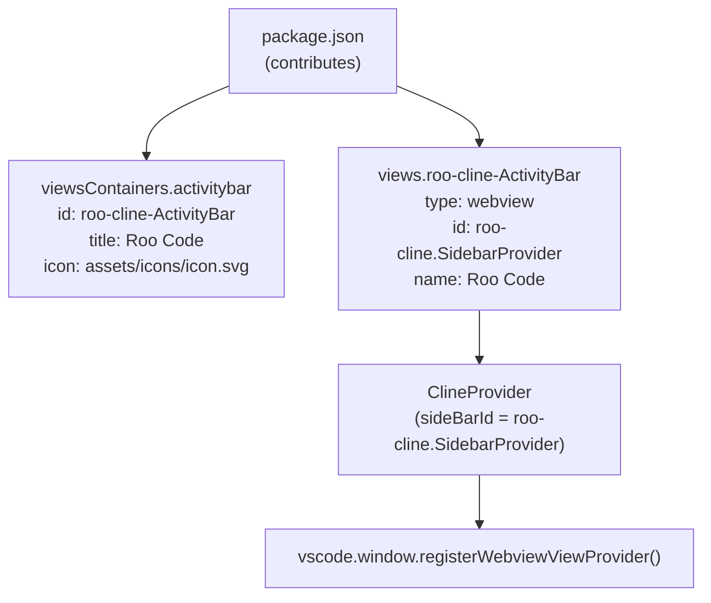
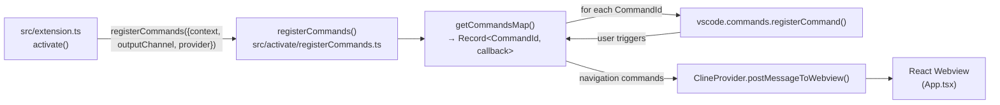
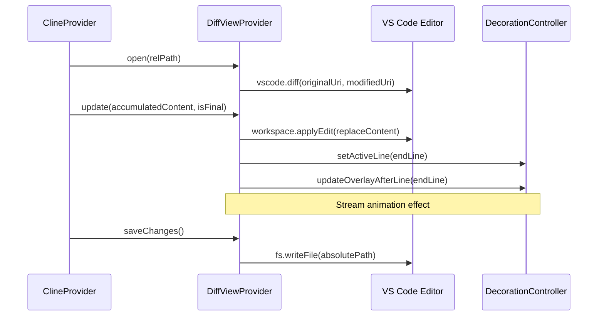
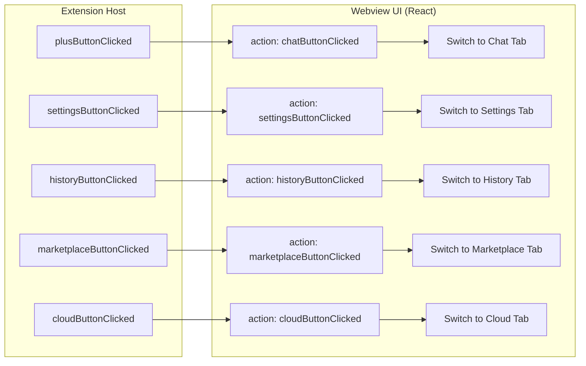
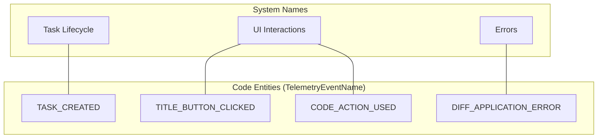

# Commands and VS Code Integration

Relevant source files

The following files were used as context for generating this wiki page:

- [packages/telemetry/src/BaseTelemetryClient.ts](packages/telemetry/src/BaseTelemetryClient.ts)
- [packages/telemetry/src/PostHogTelemetryClient.ts](packages/telemetry/src/PostHogTelemetryClient.ts)
- [packages/telemetry/src/TelemetryService.ts](packages/telemetry/src/TelemetryService.ts)
- [packages/telemetry/src/__tests__/PostHogTelemetryClient.test.ts](packages/telemetry/src/__tests__/PostHogTelemetryClient.test.ts)
- [packages/types/src/__tests__/telemetry.test.ts](packages/types/src/__tests__/telemetry.test.ts)
- [packages/types/src/telemetry.ts](packages/types/src/telemetry.ts)
- [packages/types/src/vscode.ts](packages/types/src/vscode.ts)
- [src/activate/CodeActionProvider.ts](src/activate/CodeActionProvider.ts)
- [src/activate/__tests__/CodeActionProvider.spec.ts](src/activate/__tests__/CodeActionProvider.spec.ts)
- [src/activate/handleTask.ts](src/activate/handleTask.ts)
- [src/activate/index.ts](src/activate/index.ts)
- [src/activate/registerCodeActions.ts](src/activate/registerCodeActions.ts)
- [src/activate/registerCommands.ts](src/activate/registerCommands.ts)
- [src/activate/registerTerminalActions.ts](src/activate/registerTerminalActions.ts)
- [src/integrations/editor/DiffViewProvider.ts](src/integrations/editor/DiffViewProvider.ts)
- [src/integrations/editor/__tests__/DiffViewProvider.spec.ts](src/integrations/editor/__tests__/DiffViewProvider.spec.ts)
- [src/shared/support-prompt.ts](src/shared/support-prompt.ts)
- [src/utils/focusPanel.ts](src/utils/focusPanel.ts)
- [webview-ui/src/components/ui/hooks/index.ts](webview-ui/src/components/ui/hooks/index.ts)
- [webview-ui/src/components/ui/hooks/useNonInteractiveClick.ts](webview-ui/src/components/ui/hooks/useNonInteractiveClick.ts)

This page documents all VS Code contribution points registered by the Roo Code extension: the activity bar view, registered commands, menu placements, keyboard shortcuts, and VS Code workspace configuration properties. It also covers how these commands are implemented and wired to the `ClineProvider` at activation time.

For the activation sequence that calls `registerCommands()`, see [Extension Activation and Lifecycle](). For the `ClineProvider` that receives webview messages from most command callbacks, see [ClineProvider (Core Orchestrator)](). For terminal tool execution details, see [Command Execution and Terminal Tools]().

---

## Extension Activation Events and Entry Point

The extension declares activation events in `package.json` to ensure the AI capabilities are available when needed.

| Activation Event | Meaning |
|---|---|
| `onLanguage` | Activate when any language file is opened |
| `onStartupFinished` | Activate after VS Code startup completes |

The compiled entry point is `./dist/extension.js` (the output of `src/extension.ts`). Registration of all contribution points happens inside the `activate()` function.

Sources: [src/extension.ts:251-365](), [knip.json:9-18]()

---

## Activity Bar and Sidebar View

The extension contributes one activity bar container and one webview view nested inside it.

**Diagram: Activity Bar and Sidebar Contribution Points**

The webview view is registered in `src/extension.ts` [src/extension.ts:296-300]() using `vscode.window.registerWebviewViewProvider` with `retainContextWhenHidden: true`, which keeps the webview process alive even when the sidebar is hidden.

Sources: [src/extension.ts:296-300]()

---

## Registered Commands

Commands are implemented in `src/activate/registerCommands.ts`. The `registerCommands()` function iterates over the `getCommandsMap()` result and calls `vscode.commands.registerCommand()` for each entry.

**Diagram: Command Registration Flow**

Sources: [src/activate/registerCommands.ts:64-71](), [src/extension.ts:318]()

### Navigation Commands (Webview Tab Switching)

These commands post an action message to the webview, which switches the active tab in the React UI.

| Command ID | Title | Action Sent | Webview Tab |
|---|---|---|---|
| `roo-cline.plusButtonClicked` | New Task | `chatButtonClicked` + `focusInput` | `chat` |
| `roo-cline.settingsButtonClicked` | Settings | `settingsButtonClicked` | `settings` |
| `roo-cline.historyButtonClicked` | Task History | `historyButtonClicked` | `history` |
| `roo-cline.marketplaceButtonClicked` | Marketplace | `marketplaceButtonClicked` | `marketplace` |
| `roo-cline.cloudButtonClicked` | Cloud | `cloudButtonClicked` | `cloud` |
| `roo-cline.popoutButtonClicked` | Open in Editor | *(opens tab panel)* | — |
| `roo-cline.openInNewTab` | Open In New Tab | *(opens tab panel)* | — |

`roo-cline.plusButtonClicked` additionally calls `provider.removeClineFromStack()` and `provider.refreshWorkspace()` before switching to chat [src/activate/registerCommands.ts:86-101]().

`roo-cline.popoutButtonClicked` and `roo-cline.openInNewTab` both delegate to `openClineInNewTab()`, which creates a `vscode.WebviewPanel` and a new `ClineProvider` instance in `"editor"` mode [src/activate/registerCommands.ts:200-273]().

Sources: [src/activate/registerCommands.ts:73-136](), [src/activate/registerCommands.ts:200-273]()

### Utility Commands

| Command ID | Title | Implementation |
|---|---|---|
| `roo-cline.newTask` | New Task | Delegates to `handleNewTask` [src/activate/registerCommands.ts:137]() |
| `roo-cline.setCustomStoragePath` | Set Custom Storage Path | Calls `promptForCustomStoragePath()` [src/activate/registerCommands.ts:138-141]() |
| `roo-cline.importSettings` | Import Settings | Calls `importSettingsWithFeedback()` [src/activate/registerCommands.ts:142-157]() |
| `roo-cline.focusInput` | Focus Input Field | Focuses panel, posts `focusInput` action [src/activate/registerCommands.ts:158-169]() |
| `roo-cline.acceptInput` | Accept Input/Suggestion | Posts `acceptInput` message type [src/activate/registerCommands.ts:177-185]() |
| `roo-cline.toggleAutoApprove` | Toggle Auto-Approve | Posts `toggleAutoApprove` action [src/activate/registerCommands.ts:186-197]() |

`roo-cline.focusInput` uses `focusPanel()` to bring the VS Code panel into focus and then posts a `focusInput` action to the webview. It only sends the webview message in sidebar mode [src/activate/registerCommands.ts:158-165]().

Sources: [src/activate/registerCommands.ts:137-198]()

### Terminal Commands

Registered via `registerTerminalActions(context)` [src/activate/registerTerminalActions.ts:10-14]():

| Command ID | Title | Implementation |
|---|---|---|
| `roo-cline.terminalAddToContext` | Add Terminal to Context | `handleTerminalAction` with `TERMINAL_ADD_TO_CONTEXT` |
| `roo-cline.terminalFixCommand` | Fix This Command | `handleTerminalAction` with `TERMINAL_FIX` |
| `roo-cline.terminalExplainCommand` | Explain This Command | `handleTerminalAction` with `TERMINAL_EXPLAIN` |

Terminal actions extract content using `Terminal.getTerminalContents()` and call `ClineProvider.handleTerminalAction()` [src/activate/registerTerminalActions.ts:22-38](). The prompt types are mapped to `TERMINAL_ADD_TO_CONTEXT`, `TERMINAL_FIX`, and `TERMINAL_EXPLAIN` [src/activate/registerTerminalActions.ts:11-13]().

Sources: [src/activate/registerTerminalActions.ts:10-39](), [packages/types/src/vscode.ts:17-23]()

---

## Diff View Integration

The `DiffViewProvider` manages the interactive diffing experience when the AI proposes file changes. It uses a custom URI scheme `cline-diff` to provide virtual document content.

**Diagram: Diff View Data Flow**

### Key Functions
- `open(relPath)`: Prepares the diff view, closes existing tabs for the file, and initializes `DecorationController` for the "fading" animation effect [src/integrations/editor/DiffViewProvider.ts:47-117](). It handles both "modify" and "create" edit types [src/integrations/editor/DiffViewProvider.ts:49-51]().
- `update(accumulatedContent, isFinal)`: Progressively updates the diff editor as the AI streams content. It applies `WorkspaceEdit` and manages line decorations [src/integrations/editor/DiffViewProvider.ts:119-194](). It preserves the original content's trailing newline if applicable [src/integrations/editor/DiffViewProvider.ts:172-177]().
- `saveChanges()`: Commits the diff to the actual file system, checks for new diagnostics (problems) by comparing `preDiagnostics` with current state, and returns the result to the AI [src/integrations/editor/DiffViewProvider.ts:196-210]().

Sources: [src/integrations/editor/DiffViewProvider.ts:22-210](), [src/integrations/editor/DiffViewProvider.ts:18-19]()

---

## Additional VS Code Integration Points

Beyond standard commands, `activate()` registers more deep API integrations:

| Registration | Purpose |
|---|---|
| `vscode.window.registerWebviewViewProvider` | Mounts `ClineProvider` as the sidebar panel [src/extension.ts:296-300]() |
| `vscode.workspace.registerTextDocumentContentProvider` | Provides content for the left side of diff editors via `DIFF_VIEW_URI_SCHEME` [src/extension.ts:335-337]() |
| `vscode.window.registerUriHandler` | Handles deep-link URIs (e.g. OAuth callbacks) via `handleUri` [src/extension.ts:316]() |
| `vscode.languages.registerCodeActionsProvider` | Shows Roo Code quick-fix actions (Explain/Fix/Improve) [src/extension.ts:349-353]() |

### Code Action Provider
The `CodeActionProvider` [src/activate/CodeActionProvider.ts:5]() listens for diagnostic errors and user selections to suggest AI-powered fixes. It is registered for all file patterns (`"**/*"`) [src/extension.ts:352](). Individual actions include `explainCode`, `fixCode`, `improveCode`, and `addToContext` [src/activate/registerCodeActions.ts:10-13](). These delegate to `ClineProvider.handleCodeAction()` [src/activate/registerCodeActions.ts:50]().

Sources: [src/extension.ts:296-356](), [src/activate/index.ts:1-5](), [src/activate/registerCodeActions.ts:9-53]()

---

## Command-to-Webview Message Mapping

Most navigation commands post a typed `ExtensionMessage` of `type: "action"` to the webview. 

**Diagram: Command → Webview Message → UI Action**

The `acceptInput` command uses a specialized message type (`"acceptInput"`) rather than a generic action, allowing the UI to trigger the primary button or message submission logic [src/activate/registerCommands.ts:184]().

Sources: [src/activate/registerCommands.ts:73-198](), [src/activate/registerTerminalActions.ts:34-36]()

---

## Telemetry Integration

The extension tracks command usage and integration events via the `TelemetryService`.

**Diagram: Telemetry Event Space**

Commands like `plusButtonClicked` or `settingsButtonClicked` capture `TITLE_BUTTON_CLICKED` events [src/activate/registerCommands.ts:93, 115](). Code actions capture `CODE_ACTION_USED` [packages/telemetry/src/TelemetryService.ts:142-144]().

Sources: [packages/types/src/telemetry.ts:20-77](), [packages/telemetry/src/TelemetryService.ts:15-216]()