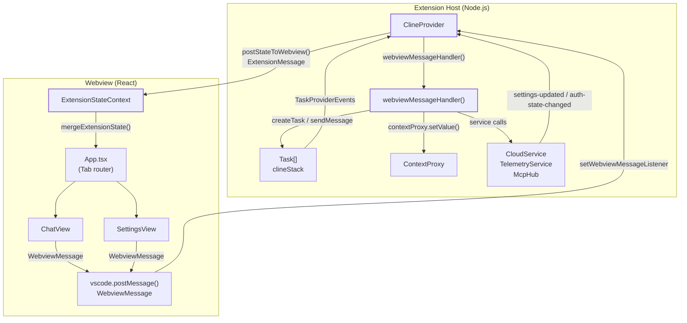
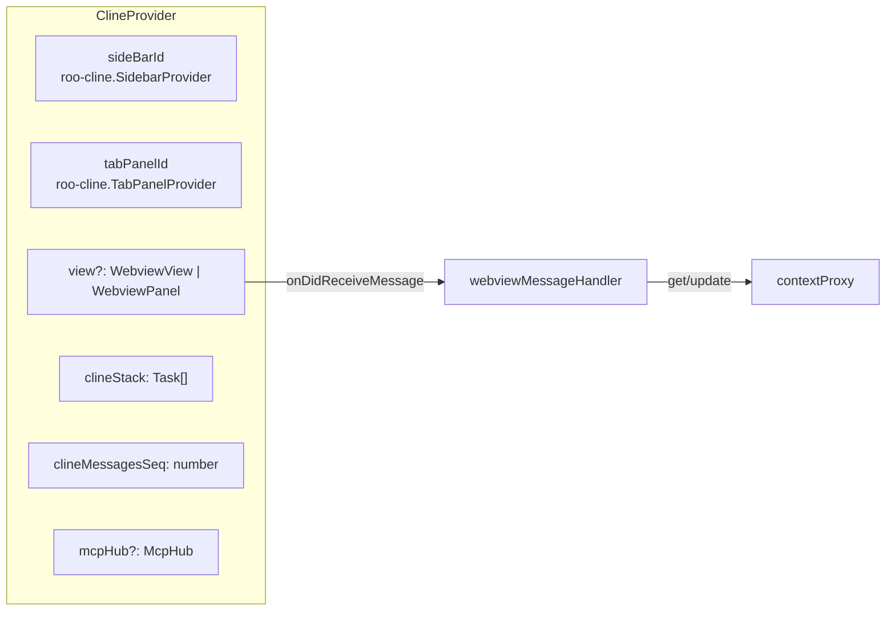

# Webview Communication System

Relevant source files

The following files were used as context for generating this wiki page:

- [packages/ipc/README.md](packages/ipc/README.md)
- [packages/ipc/src/ipc-client.ts](packages/ipc/src/ipc-client.ts)
- [packages/ipc/src/ipc-server.ts](packages/ipc/src/ipc-server.ts)
- [packages/types/npm/package.metadata.json](packages/types/npm/package.metadata.json)
- [packages/types/src/__tests__/cloud.test.ts](packages/types/src/__tests__/cloud.test.ts)
- [packages/types/src/__tests__/ipc.test.ts](packages/types/src/__tests__/ipc.test.ts)
- [packages/types/src/api.ts](packages/types/src/api.ts)
- [packages/types/src/cloud.ts](packages/types/src/cloud.ts)
- [packages/types/src/events.ts](packages/types/src/events.ts)
- [packages/types/src/ipc.ts](packages/types/src/ipc.ts)
- [packages/types/src/task.ts](packages/types/src/task.ts)
- [packages/types/src/vscode-extension-host.ts](packages/types/src/vscode-extension-host.ts)
- [releases/3.31.1-release.png](releases/3.31.1-release.png)
- [src/api/providers/fetchers/modelCache.ts](src/api/providers/fetchers/modelCache.ts)
- [src/core/webview/ClineProvider.ts](src/core/webview/ClineProvider.ts)
- [src/core/webview/__tests__/ClineProvider.spec.ts](src/core/webview/__tests__/ClineProvider.spec.ts)
- [src/core/webview/__tests__/webviewMessageHandler.spec.ts](src/core/webview/__tests__/webviewMessageHandler.spec.ts)
- [src/core/webview/webviewMessageHandler.ts](src/core/webview/webviewMessageHandler.ts)
- [src/extension/__tests__/api-delete-queued-message.spec.ts](src/extension/__tests__/api-delete-queued-message.spec.ts)
- [src/extension/__tests__/api-send-message.spec.ts](src/extension/__tests__/api-send-message.spec.ts)
- [src/extension/api.ts](src/extension/api.ts)
- [src/shared/WebviewMessage.ts](src/shared/WebviewMessage.ts)
- [webview-ui/src/components/chat/ChatRow.tsx](webview-ui/src/components/chat/ChatRow.tsx)
- [webview-ui/src/components/chat/ChatView.tsx](webview-ui/src/components/chat/ChatView.tsx)
- [webview-ui/src/components/settings/SettingsView.tsx](webview-ui/src/components/settings/SettingsView.tsx)
- [webview-ui/src/context/ExtensionStateContext.tsx](webview-ui/src/context/ExtensionStateContext.tsx)

## Purpose and Scope

The Webview Communication System implements bidirectional message passing between the VS Code extension host and the React-based webview UI. This system enables real-time state synchronization, user interaction handling, and coordinated execution of AI tasks across the extension and UI boundaries.

This page covers the message protocols, orchestration layer, and state synchronization mechanisms. 

*   For detailed orchestration logic, see [ClineProvider (Core Orchestrator)](#3.1).
*   For specific message definitions, see [Message Protocols](#3.2).
*   For UI component details, see [Webview UI Architecture](#3.3).
*   For synchronization logic, see [State Synchronization and Updates](#3.4).

---

## System Architecture

**Extension host to webview boundary**: `ClineProvider` implements `vscode.WebviewViewProvider` and holds the webview reference. All communication crosses this boundary as serialized JSON via `postMessage`.

**Component-to-code mapping diagram:**

Sources: [src/core/webview/ClineProvider.ts:126-139](), [src/core/webview/webviewMessageHandler.ts:92-100](), [webview-ui/src/context/ExtensionStateContext.tsx:151-165](), [webview-ui/src/components/chat/ChatView.tsx:68-96](), [src/extension/api.ts:203-205]()

---

## Message Protocols

### WebviewMessage Types
`WebviewMessage` represents data flowing from the UI to the Extension Host. The `webviewMessageHandler` function dispatches on `message.type` to perform operations like starting tasks, updating settings, or interacting with the file system.

| Message Type | Purpose |
|-------------|---------|
| `newTask` | Start new AI task with user input text and images [src/core/webview/webviewMessageHandler.ts:1010-1014]() |
| `askResponse` | User response to approval requests (e.g., `yesButtonClicked`) [src/core/webview/webviewMessageHandler.ts:1034-1038]() |
| `updateSettings` | Bulk settings update via `updateGlobalState` [src/core/webview/webviewMessageHandler.ts:1145-1150]() |
| `upsertApiConfiguration` | Save/update a provider profile using `ProviderSettingsManager` [src/core/webview/webviewMessageHandler.ts:1125-1130]() |
| `getModels` | Fetch model list for a provider via `modelCache` [src/core/webview/webviewMessageHandler.ts:1162-1165]() |

For a complete list of message types and their handlers, see [Message Protocols](#3.2).

Sources: [src/shared/WebviewMessage.ts:1-4](), [src/core/webview/webviewMessageHandler.ts:92-132](), [src/core/webview/ClineProvider.ts:100-106]()

### ExtensionMessage Types
`ExtensionMessage` flows from the Extension Host to the UI. The webview's `ExtensionStateContext` merges these updates into the local React state.

| Message Type | Purpose |
|-------------|---------|
| `state` | Full or partial `ExtensionState` synchronization [packages/types/src/vscode-extension-host.ts:33-33]() |
| `messageUpdated` | Updates to specific messages for real-time chat updates [packages/types/src/vscode-extension-host.ts:40-40]() |
| `taskHistoryUpdated` | Signal to refresh the task history list [packages/types/src/vscode-extension-host.ts:34-34]() |
| `mcpServers` | Updated list of active Model Context Protocol servers [packages/types/src/vscode-extension-host.ts:41-41]() |

Sources: [src/core/webview/ClineProvider.ts:37-38](), [webview-ui/src/context/ExtensionStateContext.tsx:34-60](), [packages/types/src/vscode-extension-host.ts:30-105]()

---

## ClineProvider: The Central Orchestrator

`ClineProvider` is the primary bridge between VS Code and the webview. It manages the webview lifecycle, maintains the `clineStack` of active tasks, and coordinates state broadcasts.

### Key Responsibilities
*   **Lifecycle**: Implements `resolveWebviewView` to initialize the UI, set security policies (CSP), and register message listeners. [src/core/webview/ClineProvider.ts:126-138]()
*   **Task Management**: Manages a stack of `Task` objects via `clineStack`. New tasks are created using `createTask` which initializes a new `Task` instance. [src/core/webview/ClineProvider.ts:139-148](), [src/core/webview/ClineProvider.ts:184-200]()
*   **Broadcasting**: Uses `postStateToWebview` to synchronize `ExtensionState` (including `apiConfiguration`, `customModes`, and `clineMessages`) with the UI. [src/core/webview/ClineProvider.ts:165-168](), [src/core/webview/ClineProvider.ts:585-610]()

For details, see [ClineProvider (Core Orchestrator)](#3.1).

Sources: [src/core/webview/ClineProvider.ts:126-168](), [src/extension/api.ts:27-35]()

---

## Webview UI Architecture

The webview is a React application styled with Tailwind CSS and the VS Code Webview UI Toolkit. It uses a centralized context for state management.

*   **App.tsx**: Manages top-level navigation between views like `ChatView`, `SettingsView`, and `HistoryView`. [webview-ui/src/components/chat/ChatView.tsx:54-58]()
*   **ExtensionStateContext**: Provides a unified state object (`ExtensionStateContextType`) to all components and handles incoming `ExtensionMessage` updates via `mergeExtensionState`. [webview-ui/src/context/ExtensionStateContext.tsx:34-149]()
*   **ChatView**: The primary interaction surface, rendering `ChatRow` components for messages and tool calls. It handles user input via `ChatTextArea`. [webview-ui/src/components/chat/ChatView.tsx:132-154](), [webview-ui/src/components/chat/ChatRow.tsx:132-166]()
*   **SettingsView**: Provides an interface for configuring API providers, auto-approval rules, and experimental features. [webview-ui/src/components/settings/SettingsView.tsx:124-147]()

For details, see [Webview UI Architecture](#3.3).

Sources: [webview-ui/src/context/ExtensionStateContext.tsx:1-149](), [webview-ui/src/components/chat/ChatView.tsx:68-154]()

---

## State Synchronization Mechanism

To ensure the UI remains responsive and consistent with the extension host, the system uses a robust synchronization pattern.

*   **Monotonic Sequencing**: `clineMessagesSeq` is a counter in `ClineProvider` incremented on every state push. The frontend uses this to reject stale updates that arrive out-of-order. [src/core/webview/ClineProvider.ts:165-168]()
*   **Merge Logic**: `mergeExtensionState` in the UI performs intelligent merging of nested objects like `experiments` and `customModePrompts` while respecting sequence numbers for `clineMessages`. [webview-ui/src/context/ExtensionStateContext.tsx:151-170]()
*   **Incremental Updates**: The system supports partial state updates to reduce message size, where the webview is responsible for merging the partial state into the current context. [packages/types/src/vscode-extension-host.ts:127-130]()

For details, see [State Synchronization and Updates](#3.4).

Sources: [src/core/webview/ClineProvider.ts:165-168](), [webview-ui/src/context/ExtensionStateContext.tsx:151-190](), [src/core/webview/webviewMessageHandler.ts:92-132]()