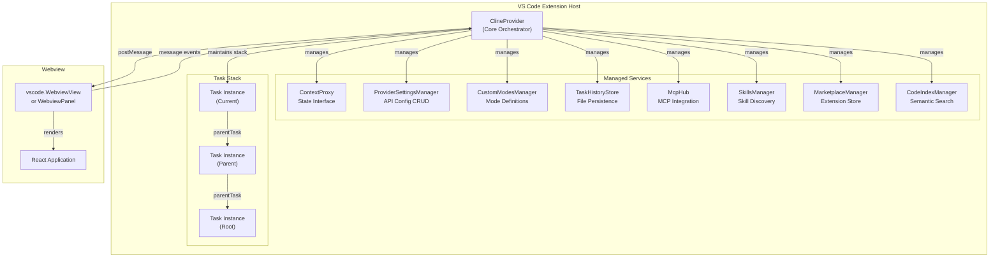
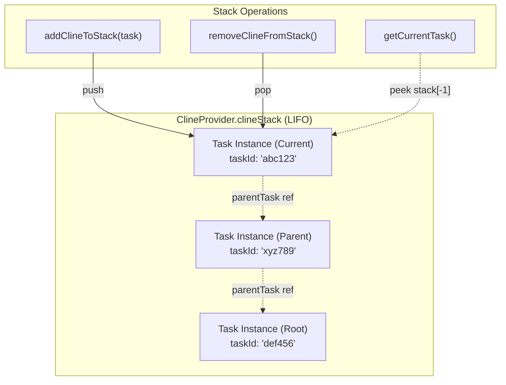
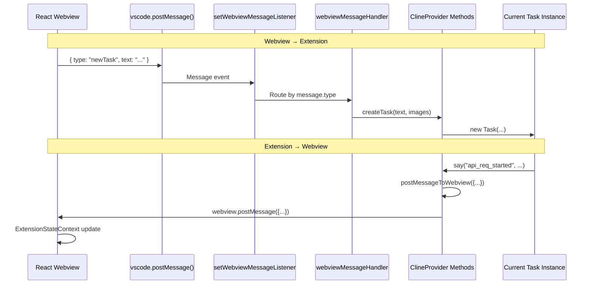
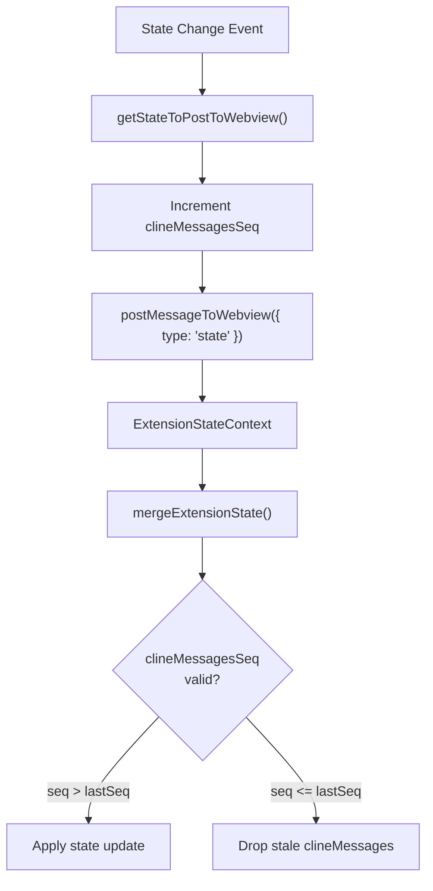
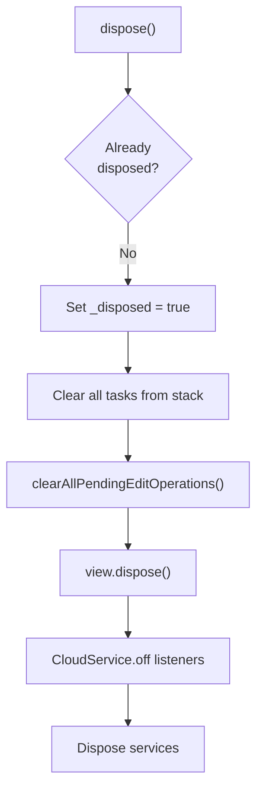

# ClineProvider (Core Orchestrator)

<details>
<summary>Relevant source files</summary>

The following files were used as context for generating this wiki page:

- [.github/workflows/cli-release.yml](.github/workflows/cli-release.yml)
- [apps/cli/scripts/build.sh](apps/cli/scripts/build.sh)
- [packages/types/src/vscode-extension-host.ts](packages/types/src/vscode-extension-host.ts)
- [src/api/providers/fetchers/modelCache.ts](src/api/providers/fetchers/modelCache.ts)
- [src/core/task-persistence/TaskHistoryStore.ts](src/core/task-persistence/TaskHistoryStore.ts)
- [src/core/task-persistence/__tests__/TaskHistoryStore.crossInstance.spec.ts](src/core/task-persistence/__tests__/TaskHistoryStore.crossInstance.spec.ts)
- [src/core/task-persistence/__tests__/TaskHistoryStore.spec.ts](src/core/task-persistence/__tests__/TaskHistoryStore.spec.ts)
- [src/core/task-persistence/index.ts](src/core/task-persistence/index.ts)
- [src/core/task/__tests__/Task.persistence.spec.ts](src/core/task/__tests__/Task.persistence.spec.ts)
- [src/core/webview/ClineProvider.ts](src/core/webview/ClineProvider.ts)
- [src/core/webview/__tests__/ClineProvider.apiHandlerRebuild.spec.ts](src/core/webview/__tests__/ClineProvider.apiHandlerRebuild.spec.ts)
- [src/core/webview/__tests__/ClineProvider.lockApiConfig.spec.ts](src/core/webview/__tests__/ClineProvider.lockApiConfig.spec.ts)
- [src/core/webview/__tests__/ClineProvider.spec.ts](src/core/webview/__tests__/ClineProvider.spec.ts)
- [src/core/webview/__tests__/ClineProvider.sticky-mode.spec.ts](src/core/webview/__tests__/ClineProvider.sticky-mode.spec.ts)
- [src/core/webview/__tests__/ClineProvider.sticky-profile.spec.ts](src/core/webview/__tests__/ClineProvider.sticky-profile.spec.ts)
- [src/core/webview/__tests__/ClineProvider.taskHistory.spec.ts](src/core/webview/__tests__/ClineProvider.taskHistory.spec.ts)
- [src/core/webview/__tests__/webviewMessageHandler.lockApiConfig.spec.ts](src/core/webview/__tests__/webviewMessageHandler.lockApiConfig.spec.ts)
- [src/core/webview/__tests__/webviewMessageHandler.spec.ts](src/core/webview/__tests__/webviewMessageHandler.spec.ts)
- [src/core/webview/webviewMessageHandler.ts](src/core/webview/webviewMessageHandler.ts)
- [src/i18n/setup.ts](src/i18n/setup.ts)
- [src/shared/WebviewMessage.ts](src/shared/WebviewMessage.ts)
- [src/shared/globalFileNames.ts](src/shared/globalFileNames.ts)
- [webview-ui/src/components/chat/ChatRow.tsx](webview-ui/src/components/chat/ChatRow.tsx)
- [webview-ui/src/components/chat/ChatView.tsx](webview-ui/src/components/chat/ChatView.tsx)
- [webview-ui/src/components/settings/SettingsView.tsx](webview-ui/src/components/settings/SettingsView.tsx)
- [webview-ui/src/context/ExtensionStateContext.tsx](webview-ui/src/context/ExtensionStateContext.tsx)

</details>


## Purpose and Scope

`ClineProvider` is the central orchestrator of the Roo Code extension, acting as the bridge between the VS Code extension host and the React-based webview UI. It manages the task execution stack, coordinates service integration, handles bidirectional message passing, and maintains state synchronization across the application.

This document covers `ClineProvider`'s architecture, initialization sequence, task management, and communication protocols.

## Class Overview

### Core Architecture



**Sources**: [src/core/webview/ClineProvider.ts:126-174](), [src/core/webview/ClineProvider.ts:383-465]()

`ClineProvider` implements `vscode.WebviewViewProvider` and `TaskProviderLike` interfaces, serving as:
- **Webview Provider**: Manages the lifecycle of the webview panel/view. [src/core/webview/ClineProvider.ts:128]()
- **Task Orchestrator**: Maintains a stack of active `Task` instances. [src/core/webview/ClineProvider.ts:139]()
- **Service Coordinator**: Initializes and manages core services. [src/core/webview/ClineProvider.ts:176-330]()
- **Message Router**: Routes messages between webview and extension logic via `webviewMessageHandler`. [src/core/webview/ClineProvider.ts:98]()
- **State Manager**: Coordinates state updates and persistence using `ContextProxy`. [src/core/webview/ClineProvider.ts:93]()

### Key Class Members

| Member | Type | Purpose |
|--------|------|---------|
| `clineStack` | `Task[]` | LIFO stack of active task instances. [src/core/webview/ClineProvider.ts:139]() |
| `view` | `WebviewView \| WebviewPanel` | VS Code webview container. [src/core/webview/ClineProvider.ts:138]() |
| `contextProxy` | `ContextProxy` | Global state interface. [src/core/webview/ClineProvider.ts:211]() |
| `providerSettingsManager` | `ProviderSettingsManager` | API configuration management. [src/core/webview/ClineProvider.ts:212]() |
| `customModesManager` | `CustomModesManager` | Mode definitions CRUD. [src/core/webview/ClineProvider.ts:213]() |
| `taskHistoryStore` | `TaskHistoryStore` | Per-task file persistence. [src/core/webview/ClineProvider.ts:153]() |
| `mcpHub` | `McpHub` | MCP server integration. [src/core/webview/ClineProvider.ts:143]() |
| `skillsManager` | `SkillsManager` | Skill discovery and execution. [src/core/webview/ClineProvider.ts:144]() |
| `marketplaceManager` | `MarketplaceManager` | Extension marketplace integration. [src/core/webview/ClineProvider.ts:145]() |
| `codeIndexManager` | `CodeIndexManager` | Semantic search coordinator. [src/core/webview/ClineProvider.ts:141]() |
| `clineMessagesSeq` | `number` | Monotonic sequence counter for state pushes. [src/core/webview/ClineProvider.ts:168]() |

**Sources**: [src/core/webview/ClineProvider.ts:136-174]()

## Service Initialization and Dependencies

### Initialization Sequence

```mermaid
sequenceDiagram
    participant Activate as extension.activate
    participant CP as ClineProvider<br/>Constructor
    participant Context as ContextProxy
    participant Services as Service Managers
    participant Cloud as CloudService
    
    Activate->>CP: new ClineProvider(context)
    CP->>Context: Access globalState/secrets
    
    CP->>CP: Initialize TaskHistoryStore
    Note over CP: Migrate from globalState if needed
    
    CP->>CP: Register TelemetryPropertiesProvider
    CP->>CP: Create WorkspaceTracker
    CP->>CP: Create ProviderSettingsManager
    CP->>CP: Create CustomModesManager
    
    CP->>Services: McpServerManager.getInstance()
    Services-->>CP: McpHub instance
    CP->>Services: new SkillsManager()
    Services-->>CP: SkillsManager instance
    CP->>Services: new MarketplaceManager()
    Services-->>CP: MarketplaceManager instance
    
    CP->>Cloud: Check CloudService.hasInstance()
    alt CloudService ready
        CP->>Cloud: initializeCloudProfileSync()
        Cloud->>CP: Register event handlers
    else CloudService not ready
        CP->>CP: Defer sync until ready
    end
    
    CP->>CP: Setup task event forwarding
```

**Sources**: [src/core/webview/ClineProvider.ts:176-330]()

### Service Dependencies

`ClineProvider` initializes services in dependency order:

1. **Core Services** (Constructor):
   - `ContextProxy`: Injected dependency for global state access. [src/core/webview/ClineProvider.ts:211]()
   - `TaskHistoryStore`: Per-task file-based persistence with migration from legacy `globalState`. [src/core/webview/ClineProvider.ts:183-184]()
   - `TelemetryService`: Registered as properties provider for mode/provider tracking. [src/core/webview/ClineProvider.ts:191]()

2. **Configuration Services**:
   - `ProviderSettingsManager`: API configuration profiles. [src/core/webview/ClineProvider.ts:212]()
   - `CustomModesManager`: Mode definitions. [src/core/webview/ClineProvider.ts:213]()

3. **Integration Services** (Async initialization):
   - `McpHub`: Singleton via `McpServerManager.getInstance()`. [src/core/webview/ClineProvider.ts:365]()
   - `SkillsManager`: Skill discovery from `.roo/skills` directories. [src/core/webview/ClineProvider.ts:371]()
   - `MarketplaceManager`: Extension marketplace integration. [src/core/webview/ClineProvider.ts:214]()

4. **Cloud Services** (Conditional):
   - Cloud profile synchronization if `CloudService.hasInstance()` returns true. [src/core/webview/ClineProvider.ts:383-412]()
   - Event handler registration for `settings-updated` and `auth-state-changed` events. [src/core/webview/ClineProvider.ts:414-446]()

**Sources**: [src/core/webview/ClineProvider.ts:176-465]()

## Task Stack Management

### Task Stack Architecture



**Sources**: [src/core/webview/ClineProvider.ts:139](), [src/core/webview/ClineProvider.ts:471-586]()

### Stack Lifecycle Operations

#### addClineToStack

When a new task is added:
1. Task instance is pushed onto the stack. [src/core/webview/ClineProvider.ts:472]()
2. `TaskFocused` event is emitted. [src/core/webview/ClineProvider.ts:473]()
3. Provider-specific setup runs (e.g., force-loading LMStudio model details). [src/core/webview/ClineProvider.ts:476]()
4. Current mode is validated against organization allow-lists. [src/core/webview/ClineProvider.ts:478-485]()

**Sources**: [src/core/webview/ClineProvider.ts:471-486]()

#### removeClineFromStack

When a task is removed:
1. Task is popped from the stack. [src/core/webview/ClineProvider.ts:511]()
2. `TaskUnfocused` event is emitted. [src/core/webview/ClineProvider.ts:517]()
3. Task is aborted with `isAbandoned = true` to exit all running promises. [src/core/webview/ClineProvider.ts:518]()
4. Event listeners are cleaned up using the `taskEventListeners` WeakMap. [src/core/webview/ClineProvider.ts:521-525]()
5. **Delegation repair**: If the removed task was a delegated child, the parent's status is updated from `"delegated"` back to `"active"` to make it resumable. [src/core/webview/ClineProvider.ts:553-575]()

**Sources**: [src/core/webview/ClineProvider.ts:508-577]()

## Webview Communication

### Message Passing Architecture



**Sources**: [src/core/webview/ClineProvider.ts:891](), [src/core/webview/webviewMessageHandler.ts:92-96]()

### postStateToWebview Mechanism

The `clineMessagesSeq` counter prevents stale state from overwriting newer messages. This sequence numbering is critical because multiple async event sources (cloud auth, settings updates, task streaming) can trigger concurrent state pushes.



**Sources**: [src/core/webview/ClineProvider.ts:1719-1756](), [webview-ui/src/context/ExtensionStateContext.tsx:151-189]()

## State Synchronization

### State Management Layers

| Layer | Component | Persistence |
|-------|-----------|-------------|
| **In-Memory** | `clineMessages` | Volatile |
| **Global State** | `ContextProxy` | VS Code `globalState` |
| **Secrets** | `ProviderSettingsManager` | VS Code `SecretStorage` |
| **Task Storage** | `TaskHistoryStore` | Individual JSON files [src/core/task-persistence/TaskHistoryStore.ts]() |

**Sources**: [src/core/webview/ClineProvider.ts:153](), [src/core/webview/ClineProvider.ts:211-213](), [src/core/task-persistence/TaskHistoryStore.ts]()

### State Write-Through Debouncing

`ClineProvider` implements a debounced write-through mechanism to keep the legacy `globalState` in sync with authoritative per-task files for backward compatibility.

```typescript
private scheduleGlobalStateWriteThrough() {
    if (this.globalStateWriteThroughTimer) {
        clearTimeout(this.globalStateWriteThroughTimer)
    }
    
    this.globalStateWriteThroughTimer = setTimeout(() => {
        this.flushGlobalStateWriteThrough()
    }, ClineProvider.GLOBAL_STATE_WRITE_THROUGH_DEBOUNCE_MS) // 5000ms
}
```

**Sources**: [src/core/webview/ClineProvider.ts:155](), [src/core/webview/ClineProvider.ts:1961-1971]()

## Event Handling

### Forwarded Events

`ClineProvider` forwards events from individual `Task` instances to higher-level consumers like the IPC bridge or telemetry service.

| Event | Trigger | Payload |
|-------|---------|---------|
| `TaskCreated` | Task instance created | `Task` instance [src/core/webview/ClineProvider.ts:113]() |
| `TaskStarted` | Task begins execution | `taskId: string` |
| `TaskCompleted` | Task finishes successfully | `taskId, tokenUsage, toolUsage` |
| `TaskAborted` | Task cancelled or failed | `taskId: string` |

**Sources**: [src/core/webview/ClineProvider.ts:238-320](), [packages/types/src/vscode-extension-host.ts]()

### Streaming Failure Rehydration

When a task aborts due to a streaming failure, `ClineProvider` automatically rehydrates the task from history to allow seamless resumption.

```typescript
if (instance.abortReason === "streaming_failed") {
    const { historyItem } = await this.getTaskWithId(instance.taskId)
    await this.createTaskWithHistoryItem({
        ...historyItem,
        rootTask: instance.rootTask,
        parentTask: instance.parentTask,
    })
}
```

**Sources**: [src/core/webview/ClineProvider.ts:245-273]()

## Lifecycle and Disposal

### Disposal Sequence



**Sources**: [src/core/webview/ClineProvider.ts:667-723]()

### Disposal Triggers

`ClineProvider` disposal is triggered in two contexts:
1. **Tab Panel Mode**: Full disposal when the user closes the editor tab. [src/core/webview/ClineProvider.ts:930]()
2. **Sidebar Mode**: Webview resources are cleared when the view is hidden, but the provider persists to maintain task state continuity. [src/core/webview/ClineProvider.ts:938-943]()

**Sources**: [src/core/webview/ClineProvider.ts:929-943]()