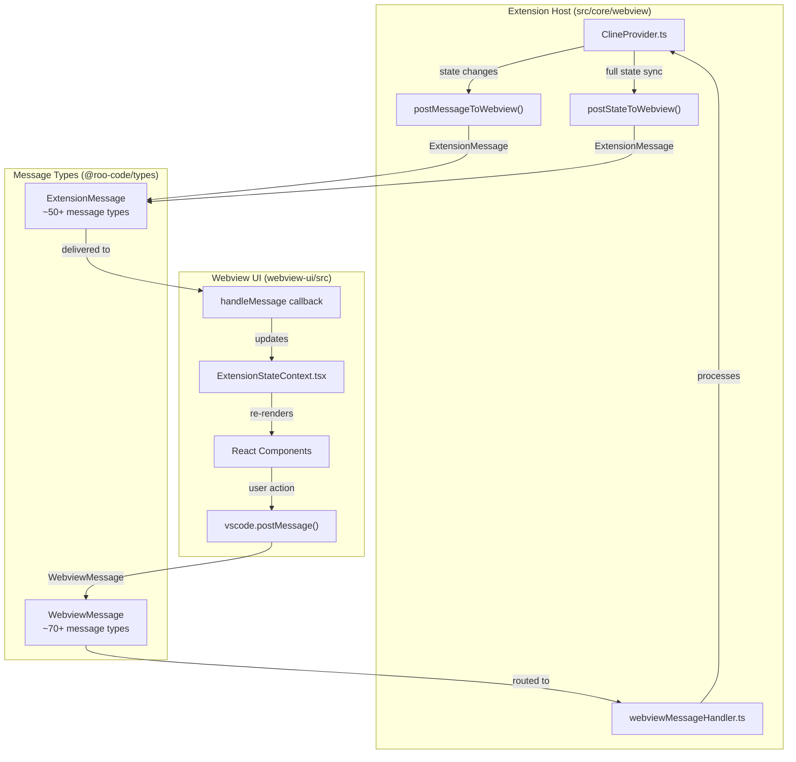
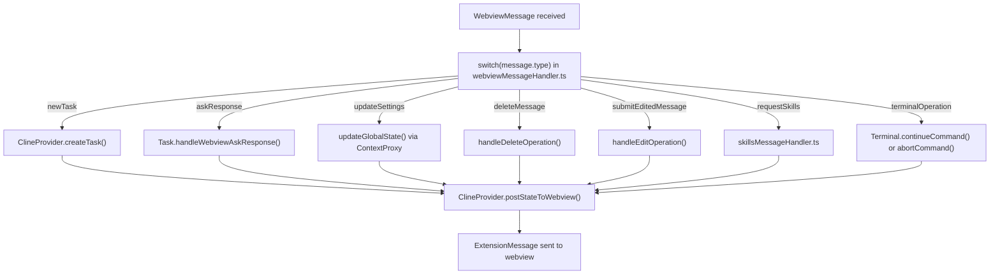
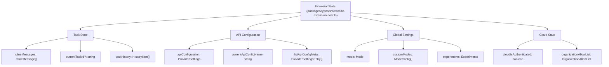

# Message Protocols

<details>
<summary>Relevant source files</summary>

The following files were used as context for generating this wiki page:

- [packages/ipc/README.md](packages/ipc/README.md)
- [packages/ipc/src/ipc-client.ts](packages/ipc/src/ipc-client.ts)
- [packages/ipc/src/ipc-server.ts](packages/ipc/src/ipc-server.ts)
- [packages/types/npm/package.metadata.json](packages/types/npm/package.metadata.json)
- [packages/types/src/__tests__/cloud.test.ts](packages/types/src/__tests__/cloud.test.ts)
- [packages/types/src/__tests__/ipc.test.ts](packages/types/src/__tests__/ipc.test.ts)
- [packages/types/src/api.ts](packages/types/src/api.ts)
- [packages/types/src/cloud.ts](packages/types/src/cloud.ts)
- [packages/types/src/events.ts](packages/types/src/events.ts)
- [packages/types/src/ipc.ts](packages/types/src/ipc.ts)
- [packages/types/src/task.ts](packages/types/src/task.ts)
- [packages/types/src/vscode-extension-host.ts](packages/types/src/vscode-extension-host.ts)
- [releases/3.31.1-release.png](releases/3.31.1-release.png)
- [src/api/providers/fetchers/modelCache.ts](src/api/providers/fetchers/modelCache.ts)
- [src/core/webview/ClineProvider.ts](src/core/webview/ClineProvider.ts)
- [src/core/webview/__tests__/ClineProvider.spec.ts](src/core/webview/__tests__/ClineProvider.spec.ts)
- [src/core/webview/__tests__/webviewMessageHandler.spec.ts](src/core/webview/__tests__/webviewMessageHandler.spec.ts)
- [src/core/webview/webviewMessageHandler.ts](src/core/webview/webviewMessageHandler.ts)
- [src/extension/__tests__/api-delete-queued-message.spec.ts](src/extension/__tests__/api-delete-queued-message.spec.ts)
- [src/extension/__tests__/api-send-message.spec.ts](src/extension/__tests__/api-send-message.spec.ts)
- [src/extension/api.ts](src/extension/api.ts)
- [src/shared/WebviewMessage.ts](src/shared/WebviewMessage.ts)
- [webview-ui/src/components/chat/ChatRow.tsx](webview-ui/src/components/chat/ChatRow.tsx)
- [webview-ui/src/components/chat/ChatView.tsx](webview-ui/src/components/chat/ChatView.tsx)
- [webview-ui/src/components/settings/SettingsView.tsx](webview-ui/src/components/settings/SettingsView.tsx)
- [webview-ui/src/context/ExtensionStateContext.tsx](webview-ui/src/context/ExtensionStateContext.tsx)

</details>


This document describes the bidirectional message-passing protocol between the Extension Host (backend) and the Webview UI (frontend) in Roo Code. The protocol enables loose coupling between the VS Code extension and the React-based user interface.

## Protocol Architecture

Roo Code uses VS Code's webview message-passing API to communicate between the extension host and the UI. Messages are serialized as JSON and passed asynchronously, with each side handling incoming messages through dedicated handler functions.

**Message Flow Architecture**



Sources: [packages/types/src/vscode-extension-host.ts:26-105](), [src/core/webview/ClineProvider.ts:126-171](), [webview-ui/src/context/ExtensionStateContext.tsx:1-149]()

## WebviewMessage Types

`WebviewMessage` represents messages sent from the Webview to the Extension. The message type is a discriminated union with over 70 distinct types, each handling specific user actions or requests.

### Core Message Structure

```typescript
interface WebviewMessage {
  type: string  // Discriminator field (70+ possible values)
  text?: string
  images?: string[]
  values?: Record<string, any>
  // ... many type-specific fields
}
```

Sources: [src/shared/WebviewMessage.ts:1-4]()

### Message Categories

**Task Management Messages**

| Message Type | Purpose | Key Fields |
|--------------|---------|------------|
| `newTask` | Start a new task with user prompt | `text`, `images` |
| `askResponse` | Respond to tool approval requests | `askResponse`, `text`, `images` |
| `cancelTask` | Cancel the currently running task | - |
| `clearTask` | Clear current task and start fresh | - |
| `showTaskWithId` | Load a task from history | `taskId` |
| `deleteTaskWithId` | Delete a task from history | `taskId` |
| `queueMessage` | Queue a message while task is busy | `text`, `images` |

**Settings and Configuration Messages**

| Message Type | Purpose | Key Fields |
|--------------|---------|------------|
| `updateSettings` | Update global settings atomically | `updatedSettings` |
| `upsertApiConfiguration` | Save or update API provider profile | `apiConfiguration`, `text` (profile name) |
| `loadApiConfiguration` | Switch to a different API profile | `text` (profile name) |
| `mode` | Change the current AI mode | `mode` |
| `customInstructions` | Update custom instructions | `text` |

**Terminal and Tool Messages**

| Message Type | Purpose | Key Fields |
|--------------|---------|------------|
| `terminalOperation` | Control terminal command execution | `terminalOperation` ("continue" or "abort") |
| `toggleToolAlwaysAllow` | Toggle auto-approval for specific tools | `toolName`, `alwaysAllow` |
| `toggleMcpServer` | Enable/disable an MCP server | `serverName`, `isEnabled` |

Sources: [src/core/webview/webviewMessageHandler.ts:92-171](), [webview-ui/src/components/chat/ChatView.tsx:15-25]()

### Message Handler Routing

The `webviewMessageHandler` function processes all incoming `WebviewMessage` instances using a large switch statement that routes each message type to its appropriate handler.

**Message Routing Flow**



Sources: [src/core/webview/webviewMessageHandler.ts:92-171]()

### Message Handler Examples

**Task Creation Message Handler**
The handler resolves image mentions (respecting size limits and model capabilities) before creating the task via `ClineProvider.createTask()`.
[src/core/webview/webviewMessageHandler.ts:176-190](), [src/core/webview/ClineProvider.ts:900-920]()

**Ask Response Message Handler**
Forwards user responses to tool approval prompts to the active `Task` instance via `handleWebviewAskResponse()`.
[src/core/webview/webviewMessageHandler.ts:563-585]()

**Settings Update Message Handler**
Atomically updates multiple settings via `ContextProxy` and triggers a full state sync to ensure the UI is consistent.
[src/core/webview/webviewMessageHandler.ts:1146-1163]()

## ExtensionMessage Types

`ExtensionMessage` represents messages sent from the Extension Host to the Webview. These messages deliver state updates, action triggers, and data responses.

### Core Message Structure

```typescript
interface ExtensionMessage {
  type: string // Discriminated union of ~50 types
  text?: string
  state?: Partial<ExtensionState>
  payload?: any
  // ... many type-specific fields like clineMessage, taskHistory, etc.
}
```

Sources: [packages/types/src/vscode-extension-host.ts:30-106]()

### Message Categories

**State Synchronization Messages**

| Message Type | Purpose | Key Fields |
|--------------|---------|------------|
| `state` | Full or partial state update | `state` (Partial<ExtensionState>) |
| `messageUpdated` | Single message incremental update | `clineMessage` |
| `taskHistoryUpdated` | Full task history replacement | `taskHistory` |
| `taskHistoryItemUpdated` | Single task history item update | `taskHistoryItem` |

**Action and Invoke Messages**

| Message Type | Purpose | Key Fields |
|--------------|---------|------------|
| `action` | Trigger UI actions | `action` (e.g., "focusInput", "chatButtonClicked") |
| `invoke` | Invoke specific UI methods | `invoke` (e.g., "newChat", "sendMessage") |

**Data Response Messages**

| Message Type | Purpose | Key Fields |
|--------------|---------|------------|
| `selectedImages` | Return selected images from picker | `images`, `context`, `messageTs` |
| `commands` | Return discovered slash commands | `commands` |
| `skills` | Return available skills | `skills` |
| `mcpServers` | Return MCP server configurations | `mcpServers` |
| `listApiConfig` | Return available API profiles | `listApiConfig` |

Sources: [packages/types/src/vscode-extension-host.ts:30-106]()

### Message Dispatch Methods

**postMessageToWebview()**
Sends individual `ExtensionMessage` instances to the webview immediately via the VS Code Webview API.
[src/core/webview/ClineProvider.ts:1842-1846]()

**postStateToWebview()**
Sends a full state snapshot to the webview. It increments `clineMessagesSeq` to prevent stale state updates.
[src/core/webview/ClineProvider.ts:1848-1856]()

## State Synchronization Patterns

### Full State Synchronization
The `postStateToWebview()` method assembles a complete `ExtensionState` snapshot and sends it to the webview. The webview merges this state with its existing state using `mergeExtensionState()`.
[src/core/webview/ClineProvider.ts:1858-1976](), [webview-ui/src/context/ExtensionStateContext.tsx:151-190]()

### Incremental Message Updates
For performance, individual message updates use the `messageUpdated` message type. The `ExtensionStateContext` finds the message by timestamp (`ts`) and updates only that entry in the `clineMessages` array.
[src/core/webview/ClineProvider.ts:1842-1846](), [webview-ui/src/context/ExtensionStateContext.tsx:373-393]()

### Stale State Protection
The `clineMessagesSeq` monotonic counter prevents stale state from overwriting newer state when multiple async operations (like cloud auth, settings, and task streaming) trigger concurrent state pushes.
[src/core/webview/ClineProvider.ts:165-168](), [webview-ui/src/context/ExtensionStateContext.tsx:166-179]()

## ExtensionState Structure

The `ExtensionState` interface defines the complete state shape synchronized between the extension and webview.

**State Structure Diagram**



Sources: [packages/types/src/vscode-extension-host.ts:30-106](), [webview-ui/src/context/ExtensionStateContext.tsx:34-147]()

## Special Message Patterns

### Dialog Confirmation Pattern
Operations like deleting messages require confirmation. The extension first sends a `showDeleteMessageDialog` message. The UI then responds with a `deleteMessageConfirm` message once the user acts on the dialog.
[src/core/webview/webviewMessageHandler.ts:226-344](), [packages/types/src/vscode-extension-host.ts:85-86]()

### Pending Operation Pattern
For operations that require coordination between multiple async handlers (like editing a message while a checkpoint restore is in progress), the extension maintains a `pendingOperations` map with automatic timeouts.
[src/core/webview/ClineProvider.ts:116-124](), [src/core/webview/ClineProvider.ts:157-158]()

### Message Queue Pattern
When the task is busy (streaming or waiting for user input), user messages are sent as `queueMessage` rather than starting a new task. The extension processes this queue once the task becomes idle.
[webview-ui/src/components/chat/ChatView.tsx:611-634](), [src/core/webview/webviewMessageHandler.ts:1296-1315]()

Sources: [src/core/webview/ClineProvider.ts:1-171](), [src/core/webview/webviewMessageHandler.ts:1-171](), [webview-ui/src/context/ExtensionStateContext.tsx:1-149]()