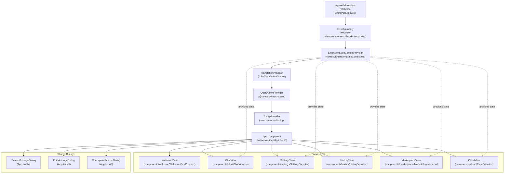
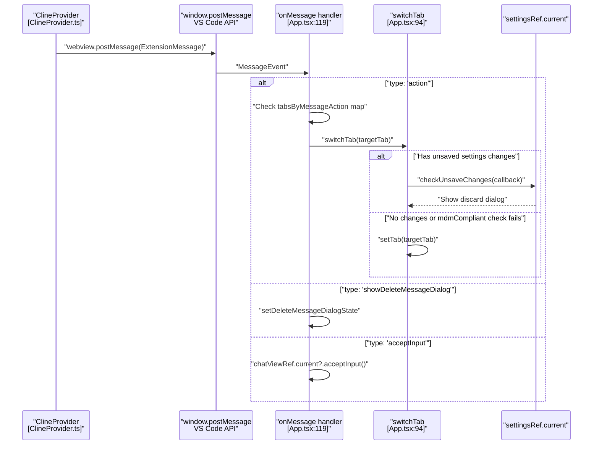
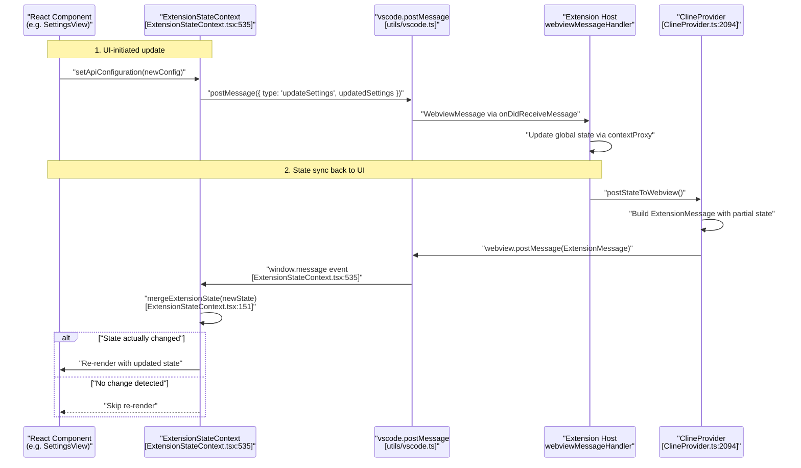
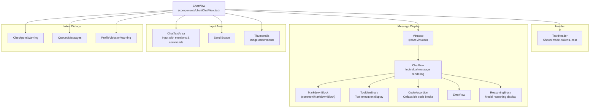
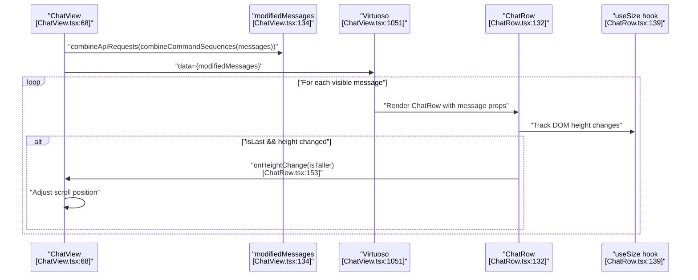
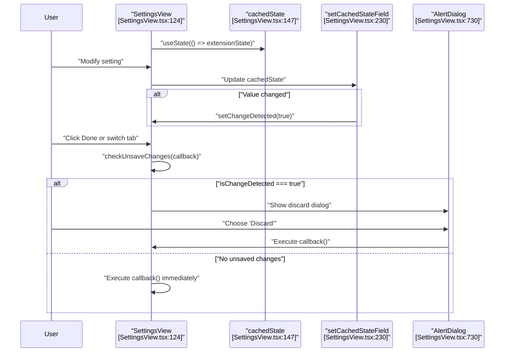

# Webview UI Architecture

<details>
<summary>Relevant source files</summary>

The following files were used as context for generating this wiki page:

- [apps/vscode-e2e/src/suite/markdown-lists.test.ts](apps/vscode-e2e/src/suite/markdown-lists.test.ts)
- [packages/types/src/vscode-extension-host.ts](packages/types/src/vscode-extension-host.ts)
- [src/api/providers/fetchers/modelCache.ts](src/api/providers/fetchers/modelCache.ts)
- [src/core/webview/ClineProvider.ts](src/core/webview/ClineProvider.ts)
- [src/core/webview/__tests__/ClineProvider.spec.ts](src/core/webview/__tests__/ClineProvider.spec.ts)
- [src/core/webview/__tests__/webviewMessageHandler.spec.ts](src/core/webview/__tests__/webviewMessageHandler.spec.ts)
- [src/core/webview/webviewMessageHandler.ts](src/core/webview/webviewMessageHandler.ts)
- [src/shared/WebviewMessage.ts](src/shared/WebviewMessage.ts)
- [webview-ui/src/App.tsx](webview-ui/src/App.tsx)
- [webview-ui/src/__tests__/App.spec.tsx](webview-ui/src/__tests__/App.spec.tsx)
- [webview-ui/src/__tests__/fileChangesFromMessages.spec.ts](webview-ui/src/__tests__/fileChangesFromMessages.spec.ts)
- [webview-ui/src/components/chat/ChatRow.tsx](webview-ui/src/components/chat/ChatRow.tsx)
- [webview-ui/src/components/chat/ChatView.tsx](webview-ui/src/components/chat/ChatView.tsx)
- [webview-ui/src/components/chat/Markdown.tsx](webview-ui/src/components/chat/Markdown.tsx)
- [webview-ui/src/components/common/MarkdownBlock.tsx](webview-ui/src/components/common/MarkdownBlock.tsx)
- [webview-ui/src/components/common/__tests__/MarkdownBlock.spec.tsx](webview-ui/src/components/common/__tests__/MarkdownBlock.spec.tsx)
- [webview-ui/src/components/settings/SettingsView.tsx](webview-ui/src/components/settings/SettingsView.tsx)
- [webview-ui/src/components/settings/styles.ts](webview-ui/src/components/settings/styles.ts)
- [webview-ui/src/components/ui/autosize-textarea.tsx](webview-ui/src/components/ui/autosize-textarea.tsx)
- [webview-ui/src/components/ui/button.tsx](webview-ui/src/components/ui/button.tsx)
- [webview-ui/src/components/ui/command.tsx](webview-ui/src/components/ui/command.tsx)
- [webview-ui/src/components/ui/dropdown-menu.tsx](webview-ui/src/components/ui/dropdown-menu.tsx)
- [webview-ui/src/components/ui/popover.tsx](webview-ui/src/components/ui/popover.tsx)
- [webview-ui/src/components/ui/select.tsx](webview-ui/src/components/ui/select.tsx)
- [webview-ui/src/components/ui/textarea.tsx](webview-ui/src/components/ui/textarea.tsx)
- [webview-ui/src/context/ExtensionStateContext.tsx](webview-ui/src/context/ExtensionStateContext.tsx)
- [webview-ui/src/index.css](webview-ui/src/index.css)

</details>


This page documents the React-based webview UI architecture for Roo Code, including the component hierarchy, routing system, state management, and view structure. The webview runs as a separate React application that communicates with the extension host via message passing.

For information about the message passing protocol between the webview and extension, see [Message Protocols](3.2). For details on state synchronization mechanisms, see [State Synchronization and Updates](3.4). For the extension-side orchestration, see [ClineProvider (Core Orchestrator)](3.1).

**Sources:** [webview-ui/src/App.tsx:1-205](), [src/core/webview/ClineProvider.ts:1-170]()

---

## Architecture Overview

The webview UI is a standalone React application built with Vite that renders inside VS Code's webview panel. It uses React Context for state management, tab-based routing, and communicates with the extension host through VS Code's webview message passing API.

The entry point is `index.html` which loads the compiled `App.tsx` component wrapped in providers. The application integrates VS Code's look and feel using Tailwind CSS with custom VS Code theme variables defined in `index.css` [webview-ui/src/index.css:65-151]().

### High-Level Component Structure

**Title: Webview Component and Provider Hierarchy**


**Sources:** [webview-ui/src/App.tsx:55-205](), [webview-ui/src/App.tsx:210-230](), [webview-ui/src/index.css:1-151]()

---

## App.tsx Root Component

The `App` component [webview-ui/src/App.tsx:55-205]() serves as the root coordinator of the webview application, managing:
- Tab routing via `tab` state variable [webview-ui/src/App.tsx:75]()
- Global dialog state for message edit/delete operations [webview-ui/src/App.tsx:77-89]()
- Message event handling from extension host via `useEvent("message", onMessage)` [webview-ui/src/App.tsx:171]()
- MDM (Mobile Device Management) compliance checks [webview-ui/src/App.tsx:98-102]()
- Persistent marketplace state via `MarketplaceViewStateManager` [webview-ui/src/App.tsx:72]()

### Tab System

Five tabs defined by `Tab` type [webview-ui/src/App.tsx:27]():

| Tab ID | Component | Component Location | Purpose |
|--------|-----------|-------------------|---------|
| `"chat"` | `ChatView` | [webview-ui/src/components/chat/ChatView.tsx:68]() | Main AI interaction interface |
| `"settings"` | `SettingsView` | [webview-ui/src/components/settings/SettingsView.tsx:124]() | Configuration panels |
| `"history"` | `HistoryView` | [webview-ui/src/components/history/HistoryView.tsx]() | Task history browser |
| `"marketplace"` | `MarketplaceView` | [webview-ui/src/components/marketplace/MarketplaceView.tsx]() | Extension marketplace |
| `"cloud"` | `CloudView` | [webview-ui/src/components/cloud/CloudView.tsx]() | Cloud features and auth |

Tab switching triggers:
- Extension messages with `action` property mapped via `tabsByMessageAction` [webview-ui/src/App.tsx:47-53]()
- Direct `switchTab` actions in message `type: "action"` handler [webview-ui/src/App.tsx:125-131]()
- User callbacks in view components via `onDone` prop handlers [webview-ui/src/App.tsx:232-248]()

The `switchTab` function [webview-ui/src/App.tsx:94-114]() checks for unsaved settings via `settingsRef.current?.checkUnsaveChanges` before navigation and blocks non-cloud tabs when `mdmCompliant === false`.

**Title: Tab Switching and Extension Message Routing**


**Sources:** [webview-ui/src/App.tsx:47-53](), [webview-ui/src/App.tsx:94-114](), [webview-ui/src/App.tsx:119-171]()

### Dialog State Management

Three shared dialog states managed at App level to enable message modification from any view:

**DeleteMessageDialog** [webview-ui/src/App.tsx:29-33]():
```typescript
interface DeleteMessageDialogState {
  isOpen: boolean
  messageTs: number
  hasCheckpoint: boolean
}
```
Triggered by `showDeleteMessageDialog` message type [webview-ui/src/App.tsx:146-152](), rendered using memoized component [webview-ui/src/App.tsx:44]() at [webview-ui/src/App.tsx:284-299]().

**EditMessageDialog** [webview-ui/src/App.tsx:35-41]():
```typescript
interface EditMessageDialogState {
  isOpen: boolean
  messageTs: number
  text: string
  hasCheckpoint: boolean
  images?: string[]
}
```
Triggered by `showEditMessageDialog` message type [webview-ui/src/App.tsx:154-162](), rendered at [webview-ui/src/App.tsx:300-313]().

**CheckpointRestoreDialog** - Controlled via `CheckpointRestoreDialog` component [webview-ui/src/App.tsx:46](), rendered at [webview-ui/src/App.tsx:255-283]() when checkpoint restore is needed.

**Sources:** [webview-ui/src/App.tsx:29-41](), [webview-ui/src/App.tsx:44-46](), [webview-ui/src/App.tsx:146-162](), [webview-ui/src/App.tsx:255-313]()

---

## ExtensionStateContext

The `ExtensionStateContext` provides global state management for the entire webview application. It wraps the raw `ExtensionState` from the extension with additional UI state and setter functions.

### State Structure

**Title: ExtensionStateContext State Categories**

```mermaid
graph TB
    ExtensionStateContextType["ExtensionStateContextType<br/>[ExtensionStateContext.tsx:34]"]
    
    subgraph "Core Extension State"
        ExtensionState["ExtensionState<br/>[@roo-code/types]"]
        clineMessages["clineMessages: ClineMessage[]<br/>Current conversation"]
        taskHistory["taskHistory: HistoryItem[]<br/>Past tasks"]
        apiConfiguration["apiConfiguration: ProviderSettings<br/>Active provider config"]
        mode["mode: Mode<br/>Code/Architect/Ask/Debug"]
        customModes["customModes: ModeConfig[]<br/>User-defined modes"]
        alwaysAllowFlags["alwaysAllow* flags<br/>Auto-approve settings"]
    end
    
    subgraph "UI-Specific State"
        showWelcome["showWelcome: boolean<br/>First-run screen"]
        theme["theme: any<br/>VS Code theme variables"]
        mcpServers["mcpServers: McpServer[]<br/>MCP server configs"]
        filePaths["filePaths: string[]<br/>Workspace files for search"]
        openedTabs["openedTabs: Array<{label, isActive, path}><br/>Editor tabs"]
        commands["commands: Command[]<br/>Slash commands"]
    end
    
    subgraph "Computed/Derived"
        cloudIsAuthenticated["cloudIsAuthenticated: boolean<br/>Auth status"]
        organizationAllowList["organizationAllowList<br/>Merged org settings"]
        hasOpenedModeSelector["hasOpenedModeSelector<br/>UI tutorial state"]
    end
    
    subgraph "Setter Functions (Sample)"
        setApiConfiguration["setApiConfiguration(config)<br/>[ExtensionStateContext.tsx:283]"]
        setMode["setMode(mode)<br/>[ExtensionStateContext.tsx:319]"]
        setAlwaysAllowReadOnly["setAlwaysAllowReadOnly(value)<br/>[ExtensionStateContext.tsx:292]"]
        setExperimentEnabled["setExperimentEnabled(id, enabled)<br/>[ExtensionStateContext.tsx:350]"]
    end
    
    ExtensionStateContextType --> ExtensionState
    ExtensionState --> clineMessages
    ExtensionState --> taskHistory
    ExtensionState --> apiConfiguration
    ExtensionState --> mode
    ExtensionState --> customModes
    ExtensionState --> alwaysAllowFlags
    
    ExtensionStateContextType --> showWelcome
    ExtensionStateContextType --> theme
    ExtensionStateContextType --> mcpServers
    ExtensionStateContextType --> filePaths
    ExtensionStateContextType --> openedTabs
    ExtensionStateContextType --> commands
    
    ExtensionStateContextType --> cloudIsAuthenticated
    ExtensionStateContextType --> organizationAllowList
    ExtensionStateContextType --> hasOpenedModeSelector
    
    ExtensionStateContextType --> setApiConfiguration
    ExtensionStateContextType --> setMode
    ExtensionStateContextType --> setAlwaysAllowReadOnly
    ExtensionStateContextType --> setExperimentEnabled
```


### Key State Properties

| Category | Properties | Description |
|----------|-----------|-------------|
| **Task State** | `clineMessages`, `currentTaskItem`, `taskHistory` | Current conversation and history [ExtensionStateContext.tsx:34-147]() |
| **Configuration** | `apiConfiguration`, `listApiConfigMeta`, `currentApiConfigName` | Provider settings and profiles [ExtensionStateContext.tsx:62, 99-100]() |
| **Modes** | `mode`, `customModes`, `customModePrompts` | Operating modes (Code/Architect/Ask/Debug) [ExtensionStateContext.tsx:101, 103, 109]() |
| **Auto-Approve** | `alwaysAllowReadOnly`, `alwaysAllowWrite`, `alwaysAllowExecute`, etc. | Permission settings [ExtensionStateContext.tsx:64-71]() |
| **UI State** | `showWelcome`, `theme`, `filePaths`, `openedTabs` | UI-specific state [ExtensionStateContext.tsx:37-38, 42-43]() |
| **Cloud** | `cloudIsAuthenticated`, `cloudUserInfo`, `cloudOrganizations` | Cloud service state [ExtensionStateContext.tsx:47-48]() |

**Sources:** [webview-ui/src/context/ExtensionStateContext.tsx:34-147]()

### State Update Flow

State updates follow a bidirectional message-passing pattern with deep comparison optimization:

**Title: Bidirectional State Synchronization**


Key implementation details:
- `mergeExtensionState` [webview-ui/src/context/ExtensionStateContext.tsx:151-248]() uses sequence numbering (`clineMessagesSeq`) to protect against stale state pushes. It specifically checks `newState.clineMessagesSeq` against the previous sequence [webview-ui/src/context/ExtensionStateContext.tsx:168-175]().
- Setter functions wrap `vscode.postMessage` calls with appropriate `WebviewMessage` types [webview-ui/src/context/ExtensionStateContext.tsx:283-524]().
- Message routing handled by `webviewMessageHandler` in [src/core/webview/webviewMessageHandler.ts:92-1460]().
- State propagation via `postStateToWebview` [src/core/webview/ClineProvider.ts:2094-2218]().

**Sources:** [webview-ui/src/context/ExtensionStateContext.tsx:151-248](), [webview-ui/src/context/ExtensionStateContext.tsx:535-660](), [src/core/webview/ClineProvider.ts:2094-2218](), [src/core/webview/webviewMessageHandler.ts:92-1460]()

---

## ChatView Component

`ChatView` [webview-ui/src/components/chat/ChatView.tsx:68-1223]() is the primary interface for interacting with the AI. It manages message display, input handling, and task execution state. The component is never unmounted (it uses `isHidden` prop instead) to preserve state during tab switches [webview-ui/src/components/chat/ChatView.tsx:55]().

### Component Structure

**Title: ChatView Component Architecture**


**Sources:** [webview-ui/src/components/chat/ChatView.tsx:1-1223]()

### Key State Management

ChatView maintains local state for UI interactions and message flow control:

| State Variable | Type | Declaration | Purpose |
|---------------|------|-------------|---------|
| `inputValue` | `string` | [webview-ui/src/components/chat/ChatView.tsx:139]() | Current text input value |
| `selectedImages` | `string[]` | [webview-ui/src/components/chat/ChatView.tsx:143]() | Images attached to message |
| `clineAsk` | `ClineAsk \| undefined` | [webview-ui/src/components/chat/ChatView.tsx:149]() | Current approval request type |
| `enableButtons` | `boolean` | [webview-ui/src/components/chat/ChatView.tsx:150]() | Whether approval buttons are enabled |
| `primaryButtonText` | `string \| undefined` | [webview-ui/src/components/chat/ChatView.tsx:151]() | Text for primary action button |
| `secondaryButtonText` | `string \| undefined` | [webview-ui/src/components/chat/ChatView.tsx:152]() | Text for secondary action button |
| `expandedRows` | `Record<number, boolean>` | [webview-ui/src/components/chat/ChatView.tsx:155]() | Which message rows are expanded |

**Sources:** [webview-ui/src/components/chat/ChatView.tsx:139-161]()

### Message Rendering with Virtuoso

ChatView uses `Virtuoso` [webview-ui/src/components/chat/ChatView.tsx:1051-1074]() for efficient rendering of large message lists:

**Title: Virtualized Message List Rendering**


Key implementation details:
- **Viewport Optimization**: Only messages in viewport are rendered to DOM [webview-ui/src/components/chat/ChatView.tsx:1051-1074]().
- **Dynamic Height Tracking**: `ChatRow` uses `useSize` to track height changes (e.g., during streaming) and triggers scroll adjustments in `ChatView` [webview-ui/src/components/chat/ChatRow.tsx:132-163]().
- **Markdown Processing**: `MarkdownBlock` handles the rendering of AI text, supporting Mermaid diagrams [webview-ui/src/components/common/MarkdownBlock.tsx:275-281]() and file links that trigger `openFile` messages back to the extension [webview-ui/src/components/common/MarkdownBlock.tsx:243-247]().

**Sources:** [webview-ui/src/components/chat/ChatView.tsx:134](), [webview-ui/src/components/chat/ChatView.tsx:1051-1091](), [webview-ui/src/components/chat/ChatRow.tsx:132-163](), [webview-ui/src/components/common/MarkdownBlock.tsx:206-305]()

---

## SettingsView Component

`SettingsView` [webview-ui/src/components/settings/SettingsView.tsx:124-803]() provides a tabbed interface for configuring Roo Code behavior. The component maintains a `cachedState` that mirrors `extensionState` to enable change detection and discard confirmation.

### Unsaved Changes Management

SettingsView uses a cached state pattern with change detection to prevent accidental data loss:

**Title: Settings Change Detection and Discard Confirmation**


Implementation details:
- **Cached State**: Initialized from `extensionState` and synced when `currentApiConfigName` changes [webview-ui/src/components/settings/SettingsView.tsx:147, 210-220]().
- **Change Detection**: `setCachedStateField` compares new values against `extensionState` to set `isChangeDetected` [webview-ui/src/components/settings/SettingsView.tsx:230-239]().
- **Ref Exposure**: Exposes `checkUnsaveChanges` via `useImperativeHandle` for parent navigation control [webview-ui/src/components/settings/SettingsView.tsx:438-463]().

**Sources:** [webview-ui/src/components/settings/SettingsView.tsx:124](), [webview-ui/src/components/settings/SettingsView.tsx:147](), [webview-ui/src/components/settings/SettingsView.tsx:210-239](), [webview-ui/src/components/settings/SettingsView.tsx:438-463](), [webview-ui/src/App.tsx:107-113]()