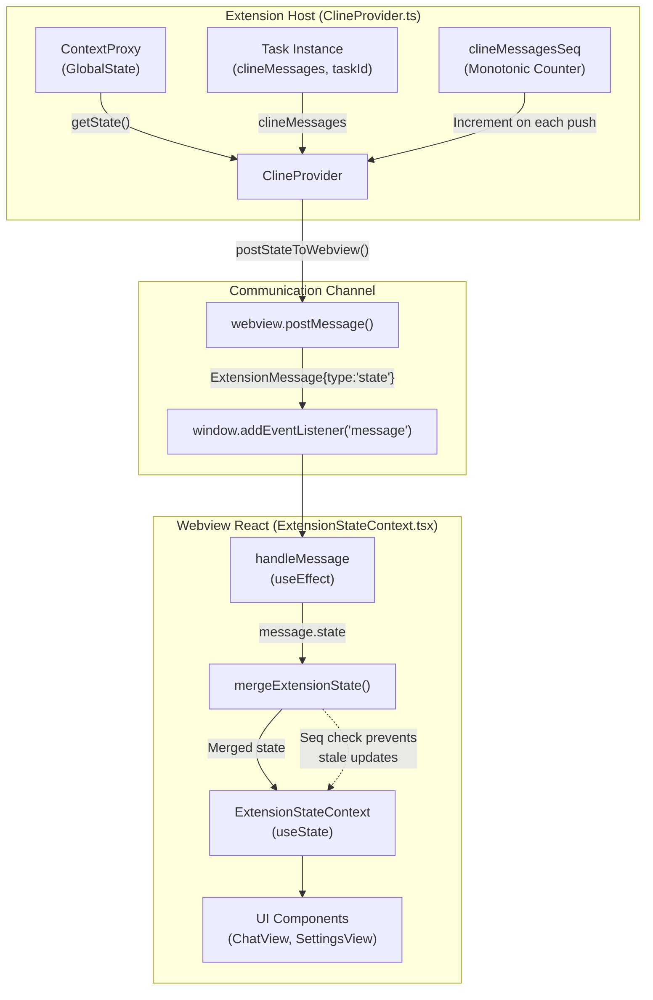
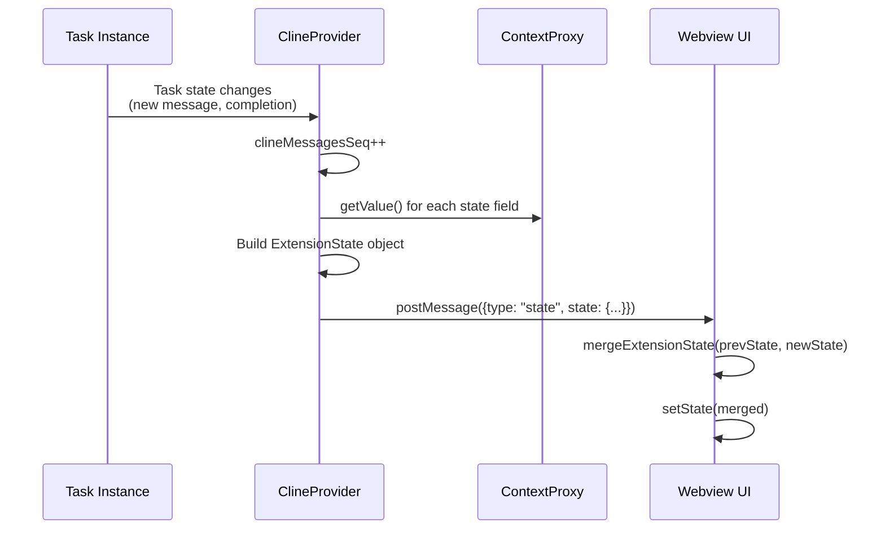
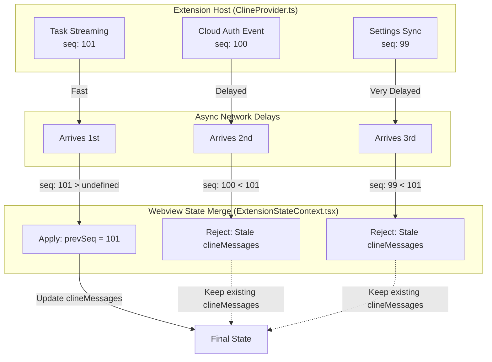
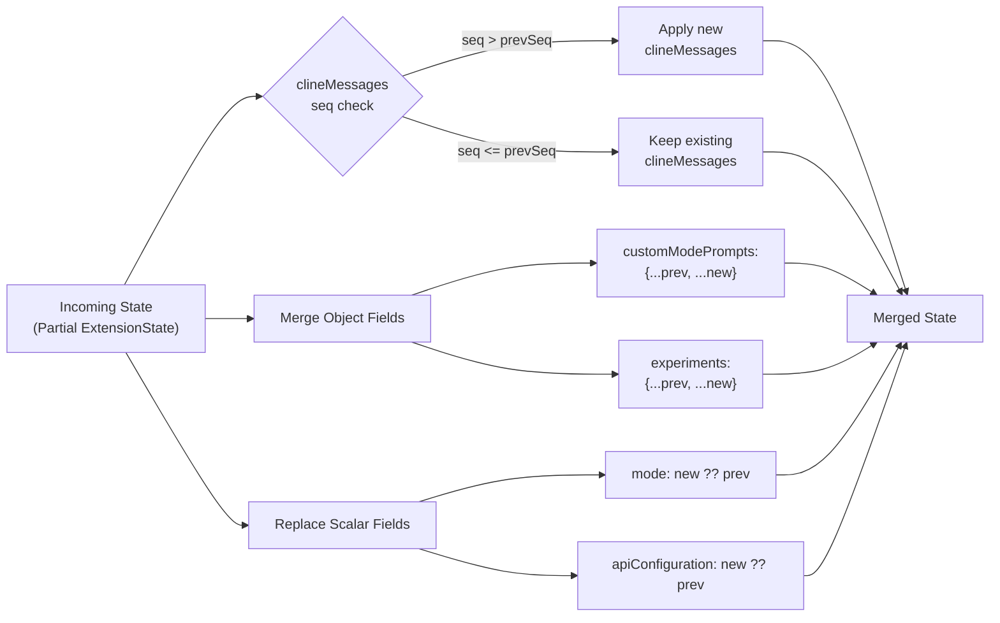

# State Synchronization and Updates

<details>
<summary>Relevant source files</summary>

The following files were used as context for generating this wiki page:

- [packages/types/src/experiment.ts](packages/types/src/experiment.ts)
- [packages/types/src/vscode-extension-host.ts](packages/types/src/vscode-extension-host.ts)
- [src/api/providers/fetchers/modelCache.ts](src/api/providers/fetchers/modelCache.ts)
- [src/core/webview/ClineProvider.ts](src/core/webview/ClineProvider.ts)
- [src/core/webview/__tests__/ClineProvider.spec.ts](src/core/webview/__tests__/ClineProvider.spec.ts)
- [src/core/webview/__tests__/webviewMessageHandler.spec.ts](src/core/webview/__tests__/webviewMessageHandler.spec.ts)
- [src/core/webview/webviewMessageHandler.ts](src/core/webview/webviewMessageHandler.ts)
- [src/shared/WebviewMessage.ts](src/shared/WebviewMessage.ts)
- [src/shared/__tests__/experiments.spec.ts](src/shared/__tests__/experiments.spec.ts)
- [src/shared/experiments.ts](src/shared/experiments.ts)
- [webview-ui/src/components/chat/ChatRow.tsx](webview-ui/src/components/chat/ChatRow.tsx)
- [webview-ui/src/components/chat/ChatView.tsx](webview-ui/src/components/chat/ChatView.tsx)
- [webview-ui/src/components/settings/SettingsView.tsx](webview-ui/src/components/settings/SettingsView.tsx)
- [webview-ui/src/context/ExtensionStateContext.tsx](webview-ui/src/context/ExtensionStateContext.tsx)
- [webview-ui/src/context/__tests__/ExtensionStateContext.spec.tsx](webview-ui/src/context/__tests__/ExtensionStateContext.spec.tsx)

</details>


## Purpose and Scope

This page documents the state synchronization mechanism between the Extension Host and the Webview UI in Roo Code. It covers how state changes in the extension are propagated to the React-based webview, how stale updates are prevented through sequence numbering, and how the webview merges partial state updates efficiently.

For the overall webview communication architecture, see [Webview Communication System](). For the webview UI components that consume this state, see [Webview UI Architecture](). For message protocol details, see [Message Protocols]().

---

## State Synchronization Architecture

The state synchronization system uses a unidirectional data flow pattern where the Extension Host is the single source of truth. State changes flow from the extension to the webview through the `postMessage` API, and the webview merges these updates into its local React state.

### State Flow Diagram



**Sources:**
- [src/core/webview/ClineProvider.ts:168-168]()
- [webview-ui/src/context/ExtensionStateContext.tsx:151-190]()
- [webview-ui/src/context/ExtensionStateContext.tsx:305-464]()

---

## The postStateToWebview Mechanism

The `postStateToWebview()` method is the primary mechanism for broadcasting state updates from the extension to the webview. It captures the current state, increments the sequence counter, and sends a partial or complete state object.

### Core State Broadcasting Methods

| Method | Purpose | When Used |
|--------|---------|-----------|
| `postStateToWebview()` | Full state update including `clineMessages` | After task events, user actions, settings changes |
| `postStateToWebviewWithoutClineMessages()` | State update excluding `clineMessages` | Settings updates when messages are unchanged |
| `postMessageToWebview()` | Individual message or action | Focused updates like theme changes, dialogs, or `messageUpdated` |

### State Capture and Transmission



The `postStateToWebview()` method performs these operations:

1. **Increment Sequence**: Increments `clineMessagesSeq` to mark this as a newer update [src/core/webview/ClineProvider.ts:168-168]().
2. **Gather State**: Calls `getState()` to collect current values from `ContextProxy` [src/core/webview/ClineProvider.ts:120-120]().
3. **Include Task State**: Adds `clineMessages`, `currentTaskId`, `currentTaskItem`, etc. [packages/types/src/vscode-extension-host.ts:130-130]().
4. **Attach Sequence**: Includes `clineMessagesSeq` in the state payload [src/core/webview/ClineProvider.ts:168-168]().
5. **Post Message**: Sends `ExtensionMessage` with `type: "state"` [packages/types/src/vscode-extension-host.ts:30-33]().

**Sources:**
- [src/core/webview/ClineProvider.ts:168-168]()
- [packages/types/src/vscode-extension-host.ts:30-241]()

---

## Sequence Numbering and Stale Update Prevention

The `clineMessagesSeq` monotonic counter prevents race conditions where stale state overwrites newer state. This is critical because multiple async operations (cloud auth, settings sync, task streaming) can trigger concurrent state pushes.

### Sequence Number Protection Mechanism



### Protection Logic in mergeExtensionState

The merge function in `ExtensionStateContext.tsx` implements sequence-based protection:

[webview-ui/src/context/ExtensionStateContext.tsx:166-179]()

```typescript
// Protect clineMessages from stale state pushes using sequence numbering.
// Multiple async event sources (cloud auth, settings, task streaming) can trigger
// concurrent state pushes. If a stale push arrives after a newer one, its clineMessages
// would overwrite the newer ones, causing the UI to flicker or lose progress.
if (
    newState.clineMessagesSeq !== undefined &&
    prevState.clineMessagesSeq !== undefined &&
    newState.clineMessagesSeq <= prevState.clineMessagesSeq &&
    newState.clineMessages !== undefined
) {
    rest.clineMessages = prevState.clineMessages
    rest.clineMessagesSeq = prevState.clineMessagesSeq
}
```

This protection ensures that:
- Only **strictly newer** sequences update `clineMessages`.
- State pushes with `seq ≤ prevSeq` preserve existing messages.
- Other state fields (settings, mode, etc.) merge normally.

**Sources:**
- [webview-ui/src/context/ExtensionStateContext.tsx:166-179]()
- [src/core/webview/ClineProvider.ts:168-168]()

---

## State Merging Logic

The webview uses `mergeExtensionState()` to intelligently combine incoming partial state updates with existing state. This function implements field-specific merge strategies to optimize performance and correctness.

### Merge Strategy by Field Type



### Field-Specific Merge Behavior

| Field Type | Merge Strategy | Rationale |
|------------|----------------|-----------|
| `clineMessages` | Sequence-gated replacement | Prevent stale message arrays from overwriting newer ones [webview-ui/src/context/ExtensionStateContext.tsx:166-179](). |
| `customModePrompts` | Object spread merge | Accumulate prompt overrides across updates [webview-ui/src/context/ExtensionStateContext.tsx:162-162](). |
| `experiments` | Object spread merge | Preserve all experiment flags [webview-ui/src/context/ExtensionStateContext.tsx:163-163](). |
| `apiConfiguration` | Complete replacement | Settings are updated atomically [webview-ui/src/context/ExtensionStateContext.tsx:155-155](). |

**Sources:**
- [webview-ui/src/context/ExtensionStateContext.tsx:151-190]()
- [packages/types/src/vscode-extension-host.ts:130-130]()

---

## Incremental Message Updates

For fine-grained updates to individual messages (e.g., updating a message's content during streaming), the extension uses the `messageUpdated` message type. This optimization reduces payload size during high-frequency streaming.

### messageUpdated Handler Logic

The webview's message handler locates the message by timestamp and updates it in place:

[webview-ui/src/context/ExtensionStateContext.tsx:373-393]()

```typescript
case "messageUpdated": {
    const clineMessage = message.clineMessage!
    setState((prevState) => {
        const lastIndex = findLastIndex(prevState.clineMessages, (msg) => msg.ts === clineMessage.ts)
        if (lastIndex !== -1) {
            const newClineMessages = [...prevState.clineMessages]
            newClineMessages[lastIndex] = clineMessage
            return { ...prevState, clineMessages: newClineMessages }
        }
        return prevState
    })
    break
}
```

**Sources:**
- [webview-ui/src/context/ExtensionStateContext.tsx:373-393]()
- [packages/types/src/vscode-extension-host.ts:40-40]()

---

## Performance Considerations

### State Update Frequency

The extension implements optimizations to reduce state synchronization overhead:

1. **Debounced Global State Writes**: File writes to global state are debounced to avoid excessive I/O.
   - [src/core/webview/ClineProvider.ts:155-156]() - `GLOBAL_STATE_WRITE_THROUGH_DEBOUNCE_MS = 5000`.

2. **Incremental Message Updates**: Use `messageUpdated` instead of full state pushes during streaming.
   - [webview-ui/src/context/ExtensionStateContext.tsx:373-393]().

3. **Partial State Pushes**: The extension often sends `Partial<ExtensionState>` to omit large unchanged fields.
   - [packages/types/src/vscode-extension-host.ts:130-130]().

**Sources:**
- [src/core/webview/ClineProvider.ts:155-156]()
- [webview-ui/src/context/ExtensionStateContext.tsx:373-393]()
- [packages/types/src/vscode-extension-host.ts:130-130]()