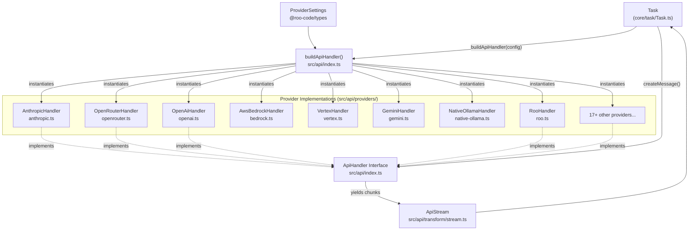
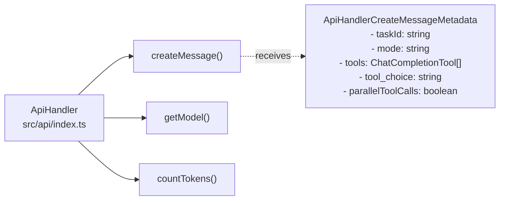

# AI Provider Integration

Relevant source files

The following files were used as context for generating this wiki page:

- [packages/types/src/providers/roo.ts](packages/types/src/providers/roo.ts)
- [src/api/index.ts](src/api/index.ts)
- [src/api/providers/__tests__/base-openai-compatible-provider-timeout.spec.ts](src/api/providers/__tests__/base-openai-compatible-provider-timeout.spec.ts)
- [src/api/providers/__tests__/base-openai-compatible-provider.spec.ts](src/api/providers/__tests__/base-openai-compatible-provider.spec.ts)
- [src/api/providers/__tests__/openai-usage-tracking.spec.ts](src/api/providers/__tests__/openai-usage-tracking.spec.ts)
- [src/api/providers/__tests__/openai.spec.ts](src/api/providers/__tests__/openai.spec.ts)
- [src/api/providers/__tests__/roo.spec.ts](src/api/providers/__tests__/roo.spec.ts)
- [src/api/providers/anthropic.ts](src/api/providers/anthropic.ts)
- [src/api/providers/base-openai-compatible-provider.ts](src/api/providers/base-openai-compatible-provider.ts)
- [src/api/providers/deepseek.ts](src/api/providers/deepseek.ts)
- [src/api/providers/fetchers/__tests__/roo.spec.ts](src/api/providers/fetchers/__tests__/roo.spec.ts)
- [src/api/providers/fetchers/__tests__/versionedSettings.spec.ts](src/api/providers/fetchers/__tests__/versionedSettings.spec.ts)
- [src/api/providers/fetchers/roo.ts](src/api/providers/fetchers/roo.ts)
- [src/api/providers/fetchers/versionedSettings.ts](src/api/providers/fetchers/versionedSettings.ts)
- [src/api/providers/mistral.ts](src/api/providers/mistral.ts)
- [src/api/providers/openai.ts](src/api/providers/openai.ts)
- [src/api/providers/openrouter.ts](src/api/providers/openrouter.ts)
- [src/api/providers/requesty.ts](src/api/providers/requesty.ts)
- [src/api/providers/roo.ts](src/api/providers/roo.ts)
- [src/api/providers/unbound.ts](src/api/providers/unbound.ts)
- [src/shared/api.ts](src/shared/api.ts)
- [webview-ui/src/components/settings/ApiOptions.tsx](webview-ui/src/components/settings/ApiOptions.tsx)
- [webview-ui/src/utils/validate.ts](webview-ui/src/utils/validate.ts)

The AI Provider Integration system enables Roo Code to support 25+ AI model providers through a unified abstraction layer. This system handles provider-specific API differences, message format transformations, streaming protocols, tool calling conventions, and error handling to present a consistent interface to the Task orchestrator.

For details on individual provider implementations, see [Provider Implementations](#4.3). For information on how models are selected and configured, see [Provider Configuration and Validation](#4.2). For streaming implementation details, see [Streaming and Response Processing](#4.5).

## Architecture Overview

The provider integration system uses the Strategy pattern with a factory function to instantiate the appropriate provider handler based on configuration. All providers implement the `ApiHandler` interface, which defines the contract for creating AI messages, retrieving model information, and counting tokens.

Title: Provider System Architecture

Sources: [src/api/index.ts:92-110](), [src/api/index.ts:112-185](), [src/api/providers/roo.ts:40-40]()

## Core Components

### ApiHandler Interface

The `ApiHandler` interface defines three core methods that all provider implementations must support:

- **`createMessage(systemPrompt, messages, metadata?)`**: Initiates an AI conversation and returns an `ApiStream` (async generator) yielding chunks.
- **`getModel()`**: Returns model ID and `ModelInfo` metadata (context window, capabilities, pricing).
- **`countTokens(content)`**: Counts tokens for content blocks (default implementation provided by `BaseProvider`).

Title: ApiHandler Interface and Metadata

Sources: [src/api/index.ts:44-90](), [src/api/index.ts:92-110]()

### buildApiHandler Factory

The `buildApiHandler` factory function instantiates the appropriate provider handler based on the `apiProvider` field in `ProviderSettings`. It includes logic to block "retired" providers via `isRetiredProvider`.

Sources: [src/api/index.ts:112-185](), [src/api/index.ts:115-120]()

### ApiHandlerOptions

Provider handlers receive configuration through `ApiHandlerOptions`, which extends `ProviderSettings` with additional handler-specific toggles.

| Field | Type | Purpose |
|-------|------|---------|
| `enableResponsesReasoningSummary` | `boolean?` | Include reasoning summaries (OpenAI Responses API) |
| `ollamaNumCtx` | `number?` | Ollama context window override |
| `openAiHeaders` | `Record<string, string>?` | Custom headers for OpenAI-compatible providers |
| `rooApiKey` | `string?` | Session token for Roo Cloud |

Sources: [src/shared/api.ts:13-26](), [src/api/providers/openai.ts:46-49](), [src/api/providers/roo.ts:45-45]()

## Provider Categories

### Static Providers

Static providers have a fixed set of models defined in the extension. Examples include Anthropic, OpenAI Native, Gemini, DeepSeek, and Mistral.

Sources: [webview-ui/src/components/settings/ApiOptions.tsx:69-97](), [src/api/providers/deepseek.ts:5-9]()

### Dynamic Providers

Dynamic providers fetch their model lists from external APIs at runtime. Model information is often cached using `getModels`.

| Provider | RouterName | Fetches Models From |
|----------|------------|---------------------|
| OpenRouter | `openrouter` | `https://openrouter.ai/api/v1/models` |
| LiteLLM | `litellm` | `{baseUrl}/models` |
| Requesty | `requesty` | Requesty registry |
| Roo | `roo` | `api.roocode.com/proxy/v1/models` |

Sources: [src/shared/api.ts:171-181](), [src/api/providers/openrouter.ts:153-156](), [src/api/providers/requesty.ts:63-71](), [src/api/providers/roo.ts:47-52]()

### Local Providers

Local providers run models on the user's machine:

- **Ollama**: Local model server, uses `NativeOllamaHandler`.
- **LM Studio**: Local inference server, uses `LmStudioHandler`.
- **VS Code LM**: Uses VS Code's built-in language model API via `VsCodeLmHandler`.

Sources: [src/api/index.ts:134-137](), [src/api/index.ts:150-151]()

## Message Format Transformation

All providers receive messages in Anthropic's format and transform them to native schemas.

- **`convertToOpenAiMessages()`**: Converts to OpenAI's standard message schema.
- **`convertToR1Format()`**: Used for DeepSeek R1 and other models that require merging consecutive same-role messages.
- **`sanitizeGeminiMessages()`**: Cleans messages for Google's Gemini API.

Sources: [src/api/providers/openrouter.ts:21-27](), [src/api/providers/openai.ts:17-18](), [src/api/providers/deepseek.ts:67-69]()

## Streaming Architecture

Providers implement streaming via async generators yielding `ApiStreamChunk` objects.

| Chunk Type | Purpose |
|------------|---------|
| `text` | Displayable text content |
| `reasoning` | Thinking text (e.g., `<think>` tags or `reasoning_content` field) |
| `tool_call_partial` | Incremental tool call fragments |
| `usage` | Token usage and cost metrics |

Sources: [src/api/providers/openai.ts:192-210](), [src/api/providers/deepseek.ts:103-144](), [src/api/providers/requesty.ts:165-192](), [src/api/providers/roo.ts:166-215]()

## Tool Calling Abstraction

Roo Code uses native tool calling. Providers convert `metadata.tools` (OpenAI format) to their native format.

- **OpenAI**: Uses `tools` and `tool_choice` directly in the request.
- **Anthropic**: Uses `convertOpenAIToolsToAnthropic()` for native tool parameters.
- **DeepSeek**: Uses `convertToR1Format` with `mergeToolResultText: true` for thinking models.

Sources: [src/api/providers/openai.ts:162-164](), [src/api/providers/anthropic.ts:78-81](), [src/api/providers/deepseek.ts:67-69]()

## Prompt Caching

Providers support prompt caching to reduce costs and latency.

- **Anthropic**: Adds `cache_control: {type: "ephemeral"}` to system prompts and recent user messages.
- **OpenAI**: Supports `supportsPromptCache` detection and injects `cache_control` in compatible models.
- **Roo Cloud**: Handles `cache_creation_input_tokens` in usage metrics.

Sources: [src/api/providers/anthropic.ts:123-139](), [src/api/providers/openai.ts:110-150](), [src/api/providers/roo.ts:25-28]()

## Configuration UI and Validation

The `ApiOptions` component renders the configuration UI, utilizing `ModelPicker` for selection and `validateApiConfiguration` for integrity checks.

- **`validateModelsAndKeysProvided`**: Ensures required fields like `apiKey` or `awsRegion` are present.
- **`validateProviderAgainstOrganizationSettings`**: Enforces enterprise allow-lists for models and providers.

Sources: [webview-ui/src/components/settings/ApiOptions.tsx:127-134](), [webview-ui/src/utils/validate.ts:16-37](), [webview-ui/src/utils/validate.ts:39-134]()

## Reasoning Models

Special handling is implemented for models with "thinking" capabilities (OpenAI o1/o3, DeepSeek R1, Claude 3.7 Sonnet).

- **`shouldUseReasoningBudget`**: Detects if a model requires or supports reasoning budgets.
- **`shouldUseReasoningEffort`**: Determines if `reasoning_effort` should be included in the API request.
- **`reasoning_content`**: Handled as a specific chunk type to be displayed separately in the UI.
- **`reasoning_details`**: Newer format used by Roo Cloud/OpenRouter to preserve reasoning blocks.

Sources: [src/shared/api.ts:44-50](), [src/shared/api.ts:52-97](), [src/api/providers/openai.ts:202-208](), [src/api/providers/roo.ts:187-193]()