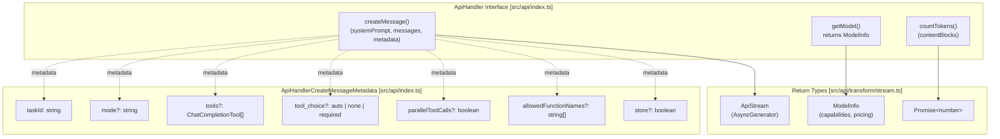
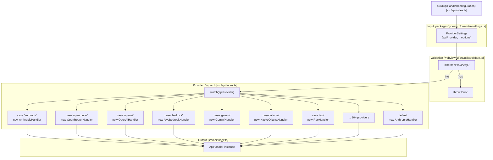
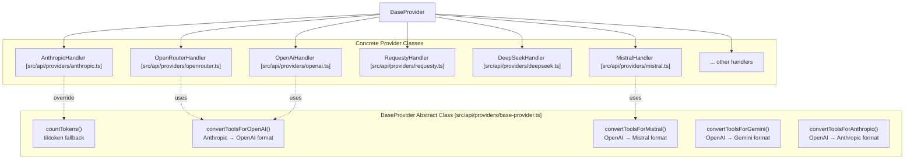
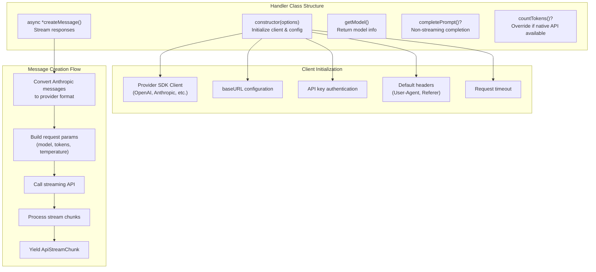
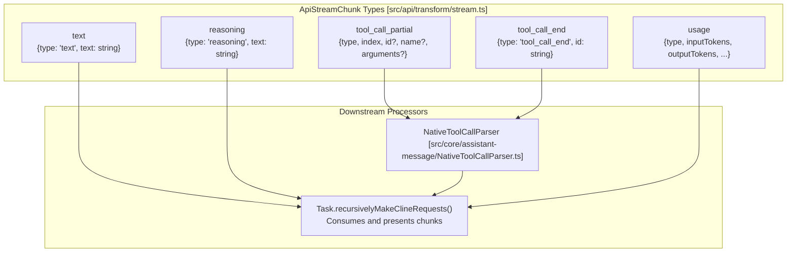

# API Handler Architecture

<details>
<summary>Relevant source files</summary>

The following files were used as context for generating this wiki page:

- [packages/types/src/provider-settings.ts](packages/types/src/provider-settings.ts)
- [packages/types/src/providers/roo.ts](packages/types/src/providers/roo.ts)
- [src/api/index.ts](src/api/index.ts)
- [src/api/providers/__tests__/base-openai-compatible-provider-timeout.spec.ts](src/api/providers/__tests__/base-openai-compatible-provider-timeout.spec.ts)
- [src/api/providers/__tests__/base-openai-compatible-provider.spec.ts](src/api/providers/__tests__/base-openai-compatible-provider.spec.ts)
- [src/api/providers/__tests__/openai-usage-tracking.spec.ts](src/api/providers/__tests__/openai-usage-tracking.spec.ts)
- [src/api/providers/__tests__/openai.spec.ts](src/api/providers/__tests__/openai.spec.ts)
- [src/api/providers/__tests__/roo.spec.ts](src/api/providers/__tests__/roo.spec.ts)
- [src/api/providers/anthropic.ts](src/api/providers/anthropic.ts)
- [src/api/providers/base-openai-compatible-provider.ts](src/api/providers/base-openai-compatible-provider.ts)
- [src/api/providers/deepseek.ts](src/api/providers/deepseek.ts)
- [src/api/providers/fetchers/__tests__/roo.spec.ts](src/api/providers/fetchers/__tests__/roo.spec.ts)
- [src/api/providers/fetchers/__tests__/versionedSettings.spec.ts](src/api/providers/fetchers/__tests__/versionedSettings.spec.ts)
- [src/api/providers/fetchers/roo.ts](src/api/providers/fetchers/roo.ts)
- [src/api/providers/fetchers/versionedSettings.ts](src/api/providers/fetchers/versionedSettings.ts)
- [src/api/providers/mistral.ts](src/api/providers/mistral.ts)
- [src/api/providers/openai.ts](src/api/providers/openai.ts)
- [src/api/providers/openrouter.ts](src/api/providers/openrouter.ts)
- [src/api/providers/requesty.ts](src/api/providers/requesty.ts)
- [src/api/providers/roo.ts](src/api/providers/roo.ts)
- [src/api/providers/unbound.ts](src/api/providers/unbound.ts)
- [src/shared/api.ts](src/shared/api.ts)
- [webview-ui/src/components/settings/ApiOptions.tsx](webview-ui/src/components/settings/ApiOptions.tsx)
- [webview-ui/src/utils/validate.ts](webview-ui/src/utils/validate.ts)

</details>


## Purpose and Scope

The API Handler Architecture provides a unified abstraction layer for integrating 20+ LLM providers (Anthropic, OpenAI, OpenRouter, Bedrock, etc.) behind a common interface. This system enables the Task execution layer to interact with any provider through consistent methods without provider-specific logic. The architecture uses a factory pattern to instantiate provider-specific handlers that implement standard contracts for message creation, token counting, and model metadata retrieval.

For provider-specific configuration and validation, see [Provider Configuration and Validation](#4.2). For information about specific provider implementations, see [Provider Implementations](#4.3). For streaming response processing, see [Streaming and Response Processing](#4.5).

Sources: [src/api/index.ts:1-182]()

---

## Core Interfaces and Contracts

The system defines two primary interfaces that all providers must implement or optionally support:

### ApiHandler Interface

The `ApiHandler` interface is the core contract that all provider handlers must implement. It defines three essential methods:

| Method | Return Type | Purpose |
|--------|-------------|---------|
| `createMessage()` | `ApiStream` | Streams AI responses with tool calls, text, and usage metrics |
| `getModel()` | `{ id: string; info: ModelInfo }` | Returns model ID and capability metadata |
| `countTokens()` | `Promise<number>` | Counts tokens for content blocks (uses tiktoken by default) |



**Diagram: ApiHandler interface methods and metadata structure**

The `ApiHandlerCreateMessageMetadata` type provides context for message creation, including task tracking (via `taskId`), tool definitions, and provider-specific features like OpenAI's Responses API storage control (`store`).

Sources: [src/api/index.ts:91-109](), [src/api/index.ts:43-89]()

### SingleCompletionHandler Interface

The `SingleCompletionHandler` interface is an optional extension for providers that support non-streaming completions:

```typescript
export interface SingleCompletionHandler {
    completePrompt(prompt: string): Promise<string>
}
```

This interface is used for simple prompt completions without streaming, such as summarization tasks or skill invocations that don't require real-time output. Handlers like `OpenRouterHandler` [src/api/providers/openrouter.ts:141](), `UnboundHandler` [src/api/providers/unbound.ts:45](), and `RequestyHandler` [src/api/providers/requesty.ts:52]() implement this interface.

Sources: [src/api/index.ts:39-41](), [src/api/providers/openrouter.ts:141](), [src/api/providers/unbound.ts:45](), [src/api/providers/requesty.ts:52]()

---

## Provider Factory Pattern

### buildApiHandler Factory

The `buildApiHandler()` factory function is the entry point for provider instantiation. It dispatches to provider-specific constructors based on the `apiProvider` field in the configuration:



**Diagram: buildApiHandler factory dispatch flow**

The factory validates that the provider is not retired via `isRetiredProvider` [src/api/index.ts:115]() before dispatching. Retired providers throw a descriptive error instructing users to select a different provider.

Sources: [src/api/index.ts:111-182](), [packages/types/src/provider-settings.ts:159-160]()

### ApiHandlerOptions Type

The `ApiHandlerOptions` type extends `ProviderSettings` (minus `apiProvider`) and adds handler-specific configuration:

| Field | Type | Purpose |
|-------|------|---------|
| `enableResponsesReasoningSummary` | `boolean?` | Enable reasoning summaries for OpenAI Responses API models |
| `ollamaNumCtx` | `number?` | Override Ollama's `num_ctx` parameter |

All provider-specific fields from `ProviderSettings` are included (API keys, base URLs, model IDs, etc.).

Sources: [src/shared/api.ts:11-26]()

---

## BaseProvider Abstract Class

All provider handlers extend the `BaseProvider` abstract class, which provides common functionality:



**Diagram: BaseProvider inheritance hierarchy and tool conversion utilities**

### Default Token Counting

`BaseProvider` implements `countTokens()` using the `tiktoken` library with GPT-4 encoding as a fallback. Individual providers can override this to use native token counting endpoints:

- **AnthropicHandler**: Uses Anthropic's native token counting API.
- **GeminiHandler**: Uses Gemini's `countTokens()` method.
- **Others**: Use tiktoken fallback (good enough for most providers).

Sources: [src/api/index.ts:101-110](), [src/api/providers/anthropic.ts:31-34]()

---

## Provider Implementation Pattern

### Standard Handler Structure

Each provider handler follows a consistent structure, often extending `BaseOpenAiCompatibleProvider` for OpenAI-like APIs.



**Diagram: Standard provider handler implementation pattern**

Sources: [src/api/providers/roo.ts:40-124](), [src/api/providers/openai.ts:31-80]()

### RooHandler Example

The `RooHandler` provides a specialized implementation for Roo Code Cloud:

#### Authentication and Initialization
`RooHandler` [src/api/providers/roo.ts:44-71]() initializes by retrieving a session token from `CloudService`. It targets `https://api.roocode.com/proxy/v1` by default and asynchronously loads dynamic models via `loadDynamicModels`.

#### Reasoning Integration
`RooHandler` [src/api/providers/roo.ts:73-119]() demonstrates the use of `getModelParams` and `getRooReasoning` to inject provider-specific reasoning parameters into the request. It supports both `reasoningBudget` and `reasoningEffort`.

#### Stream Processing
`RooHandler` [src/api/providers/roo.ts:125-260]() implements `createMessage` with an accumulator (`reasoningDetailsAccumulator`) for `reasoning_details`. This handles complex streaming formats (like Gemini or Claude via proxy) by merging chunks sharing the same reasoning block ID.

Sources: [src/api/providers/roo.ts:40-260]()

### BaseOpenAiCompatibleProvider

Many handlers (Roo, etc.) extend `BaseOpenAiCompatibleProvider` to leverage a shared OpenAI client implementation.

#### Stream Creation
`BaseOpenAiCompatibleProvider` handles the central logic for creating a chat completion stream, including:
- Clamping `max_tokens` to 20% of context window via `getModelMaxOutputTokens` [src/shared/api.ts:105-157]().
- Converting tools using `convertToolsForOpenAI`.
- Enabling `thinking` parameters if `enableReasoningEffort` is set.

Sources: [src/api/providers/roo.ts:40](), [src/shared/api.ts:105-157]()

---

## Stream Protocol

### ApiStream Type

The `ApiStream` type is an async generator that yields `ApiStreamChunk` objects.



**Diagram: ApiStream chunk types and processing flow**

### Reasoning Detail Consolidation
For providers like OpenRouter or Roo Cloud that return complex reasoning metadata, `consolidateReasoningDetails` is used to group chunks by index and type, concatenating text and handling data blocks. `RooHandler` uses a `reasoningDetailsAccumulator` [src/api/providers/roo.ts:147-159]() to merge chunks sharing the same ID (e.g., `reasoning.summary` and `reasoning.encrypted`).

Sources: [src/api/providers/roo.ts:147-159](), [src/api/transform/stream.ts:1-50]()

---

## Model Capability and Token Management

### Max Token Calculation
The `getModelMaxOutputTokens` function [src/shared/api.ts:105-157]() provides centralized logic for output limits:
- **Clamping**: Most models are clamped to 20% of the context window [src/shared/api.ts:147]().
- **Exceptions**: GPT-5 models bypass the cap [src/shared/api.ts:142]().
- **Anthropic Contexts**: Ensures a non-zero value, defaulting to `ANTHROPIC_DEFAULT_MAX_TOKENS` [src/shared/api.ts:132]().
- **Reasoning**: If reasoning budget is active, it defaults to `DEFAULT_HYBRID_REASONING_MODEL_MAX_TOKENS` (16,384 tokens) [src/shared/api.ts:117]().

### Reasoning Logic
`shared/api.ts` defines when to use reasoning:
- `shouldUseReasoningBudget` [src/shared/api.ts:44-50](): Required by model or enabled by user with budget support.
- `shouldUseReasoningEffort` [src/shared/api.ts:52-97](): Validates selected effort (low, medium, high) against model capabilities.

Sources: [src/shared/api.ts:44-157]()

---

## Summary

The API Handler Architecture provides a flexible, extensible system for LLM provider integration. Key architectural decisions include:

1. **Unified Interface**: All providers implement `ApiHandler`, enabling Task execution without provider-specific logic.
2. **Factory Pattern**: `buildApiHandler()` centralizes provider instantiation and validation.
3. **BaseProvider Utilities**: Common functionality (token counting, tool conversion) is shared across providers.
4. **Streaming Protocol**: Consistent `ApiStream` chunk types enable uniform response processing.
5. **Reasoning Awareness**: Deep integration for "thinking" models (o1, R1, DeepSeek Reasoner) with specific parameter transformations.

Sources: [src/api/index.ts:1-182](), [src/api/providers/roo.ts:40-260](), [src/shared/api.ts:1-187]()