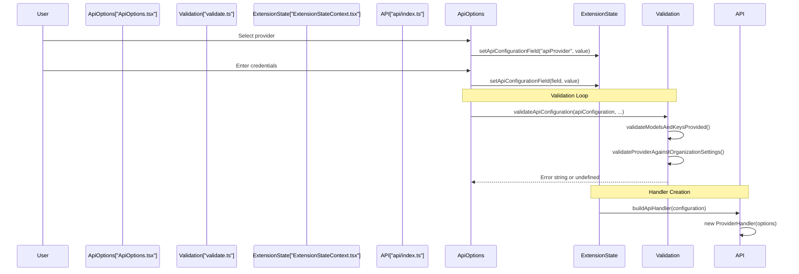
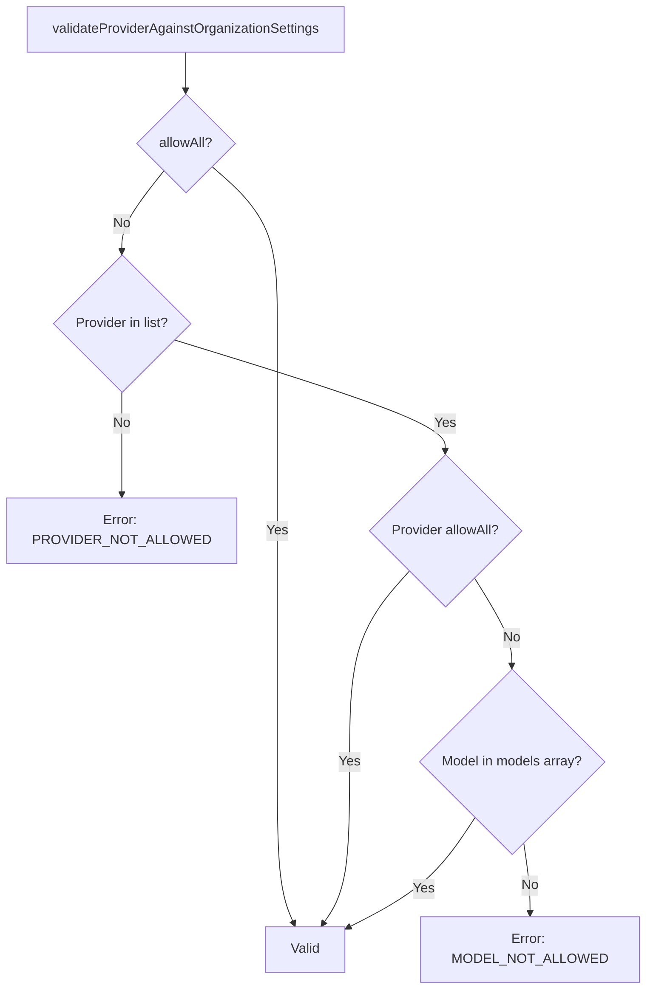

# Provider Configuration and Validation

<details>
<summary>Relevant source files</summary>

The following files were used as context for generating this wiki page:

- [packages/types/src/providers/moonshot.ts](packages/types/src/providers/moonshot.ts)
- [src/api/index.ts](src/api/index.ts)
- [src/api/providers/__tests__/moonshot.spec.ts](src/api/providers/__tests__/moonshot.spec.ts)
- [src/api/providers/anthropic.ts](src/api/providers/anthropic.ts)
- [src/api/providers/deepseek.ts](src/api/providers/deepseek.ts)
- [src/api/providers/fetchers/__tests__/lmstudio.test.ts](src/api/providers/fetchers/__tests__/lmstudio.test.ts)
- [src/api/providers/fetchers/lmstudio.ts](src/api/providers/fetchers/lmstudio.ts)
- [src/api/providers/mistral.ts](src/api/providers/mistral.ts)
- [src/api/providers/moonshot.ts](src/api/providers/moonshot.ts)
- [src/api/providers/openai.ts](src/api/providers/openai.ts)
- [src/api/providers/openrouter.ts](src/api/providers/openrouter.ts)
- [src/api/providers/requesty.ts](src/api/providers/requesty.ts)
- [src/api/providers/unbound.ts](src/api/providers/unbound.ts)
- [src/shared/api.ts](src/shared/api.ts)
- [webview-ui/src/components/settings/ApiOptions.tsx](webview-ui/src/components/settings/ApiOptions.tsx)
- [webview-ui/src/components/settings/ModelDescriptionMarkdown.tsx](webview-ui/src/components/settings/ModelDescriptionMarkdown.tsx)
- [webview-ui/src/components/settings/ModelInfoView.tsx](webview-ui/src/components/settings/ModelInfoView.tsx)
- [webview-ui/src/components/settings/ModelPicker.tsx](webview-ui/src/components/settings/ModelPicker.tsx)
- [webview-ui/src/components/settings/SectionHeader.tsx](webview-ui/src/components/settings/SectionHeader.tsx)
- [webview-ui/src/components/settings/TemperatureControl.tsx](webview-ui/src/components/settings/TemperatureControl.tsx)
- [webview-ui/src/components/settings/providers/Gemini.tsx](webview-ui/src/components/settings/providers/Gemini.tsx)
- [webview-ui/src/components/settings/providers/LMStudio.tsx](webview-ui/src/components/settings/providers/LMStudio.tsx)
- [webview-ui/src/components/settings/providers/LiteLLM.tsx](webview-ui/src/components/settings/providers/LiteLLM.tsx)
- [webview-ui/src/components/settings/providers/Ollama.tsx](webview-ui/src/components/settings/providers/Ollama.tsx)
- [webview-ui/src/components/settings/providers/OpenAI.tsx](webview-ui/src/components/settings/providers/OpenAI.tsx)
- [webview-ui/src/components/settings/providers/OpenAICompatible.tsx](webview-ui/src/components/settings/providers/OpenAICompatible.tsx)
- [webview-ui/src/components/settings/providers/OpenRouter.tsx](webview-ui/src/components/settings/providers/OpenRouter.tsx)
- [webview-ui/src/components/settings/providers/Requesty.tsx](webview-ui/src/components/settings/providers/Requesty.tsx)
- [webview-ui/src/components/settings/providers/Unbound.tsx](webview-ui/src/components/settings/providers/Unbound.tsx)
- [webview-ui/src/components/settings/providers/VSCodeLM.tsx](webview-ui/src/components/settings/providers/VSCodeLM.tsx)
- [webview-ui/src/components/settings/providers/Vertex.tsx](webview-ui/src/components/settings/providers/Vertex.tsx)
- [webview-ui/src/components/settings/providers/__tests__/Gemini.spec.tsx](webview-ui/src/components/settings/providers/__tests__/Gemini.spec.tsx)
- [webview-ui/src/components/settings/providers/__tests__/Vertex.spec.tsx](webview-ui/src/components/settings/providers/__tests__/Vertex.spec.tsx)
- [webview-ui/src/utils/validate.ts](webview-ui/src/utils/validate.ts)

</details>


This page documents the system for configuring and validating AI provider settings, including API keys, model selection, and provider-specific parameters. This is the layer that allows users to connect Roo Code to their chosen AI provider (Anthropic, OpenAI, OpenRouter, etc.) through the settings UI.

For the provider abstraction and API handler implementations, see [4.1 API Handler Architecture](). For model capability detection and features, see [4.4 Model Features and Capabilities]().

## Overview

Provider configuration and validation operates across three layers:

1.  **Type Definitions**: `ProviderSettings` from `@roo-code/types` defines the complete configuration schema.
2.  **Validation Layer**: Functions in [webview-ui/src/utils/validate.ts]() validate user input against requirements and constraints.
3.  **UI Layer**: React components in [webview-ui/src/components/settings/ApiOptions.tsx]() render configuration forms and display validation errors.

The system supports 20+ providers with both static model lists (hardcoded in the extension) and dynamic model lists (fetched from provider APIs).

**Sources:** [src/shared/api.ts:1-9](), [webview-ui/src/utils/validate.ts:16-37](), [webview-ui/src/components/settings/ApiOptions.tsx:127-134]()

## Configuration Data Structure

### ProviderSettings Type

The `ProviderSettings` type is the canonical configuration object. It contains both global settings (like `modelTemperature`) and provider-specific fields.

| Field | Type | Providers | Purpose |
| :--- | :--- | :--- | :--- |
| `apiProvider` | `ProviderName` | All | Selected provider identifier |
| `apiKey` | `string` | Anthropic | Anthropic API key |
| `openRouterApiKey` | `string` | OpenRouter | OpenRouter API key |
| `openAiApiKey` | `string` | OpenAI-compatible | API key for custom OpenAI endpoints |
| `openAiBaseUrl` | `string` | OpenAI-compatible | Custom base URL |
| `awsRegion` | `string` | AWS Bedrock | AWS region |
| `vertexProjectId` | `string` | Vertex AI | GCP project ID |
| `ollamaModelId` | `string` | Ollama | Selected local model ID |
| `modelTemperature`| `number` | Most | Controls randomness of output |

**Sources:** [src/shared/api.ts:3-9](), [webview-ui/src/components/settings/ApiOptions.tsx:8-36]()

### ApiHandlerOptions

The `ApiHandlerOptions` type extends `ProviderSettings` (minus `apiProvider`) with handler-specific toggles used during the instantiation of API handlers in the extension host.

```typescript
export type ApiHandlerOptions = Omit<ProviderSettings, "apiProvider"> & {
	enableResponsesReasoningSummary?: boolean
	ollamaNumCtx?: number
}
```

**Sources:** [src/shared/api.ts:13-26](), [src/api/index.ts:112-113]()

## Configuration and Validation Flow

The following diagram bridges the UI interaction space with the underlying code entities responsible for state and validation.



**Sources:** [webview-ui/src/components/settings/ApiOptions.tsx:171-180](), [webview-ui/src/utils/validate.ts:16-37](), [src/api/index.ts:112-185]()

## Validation System

### Required Field Validation

The `validateModelsAndKeysProvided` function enforces provider-specific requirements. If a required field is missing, it returns a localized error message via `i18next`.

*   **Anthropic**: Requires `apiKey`. [webview-ui/src/utils/validate.ts:61-65]()
*   **AWS Bedrock**: Requires `awsRegion`. [webview-ui/src/utils/validate.ts:66-70]()
*   **Vertex AI**: Requires both `vertexProjectId` and `vertexRegion`. [webview-ui/src/utils/validate.ts:71-75]()
*   **OpenAI (Custom)**: Requires `openAiBaseUrl`, `openAiApiKey`, and `openAiModelId`. [webview-ui/src/utils/validate.ts:91-95]()
*   **Ollama/LM Studio**: Requires the respective `modelId`. [webview-ui/src/utils/validate.ts:96-105]()
*   **Requesty/Unbound/LiteLLM**: Requires specific API keys for each router. [webview-ui/src/utils/validate.ts:46-60]()

**Sources:** [webview-ui/src/utils/validate.ts:39-134]()

### Organization Allow List Validation

`validateProviderAgainstOrganizationSettings` checks if the current configuration complies with organizational policies defined in `OrganizationAllowList`.



**Sources:** [webview-ui/src/utils/validate.ts:141-177]()

### Bedrock ARN Validation

Custom Bedrock ARNs use `validateBedrockArn`. It is designed to be permissive for advanced users while providing warnings for region mismatches.

*   **Regex**: Uses `arn.match(/^arn:[^:]+:[^:]+:([^:]+):/)` to extract the region component from the ARN string. [webview-ui/src/utils/validate.ts:207]()
*   **Behavior**: Always returns `isValid: true` to trust the user, but includes an `errorMessage` if the extracted `arnRegion` does not match the configured `awsRegion`. [webview-ui/src/utils/validate.ts:211-220]()

**Sources:** [webview-ui/src/utils/validate.ts:203-221]()

## Settings UI Components

### ApiOptions Component

The `ApiOptions` component is the primary interface for provider settings. It manages local state for complex fields like headers and debounces updates to the global extension state.

*   **Header Management**: Uses `convertHeadersToObject` to transform a list of tuples `[string, string][]` into a record for the API. [webview-ui/src/components/settings/ApiOptions.tsx:158]()
*   **Debouncing**: Updates `openAiHeaders` after a 300ms delay using `useDebounce` to prevent excessive state writes during typing. [webview-ui/src/components/settings/ApiOptions.tsx:155-167]()
*   **Model Sync**: Automatically syncs the generic `apiModelId` whenever a provider-specific model ID (like `openRouterModelId`) changes via a `useEffect` hook. [webview-ui/src/components/settings/ApiOptions.tsx:208-218]()

**Sources:** [webview-ui/src/components/settings/ApiOptions.tsx:136-167](), [webview-ui/src/components/settings/ApiOptions.tsx:208-218]()

### ModelPicker Component

`ModelPicker` provides a searchable combobox for model selection, utilizing Radix UI primitives and `lucide-react` icons.

*   **Filtering**: Uses `filterModels` to exclude models based on organization settings and `deprecated` flags. [webview-ui/src/components/settings/ModelPicker.tsx:114-124]()
*   **Persistence**: Includes the currently selected model in the list even if it is deprecated, allowing users to see their active selection. [webview-ui/src/components/settings/ModelPicker.tsx:121]()
*   **Initialization**: Ensures a default model is selected if none is present during component mount. [webview-ui/src/components/settings/ModelPicker.tsx:184-191]()

**Sources:** [webview-ui/src/components/settings/ModelPicker.tsx:113-134](), [webview-ui/src/components/settings/ModelPicker.tsx:184-191]()

## Reasoning and Token Configuration

### Reasoning Logic

The system distinguishes between "Reasoning Budget" (used by models like Claude 3.7 Sonnet) and "Reasoning Effort" (used by OpenAI o1/o3).

*   **`shouldUseReasoningBudget`**: Returns true if the model requires it (`model.requiredReasoningBudget`) or if the user has enabled reasoning effort on a model that supports optional budgets. [src/shared/api.ts:44-50]()
*   **`shouldUseReasoningEffort`**: Evaluates the `reasoningEffort` setting (none, low, medium, high) against the model's `supportsReasoningEffort` capability. [src/shared/api.ts:52-97]()

**Sources:** [src/shared/api.ts:44-97]()

### Max Output Tokens Calculation

The `getModelMaxOutputTokens` function determines the `max_tokens` parameter sent to APIs.

1.  **Reasoning Models**: Uses `settings.modelMaxTokens` or `DEFAULT_HYBRID_REASONING_MODEL_MAX_TOKENS` (16,384). [src/shared/api.ts:116-118]()
2.  **Anthropic Contexts**: Defaults to `ANTHROPIC_DEFAULT_MAX_TOKENS` (8,192) if no explicit model limit is set or if the model ID includes "claude". [src/shared/api.ts:120-134]()
3.  **GPT-5 Exception**: GPT-5 models bypass standard clamping and use their full configured max tokens. [src/shared/api.ts:139-144]()
4.  **Standard Clamping**: Other models have their `maxTokens` clamped to 20% of their context window. [src/shared/api.ts:147]()

**Sources:** [src/shared/api.ts:105-157]()

## Dynamic Model Discovery

### GetModelsOptions

To support dynamic model lists, the system uses a discriminated union `GetModelsOptions` to ensure that callers provide the necessary credentials for specific discovery endpoints.

```typescript
const dynamicProviderExtras = {
	openrouter: {} as {},
	litellm: {} as { apiKey: string; baseUrl: string },
	ollama: {} as {},
	roo: {} as { apiKey?: string; baseUrl?: string },
	poe: {} as { apiKey?: string; baseUrl?: string },
    // ...
} as const satisfies Record<RouterName, object>
```

**Sources:** [src/shared/api.ts:171-187]()