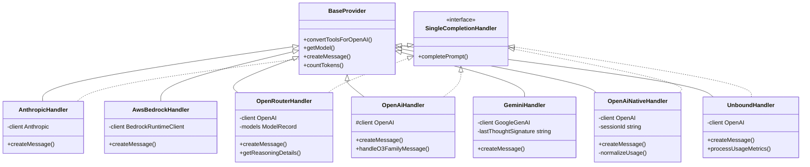
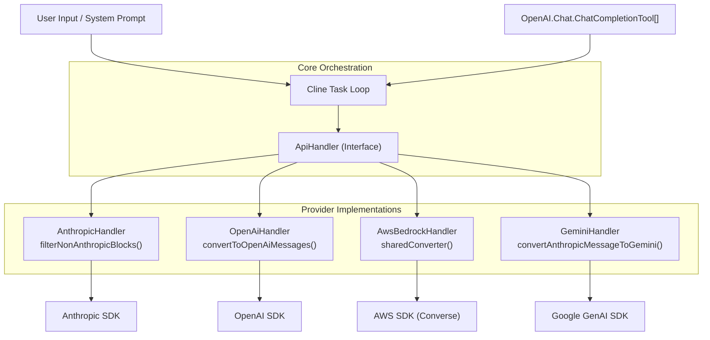

# Provider Implementations

Relevant source files

The following files were used as context for generating this wiki page:

- [packages/types/src/model.ts](packages/types/src/model.ts)
- [packages/types/src/providers/anthropic.ts](packages/types/src/providers/anthropic.ts)
- [packages/types/src/providers/baseten.ts](packages/types/src/providers/baseten.ts)
- [packages/types/src/providers/bedrock.ts](packages/types/src/providers/bedrock.ts)
- [packages/types/src/providers/fireworks.ts](packages/types/src/providers/fireworks.ts)
- [packages/types/src/providers/gemini.ts](packages/types/src/providers/gemini.ts)
- [packages/types/src/providers/index.ts](packages/types/src/providers/index.ts)
- [packages/types/src/providers/lite-llm.ts](packages/types/src/providers/lite-llm.ts)
- [packages/types/src/providers/lm-studio.ts](packages/types/src/providers/lm-studio.ts)
- [packages/types/src/providers/minimax.ts](packages/types/src/providers/minimax.ts)
- [packages/types/src/providers/openai-codex.ts](packages/types/src/providers/openai-codex.ts)
- [packages/types/src/providers/openai.ts](packages/types/src/providers/openai.ts)
- [packages/types/src/providers/openrouter.ts](packages/types/src/providers/openrouter.ts)
- [packages/types/src/providers/qwen-code.ts](packages/types/src/providers/qwen-code.ts)
- [packages/types/src/providers/sambanova.ts](packages/types/src/providers/sambanova.ts)
- [packages/types/src/providers/vercel-ai-gateway.ts](packages/types/src/providers/vercel-ai-gateway.ts)
- [packages/types/src/providers/vertex.ts](packages/types/src/providers/vertex.ts)
- [packages/types/src/providers/xai.ts](packages/types/src/providers/xai.ts)
- [packages/types/src/providers/zai.ts](packages/types/src/providers/zai.ts)
- [src/api/index.ts](src/api/index.ts)
- [src/api/providers/__tests__/anthropic-vertex.spec.ts](src/api/providers/__tests__/anthropic-vertex.spec.ts)
- [src/api/providers/__tests__/anthropic.spec.ts](src/api/providers/__tests__/anthropic.spec.ts)
- [src/api/providers/__tests__/bedrock.spec.ts](src/api/providers/__tests__/bedrock.spec.ts)
- [src/api/providers/__tests__/fireworks.spec.ts](src/api/providers/__tests__/fireworks.spec.ts)
- [src/api/providers/__tests__/gemini-handler.spec.ts](src/api/providers/__tests__/gemini-handler.spec.ts)
- [src/api/providers/__tests__/gemini.spec.ts](src/api/providers/__tests__/gemini.spec.ts)
- [src/api/providers/__tests__/lite-llm.spec.ts](src/api/providers/__tests__/lite-llm.spec.ts)
- [src/api/providers/__tests__/lm-studio-timeout.spec.ts](src/api/providers/__tests__/lm-studio-timeout.spec.ts)
- [src/api/providers/__tests__/lmstudio-native-tools.spec.ts](src/api/providers/__tests__/lmstudio-native-tools.spec.ts)
- [src/api/providers/__tests__/lmstudio.spec.ts](src/api/providers/__tests__/lmstudio.spec.ts)
- [src/api/providers/__tests__/minimax.spec.ts](src/api/providers/__tests__/minimax.spec.ts)
- [src/api/providers/__tests__/openai-codex-native-tool-calls.spec.ts](src/api/providers/__tests__/openai-codex-native-tool-calls.spec.ts)
- [src/api/providers/__tests__/openai-codex.spec.ts](src/api/providers/__tests__/openai-codex.spec.ts)
- [src/api/providers/__tests__/openai-native-tools.spec.ts](src/api/providers/__tests__/openai-native-tools.spec.ts)
- [src/api/providers/__tests__/openai-native-usage.spec.ts](src/api/providers/__tests__/openai-native-usage.spec.ts)
- [src/api/providers/__tests__/openai-native.spec.ts](src/api/providers/__tests__/openai-native.spec.ts)
- [src/api/providers/__tests__/openai-timeout.spec.ts](src/api/providers/__tests__/openai-timeout.spec.ts)
- [src/api/providers/__tests__/qwen-code-native-tools.spec.ts](src/api/providers/__tests__/qwen-code-native-tools.spec.ts)
- [src/api/providers/__tests__/sambanova.spec.ts](src/api/providers/__tests__/sambanova.spec.ts)
- [src/api/providers/__tests__/vercel-ai-gateway.spec.ts](src/api/providers/__tests__/vercel-ai-gateway.spec.ts)
- [src/api/providers/__tests__/vertex.spec.ts](src/api/providers/__tests__/vertex.spec.ts)
- [src/api/providers/__tests__/xai.spec.ts](src/api/providers/__tests__/xai.spec.ts)
- [src/api/providers/__tests__/zai.spec.ts](src/api/providers/__tests__/zai.spec.ts)
- [src/api/providers/anthropic-vertex.ts](src/api/providers/anthropic-vertex.ts)
- [src/api/providers/anthropic.ts](src/api/providers/anthropic.ts)
- [src/api/providers/bedrock.ts](src/api/providers/bedrock.ts)
- [src/api/providers/deepseek.ts](src/api/providers/deepseek.ts)
- [src/api/providers/fetchers/__tests__/litellm.spec.ts](src/api/providers/fetchers/__tests__/litellm.spec.ts)
- [src/api/providers/fetchers/__tests__/openrouter.spec.ts](src/api/providers/fetchers/__tests__/openrouter.spec.ts)
- [src/api/providers/fetchers/__tests__/vercel-ai-gateway.spec.ts](src/api/providers/fetchers/__tests__/vercel-ai-gateway.spec.ts)
- [src/api/providers/fetchers/litellm.ts](src/api/providers/fetchers/litellm.ts)
- [src/api/providers/fetchers/openrouter.ts](src/api/providers/fetchers/openrouter.ts)
- [src/api/providers/fetchers/vercel-ai-gateway.ts](src/api/providers/fetchers/vercel-ai-gateway.ts)
- [src/api/providers/gemini.ts](src/api/providers/gemini.ts)
- [src/api/providers/index.ts](src/api/providers/index.ts)
- [src/api/providers/lite-llm.ts](src/api/providers/lite-llm.ts)
- [src/api/providers/lm-studio.ts](src/api/providers/lm-studio.ts)
- [src/api/providers/minimax.ts](src/api/providers/minimax.ts)
- [src/api/providers/mistral.ts](src/api/providers/mistral.ts)
- [src/api/providers/openai-codex.ts](src/api/providers/openai-codex.ts)
- [src/api/providers/openai-native.ts](src/api/providers/openai-native.ts)
- [src/api/providers/openai.ts](src/api/providers/openai.ts)
- [src/api/providers/openrouter.ts](src/api/providers/openrouter.ts)
- [src/api/providers/qwen-code.ts](src/api/providers/qwen-code.ts)
- [src/api/providers/requesty.ts](src/api/providers/requesty.ts)
- [src/api/providers/router-provider.ts](src/api/providers/router-provider.ts)
- [src/api/providers/unbound.ts](src/api/providers/unbound.ts)
- [src/api/providers/utils/__tests__/timeout-config.spec.ts](src/api/providers/utils/__tests__/timeout-config.spec.ts)
- [src/api/providers/utils/router-tool-preferences.ts](src/api/providers/utils/router-tool-preferences.ts)
- [src/api/providers/utils/timeout-config.ts](src/api/providers/utils/timeout-config.ts)
- [src/api/providers/vercel-ai-gateway.ts](src/api/providers/vercel-ai-gateway.ts)
- [src/api/providers/vertex.ts](src/api/providers/vertex.ts)
- [src/api/providers/xai.ts](src/api/providers/xai.ts)
- [src/api/providers/zai.ts](src/api/providers/zai.ts)
- [src/api/transform/__tests__/gemini-format.spec.ts](src/api/transform/__tests__/gemini-format.spec.ts)
- [src/api/transform/__tests__/minimax-format.spec.ts](src/api/transform/__tests__/minimax-format.spec.ts)
- [src/api/transform/__tests__/responses-api-input.spec.ts](src/api/transform/__tests__/responses-api-input.spec.ts)
- [src/api/transform/__tests__/responses-api-stream.spec.ts](src/api/transform/__tests__/responses-api-stream.spec.ts)
- [src/api/transform/gemini-format.ts](src/api/transform/gemini-format.ts)
- [src/api/transform/minimax-format.ts](src/api/transform/minimax-format.ts)
- [src/api/transform/responses-api-input.ts](src/api/transform/responses-api-input.ts)
- [src/api/transform/responses-api-stream.ts](src/api/transform/responses-api-stream.ts)
- [src/api/transform/zai-format.ts](src/api/transform/zai-format.ts)
- [src/services/search/__tests__/file-search.spec.ts](src/services/search/__tests__/file-search.spec.ts)
- [src/services/search/file-search.ts](src/services/search/file-search.ts)
- [src/shared/api.ts](src/shared/api.ts)
- [src/shared/cost.ts](src/shared/cost.ts)
- [src/utils/__tests__/cost.spec.ts](src/utils/__tests__/cost.spec.ts)
- [src/utils/__tests__/tool-id.spec.ts](src/utils/__tests__/tool-id.spec.ts)
- [src/utils/tool-id.ts](src/utils/tool-id.ts)
- [webview-ui/src/components/settings/ApiOptions.tsx](webview-ui/src/components/settings/ApiOptions.tsx)
- [webview-ui/src/components/settings/__tests__/ApiOptions.spec.tsx](webview-ui/src/components/settings/__tests__/ApiOptions.spec.tsx)
- [webview-ui/src/components/settings/providers/Anthropic.tsx](webview-ui/src/components/settings/providers/Anthropic.tsx)
- [webview-ui/src/components/settings/providers/Bedrock.tsx](webview-ui/src/components/settings/providers/Bedrock.tsx)
- [webview-ui/src/components/settings/providers/ZAi.tsx](webview-ui/src/components/settings/providers/ZAi.tsx)
- [webview-ui/src/components/settings/providers/index.ts](webview-ui/src/components/settings/providers/index.ts)
- [webview-ui/src/components/ui/hooks/__tests__/useSelectedModel.spec.ts](webview-ui/src/components/ui/hooks/__tests__/useSelectedModel.spec.ts)
- [webview-ui/src/components/ui/hooks/useOpenRouterModelProviders.ts](webview-ui/src/components/ui/hooks/useOpenRouterModelProviders.ts)
- [webview-ui/src/components/ui/hooks/useSelectedModel.ts](webview-ui/src/components/ui/hooks/useSelectedModel.ts)
- [webview-ui/src/utils/validate.ts](webview-ui/src/utils/validate.ts)

This page documents the concrete handler classes that implement the AI provider abstraction layer. Each handler translates the unified `ApiHandler` interface into the wire format expected by a specific AI service. For the base interfaces and factory function (`buildApiHandler`) that selects among these implementations, see [API Handler Architecture](4.1). For configuration types and validation, see [Provider Configuration and Validation](4.2). For model capability flags and `ModelInfo`, see [Model Features and Capabilities](4.4).

---

## Class Hierarchy

All providers extend `BaseProvider` (from `src/api/providers/base-provider.ts`), which provides shared utility methods such as `convertToolsForOpenAI`. Several providers implement `SingleCompletionHandler` to support non-streaming prompt completion.

**Provider class inheritance diagram**

Sources: [src/api/index.ts:40-42](), [src/api/providers/anthropic.ts:31-31](), [src/api/providers/bedrock.ts:199-199](), [src/api/providers/openai-native.ts:35-35](), [src/api/providers/gemini.ts:36-36](), [src/api/providers/unbound.ts:45-45](), [src/api/providers/openrouter.ts:141-141]()

---

## Provider Overview Table

| Class | SDK/API Used | Model Discovery | Primary Entry Point |
|---|---|---|---|
| `AnthropicHandler` | `@anthropic-ai/sdk` | Static `anthropicModels` | `createMessage` |
| `OpenRouterHandler` | `openai` (Router) | Dynamic `getModels` | `createMessage` |
| `OpenAiHandler` | `openai` (Compatible) | Settings `openAiModelId` | `createMessage` |
| `AwsBedrockHandler` | `@aws-sdk/client-bedrock-runtime` | Static `bedrockModels` | `createMessage` |
| `OpenAiNativeHandler` | `openai` (Responses API) | Static `openAiNativeModels` | `createMessage` |
| `GeminiHandler` | `@google/genai` | Static `geminiModels` | `createMessage` |
| `UnboundHandler` | `openai` (compat) | Dynamic `getModels` | `createMessage` |

Sources: [src/api/index.ts:121-185](), [src/api/providers/openrouter.ts:153-156](), [src/api/providers/openai.ts:36-79](), [src/api/providers/unbound.ts:51-66]()

---

## OpenRouterHandler

**File:** `src/api/providers/openrouter.ts`

`OpenRouterHandler` acts as a specialized wrapper for the OpenRouter aggregator. It includes logic for dynamic model discovery and provider-specific error extraction.

### Dynamic Model Loading
The handler asynchronously loads models and endpoints upon construction to populate the cache [src/api/providers/openrouter.ts:158-162](). It uses `getModels({ provider: "openrouter" })` to fetch the available model list [src/api/providers/openrouter.ts:167]().

### Error Extraction
OpenRouter often wraps upstream errors in a `metadata.raw` string. The `extractErrorFromMetadataRaw` function parses this JSON string to find nested error messages from providers like Anthropic or OpenAI [src/api/providers/openrouter.ts:92-120]().

### Reasoning Support
It tracks reasoning details via `currentReasoningDetails` [src/api/providers/openrouter.ts:147](), which can be retrieved via `getReasoningDetails()` for UI display [src/api/providers/openrouter.ts:185-187]().

Sources: [src/api/providers/openrouter.ts:141-208]()

---

## OpenAiHandler

**File:** `src/api/providers/openai.ts`

This handler serves as the primary "OpenAI Compatible" implementation, supporting OpenAI, Azure OpenAI, and Azure AI Inference (e.g., for DeepSeek models on Azure).

### Multi-Platform Support
The constructor detects the platform based on the `baseURL` or `openAiUseAzure` flag:
*   **Azure AI Inference:** Used if the URL contains `openai.azure.com` with an inference path [src/api/providers/openai.ts:53-61]().
*   **Azure OpenAI:** Standard Azure SDK initialization [src/api/providers/openai.ts:62-71]().
*   **Standard OpenAI:** Default fallback for OpenAI-compatible endpoints [src/api/providers/openai.ts:72-79]().

### Special Handling for O1/O3 Models
Requests for the `o1` or `o3` model families are routed to `handleO3FamilyMessage`, which handles their specific constraints (e.g., lack of system prompt support in some versions or specific reasoning parameters) [src/api/providers/openai.ts:94-97]().

Sources: [src/api/providers/openai.ts:31-103]()

---

## AnthropicHandler

**File:** `src/api/providers/anthropic.ts`

`AnthropicHandler` wraps the Anthropic TypeScript SDK directly.

### Prompt Caching
For supported models (e.g., Claude 3.5 Sonnet), the handler automatically identifies the last user message and the second-to-last user message to attach `cache_control: { type: "ephemeral" }` [src/api/providers/anthropic.ts:107-139]().

### 1M Context Beta
If enabled via `anthropicBeta1MContext`, it adds the `context-1m-2025-08-07` beta flag for models like `claude-sonnet-4-6` or `claude-opus-4-6` [src/api/providers/anthropic.ts:68-76]().

Sources: [src/api/providers/anthropic.ts:31-180]()

---

## OpenAiNativeHandler

**File:** `src/api/providers/openai-native.ts`

Implements the OpenAI "Responses API" with enhanced session tracking and detailed usage metrics.

### Session Tracking
Generates a unique `sessionId` (UUID v7) per handler instance, which is passed in the `session_id` header for request tracing and debugging [src/api/providers/openai-native.ts:89-105]().

### Usage Normalization
The `normalizeUsage` method extracts detailed token metrics, including `cache_read_input_tokens` and `cache_creation_input_tokens`, and calculates costs using `calculateApiCostOpenAI` [src/api/providers/openai-native.ts:110-170]().

Sources: [src/api/providers/openai-native.ts:35-170]()

---

## AwsBedrockHandler

**File:** `src/api/providers/bedrock.ts`

Uses the AWS SDK `ConverseStreamCommand` to interact with models hosted on Amazon Bedrock.

### ARN Support
Supports custom ARNs for models or inference profiles. If `awsCustomArn` is provided, the handler parses it to extract the region and resource name [src/api/providers/bedrock.ts:214-228]().

### Reasoning Budget
Supports the `thinking` budget for models like Claude 3.7. If `shouldUseReasoningBudget` is true, it populates the `additionalModelRequestFields` with the budget tokens [src/api/providers/bedrock.ts:387-406]().

Sources: [src/api/providers/bedrock.ts:199-406](), [src/shared/api.ts:44-50]()

---

## GeminiHandler

**File:** `src/api/providers/gemini.ts`

Supports Google Gemini models via `GoogleGenAI` SDK, including Vertex AI integration.

### Thought Signatures
Gemini 3 models require round-tripping thought signatures during tool-calling. The handler manages `lastThoughtSignature` and ensures it is included in subsequent messages [src/api/providers/gemini.ts:81-96]().

### Vertex AI Configuration
When `isVertex` is true, the client is initialized with project and location details, supporting both JSON credentials and key files [src/api/providers/gemini.ts:44-72]().

Sources: [src/api/providers/gemini.ts:36-163]()

---

## Message Transformation Flow

The following diagram illustrates how natural language prompts and tool definitions are transformed into provider-specific formats before being dispatched to the API.

**Natural Language to Provider Space Transformation**

Sources: [src/api/providers/anthropic.ts:65](), [src/api/providers/openai.ts:124](), [src/api/providers/bedrock.ts:43](), [src/api/providers/gemini.ts:128]()

---

## Error Handling and Validation

Providers use a combination of local validation and specialized error handlers to provide clear feedback.

| Component | Function | Purpose |
|---|---|---|
| `validate.ts` | `validateApiConfiguration` | Checks if required keys/IDs are present for the selected provider [webview-ui/src/utils/validate.ts:16-37](). |
| `openai-error-handler.ts` | `handleOpenAIError` | Translates OpenAI SDK errors into `ApiProviderError` with provider-specific context [src/api/providers/utils/openai-error-handler.ts](). |
| `OpenRouterHandler` | `handleStreamingError` | Extracts raw upstream errors from OpenRouter metadata for telemetry [src/api/providers/openrouter.ts:194-207](). |

Sources: [webview-ui/src/utils/validate.ts:16-134](), [src/api/providers/openrouter.ts:194-207]()