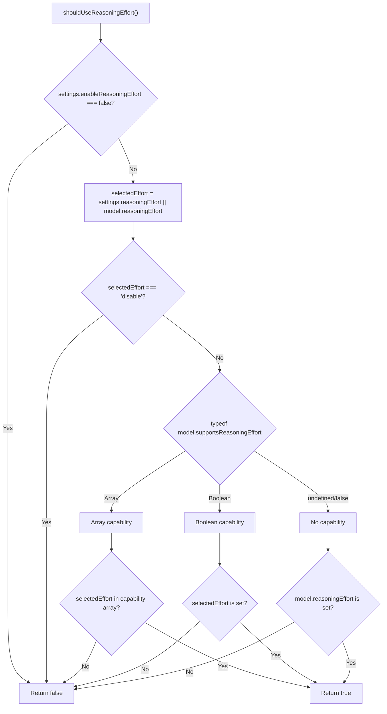
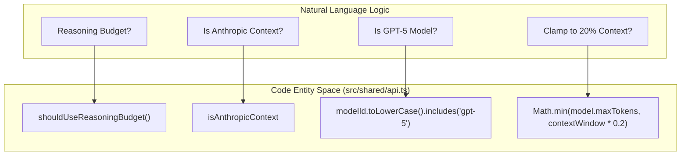
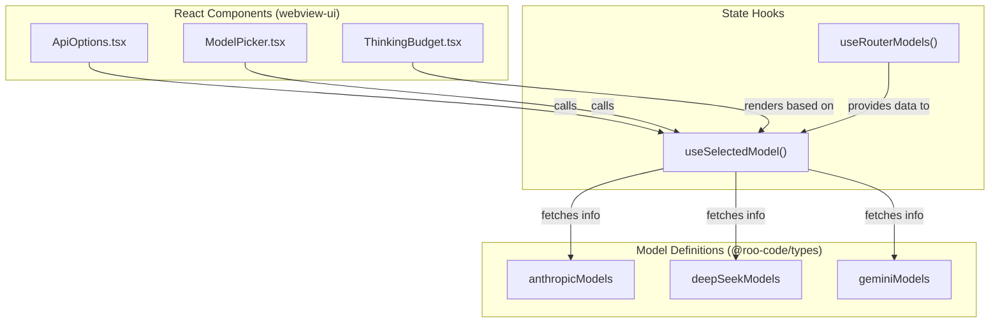

# Model Features and Capabilities

Relevant source files

The following files were used as context for generating this wiki page:

- [packages/types/src/providers/moonshot.ts](packages/types/src/providers/moonshot.ts)
- [src/api/index.ts](src/api/index.ts)
- [src/api/providers/__tests__/moonshot.spec.ts](src/api/providers/__tests__/moonshot.spec.ts)
- [src/api/providers/__tests__/openrouter.spec.ts](src/api/providers/__tests__/openrouter.spec.ts)
- [src/api/providers/__tests__/requesty.spec.ts](src/api/providers/__tests__/requesty.spec.ts)
- [src/api/providers/anthropic.ts](src/api/providers/anthropic.ts)
- [src/api/providers/deepseek.ts](src/api/providers/deepseek.ts)
- [src/api/providers/mistral.ts](src/api/providers/mistral.ts)
- [src/api/providers/moonshot.ts](src/api/providers/moonshot.ts)
- [src/api/providers/openai.ts](src/api/providers/openai.ts)
- [src/api/providers/openrouter.ts](src/api/providers/openrouter.ts)
- [src/api/providers/requesty.ts](src/api/providers/requesty.ts)
- [src/api/providers/unbound.ts](src/api/providers/unbound.ts)
- [src/api/transform/__tests__/model-params.spec.ts](src/api/transform/__tests__/model-params.spec.ts)
- [src/api/transform/__tests__/reasoning.spec.ts](src/api/transform/__tests__/reasoning.spec.ts)
- [src/api/transform/model-params.ts](src/api/transform/model-params.ts)
- [src/api/transform/reasoning.ts](src/api/transform/reasoning.ts)
- [src/shared/__tests__/api.spec.ts](src/shared/__tests__/api.spec.ts)
- [src/shared/api.ts](src/shared/api.ts)
- [webview-ui/src/components/settings/ApiOptions.tsx](webview-ui/src/components/settings/ApiOptions.tsx)
- [webview-ui/src/components/settings/ModelDescriptionMarkdown.tsx](webview-ui/src/components/settings/ModelDescriptionMarkdown.tsx)
- [webview-ui/src/components/settings/ModelInfoView.tsx](webview-ui/src/components/settings/ModelInfoView.tsx)
- [webview-ui/src/components/settings/ModelPicker.tsx](webview-ui/src/components/settings/ModelPicker.tsx)
- [webview-ui/src/components/settings/SectionHeader.tsx](webview-ui/src/components/settings/SectionHeader.tsx)
- [webview-ui/src/components/settings/TemperatureControl.tsx](webview-ui/src/components/settings/TemperatureControl.tsx)
- [webview-ui/src/components/settings/ThinkingBudget.tsx](webview-ui/src/components/settings/ThinkingBudget.tsx)
- [webview-ui/src/components/settings/__tests__/ThinkingBudget.spec.tsx](webview-ui/src/components/settings/__tests__/ThinkingBudget.spec.tsx)
- [webview-ui/src/utils/validate.ts](webview-ui/src/utils/validate.ts)

## Purpose and Scope

This document explains the `ModelInfo` structure and capability detection system that controls how Roo Code adapts its behavior to different AI models. It covers model capability flags, reasoning token budgets, output token calculations, and how the UI conditionally displays features based on model capabilities.

For information about provider implementations and API handler architecture, see [4.1](). For model discovery and caching mechanisms, see [4.7]().

## ModelInfo Structure

The `ModelInfo` type (defined in `@roo-code/types`) describes a model's capabilities, pricing, and constraints. Each API handler returns a `ModelInfo` object via the `getModel()` method [src/api/index.ts:99-99]().

### Core Fields

| Field | Type | Purpose |
|-------|------|---------|
| `contextWindow` | `number` | Maximum context length in tokens |
| `maxTokens` | `number \| undefined` | Maximum output tokens the model can generate |
| `supportsImages` | `boolean \| undefined` | Whether the model accepts image inputs |
| `supportsPromptCache` | `boolean \| undefined` | Whether the model supports prompt caching |

### Reasoning Capability Fields

| Field | Type | Purpose |
|-------|------|---------|
| `requiredReasoningBudget` | `boolean \| undefined` | Model requires reasoning budget (e.g., o1 models) |
| `supportsReasoningBudget` | `boolean \| undefined` | Model optionally supports reasoning budget |
| `supportsReasoningEffort` | `boolean \| array \| undefined` | Whether model supports reasoning effort and which levels |
| `reasoningEffort` | `string \| undefined` | Default reasoning effort level for the model |
| `maxThinkingTokens` | `number \| undefined` | Maximum tokens allowed for reasoning/thinking |

### Temperature and Behavior Fields

| Field | Type | Purpose |
|-------|------|---------|
| `supportsTemperature` | `boolean \| undefined` | Whether the model supports temperature parameter |
| `defaultTemperature` | `number \| undefined` | Model's recommended temperature value |

**Sources:** [src/shared/api.ts:42-50](), [src/api/index.ts:99-99]()

## Reasoning Capabilities System

### Reasoning Budget Detection

The `shouldUseReasoningBudget()` function determines whether to allocate a token budget for reasoning steps. This is critical for models like OpenAI's `o1` or Gemini's thinking models.

**Decision Logic:**
1. Returns `true` if `model.requiredReasoningBudget` is set [src/shared/api.ts:50-50]().
2. Returns `true` if `model.supportsReasoningBudget` is set and reasoning is enabled in settings [src/shared/api.ts:50-50]().
3. Returns `false` otherwise.

**Constants:**
- `DEFAULT_HYBRID_REASONING_MODEL_MAX_TOKENS = 16384` [src/shared/api.ts:99-99]()
- `DEFAULT_HYBRID_REASONING_MODEL_THINKING_TOKENS = 8192` [src/shared/api.ts:100-100]()
- `GEMINI_25_PRO_MIN_THINKING_TOKENS = 128` [src/shared/api.ts:101-101]()

**Sources:** [src/shared/api.ts:44-51](), [src/shared/api.ts:99-101]()

### Reasoning Effort Detection

The `shouldUseReasoningEffort()` function determines whether to include reasoning effort parameters (low, medium, high) in API requests.

Title: Reasoning Effort Decision Logic

**Reasoning Effort Levels:**
- `"disable"`: Explicitly omits reasoning parameters [src/shared/api.ts:73-73]().
- `"none"`: Valid level for models supporting it [src/shared/api.ts:79-79]().
- `"low"`, `"medium"`, `"high"`: Standard effort levels [src/shared/api.ts:67-69]().

**Sources:** [src/shared/api.ts:52-97]()

## Max Output Tokens Calculation

The `getModelMaxOutputTokens()` function calculates the maximum tokens the model should generate. It implements logic to handle provider-specific defaults and context-window clamping.

Title: Token Calculation Flow (Natural Language to Code Entities)

**Special Rules:**
1. **Reasoning Budget:** If using reasoning budget, it uses `settings.modelMaxTokens` or `16384` [src/shared/api.ts:116-118]().
2. **GPT-5 Exception:** GPT-5 models bypass the 20% context window cap and use the full `model.maxTokens` [src/shared/api.ts:139-143]().
3. **Anthropic Default:** If context is Anthropic and model is hybrid, or if `maxTokens` is missing, it defaults to `ANTHROPIC_DEFAULT_MAX_TOKENS` [src/shared/api.ts:126-133]().
4. **Clamping:** Standard models are limited to `min(maxTokens, contextWindow * 0.2)` to prevent runaway output [src/shared/api.ts:147-147]().

**Sources:** [src/shared/api.ts:105-157]()

## Model Capability Detection

### supportsImages
Determines if the model can process visual input. This is explicitly defined in `ModelInfo` and used by components like `ChatTextArea` to enable image attachments.

### supportsPromptCache
Indicates if the model supports ephemeral caching (e.g., Claude's prompt caching). Handlers like `OpenAiHandler` use this to inject `cache_control` headers into messages [src/api/providers/openai.ts:110-126](). The `AnthropicHandler` similarly applies `cache_control: { type: "ephemeral" }` to system prompts and recent user messages [src/api/providers/anthropic.ts:123-139]().

### Thinking Mode (DeepSeek)
Models like `deepseek-reasoner` are detected by ID, enabling specific transformations like `convertToR1Format` with `mergeToolResultText: true` to preserve reasoning content during tool call sequences [src/api/providers/deepseek.ts:59-69]().

### Mistral Thinking
The `MistralHandler` detects thinking chunks in the stream by checking for `chunk.type === "thinking"` in the delta content [src/api/providers/mistral.ts:125-125]().

**Sources:** [src/api/providers/deepseek.ts:50-85](), [src/api/providers/mistral.ts:114-139](), [src/api/providers/openai.ts:104-150](), [src/api/providers/anthropic.ts:123-139]()

## Capability-Based UI Rendering

The `ApiOptions` component and associated hooks use `useSelectedModel` to adapt the UI to the active model's specific features.

Title: UI Capability Integration

**Implementation Details:**
- **Model Selection:** `useSelectedModel` resolves the specific `ModelInfo` by merging base model data with provider-specific overrides (especially for OpenRouter) [webview-ui/src/components/settings/ApiOptions.tsx:182-186]().
- **Validation:** `validateApiConfiguration` ensures required keys and model IDs are present based on the selected provider's requirements [webview-ui/src/utils/validate.ts:16-37](). It also validates against `organizationAllowList` to enforce organizational policy [webview-ui/src/utils/validate.ts:141-177]().
- **Model Picker:** The `ModelPicker` component filters available models based on provider and allow-lists, while still showing the currently selected model even if deprecated [webview-ui/src/components/settings/ModelPicker.tsx:113-134]().

**Sources:** [webview-ui/src/components/settings/ApiOptions.tsx:182-186](), [webview-ui/src/components/settings/ModelPicker.tsx:113-134](), [webview-ui/src/utils/validate.ts:16-177]()