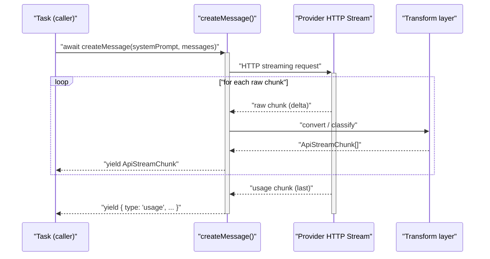
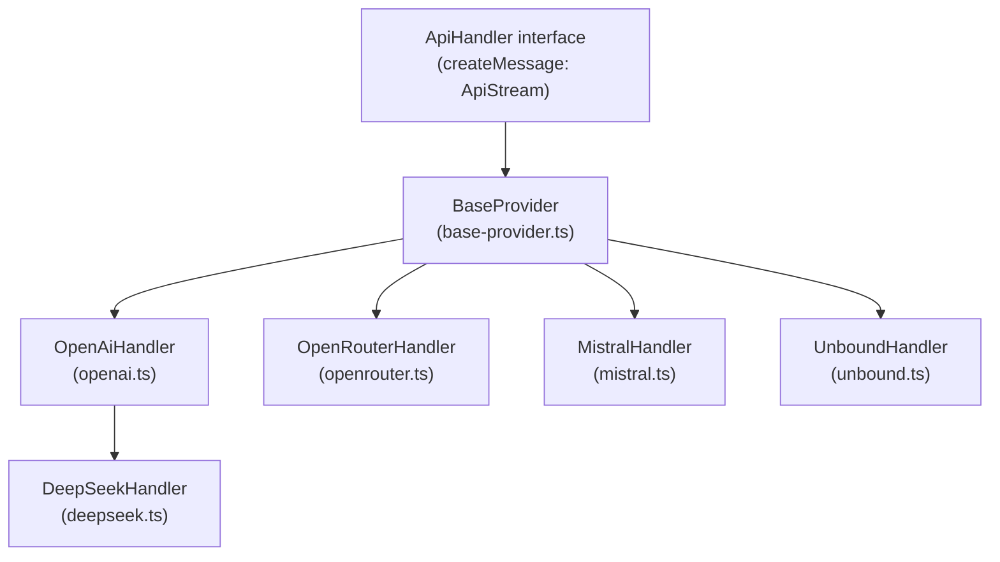
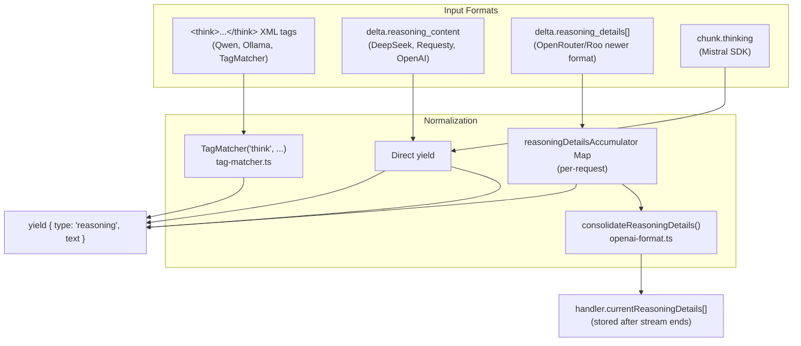

# Streaming and Response Processing

<details>
<summary>Relevant source files</summary>

The following files were used as context for generating this wiki page:

- [packages/types/src/message.ts](packages/types/src/message.ts)
- [packages/types/src/providers/mistral.ts](packages/types/src/providers/mistral.ts)
- [packages/types/src/providers/requesty.ts](packages/types/src/providers/requesty.ts)
- [src/api/index.ts](src/api/index.ts)
- [src/api/providers/anthropic.ts](src/api/providers/anthropic.ts)
- [src/api/providers/deepseek.ts](src/api/providers/deepseek.ts)
- [src/api/providers/fireworks.ts](src/api/providers/fireworks.ts)
- [src/api/providers/mistral.ts](src/api/providers/mistral.ts)
- [src/api/providers/openai-compatible.ts](src/api/providers/openai-compatible.ts)
- [src/api/providers/openai.ts](src/api/providers/openai.ts)
- [src/api/providers/openrouter.ts](src/api/providers/openrouter.ts)
- [src/api/providers/requesty.ts](src/api/providers/requesty.ts)
- [src/api/providers/sambanova.ts](src/api/providers/sambanova.ts)
- [src/api/providers/unbound.ts](src/api/providers/unbound.ts)
- [src/api/transform/__tests__/ai-sdk.spec.ts](src/api/transform/__tests__/ai-sdk.spec.ts)
- [src/api/transform/__tests__/mistral-format.spec.ts](src/api/transform/__tests__/mistral-format.spec.ts)
- [src/api/transform/__tests__/openai-format.spec.ts](src/api/transform/__tests__/openai-format.spec.ts)
- [src/api/transform/ai-sdk.ts](src/api/transform/ai-sdk.ts)
- [src/api/transform/mistral-format.ts](src/api/transform/mistral-format.ts)
- [src/api/transform/openai-format.ts](src/api/transform/openai-format.ts)
- [src/core/task-persistence/__tests__/apiMessages.spec.ts](src/core/task-persistence/__tests__/apiMessages.spec.ts)
- [src/core/task-persistence/__tests__/taskMessages.spec.ts](src/core/task-persistence/__tests__/taskMessages.spec.ts)
- [src/core/task/__tests__/Task.sticky-profile-race.spec.ts](src/core/task/__tests__/Task.sticky-profile-race.spec.ts)
- [src/core/task/__tests__/Task.throttle.test.ts](src/core/task/__tests__/Task.throttle.test.ts)
- [src/core/task/__tests__/flushPendingToolResultsToHistory.spec.ts](src/core/task/__tests__/flushPendingToolResultsToHistory.spec.ts)
- [src/core/task/__tests__/grace-retry-errors.spec.ts](src/core/task/__tests__/grace-retry-errors.spec.ts)
- [src/core/task/__tests__/grounding-sources.test.ts](src/core/task/__tests__/grounding-sources.test.ts)
- [src/core/task/__tests__/reasoning-preservation.test.ts](src/core/task/__tests__/reasoning-preservation.test.ts)
- [src/integrations/misc/__tests__/export-markdown.spec.ts](src/integrations/misc/__tests__/export-markdown.spec.ts)
- [src/integrations/misc/export-markdown.ts](src/integrations/misc/export-markdown.ts)
- [src/shared/api.ts](src/shared/api.ts)
- [webview-ui/src/components/settings/ApiOptions.tsx](webview-ui/src/components/settings/ApiOptions.tsx)
- [webview-ui/src/utils/validate.ts](webview-ui/src/utils/validate.ts)

</details>


This page documents the `ApiStream` async generator pattern, the `ApiStreamChunk` discriminated union type, the message format transformation utilities, and how reasoning content is handled during streaming. It covers the mechanics of streaming from the AI provider layer inward to the task loop.

For information about how the task loop consumes these streams, see [Task Lifecycle and Execution](). For token counting and cost computation applied to the `usage` chunks yielded here, see [Token Usage and Cost Calculation](). For provider implementations that produce these streams, see [Provider Implementations]().

---

## ApiStream and ApiStreamChunk

All provider handlers implement `createMessage` as an `async generator` that yields `ApiStreamChunk` values. The type alias for this generator is `ApiStream`, defined in `src/api/transform/stream.ts`.

**`ApiStreamChunk` — the discriminated union emitted by every provider**

| `type` | Fields | Description |
|---|---|---|
| `"text"` | `text: string` | A fragment of the assistant's visible response |
| `"reasoning"` | `text: string` | A fragment of the model's internal reasoning/thinking |
| `"usage"` | `inputTokens`, `outputTokens`, `cacheWriteTokens?`, `cacheReadTokens?`, `totalCost?` | Token counts and cost for the request |
| `"tool_call_partial"` | `index`, `id?`, `name?`, `arguments?` | A streaming fragment of a native tool call (OpenAI-style) |
| `"tool_call_end"` | `id: string` | Signals that a tool call with the given id is complete |
| `"tool_call"` | `id`, `name`, `arguments` | A complete (non-streaming) tool call |
| `"tool_call_start"` | `id`, `name` | Tool call start event (AI SDK providers) |
| `"tool_call_delta"` | `id`, `delta` | Tool call argument fragment (AI SDK providers) |

Sources: [src/api/transform/stream.ts:1-35](), [src/api/transform/ai-sdk.ts:196-230]()

---

## Stream Flow Diagram

**How a `createMessage` call produces `ApiStreamChunk` events**



Sources: [src/api/providers/openrouter.ts:209-534](), [src/api/providers/openai.ts:82-270](), [src/api/providers/mistral.ts:75-165]()

---

## Provider Streaming Implementations

Each provider has its own `createMessage` implementation. Most share common patterns through base classes or specialized transform utilities.

**Provider → Base class / streaming pattern**



Sources: [src/api/providers/openai.ts:31-80](), [src/api/providers/openrouter.ts:141-208](), [src/api/providers/mistral.ts:51-73](), [src/api/providers/deepseek.ts:25-49]()

---

## Reasoning and Thinking Processing

The system supports multiple formats for model reasoning (thinking), ensuring that internal thoughts are preserved and optionally prepended to conversation history.

**Reasoning Extraction Paths**



Sources: [src/api/providers/openai.ts:180-205](), [src/api/providers/deepseek.ts:114-121](), [src/api/providers/mistral.ts:124-132](), [src/api/transform/openai-format.ts:41-146]()

### TagMatcher for `<think>` tags
For models that output reasoning within text blocks (like DeepSeek R1 or Qwen via some providers), Roo Code uses a `TagMatcher` to intercept content within `<think>` tags and yield it as `reasoning` chunks instead of `text` chunks.

Sources: [src/api/providers/openai.ts:180-187]()

### Preservation in Task History
When a model supports reasoning preservation, the `Task` class prepends the reasoning content to the assistant's message using `<think>` tags before saving to `apiConversationHistory`. This ensures subsequent turns maintain the model's logical context.

Sources: [src/core/task/__tests__/reasoning-preservation.test.ts:219-243]()

---

## Tool Call Streaming

Native tool calling is streamed incrementally. The system uses different event protocols depending on the provider type.

**OpenAI-style incremental protocol**

Used by `OpenAiHandler`, `DeepSeekHandler`, `UnboundHandler`, and `RequestyHandler`. It emits `tool_call_partial` events with indices and partial arguments.

```typescript
yield { type: "tool_call_partial", index: 0, id: "call_abc", name: "read_file" }
yield { type: "tool_call_partial", index: 0, arguments: '{"path":' }
yield { type: "tool_call_partial", index: 0, arguments: '"file.ts"}' }
```

Sources: [src/api/providers/openai.ts:223-233](), [src/api/providers/deepseek.ts:124-134](), [src/api/providers/unbound.ts:170-180]()

**Mistral Protocol**

The `MistralHandler` iterates through `toolCalls` in the stream delta and yields `tool_call_partial` chunks similar to the OpenAI format.

Sources: [src/api/providers/mistral.ts:143-155]()

---

## Usage Chunk Emission

Every provider emits exactly one `{ type: "usage" }` chunk as the last item in the stream. Usage data is collected during streaming and yielded after the content stream ends.

**Fields per provider**

| Provider | `inputTokens` | `outputTokens` | `cacheWriteTokens` | `cacheReadTokens` | `totalCost` |
|---|---|---|---|---|---|
| OpenRouter | `prompt_tokens` | `completion_tokens` | — | `cached_tokens` | `cost` |
| DeepSeek | `prompt_tokens` | `completion_tokens` | `cache_miss_tokens` | `cached_tokens` | — |
| Unbound | `prompt_tokens` | `completion_tokens` | `cache_creation_input_tokens` | `cache_read_input_tokens` | calculated locally |
| Requesty | `prompt_tokens` | `completion_tokens` | `caching_tokens` | `cached_tokens` | calculated locally |

Sources: [src/api/providers/openrouter.ts:524-533](), [src/api/providers/deepseek.ts:147-155](), [src/api/providers/unbound.ts:92-109](), [src/api/providers/requesty.ts:98-116]()

---

## Gemini Message Sanitization

When switching to a Gemini model mid-conversation via OpenRouter, historical assistant messages may have tool calls without the `reasoning_details` (thought signatures) that Gemini requires. `sanitizeGeminiMessages` in `src/api/transform/openai-format.ts` handles this by:

1. Scanning assistant messages that have `tool_calls`.
2. For each tool call, checking for a matching `reasoning_details` entry (matched by `id`).
3. Dropping tool calls without matching reasoning details to prevent poisoning the request.
4. Removing corresponding `role: "tool"` result messages for dropped tool calls.

Sources: [src/api/transform/openai-format.ts:164-254](), [src/api/providers/openrouter.ts:265-299]()