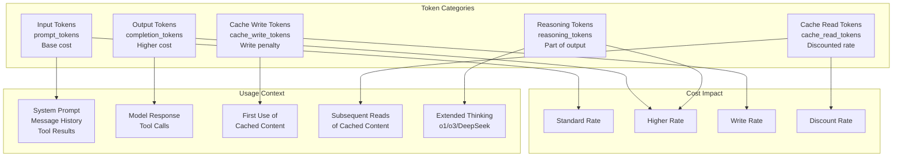
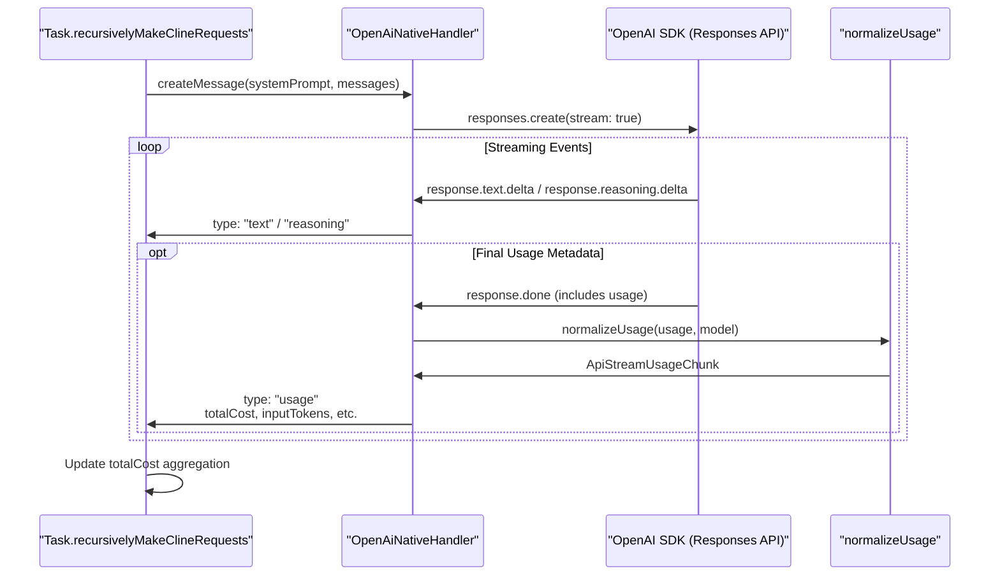
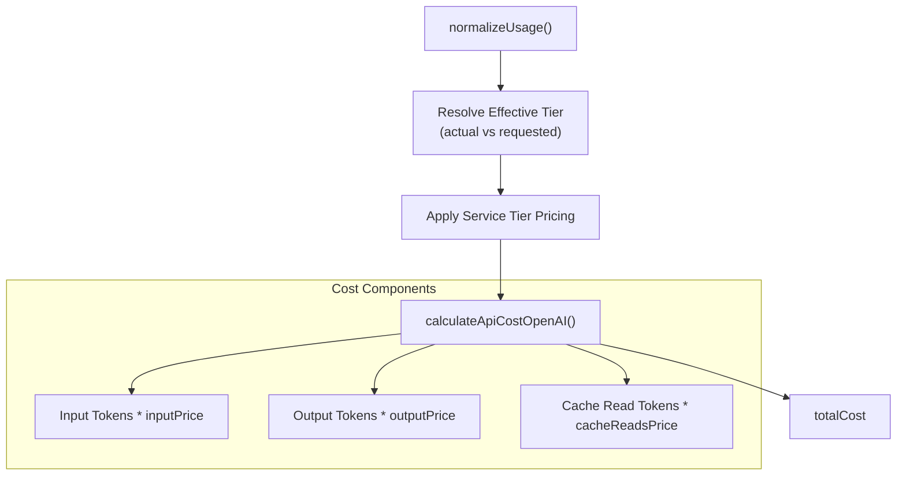

# Token Usage and Cost Calculation

Relevant source files

The following files were used as context for generating this wiki page:

- [packages/types/src/model.ts](packages/types/src/model.ts)
- [packages/types/src/providers/openai-codex.ts](packages/types/src/providers/openai-codex.ts)
- [packages/types/src/providers/openai.ts](packages/types/src/providers/openai.ts)
- [src/api/providers/__tests__/openai-codex-native-tool-calls.spec.ts](src/api/providers/__tests__/openai-codex-native-tool-calls.spec.ts)
- [src/api/providers/__tests__/openai-codex.spec.ts](src/api/providers/__tests__/openai-codex.spec.ts)
- [src/api/providers/__tests__/openai-native-tools.spec.ts](src/api/providers/__tests__/openai-native-tools.spec.ts)
- [src/api/providers/__tests__/openai-native-usage.spec.ts](src/api/providers/__tests__/openai-native-usage.spec.ts)
- [src/api/providers/__tests__/openai-native.spec.ts](src/api/providers/__tests__/openai-native.spec.ts)
- [src/api/providers/openai-codex.ts](src/api/providers/openai-codex.ts)
- [src/api/providers/openai-native.ts](src/api/providers/openai-native.ts)
- [src/integrations/terminal/__tests__/setupTerminalTests.ts](src/integrations/terminal/__tests__/setupTerminalTests.ts)
- [src/shared/combineApiRequests.ts](src/shared/combineApiRequests.ts)
- [src/shared/combineCommandSequences.ts](src/shared/combineCommandSequences.ts)
- [src/shared/cost.ts](src/shared/cost.ts)
- [src/shared/getApiMetrics.ts](src/shared/getApiMetrics.ts)
- [src/utils/__tests__/cost.spec.ts](src/utils/__tests__/cost.spec.ts)
- [src/utils/__tests__/tool-id.spec.ts](src/utils/__tests__/tool-id.spec.ts)
- [src/utils/tool-id.ts](src/utils/tool-id.ts)
- [webview-ui/src/components/settings/__tests__/ApiOptions.spec.tsx](webview-ui/src/components/settings/__tests__/ApiOptions.spec.tsx)

This page documents how Roo Code tracks token usage across API requests and calculates costs for different providers. Token counting determines context window utilization, cache efficiency, and billing costs. This covers token accounting for input, output, cached reads/writes, and reasoning tokens, as well as the max output tokens calculation that controls response length.

For information about API streaming and response processing, see [Streaming and Response Processing](4.5). For model capabilities and features, see [Model Features and Capabilities](4.4).

---

## Token Usage Categories

Roo Code tracks five distinct categories of token usage across provider APIs. Each category has different cost implications and optimization strategies.

### Token Type Definitions

Title: Token Usage Flow and Cost Impact

**Sources:** [src/api/providers/openai-native.ts:110-170](), [packages/types/src/model.ts:97-100]()

### Provider-Specific Token Fields

Different providers use varying field names for the same token categories. Roo Code normalizes these into a consistent internal representation. For the OpenAI Responses API, Roo Code extracts detailed cache information from `input_tokens_details`.

| Category | OpenAI Native | OpenAI Codex | DeepSeek | Anthropic |
|----------|---------------|--------------|----------|-----------|
| Input | `input_tokens` | `input_tokens` | `prompt_tokens` | `input_tokens` |
| Output | `output_tokens` | `output_tokens` | `completion_tokens` | `output_tokens` |
| Cache Write | `cache_creation_input_tokens` | `cache_creation_input_tokens` | `cache_miss_tokens` | `cache_creation_input_tokens` |
| Cache Read | `input_tokens_details.cached_tokens` | `input_tokens_details.cached_tokens` | `cached_tokens` | `cache_read_input_tokens` |
| Reasoning | `output_tokens_details.reasoning_tokens` | `output_tokens_details.reasoning_tokens` | `reasoning_content` | N/A |

**Sources:** [src/api/providers/openai-native.ts:110-169](), [src/api/providers/openai-codex.ts:104-140]()

---

## Token Counting Flow

Token counting occurs at multiple stages: before sending (for context management), during streaming (for live tracking), and after completion (for cost calculation).

### Request and Response Flow

Title: API Token Usage Data Flow

**Sources:** [src/api/providers/openai-native.ts:110-170](), [src/api/providers/openai-native.ts:172-215]()

---

## Max Output Tokens Calculation

The calculation of `max_tokens` for API requests ensures that responses are long enough for complex tasks but capped to manage costs and context limits.

### GPT-5 Family Logic
For GPT-5 family models (e.g., `gpt-5.1`, `gpt-5.2`, `gpt-5.3-codex`), the system allows for large context windows (up to 1.05M tokens) and specifically manages `maxTokens` (typically 128,000) [packages/types/src/providers/openai.ts:8-52]().

**Key Logic:**
- **Subscription-based models**: Models like those in `OpenAiCodexHandler` are subscription-based, resulting in a `totalCost` of 0 regardless of token count [src/api/providers/openai-codex.ts:130-138]().
- **Reasoning Models**: When reasoning effort is used (e.g., "low", "medium", "high"), the `output_tokens_details.reasoning_tokens` are tracked separately but contribute to the `outputTokens` total [src/api/providers/openai-native.ts:154-168]().

---

## Usage Tracking and Normalization

The `normalizeUsage` function in provider handlers is responsible for transforming raw provider metadata into the standard `ApiStreamUsageChunk`.

### Detailed Token Shapes (Responses API)
The OpenAI Responses API provides granular details about token usage, which Roo Code parses to provide accurate metrics:

1.  **Input Derivation**: If total input tokens are missing but details exist, the system derives `totalInputTokens` from `cached_tokens` + `cache_miss_tokens` [src/api/providers/openai-native.ts:122-126]().
2.  **Cache Accounting**:
    *   `cacheReadTokens`: Extracted from `usage.cache_read_input_tokens` or `input_tokens_details.cached_tokens` [src/api/providers/openai-native.ts:135-136]().
    *   `cacheWriteTokens`: Extracted from `usage.cache_creation_input_tokens` or `usage.cache_write_tokens` [src/api/providers/openai-native.ts:133-134]().
3.  **Reasoning Tokens**: Specifically extracted from `output_tokens_details.reasoning_tokens` to show the "thinking" cost [src/api/providers/openai-native.ts:154-157]().

**Sources:** [src/api/providers/openai-native.ts:110-170](), [src/api/providers/__tests__/openai-native-usage.spec.ts:22-126]()

---

## Cost Calculation

Roo Code calculates API costs using pricing models defined in the model metadata, accounting for service tiers and long-context pricing.

### Pricing Models and Tiers
Models can define multiple pricing tiers (e.g., `flex`, `priority`) and multipliers for long-context usage.

Title: Pricing Logic for OpenAI Native

**Key Pricing Features:**
- **Service Tiers**: OpenAI Native models support tiers like `flex` (lower cost) and `priority` (higher cost) [packages/types/src/providers/openai.ts:47-50]().
- **Long Context Pricing**: Some models (like `gpt-5.4`) apply multipliers (e.g., 2x input, 1.5x output) once a token threshold is crossed [packages/types/src/providers/openai.ts:39-44]().
- **Codex Subscription**: Models accessed via the Codex OAuth flow always report a cost of 0 as they are covered by ChatGPT Plus/Pro subscriptions [src/api/providers/openai-codex.ts:137](), [packages/types/src/providers/openai-codex.ts:36-38]().

**Sources:** [src/api/providers/openai-native.ts:138-152](), [packages/types/src/model.ts:131-147](), [packages/types/src/providers/openai.ts:39-44]()

---

## Summary

Token usage and cost calculation in Roo Code:

1.  **Normalization**: Diverse API response formats are normalized into a standard `ApiStreamUsageChunk` containing input, output, cache read/write, and reasoning tokens [src/api/providers/openai-native.ts:159-169]().
2.  **Granular Tracking**: The system tracks `cache_creation_input_tokens` vs `cache_read_input_tokens` to provide accurate cost accounting for models with prompt caching [src/api/providers/openai-native.ts:130-137]().
3.  **Tier Awareness**: Cost calculation respects the `ServiceTier` (default, flex, priority) used for the request [src/api/providers/openai-native.ts:139-141]().
4.  **Codex/Subscription Support**: Provides a path for "zero-cost" usage through OAuth-authenticated subscription models [src/api/providers/openai-codex.ts:130-138]().

**Sources:** [src/api/providers/openai-native.ts:110-170](), [src/api/providers/openai-codex.ts:104-140](), [packages/types/src/model.ts:97-110]()