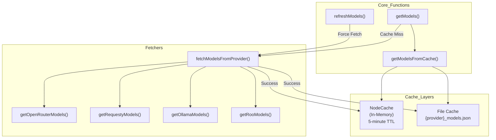
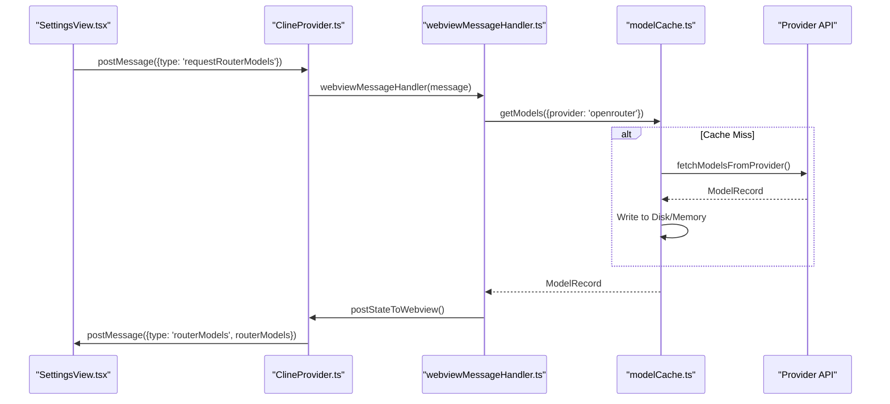

# Model Discovery and Caching

Relevant source files

The following files were used as context for generating this wiki page:

- [packages/types/src/providers/roo.ts](packages/types/src/providers/roo.ts)
- [packages/types/src/vscode-extension-host.ts](packages/types/src/vscode-extension-host.ts)
- [src/api/providers/__tests__/base-openai-compatible-provider-timeout.spec.ts](src/api/providers/__tests__/base-openai-compatible-provider-timeout.spec.ts)
- [src/api/providers/__tests__/base-openai-compatible-provider.spec.ts](src/api/providers/__tests__/base-openai-compatible-provider.spec.ts)
- [src/api/providers/__tests__/openai-usage-tracking.spec.ts](src/api/providers/__tests__/openai-usage-tracking.spec.ts)
- [src/api/providers/__tests__/openai.spec.ts](src/api/providers/__tests__/openai.spec.ts)
- [src/api/providers/__tests__/roo.spec.ts](src/api/providers/__tests__/roo.spec.ts)
- [src/api/providers/base-openai-compatible-provider.ts](src/api/providers/base-openai-compatible-provider.ts)
- [src/api/providers/fetchers/__tests__/roo.spec.ts](src/api/providers/fetchers/__tests__/roo.spec.ts)
- [src/api/providers/fetchers/__tests__/versionedSettings.spec.ts](src/api/providers/fetchers/__tests__/versionedSettings.spec.ts)
- [src/api/providers/fetchers/modelCache.ts](src/api/providers/fetchers/modelCache.ts)
- [src/api/providers/fetchers/roo.ts](src/api/providers/fetchers/roo.ts)
- [src/api/providers/fetchers/versionedSettings.ts](src/api/providers/fetchers/versionedSettings.ts)
- [src/api/providers/roo.ts](src/api/providers/roo.ts)
- [src/core/webview/ClineProvider.ts](src/core/webview/ClineProvider.ts)
- [src/core/webview/__tests__/ClineProvider.spec.ts](src/core/webview/__tests__/ClineProvider.spec.ts)
- [src/core/webview/__tests__/webviewMessageHandler.spec.ts](src/core/webview/__tests__/webviewMessageHandler.spec.ts)
- [src/core/webview/webviewMessageHandler.ts](src/core/webview/webviewMessageHandler.ts)
- [src/shared/WebviewMessage.ts](src/shared/WebviewMessage.ts)
- [webview-ui/src/components/chat/ChatRow.tsx](webview-ui/src/components/chat/ChatRow.tsx)
- [webview-ui/src/components/chat/ChatView.tsx](webview-ui/src/components/chat/ChatView.tsx)
- [webview-ui/src/components/settings/SettingsView.tsx](webview-ui/src/components/settings/SettingsView.tsx)
- [webview-ui/src/context/ExtensionStateContext.tsx](webview-ui/src/context/ExtensionStateContext.tsx)

This page documents the model discovery and caching system that fetches LLM model metadata from provider APIs and maintains a two-tier cache (in-memory + disk) to optimize performance and provide offline availability.

**Purpose**: Explains how Roo Code discovers available models from dynamic providers (OpenRouter, Requesty, Roo Code Cloud, etc.), caches model information locally, and handles cache invalidation/refresh. This system enables the UI to display accurate model lists with pricing, context window data, and capabilities without requiring repeated API calls.

**Scope**: Covers the `modelCache.ts` module, provider-specific fetchers (notably `roo.ts`), cache storage strategies, and integration points with the settings UI.

---

## Overview

The model cache system provides a unified interface for fetching and caching model metadata from multiple LLM provider APIs. Dynamic providers (those with large, frequently-changing model catalogs) require API calls to discover available models, their capabilities, and pricing information.

**Key Features**:
- **Two-tier caching**: Fast in-memory cache (`NodeCache`) with 5-minute TTL and persistent disk cache for cold starts [src/api/providers/fetchers/modelCache.ts:30-50]().
- **Empty response protection**: Prevents caching failed API responses that return empty model lists [src/api/providers/fetchers/modelCache.ts:134-142]().
- **In-flight request deduplication**: Ensures only one concurrent API call per provider to prevent race conditions [src/api/providers/fetchers/modelCache.ts:37-171]().
- **Atomic disk writes**: Cache remains available during refresh operations via `safeWriteJson` [src/api/providers/fetchers/modelCache.ts:41-43]().
- **Background initialization**: Refreshes public provider caches on extension startup [src/api/providers/fetchers/modelCache.ts:228-247]().

Sources: [src/api/providers/fetchers/modelCache.ts:1-106](), [src/api/providers/fetchers/modelCache.ts:119-200]()

---

## Two-Tier Cache Architecture

The system coordinates between an in-memory `NodeCache` and a local filesystem cache located in the extension's global storage directory.

**Model Discovery Data Flow**

**Cache Lookup Flow**:
1. **Memory Cache Check**: Fast in-memory lookup using `memoryCache.get(provider)` [src/api/providers/fetchers/modelCache.ts:278-281]().
2. **Disk Cache Fallback**: If memory misses, the system attempts to read from `${provider}_models.json` in the cache directory [src/api/providers/fetchers/modelCache.ts:45-51]().
3. **API Fetch**: If both caches miss, `fetchModelsFromProvider` is called to perform a network request [src/api/providers/fetchers/modelCache.ts:60-103]().

Sources: [src/api/providers/fetchers/modelCache.ts:30-51](), [src/api/providers/fetchers/modelCache.ts:119-155](), [src/api/providers/fetchers/modelCache.ts:276-321]()

---

## Cache Operations

### getModels() and refreshModels()

`getModels()` is the primary entry point for retrieving data, prioritizing the cache [src/api/providers/fetchers/modelCache.ts:119-126](). In contrast, `refreshModels()` bypasses existing caches to force a fresh fetch from the provider [src/api/providers/fetchers/modelCache.ts:166-181]().

**In-Flight Request Deduplication**:
To prevent "thundering herd" issues where multiple components request the same provider models simultaneously, the system uses an `inFlightRefresh` Map [src/api/providers/fetchers/modelCache.ts:37](). If a request for a specific `RouterName` is already active, subsequent callers await the same promise [src/api/providers/fetchers/modelCache.ts:169-175]().

**Empty Response Protection**:
If an API returns an empty model list, the system logs a telemetry event `MODEL_CACHE_EMPTY_RESPONSE` [src/api/providers/fetchers/modelCache.ts:141-146](). Crucially, it does **not** overwrite a valid existing cache with an empty result, protecting the UI from temporary API glitches [src/api/providers/fetchers/modelCache.ts:188-199]().

Sources: [src/api/providers/fetchers/modelCache.ts:37-199](), [src/api/providers/fetchers/modelCache.ts:119-155]()

---

## Provider-Specific Fetchers

The `fetchModelsFromProvider` function routes requests to specific implementation files based on the provider type [src/api/providers/fetchers/modelCache.ts:65-100]().

### Roo Code Cloud Fetcher
The `getRooModels` fetcher retrieves models from the Roo Code Cloud proxy (`api.roocode.com`) [src/api/providers/fetchers/roo.ts:16-20](). It performs sophisticated processing of the `RooModelsResponseSchema`:

1. **Tag-based Feature Detection**: Models are checked for tags like `vision` (supports images), `reasoning` (supports reasoning effort), and `stealth` (hides vendor identity) [src/api/providers/fetchers/roo.ts:86-96]().
2. **Versioned Settings**: Supports `versionedSettings` which allow the proxy to provide different tool configurations or reasoning defaults based on the specific version of the Roo Code extension installed [src/api/providers/fetchers/roo.ts:123-146]().
3. **Price Parsing**: Converts API string prices to numbers using `parseApiPrice`, including support for cache read/write pricing [src/api/providers/fetchers/roo.ts:98-102]().

### Requesty and OpenRouter
Similar to Roo Code Cloud, these fetchers hit their respective `/v1/models` endpoints and map vendor-specific metadata to the internal `ModelInfo` interface used by the `ModelPicker` component.

Sources: [src/api/providers/fetchers/roo.ts:16-157](), [src/api/providers/fetchers/modelCache.ts:60-103]()

---

## Webview Integration and Data Flow

The model discovery process is typically triggered by the Webview UI when the user opens the Settings view or changes providers.

**Webview State Update Sequence**

**State Synchronization**:
The `ClineProvider` uses a monotonically increasing sequence number `clineMessagesSeq` to ensure that stale state updates (which might include model lists) do not overwrite newer state in the React UI [src/core/webview/ClineProvider.ts:168](). The `ExtensionStateContext` in the webview uses this `clineMessagesSeq` to protect `clineMessages` from being overwritten by out-of-order async event sources [webview-ui/src/context/ExtensionStateContext.tsx:166-175]().

Sources: [src/core/webview/ClineProvider.ts:165-175](), [src/core/webview/webviewMessageHandler.ts:92-170](), [webview-ui/src/context/ExtensionStateContext.tsx:151-175]()

---

## File Structure and Validation

### Storage Location
Models are stored as JSON files in the global storage directory under a `cache` subfolder [src/api/providers/fetchers/modelCache.ts:39-51]().
- Example: `openrouter_models.json`
- Example: `roo_models.json`

### Data Integrity
The system uses **Zod** for schema validation when reading from disk. The `modelRecordSchema` ensures that the JSON on disk correctly maps to a `Record<string, ModelInfo>` [src/api/providers/fetchers/modelCache.ts:33](). If validation fails, the cache is treated as missing and a fresh fetch is attempted [src/api/providers/fetchers/modelCache.ts:300-309]().

Sources: [src/api/providers/fetchers/modelCache.ts:31-51](), [src/api/providers/fetchers/modelCache.ts:285-315]()