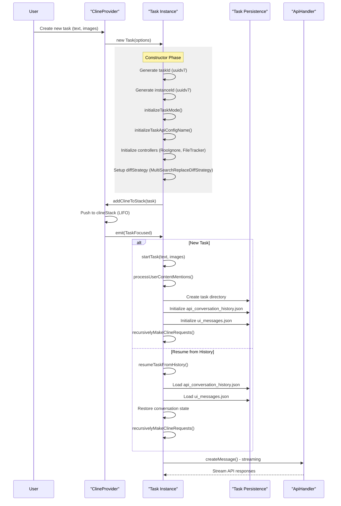

# Task Management System

<details>
<summary>Relevant source files</summary>

The following files were used as context for generating this wiki page:

- [src/__tests__/command-mentions.spec.ts](src/__tests__/command-mentions.spec.ts)
- [src/core/mentions/__tests__/processUserContentMentions.spec.ts](src/core/mentions/__tests__/processUserContentMentions.spec.ts)
- [src/core/mentions/index.ts](src/core/mentions/index.ts)
- [src/core/mentions/processUserContentMentions.ts](src/core/mentions/processUserContentMentions.ts)
- [src/core/task/Task.ts](src/core/task/Task.ts)
- [src/core/task/__tests__/Task.spec.ts](src/core/task/__tests__/Task.spec.ts)
- [src/core/tools/RunSlashCommandTool.ts](src/core/tools/RunSlashCommandTool.ts)
- [src/core/tools/SkillTool.ts](src/core/tools/SkillTool.ts)
- [src/core/tools/__tests__/runSlashCommandTool.spec.ts](src/core/tools/__tests__/runSlashCommandTool.spec.ts)
- [src/services/skills/__tests__/skillInvocation.spec.ts](src/services/skills/__tests__/skillInvocation.spec.ts)

</details>


## Purpose and Scope

The Task Management System is the core execution engine of Roo Code, managing the lifecycle of AI-driven work sessions. A **Task** represents a single unit of work with its own conversation history, API interactions, and execution state. This system handles task creation, execution, delegation, persistence, and recovery.

This page covers the `Task` class architecture, task stack management, persistence mechanisms, and lifecycle orchestration.

*   For details on execution loops and events, see [Task Lifecycle and Execution](#5.1).
*   For hierarchical task management, see [Task Stack and Subtasks](#5.2).
*   For storage implementation, see [Task Persistence and History](#5.3).
*   For the interaction protocol, see [Ask/Say Pattern and User Interaction](#5.4).
*   For safety limits and retry logic, see [Error Handling and Retries](#5.5).
*   For state recovery via Git, see [Checkpoint System](#5.6).

---

## Task Class Architecture

The `Task` class is the central coordinator for AI-driven work execution. Each task instance maintains its own conversation history, API configuration, execution state, and tool execution context.

### Core Task Structure

```mermaid
graph TB
    subgraph "Task Identity"
        [TASKID] ["taskId (uuidv7)<br/>Unique across all tasks"]
        [INSTANCEID] ["instanceId (uuidv7)<br/>Unique per Task instance"]
        [ROOTTASKID] ["rootTaskId<br/>Top-level parent"]
        [PARENTTASKID] ["parentTaskId<br/>Immediate parent"]
        [CHILDTASKID] ["childTaskId<br/>Current delegated child"]
    end
    
    subgraph "Task State"
        [MODE] ["_taskMode: string<br/>e.g., 'code', 'architect'"]
        [APICONFIG] ["_taskApiConfigName: string<br/>Provider profile name"]
        [ABORT] ["abort: boolean<br/>Abort flag"]
        [PAUSED] ["isPaused: boolean<br/>Pause state"]
        [ABANDONED] ["abandoned: boolean<br/>Permanently stopped"]
    end
    
    subgraph "Execution Context"
        [APIHANDLER] ["api: ApiHandler<br/>LLM provider interface"]
        [DIFFSTRATEGY] ["diffStrategy: DiffStrategy<br/>Code editing strategy"]
        [TERMINALPROCESS] ["terminalProcess: RooTerminalProcess<br/>Command execution"]
        [ROOIGNORE] ["rooIgnoreController: RooIgnoreController<br/>Access control"]
        [FILETRACKER] ["fileContextTracker: FileContextTracker<br/>File usage tracking"]
    end
    
    subgraph "Message State"
        [APIHISTORY] ["apiConversationHistory: ApiMessage[]<br/>LLM conversation"]
        [CLINEMESSAGES] ["clineMessages: ClineMessage[]<br/>UI messages"]
        [USERCONTENT] ["userMessageContent: ContentBlockParam[]<br/>Current user message"]
        [ASSISTANTCONTENT] ["assistantMessageContent: AssistantMessageContent[]<br/>Streaming response"]
    end
    
    [TASKID] --> [MODE]
    [MODE] --> [APIHANDLER]
    [APIHANDLER] --> [APIHISTORY]
    [APIHISTORY] --> [CLINEMESSAGES]
```

**Sources:** [src/core/task/Task.ts:162-422]()

### Task Options and Initialization

Tasks are created with a comprehensive `TaskOptions` object that configures behavior, API settings, and parent-child relationships:

| Option | Type | Purpose |
|--------|------|---------|
| `provider` | `ClineProvider` | Parent provider managing this task |
| `apiConfiguration` | `ProviderSettings` | LLM provider settings |
| `task` | `string?` | Initial user message (for new tasks) |
| `historyItem` | `HistoryItem?` | Saved task data (for resumed tasks) |
| `rootTask` | `Task?` | Top-level ancestor task |
| `parentTask` | `Task?` | Immediate parent task |
| `enableCheckpoints` | `boolean` | Enable git-based checkpointing |
| `consecutiveMistakeLimit` | `number` | Max consecutive errors before intervention |
| `experiments` | `Record<string, boolean>` | Feature flags |
| `startTask` | `boolean` | Start execution immediately |

**Sources:** [src/core/task/Task.ts:141-161]()

---

## Task Lifecycle

### Task Creation Flow

The `ClineProvider` orchestrates the creation of a `Task` instance, which then initializes its own environment, including modes and storage.



**Sources:** [src/core/task/Task.ts:424-583](), [src/core/webview/ClineProvider.ts:427-461]()

### Task Execution Loop

The `recursivelyMakeClineRequests()` method implements the core AI-driven execution loop, managing the state machine between API calls and tool executions.

```mermaid
graph TB
    [START] ["recursivelyMakeClineRequests()"] --> [CHECKABORT] {Check abort flag}
    [CHECKABORT] -->|Aborted| [CLEANUP] [Clean up and exit]
    [CHECKABORT] -->|Continue| [RATELIMIT] [attemptApiRequest with rate limiting]
    
    [RATELIMIT] --> [BUILDREQ] [Build API request]
    [BUILDREQ] --> [SYSTEMP] [Generate system prompt]
    [SYSTEMP] --> [APIHISTORY] [Get effective API history]
    [APIHISTORY] --> [STREAM] [Stream API response]
    
    [STREAM] --> [PARSESTREAM] ["NativeToolCallParser"]
    [PARSESTREAM] --> [CHUNKS] [Process stream chunks]
    [CHUNKS] --> [SAVEMSG] [Save assistant message to history]
    [SAVEMSG] --> [CHECKTOOLS] {Tool calls?}
    
    [CHECKTOOLS] -->|No tools| [CHECKCOMPLETE] {Complete?}
    [CHECKTOOLS] -->|Has tools| [WAITAPPROVAL] [Wait for approval]
    
    [WAITAPPROVAL] --> [APPROVED] {Approved?}
    [APPROVED] -->|Yes| [EXECUTETOOL] [Execute tool]
    [APPROVED] -->|No| [DENIED] [Handle denial]
    
    [EXECUTETOOL] --> [TOOLRESULT] [Add tool_result to userMessageContent]
    [TOOLRESULT] --> [CHECKMORE] {More tools?}
    [CHECKMORE] -->|Yes| [WAITAPPROVAL]
    [CHECKMORE] -->|No| [RECURSE] [Recursive call]
    [RECURSE] --> [CHECKABORT]
    
    [DENIED] --> [FEEDBACK] [Add feedback to userMessageContent]
    [FEEDBACK] --> [RECURSE]
    
    [CHECKCOMPLETE] -->|completion_result| [FINISH] [Task complete]
    [CHECKCOMPLETE] -->|followup| [ASKUSER] [Ask user for input]
    [CHECKCOMPLETE] -->|No action| [ERRORNOTOOLS] [Error: no tools used]
    [ERRORNOTOOLS] --> [RECURSE]
    
    [ASKUSER] --> [WAITRESP] [Wait for user response]
    [WAITRESP] --> [ADDRESP] [Add response to userMessageContent]
    [ADDRESP] --> [RECURSE]
```

For a deep dive into the loop logic, see [Task Lifecycle and Execution](#5.1).

**Sources:** [src/core/task/Task.ts:1358-1927]()

---

## Task Stack and Delegation

The `ClineProvider` maintains a **task stack** (`clineStack`) that represents the hierarchy of active tasks. This stack enables task delegation where a parent task can spawn subtasks (e.g., using the `new_task` tool).

```mermaid
graph TB
    subgraph "ClineProvider"
        [STACK] ["clineStack: Task[]<br/>(LIFO - Last In First Out)"]
    end
    
    subgraph "Stack Operations"
        [PUSH] ["addClineToStack(task)<br/>- Push new task to top<br/>- Emit TaskFocused"]
        [POP] ["removeClineFromStack()<br/>- Pop top task<br/>- Abort and cleanup<br/>- Repair parent metadata"]
    end
    
    subgraph "Example Stack State"
        [TOP] ["Task C (childTaskId)<br/>Status: active<br/>Current focus"]
        [MID] ["Task B (parentTaskId)<br/>Status: delegated<br/>awaitingChildId: C"]
        [BOT] ["Task A (rootTaskId)<br/>Status: delegated<br/>awaitingChildId: B"]
    end
    
    [PUSH] --> [STACK]
    [STACK] --> [POP]
    [TOP] --> [MID]
    [MID] --> [BOT]
```

For details on how the stack manages parent/child relationships, see [Task Stack and Subtasks](#5.2).

**Sources:** [src/core/webview/ClineProvider.ts:139](), [src/core/webview/ClineProvider.ts:427-533]()

---

## Task Persistence and History

Each task maintains dual persistence files in its dedicated directory under the global storage path.

| File | Purpose | Content |
|------|---------|---------|
| `api_conversation_history.json` | LLM API messages | Array of `ApiMessage` (user/assistant turns) |
| `ui_messages.json` | User interface state | Array of `ClineMessage` (ask/say messages for chat display) |

The `TaskHistoryStore` manages the global list of tasks and their metadata, allowing users to browse and resume previous sessions. For more information, see [Task Persistence and History](#5.3).

**Sources:** [src/core/task-persistence/index.ts:111-117](), [src/core/task/Task.ts:112-117]()

---

## User Interaction: Ask/Say Pattern

Tasks communicate with the user and the webview through a standardized interaction protocol:

*   **`say()`**: Sends informational status messages (e.g., "Reading file..."). These do not require user input.
*   **`ask()`**: Requests user approval or information (e.g., "Approve command execution?"). This pauses the task execution loop until a response is received via `handleWebviewAskResponse`.

The system also supports complex user interactions through `@mentions` and slash commands, which are parsed via `parseMentions` and `processUserContentMentions` before being sent to the LLM.

For the full list of interaction types, see [Ask/Say Pattern and User Interaction](#5.4).

**Sources:** [src/core/task/Task.ts:2024-2233](), [src/core/mentions/processUserContentMentions.ts:36-56]()

---

## Error Handling and Recovery

The system includes several layers of protection against runaway or failing tasks:

*   **Consecutive Mistake Limit**: Stops the task if the AI makes too many repeated errors (default 3).
*   **Tool Repetition Detector**: Identifies when the AI is stuck in a loop of calling the same tool with the same arguments.
*   **Rate Limiting**: Uses `lastGlobalApiRequestTime` to ensure requests respect provider limits.

For recovery strategies and detailed error handling logic, see [Error Handling and Retries](#5.5).

**Sources:** [src/core/task/Task.ts:49](), [src/core/task/Task.ts:100](), [src/core/task/Task.ts:1858-1927]()

---

## Key Code Entities Reference

| Entity | Location | Purpose |
|--------|----------|---------|
| `Task` | [src/core/task/Task.ts:162]() | Main orchestrator for a single task session |
| `ClineProvider` | [src/core/webview/ClineProvider.ts:126]() | Orchestrates the task stack and webview integration |
| `NativeToolCallParser` | [src/core/assistant-message/NativeToolCallParser.ts:1]() | Parses tool calls from LLM streaming responses |
| `processUserContentMentions` | [src/core/mentions/processUserContentMentions.ts:36]() | Handles @mentions and slash commands in user input |
| `RunSlashCommandTool` | [src/core/tools/RunSlashCommandTool.ts:19]() | Executes workspace-defined slash commands |
| `SkillTool` | [src/core/tools/SkillTool.ts:16]() | Invokes specialized AI "skills" defined in the workspace |