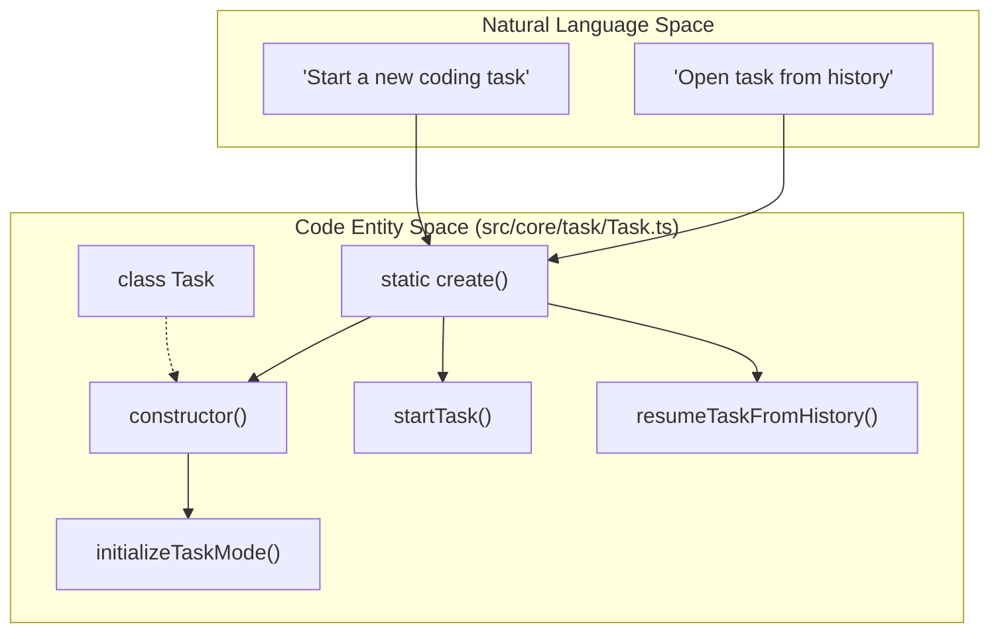
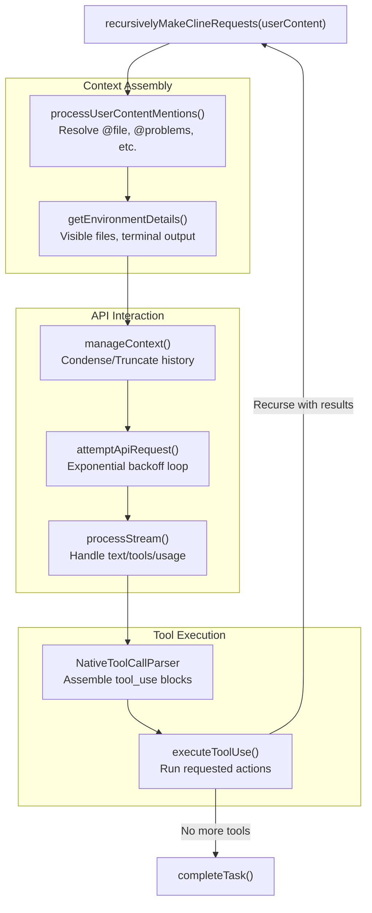
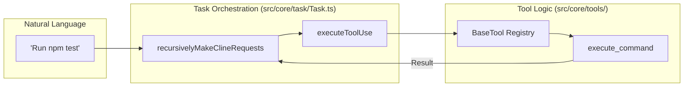

# Task Lifecycle and Execution

Relevant source files

The following files were used as context for generating this wiki page:

- [packages/types/src/message.ts](packages/types/src/message.ts)
- [src/__tests__/command-mentions.spec.ts](src/__tests__/command-mentions.spec.ts)
- [src/api/providers/fireworks.ts](src/api/providers/fireworks.ts)
- [src/api/providers/openai-compatible.ts](src/api/providers/openai-compatible.ts)
- [src/api/providers/sambanova.ts](src/api/providers/sambanova.ts)
- [src/api/transform/__tests__/ai-sdk.spec.ts](src/api/transform/__tests__/ai-sdk.spec.ts)
- [src/api/transform/ai-sdk.ts](src/api/transform/ai-sdk.ts)
- [src/core/mentions/__tests__/processUserContentMentions.spec.ts](src/core/mentions/__tests__/processUserContentMentions.spec.ts)
- [src/core/mentions/index.ts](src/core/mentions/index.ts)
- [src/core/mentions/processUserContentMentions.ts](src/core/mentions/processUserContentMentions.ts)
- [src/core/task-persistence/__tests__/apiMessages.spec.ts](src/core/task-persistence/__tests__/apiMessages.spec.ts)
- [src/core/task-persistence/__tests__/taskMessages.spec.ts](src/core/task-persistence/__tests__/taskMessages.spec.ts)
- [src/core/task/Task.ts](src/core/task/Task.ts)
- [src/core/task/__tests__/Task.spec.ts](src/core/task/__tests__/Task.spec.ts)
- [src/core/task/__tests__/Task.sticky-profile-race.spec.ts](src/core/task/__tests__/Task.sticky-profile-race.spec.ts)
- [src/core/task/__tests__/Task.throttle.test.ts](src/core/task/__tests__/Task.throttle.test.ts)
- [src/core/task/__tests__/flushPendingToolResultsToHistory.spec.ts](src/core/task/__tests__/flushPendingToolResultsToHistory.spec.ts)
- [src/core/task/__tests__/grace-retry-errors.spec.ts](src/core/task/__tests__/grace-retry-errors.spec.ts)
- [src/core/task/__tests__/grounding-sources.test.ts](src/core/task/__tests__/grounding-sources.test.ts)
- [src/core/task/__tests__/reasoning-preservation.test.ts](src/core/task/__tests__/reasoning-preservation.test.ts)
- [src/core/tools/RunSlashCommandTool.ts](src/core/tools/RunSlashCommandTool.ts)
- [src/core/tools/SkillTool.ts](src/core/tools/SkillTool.ts)
- [src/core/tools/__tests__/runSlashCommandTool.spec.ts](src/core/tools/__tests__/runSlashCommandTool.spec.ts)
- [src/services/skills/__tests__/skillInvocation.spec.ts](src/services/skills/__tests__/skillInvocation.spec.ts)

## Purpose and Scope

This document describes the lifecycle and execution flow of the `Task` class, which orchestrates AI-powered interactions with language models. The `Task` class manages the complete lifecycle from initialization through recursive API requests, tool execution, and completion. It serves as the primary engine for the Roo Code agent, bridging the gap between user intent and autonomous action.

**Sources:** [src/core/task/Task.ts:162-180]()

---

## Task Creation and Initialization

### Factory Methods

The `Task` class provides two creation patterns to handle both fresh tasks and resuming existing ones from history:

1.  **Constructor**: Directly instantiates the task. If `startTask` is true in options, it begins execution immediately [src/core/task/Task.ts:574-576]().
2.  **Static `Task.create()` factory**: A convenience method used by `ClineProvider` to instantiate and initialize a task in one call [src/core/task/Task.ts:400-418]().

### Natural Language to Code Entity Mapping: Initialization

The following diagram maps high-level initialization concepts to the specific code entities in `Task.ts`.

**Sources:** [src/core/task/Task.ts:400-418](), [src/core/task/Task.ts:420-578](), [src/core/task/Task.ts:601-653]()

### Initialization Sequence

The constructor and initialization methods perform critical setup:

| Step | Component | Purpose |
| :--- | :--- | :--- |
| 1 | `taskId` | UUIDv7 for new tasks or restored from `HistoryItem` [src/core/task/Task.ts:430-435](). |
| 2 | `initializeTaskMode` | Determines the agent's persona (e.g., Code, Architect) [src/core/task/Task.ts:601-653](). |
| 3 | `ApiHandler` | Built via `buildApiHandler()` using `apiConfiguration` [src/core/task/Task.ts:544-544](). |
| 4 | `RooIgnoreController` | Respects `.rooignore` rules for file access [src/core/task/Task.ts:532-532](). |
| 5 | `CheckpointService` | Initializes git-based versioning for the task via `getCheckpointService()` [src/core/task/Task.ts:541-541](). |
| 6 | `TerminalRegistry` | Manages terminal instances associated with this task [src/core/task/Task.ts:535-535](). |

**Sources:** [src/core/task/Task.ts:420-578](), [src/core/task/Task.ts:601-653](), [src/core/checkpoints/index.ts:24-40]()

---

## The Execution Loop

### Core Recursive Request Method

The `recursivelyMakeClineRequests()` method is the heart of task execution. It manages the loop of sending context to the AI, receiving a response (potentially with tool calls), executing those tools, and feeding results back.

**Sources:** [src/core/task/Task.ts:1605-1966](), [src/core/environment/getEnvironmentDetails.ts:23-200](), [src/core/mentions/processUserContentMentions.ts:36-56]()

### API Request Attempt with Retry

The `attemptApiRequest()` method wraps the `ApiHandler.createMessage` call in a retry loop. It handles network failures and rate limits using exponential backoff, capped by `MAX_EXPONENTIAL_BACKOFF_SECONDS` [src/core/task/Task.ts:136-136](), [src/core/task/Task.ts:1968-2145]().

**Sources:** [src/core/task/Task.ts:1968-2145]()

---

## Task Lifecycle Phases and Events

The task transitions through several states, emitting events via its `EventEmitter` [src/core/task/Task.ts:162-162]().

| Event | Code Trigger | Purpose |
| :--- | :--- | :--- |
| `TaskCreated` | `Task` constructor [src/core/task/Task.ts:577]() | Signals a new task instance exists. |
| `TaskStarted` | `startTask()` [src/core/task/Task.ts:1558]() | Signals the first API request is being prepared. |
| `TaskCompleted` | `completeTask()` [src/core/task/Task.ts:2375]() | Signals the objective is met or the user finished. |
| `TaskIdle` | `ask()` [src/core/task/Task.ts:1595]() | Signals the agent is waiting for user input. |

**Sources:** [src/core/task/Task.ts:577-2375](), [packages/types/src/history.ts:1-50]()

---

## Context and Message Management

### Dual Message Storage

Roo Code maintains two distinct message arrays to separate what the user sees from what the AI receives:

1.  **`clineMessages`**: An array of `ClineMessage` objects. These contain UI-specific metadata like `ts` (timestamps), `say` (status updates), and `ask` (user prompts) [src/core/task/Task.ts:310-310]().
2.  **`apiConversationHistory`**: An array of `ApiMessage` objects. These are formatted strictly for the LLM (Anthropic/OpenAI format), excluding UI status messages to save tokens [src/core/task/Task.ts:309-309]().

### Context Window Recovery

If an API request fails with a "context length exceeded" error, the `Task` class attempts recovery:
1.  **Summarization**: It uses `summarizeConversation()` to condense earlier parts of the chat [src/core/task/Task.ts:2083-2092]().
2.  **Truncation**: If summarization isn't enough, it performs a "forced reduction" (removing 25% of context), removing approximately the oldest messages [src/core/task/Task.ts:138-138](), [src/core/task/Task.ts:2104-2111]().

**Sources:** [src/core/task/Task.ts:309-310](), [src/core/task/Task.ts:2082-2116](), [src/core/condense/index.ts:1-50]()

---

## Tool Execution Integration

### Natural Language to Code Entity Mapping: Tool Flow

This diagram shows how a user's request to "Run a command" flows through the task execution system.

**Sources:** [src/core/task/Task.ts:1820-1850](), [src/core/tools/BaseTool.ts:1-30]()

### Consecutive Mistake Tracking

To prevent the agent from getting stuck in an infinite loop (e.g., repeatedly failing the same command), the `Task` tracks `consecutiveMistakeCount` [src/core/task/Task.ts:320-325](). If it exceeds the `consecutiveMistakeLimit` (defaulting to `DEFAULT_CONSECUTIVE_MISTAKE_LIMIT`) [src/core/task/Task.ts:49-49](), the agent pauses and asks the user for help [src/core/task/Task.ts:1894-1903]().

**Sources:** [src/core/task/Task.ts:320-325](), [src/core/task/Task.ts:1894-1903]()

---

## Task Termination and Cleanup

### Abort and Disposal

Tasks can be terminated by the user or by completion. The `abort()` method ensures clean termination:
-   Cancels the active `AbortController` for the API stream [src/core/task/Task.ts:2150-2150]().
-   Kills any running processes in `TerminalRegistry` associated with the `taskId` [src/core/task/Task.ts:2163-2163]().
-   Closes open diff views [src/core/task/Task.ts:2161-2161]().

**Sources:** [src/core/task/Task.ts:2147-2185](), [src/core/task/Task.ts:2360-2394]()