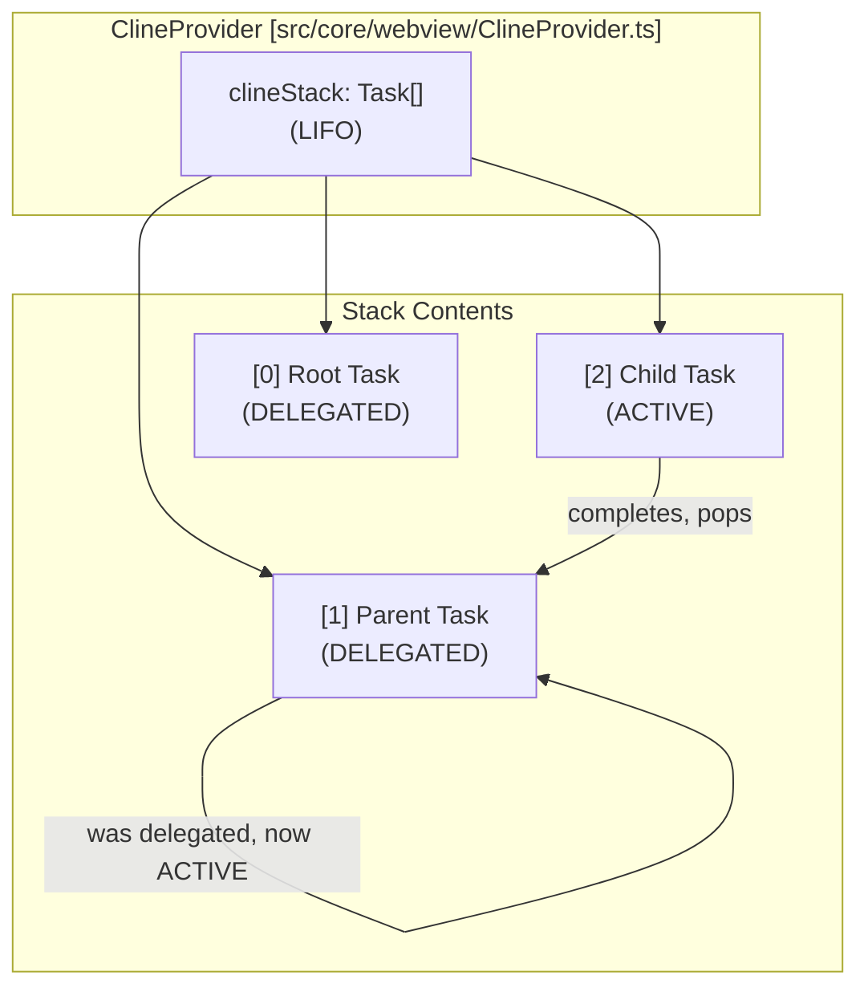
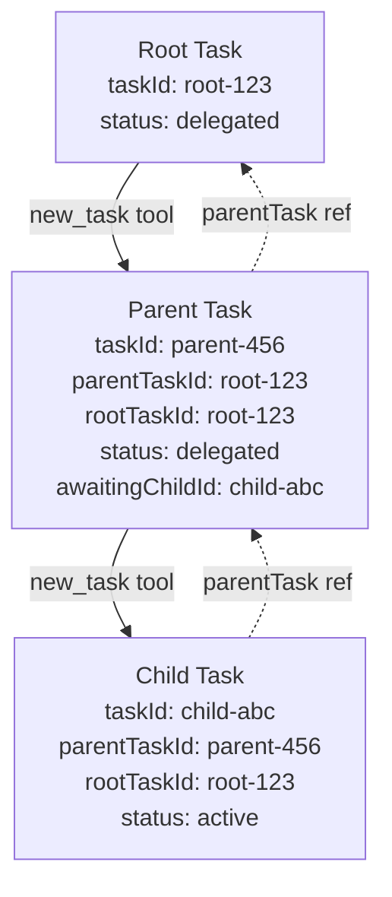
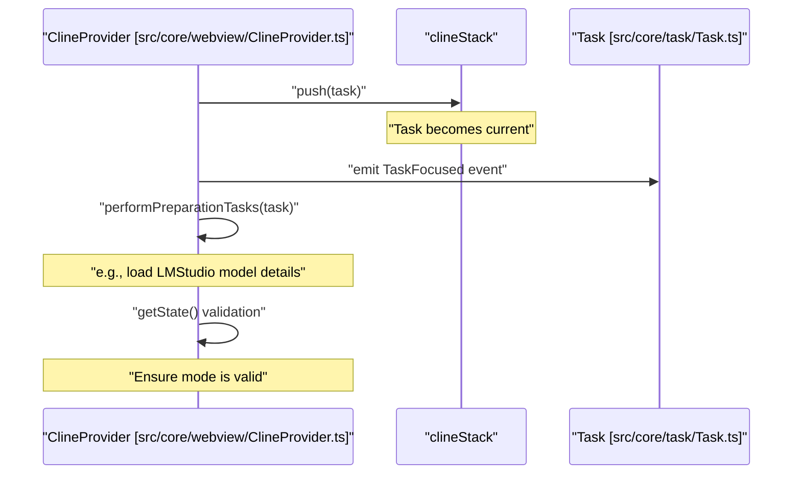
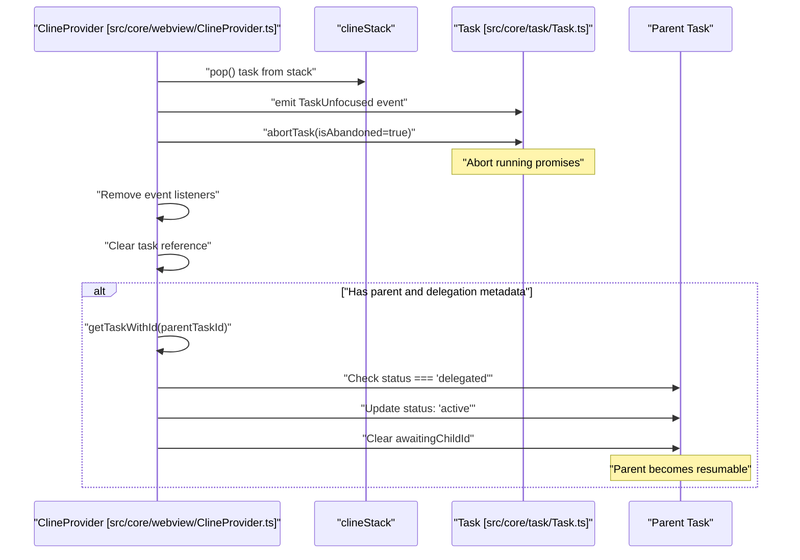
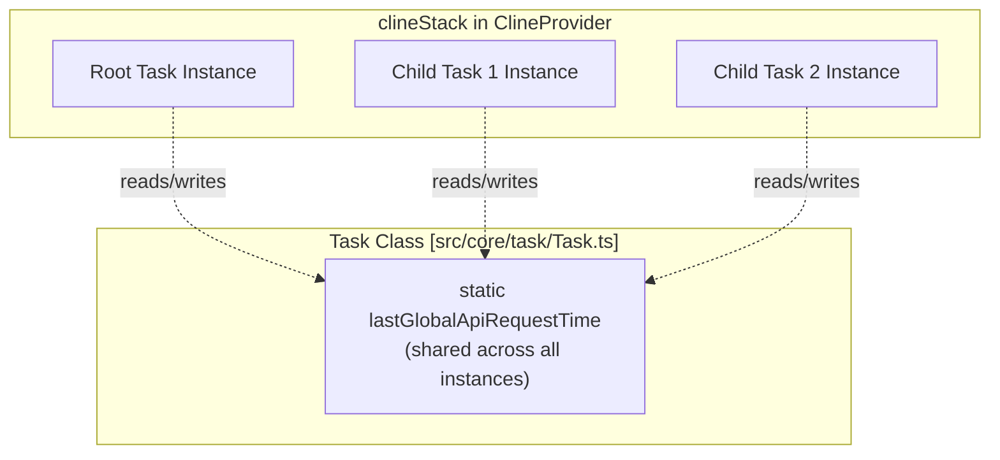
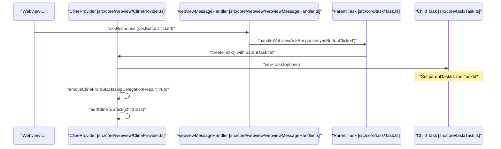

# Task Stack and Subtasks

<details>
<summary>Relevant source files</summary>

The following files were used as context for generating this wiki page:

- [packages/types/src/vscode-extension-host.ts](packages/types/src/vscode-extension-host.ts)
- [src/__tests__/command-mentions.spec.ts](src/__tests__/command-mentions.spec.ts)
- [src/api/providers/fetchers/modelCache.ts](src/api/providers/fetchers/modelCache.ts)
- [src/core/mentions/__tests__/processUserContentMentions.spec.ts](src/core/mentions/__tests__/processUserContentMentions.spec.ts)
- [src/core/mentions/index.ts](src/core/mentions/index.ts)
- [src/core/mentions/processUserContentMentions.ts](src/core/mentions/processUserContentMentions.ts)
- [src/core/task/Task.ts](src/core/task/Task.ts)
- [src/core/task/__tests__/Task.spec.ts](src/core/task/__tests__/Task.spec.ts)
- [src/core/tools/RunSlashCommandTool.ts](src/core/tools/RunSlashCommandTool.ts)
- [src/core/tools/SkillTool.ts](src/core/tools/SkillTool.ts)
- [src/core/tools/__tests__/runSlashCommandTool.spec.ts](src/core/tools/__tests__/runSlashCommandTool.spec.ts)
- [src/core/webview/ClineProvider.ts](src/core/webview/ClineProvider.ts)
- [src/core/webview/__tests__/ClineProvider.spec.ts](src/core/webview/__tests__/ClineProvider.spec.ts)
- [src/core/webview/__tests__/webviewMessageHandler.spec.ts](src/core/webview/__tests__/webviewMessageHandler.spec.ts)
- [src/core/webview/webviewMessageHandler.ts](src/core/webview/webviewMessageHandler.ts)
- [src/services/skills/__tests__/skillInvocation.spec.ts](src/services/skills/__tests__/skillInvocation.spec.ts)
- [src/shared/WebviewMessage.ts](src/shared/WebviewMessage.ts)
- [webview-ui/src/components/chat/ChatRow.tsx](webview-ui/src/components/chat/ChatRow.tsx)
- [webview-ui/src/components/chat/ChatView.tsx](webview-ui/src/components/chat/ChatView.tsx)
- [webview-ui/src/components/settings/SettingsView.tsx](webview-ui/src/components/settings/SettingsView.tsx)
- [webview-ui/src/context/ExtensionStateContext.tsx](webview-ui/src/context/ExtensionStateContext.tsx)

</details>


## Purpose and Scope

This document describes Roo Code's task stack and subtask delegation system. It covers the LIFO stack structure managed by `ClineProvider`, how parent tasks delegate work to child subtasks via the `new_task` tool, task status transitions during delegation, and the metadata repair mechanisms that maintain task hierarchy consistency.

For information about the broader Task execution pipeline, see [Task Lifecycle and Execution](). For task persistence details, see [Task Persistence and History]().

---

## ClineProvider Task Stack

### LIFO Stack Architecture

The `ClineProvider` class maintains a `clineStack` array that operates as a Last-In-First-Out (LIFO) stack of active `Task` instances [[src/core/webview/ClineProvider.ts:139]](). The task at the top of the stack is always the currently executing task [[src/core/webview/ClineProvider.ts:583]]().

**Task Stack Structure:**



**Sources:** [[src/core/webview/ClineProvider.ts:139]](), [[src/core/webview/ClineProvider.ts:579-585]]()

### Stack Management API

The `ClineProvider` provides methods to manipulate the task stack:

| Method | Purpose |
|--------|---------|
| `addClineToStack(task: Task)` | Pushes a new task onto the stack, making it the current task [[src/core/webview/ClineProvider.ts:471-486]]() |
| `removeClineFromStack(options?)` | Pops the current task, optionally repairing parent metadata [[src/core/webview/ClineProvider.ts:508-577]]() |
| `getCurrentTask()` | Returns the task at the top of the stack [[src/core/webview/ClineProvider.ts:583]]() |
| `getTaskStackSize()` | Returns the current stack depth [[src/core/webview/ClineProvider.ts:579-581]]() |
| `getCurrentTaskStack()` | Returns array of task IDs in the stack [[src/core/webview/ClineProvider.ts:587-589]]() |

**Sources:** [[src/core/webview/ClineProvider.ts:471-589]]()

---

## Task Hierarchy Architecture

### Relationship Structure

Tasks form a parent-child hierarchy through ID references and object pointers. When a task delegates work via the `new_task` tool, it creates a child task that is pushed onto the stack.

**Hierarchy Diagram:**



**Sources:** [[src/core/webview/ClineProvider.ts:139]](), [[src/core/task/Task.ts:163-177]]()

### Task Hierarchy Fields

Each `Task` instance maintains both ID-based and reference-based tracking of its position in the hierarchy:

| Field | Type | Purpose |
|-------|------|---------|
| `taskId` | `string` | Unique identifier for this task (UUID v7) [[src/core/task/Task.ts:163]]() |
| `rootTaskId` | `string \| undefined` | ID of the root task in the hierarchy [[src/core/task/Task.ts:164]]() |
| `parentTaskId` | `string \| undefined` | ID of the immediate parent task [[src/core/task/Task.ts:165]]() |
| `childTaskId` | `string \| undefined` | ID of the currently active child task [[src/core/task/Task.ts:166]]() |
| `rootTask` | `Task \| undefined` | Direct reference to root task object [[src/core/task/Task.ts:174]]() |
| `parentTask` | `Task \| undefined` | Direct reference to parent task object [[src/core/task/Task.ts:175]]() |
| `taskNumber` | `number` | Sequential number for ordering tasks [[src/core/task/Task.ts:176]]() |
| `pendingNewTaskToolCallId` | `string \| undefined` | Tool call ID that initiated this subtask [[src/core/task/Task.ts:167]]() |

**Sources:** [[src/core/task/Task.ts:163-197]]()

---

## Delegation Flow and Stack Operations

### Adding Tasks to the Stack

When a task is created (either as a new root task or as a child subtask), it's pushed onto the stack via `addClineToStack()` [[src/core/webview/ClineProvider.ts:471]]():

**Add Task Flow:**



The preparation tasks include provider-specific setup, such as loading full model details for LMStudio to read context size via `forceFullModelDetailsLoad` [[src/core/webview/ClineProvider.ts:91]]().

**Sources:** [[src/core/webview/ClineProvider.ts:471-503]](), [[src/api/providers/fetchers/lmstudio.ts:91]]()

### Removing Tasks from the Stack

When a task completes or is cancelled, it's removed from the stack via `removeClineFromStack()` [[src/core/webview/ClineProvider.ts:508]](). This method performs several critical operations:

**Remove Task Flow:**



**Sources:** [[src/core/webview/ClineProvider.ts:508-577]]()

### Delegation Metadata Repair

The delegation metadata repair mechanism ensures that when a child task is removed from the stack, the parent task's history metadata transitions correctly from "delegated" back to "active" [[src/core/webview/ClineProvider.ts:553-576]](). This is handled within `removeClineFromStack` by checking `parentTaskId` and `childTaskId` against the stored history.

**Sources:** [[src/core/webview/ClineProvider.ts:553-576]]()

### Task Status Transitions

During delegation, task status fields transition through specific states:

| Status | Meaning | When Applied |
|--------|---------|--------------|
| `active` | Task is currently executing or resumable | Initial state, or after child completes |
| `delegated` | Task is waiting for a child to complete | When `new_task` tool creates a child |
| `completed` | Task has finished successfully | After `attempt_completion` tool |

The `awaitingChildId` field in the history item tracks which child task the parent is waiting for during delegation [[src/core/webview/ClineProvider.ts:566]]().

**Sources:** [[src/core/webview/ClineProvider.ts:553-576]]()

---

## Global Rate Limiting Across Task Stack

### Shared API Request Timestamp

All tasks in a hierarchy share a global rate limiting mechanism to prevent exceeding API provider rate limits. This is implemented through a static class field `lastGlobalApiRequestTime` in `Task.ts` that tracks the last API request time across all task instances.

**Global Rate Limit Diagram:**



**Sources:** [[src/core/task/Task.ts:286-295]]()

---

## Task Creation and Initialization

### Creating Subtasks via new_task Tool

When the AI uses the `new_task` tool, the parent task creates a child task and adds it to the stack. This logic is triggered by the `askResponse` handler in `webviewMessageHandler.ts` when a user approves a subtask creation [[src/core/webview/webviewMessageHandler.ts:218-235]]().

**Subtask Creation Flow:**



**Sources:** [[src/core/webview/webviewMessageHandler.ts:218-235]](), [[src/core/webview/ClineProvider.ts:427-442]]()

### Workspace Inheritance

Child tasks automatically inherit the workspace path from their parent task, ensuring all tasks in a hierarchy operate on the same codebase [[src/core/task/Task.ts:177]]().

**Sources:** [[src/core/task/Task.ts:177]]()

---

## Pending Operations and Cleanup

### Task Event Listeners

Each task instance has event listeners registered by `ClineProvider` for task lifecycle events [[src/core/webview/ClineProvider.ts:148]](). These listeners are stored in a `WeakMap` for proper cleanup to prevent memory leaks [[src/core/webview/ClineProvider.ts:534-540]]().

**Sources:** [[src/core/webview/ClineProvider.ts:148]](), [[src/core/webview/ClineProvider.ts:534-540]]()

### Pending Edit Operations

The `ClineProvider` manages pending edit operations for message editing with timeout-based cleanup via the `pendingOperations` Map [[src/core/webview/ClineProvider.ts:157]]() and `PENDING_OPERATION_TIMEOUT_MS` [[src/core/webview/ClineProvider.ts:158]]().

**Sources:** [[src/core/webview/ClineProvider.ts:157-158]]()

---

## Task Stack Queries

### Stack Size and Current Task

The `ClineProvider` provides methods to query the current stack state:

```typescript
// src/core/webview/ClineProvider.ts
getTaskStackSize(): number {
    return this.clineStack.length // line 580
}

getCurrentTask(): Task | undefined {
    return this.clineStack[this.clineStack.length - 1] // line 583
}

getCurrentTaskStack(): string[] {
    return this.clineStack.map((cline) => cline.taskId) // line 588
}
```

**Sources:** [[src/core/webview/ClineProvider.ts:579-589]]()

---

## Use Cases and Patterns

### History and Resume

When a task with children is saved to history, the hierarchy information is persisted in `TaskHistoryStore`. During streaming failure rehydration, the `onTaskAborted` handler in `ClineProvider` captures the live references before the task is aborted and re-passes them to `createTaskWithHistoryItem` [[src/core/webview/ClineProvider.ts:248-264]]().

**Sources:** [[src/core/webview/ClineProvider.ts:248-264]](), [[src/core/task-persistence/index.ts:100]]()

### Rate Limiting Tests

The test suite includes comprehensive tests for rate limiting across parent and child tasks, utilizing the `resetGlobalApiRequestTime()` static method in `Task.ts`.

**Sources:** [[src/core/webview/__tests__/ClineProvider.spec.ts:184-200]](), [[src/core/task/Task.ts:293-295]]()