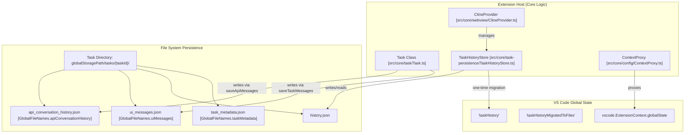
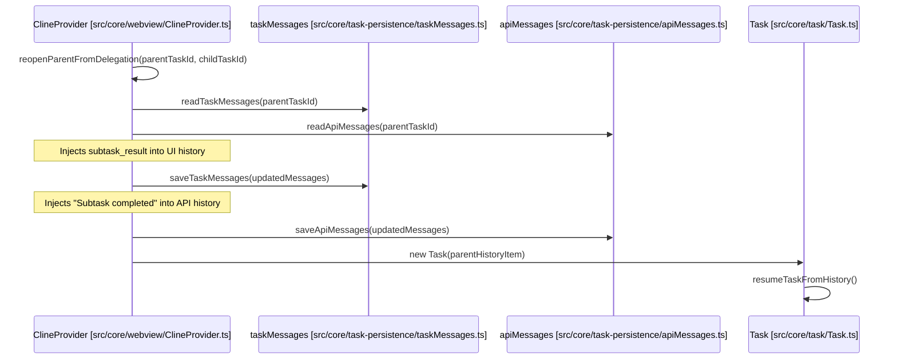

# Task Persistence and History

Relevant source files

The following files were used as context for generating this wiki page:

- [.github/workflows/cli-release.yml](.github/workflows/cli-release.yml)
- [.roo/rules-code/use-safeWriteJson.md](.roo/rules-code/use-safeWriteJson.md)
- [apps/cli/scripts/build.sh](apps/cli/scripts/build.sh)
- [packages/types/src/history.ts](packages/types/src/history.ts)
- [src/api/providers/fetchers/modelEndpointCache.ts](src/api/providers/fetchers/modelEndpointCache.ts)
- [src/core/config/ContextProxy.ts](src/core/config/ContextProxy.ts)
- [src/core/config/ProviderSettingsManager.ts](src/core/config/ProviderSettingsManager.ts)
- [src/core/config/__tests__/ContextProxy.spec.ts](src/core/config/__tests__/ContextProxy.spec.ts)
- [src/core/config/__tests__/ProviderSettingsManager.spec.ts](src/core/config/__tests__/ProviderSettingsManager.spec.ts)
- [src/core/config/__tests__/importExport.spec.ts](src/core/config/__tests__/importExport.spec.ts)
- [src/core/config/importExport.ts](src/core/config/importExport.ts)
- [src/core/context-tracking/FileContextTracker.ts](src/core/context-tracking/FileContextTracker.ts)
- [src/core/environment/__tests__/getEnvironmentDetails.spec.ts](src/core/environment/__tests__/getEnvironmentDetails.spec.ts)
- [src/core/environment/getEnvironmentDetails.ts](src/core/environment/getEnvironmentDetails.ts)
- [src/core/task-persistence/TaskHistoryStore.ts](src/core/task-persistence/TaskHistoryStore.ts)
- [src/core/task-persistence/__tests__/TaskHistoryStore.crossInstance.spec.ts](src/core/task-persistence/__tests__/TaskHistoryStore.crossInstance.spec.ts)
- [src/core/task-persistence/__tests__/TaskHistoryStore.spec.ts](src/core/task-persistence/__tests__/TaskHistoryStore.spec.ts)
- [src/core/task-persistence/apiMessages.ts](src/core/task-persistence/apiMessages.ts)
- [src/core/task-persistence/index.ts](src/core/task-persistence/index.ts)
- [src/core/task-persistence/taskMessages.ts](src/core/task-persistence/taskMessages.ts)
- [src/core/task-persistence/taskMetadata.ts](src/core/task-persistence/taskMetadata.ts)
- [src/core/task/__tests__/Task.persistence.spec.ts](src/core/task/__tests__/Task.persistence.spec.ts)
- [src/core/task/__tests__/native-tools-filtering.spec.ts](src/core/task/__tests__/native-tools-filtering.spec.ts)
- [src/core/task/__tests__/task-tool-history.spec.ts](src/core/task/__tests__/task-tool-history.spec.ts)
- [src/core/tools/ReadFileTool.ts](src/core/tools/ReadFileTool.ts)
- [src/core/tools/__tests__/newTaskTool.spec.ts](src/core/tools/__tests__/newTaskTool.spec.ts)
- [src/core/tools/__tests__/readFileTool.spec.ts](src/core/tools/__tests__/readFileTool.spec.ts)
- [src/core/tools/helpers/__tests__/toolResultFormatting.spec.ts](src/core/tools/helpers/__tests__/toolResultFormatting.spec.ts)
- [src/core/tools/helpers/toolResultFormatting.ts](src/core/tools/helpers/toolResultFormatting.ts)
- [src/core/webview/__tests__/ClineProvider.apiHandlerRebuild.spec.ts](src/core/webview/__tests__/ClineProvider.apiHandlerRebuild.spec.ts)
- [src/core/webview/__tests__/ClineProvider.lockApiConfig.spec.ts](src/core/webview/__tests__/ClineProvider.lockApiConfig.spec.ts)
- [src/core/webview/__tests__/ClineProvider.sticky-mode.spec.ts](src/core/webview/__tests__/ClineProvider.sticky-mode.spec.ts)
- [src/core/webview/__tests__/ClineProvider.sticky-profile.spec.ts](src/core/webview/__tests__/ClineProvider.sticky-profile.spec.ts)
- [src/core/webview/__tests__/ClineProvider.taskHistory.spec.ts](src/core/webview/__tests__/ClineProvider.taskHistory.spec.ts)
- [src/core/webview/__tests__/webviewMessageHandler.lockApiConfig.spec.ts](src/core/webview/__tests__/webviewMessageHandler.lockApiConfig.spec.ts)
- [src/i18n/setup.ts](src/i18n/setup.ts)
- [src/integrations/misc/image-handler.ts](src/integrations/misc/image-handler.ts)
- [src/services/code-index/cache-manager.ts](src/services/code-index/cache-manager.ts)
- [src/shared/globalFileNames.ts](src/shared/globalFileNames.ts)
- [src/utils/export.ts](src/utils/export.ts)

This page documents the technical implementation of task persistence in Roo Code, covering the `TaskHistoryStore`, file-based message storage, task resumption logic, and the backward compatibility mechanisms for global state management.

---

## Dual Storage Architecture

Roo Code uses a **dual storage pattern** to persist task state, separating API-level conversation history from UI-level display messages. This separation optimizes both API communication (with token-efficient history management) and UI rendering (with rich display metadata).

### Storage Entities and Data Flow

The following diagram maps the relationship between the natural language concepts of "History" and the specific code entities responsible for managing them.

**Sources:** [src/core/task-persistence/apiMessages.ts:1-10](), [src/core/task-persistence/TaskHistoryStore.ts:10-25](), [src/shared/globalFileNames.ts:1-10](), [src/core/config/ContextProxy.ts:40-52]()

---

## Task History Metadata: TaskHistoryStore

The `TaskHistoryStore` class is responsible for managing high-level metadata for all tasks (e.g., task description, token usage, cost, and status). Unlike previous versions that stored all history in a single large array in VS Code's `globalState`, Roo Code now persists metadata in individual `history.json` files within each task's directory.

### Initialization and Migration

When the extension activates, `ClineProvider` initializes the store. If the migration flag `taskHistoryMigratedToFiles` is not set, it performs a one-time migration of legacy data.

| Step | Function/Logic | File Reference |
| :--- | :--- | :--- |
| **Initialize** | `this.taskHistoryStore.initialize()` | [src/core/webview/ClineProvider.ts:192-202]() |
| **Check Migration** | Checks `globalState.get("taskHistoryMigratedToFiles")` | [src/core/task-persistence/TaskHistoryStore.ts:40-50]() |
| **Migrate** | `migrateFromGlobalState(legacyHistory)` | [src/core/task-persistence/TaskHistoryStore.ts:100-120]() |

### Backward Compatibility: Write-Through

To ensure compatibility with older versions of the extension (or external tools), `TaskHistoryStore` maintains a "write-through" mechanism. Every time a task's history is updated, a debounced operation syncs the entire history back to the VS Code `globalState`.

*   **Debounce Duration**: 5000ms (`GLOBAL_STATE_WRITE_THROUGH_DEBOUNCE_MS`)
*   **Trigger**: Any call to `TaskHistoryStore.write()`
*   **Implementation**: `scheduleGlobalStateWriteThrough()` in `ClineProvider`.

**Sources:** [src/core/webview/ClineProvider.ts:152-157](), [src/core/task-persistence/TaskHistoryStore.ts:60-80]()

---

## Message Persistence

While `TaskHistoryStore` handles metadata, the actual conversation content is managed by `saveApiMessages` and `saveTaskMessages`.

### API Conversation History (`api_conversation_history.json`)

This file stores `ApiMessage` objects, which are compatible with the Anthropic `MessageParam` format but extended for Roo Code features.

| Field | Type | Description |
| :--- | :--- | :--- |
| `ts` | `number` | Timestamp of the message [src/core/task-persistence/apiMessages.ts:13]() |
| `reasoning_content` | `string` | Preserved "thinking" for DeepSeek/Z.ai models [src/core/task-persistence/apiMessages.ts:25]() |
| `condenseId` | `string` | Identifier for non-destructive context condensation [src/core/task-persistence/apiMessages.ts:27]() |
| `isTruncationMarker`| `boolean`| Marks a boundary where history was truncated [src/core/task-persistence/apiMessages.ts:37]() |

**Implementation Details:**
*   **Writing**: `saveApiMessages` uses `safeWriteJson` to prevent file corruption during concurrent access. [src/core/task-persistence/apiMessages.ts:109-121]()
*   **Reading**: `readApiMessages` handles legacy filename resolution (falling back to `claude_messages.json` if the new filename is missing). [src/core/task-persistence/apiMessages.ts:40-107]()

### UI Messages (`ui_messages.json`)

This file stores `ClineMessage` objects, which contain rich metadata for the React webview (e.g., tool execution status, user-facing "says" and "asks").

**Sources:** [src/core/task-persistence/taskMessages.ts:17-56](), [src/core/task-persistence/apiMessages.ts:12-38]()

---

## Task Resumption and Delegation History

Task resumption allows a user to pick up a task exactly where it left off. This is particularly complex during **subtask delegation**, where a parent task must resume after a child task completes.

### Resumption via Reopening Parent

When a subtask finishes, the `reopenParentFromDelegation` method in `ClineProvider` manages the transition of metadata and message injection to ensure continuity.

**Metadata Transitions during Delegation:**
1.  **Parent Status**: Transitions from `delegated` back to `active`. [src/__tests__/history-resume-delegation.spec.ts:98]()
2.  **History Injection**: A `say` message of type `subtask_result` is appended to the parent's UI history. [src/__tests__/history-resume-delegation.spec.ts:169]()
3.  **API Context Alignment**: If the parent was waiting on a `new_task` tool, a corresponding `tool_result` is injected into the API history to satisfy the LLM's tool-calling protocol. [src/__tests__/history-resume-delegation.spec.ts:205-210]()

**Sources:** [src/__tests__/history-resume-delegation.spec.ts:47-120](), [src/core/task-persistence/apiMessages.ts:40-46](), [src/core/task-persistence/taskMessages.ts:17-25]()

---

## Task Metadata and File Context Tracking

Roo Code tracks which files have been modified or read within a task's context to prevent stale context issues.

### FileContextTracker

The `FileContextTracker` manages a `task_metadata.json` file that records the state of files involved in the task.

| State | Logic | File Reference |
| :--- | :--- | :--- |
| **Active** | File was just read or edited by Roo. | [src/core/context-tracking/FileContextTracker.ts:164-166]() |
| **Stale** | File was modified by the user outside of Roo. | [src/core/context-tracking/FileContextTracker.ts:150-152]() |
| **User Edited** | Detected via `vscode.FileSystemWatcher`. | [src/core/context-tracking/FileContextTracker.ts:66-73]() |

**Sources:** [src/core/context-tracking/FileContextTracker.ts:23-36](), [src/core/context-tracking/FileContextTracker.ts:114-126]()

### Metadata Calculation Utility

The `taskMetadata` function generates a `HistoryItem` for the store, aggregating usage and cost. It uses `NodeCache` to optimize directory size calculations.

| Metric | Source / Logic | File Reference |
| :--- | :--- | :--- |
| **Token Usage** | `getApiMetrics(messages)` | [src/core/task-persistence/taskMetadata.ts:75-76]() |
| **Directory Size**| `getFolderSize.loose(taskDir)` with `taskSizeCache` | [src/core/task-persistence/taskMetadata.ts:78-89]() |
| **Last Timestamp**| TS of the last relevant message | [src/core/task-persistence/taskMetadata.ts:69-73]() |
| **API Config** | `apiConfigName` for sticky profile support | [src/core/task-persistence/taskMetadata.ts:113]() |

**Sources:** [src/core/task-persistence/taskMetadata.ts:13-118]()