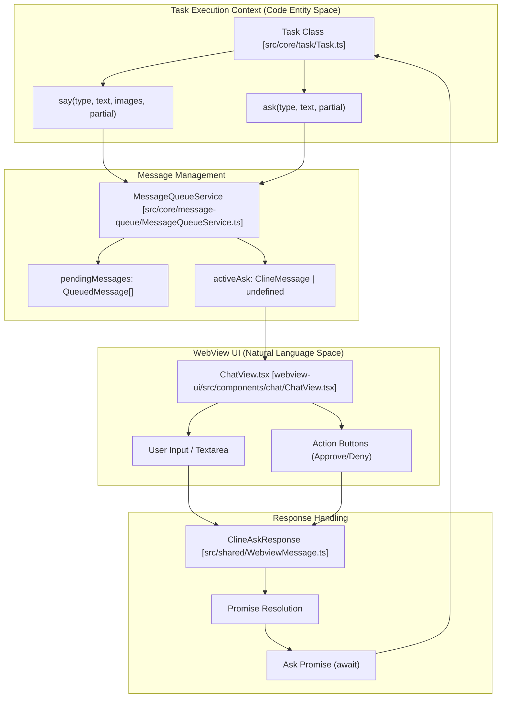
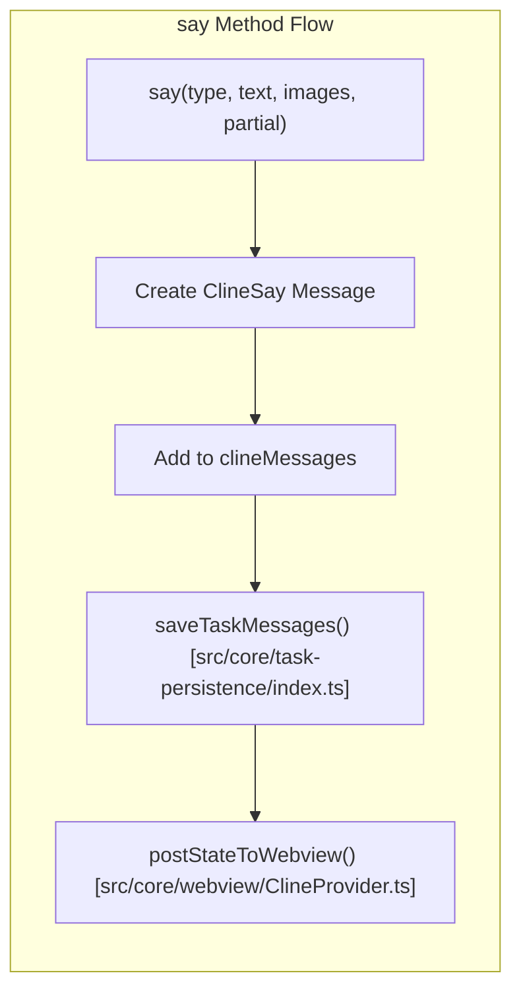
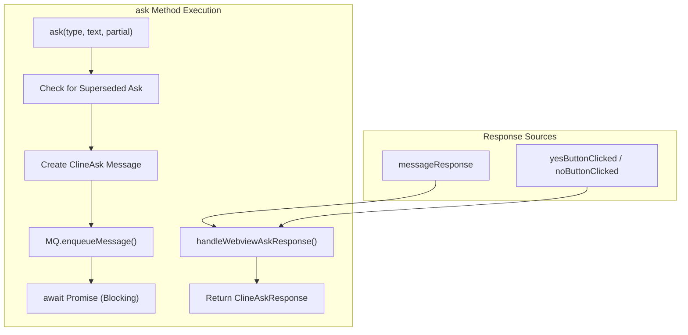
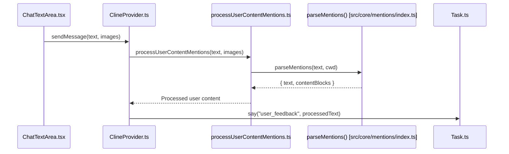

# Ask/Say Pattern and User Interaction

Relevant source files

The following files were used as context for generating this wiki page:

- [packages/types/src/vscode-extension-host.ts](packages/types/src/vscode-extension-host.ts)
- [src/__tests__/command-mentions.spec.ts](src/__tests__/command-mentions.spec.ts)
- [src/api/providers/fetchers/modelCache.ts](src/api/providers/fetchers/modelCache.ts)
- [src/core/mentions/__tests__/processUserContentMentions.spec.ts](src/core/mentions/__tests__/processUserContentMentions.spec.ts)
- [src/core/mentions/index.ts](src/core/mentions/index.ts)
- [src/core/mentions/processUserContentMentions.ts](src/core/mentions/processUserContentMentions.ts)
- [src/core/task/Task.ts](src/core/task/Task.ts)
- [src/core/task/__tests__/Task.spec.ts](src/core/task/__tests__/Task.spec.ts)
- [src/core/tools/RunSlashCommandTool.ts](src/core/tools/RunSlashCommandTool.ts)
- [src/core/tools/SkillTool.ts](src/core/tools/SkillTool.ts)
- [src/core/tools/__tests__/runSlashCommandTool.spec.ts](src/core/tools/__tests__/runSlashCommandTool.spec.ts)
- [src/core/webview/ClineProvider.ts](src/core/webview/ClineProvider.ts)
- [src/core/webview/__tests__/ClineProvider.spec.ts](src/core/webview/__tests__/ClineProvider.spec.ts)
- [src/core/webview/__tests__/webviewMessageHandler.spec.ts](src/core/webview/__tests__/webviewMessageHandler.spec.ts)
- [src/core/webview/webviewMessageHandler.ts](src/core/webview/webviewMessageHandler.ts)
- [src/services/skills/__tests__/skillInvocation.spec.ts](src/services/skills/__tests__/skillInvocation.spec.ts)
- [src/shared/WebviewMessage.ts](src/shared/WebviewMessage.ts)
- [webview-ui/src/components/chat/ChatRow.tsx](webview-ui/src/components/chat/ChatRow.tsx)
- [webview-ui/src/components/chat/ChatView.tsx](webview-ui/src/components/chat/ChatView.tsx)
- [webview-ui/src/components/settings/SettingsView.tsx](webview-ui/src/components/settings/SettingsView.tsx)
- [webview-ui/src/context/ExtensionStateContext.tsx](webview-ui/src/context/ExtensionStateContext.tsx)

## Purpose and Scope

This document details the ask/say communication pattern that enables bidirectional interaction between the AI agent (`Task`) and the user through the VS Code webview. The `Task.ask()` method requests user input or approval, while `Task.say()` displays messages and status updates. Together, these methods orchestrate all user interactions during task execution.

For the broader task lifecycle context, see [5.1 Task Lifecycle and Execution](). For webview message protocols, see [3.2 Message Protocols]().

---

## Core Communication Architecture

### Overview of Ask/Say Pattern

The communication flow bridges the "Natural Language Space" (user intent) and "Code Entity Space" (task execution logic).

**Sources:** [src/core/task/Task.ts:162-322](), [webview-ui/src/components/chat/ChatView.tsx:149-153](), [src/shared/WebviewMessage.ts:3-4]()

---

## Task.say() Method

### Purpose and Implementation

The `say()` method displays non-interactive messages to the user. It adds messages to the `clineMessages` array and posts them to the webview for rendering. The `ClineProvider` uses a monotonically increasing sequence number `clineMessagesSeq` to prevent stale state updates from overwriting newer chat history in the webview.

### Say Message Types

| Type | Purpose | Example Use Case |
|------|---------|------------------|
| `text` | Plain text message | General information or thought process |
| `error` | Error message | Tool execution failure or API errors |
| `command_output` | Terminal output | Output from `execute_command` |
| `completion_result` | Task completion summary | Result of `attempt_completion` |
| `api_req_started` | API request initiated | Token usage and cost tracking |
| `api_req_finished` | API request completed | Response received confirmation |
| `user_feedback` | User's response text | Echoing user input after an `ask()` |
| `rooignore_error` | Access denied | File blocked by `.rooignore` controller |

**Sources:** [src/core/task/Task.ts:2100-2200](), [src/core/webview/ClineProvider.ts:168-169](), [src/core/webview/ClineProvider.ts:98-101]()

---

## Task.ask() Method

### Purpose and Signature

The `ask()` method requests user input or approval, blocking task execution until the user responds. It returns a `Promise` that resolves with a `ClineAskResponse`.

### Ask Types and Responses

| Ask Type | Purpose | User Actions | Response Format |
|----------|---------|--------------|-----------------|
| `completion_result` | Task completion approval | Accept / Provide feedback | `yesButtonClicked` or `messageResponse` |
| `followup` | Followup question | Type answer / Select suggestion | `messageResponse` |
| `command` | Command execution approval | Approve / Deny / Edit | `yesButtonClicked`, `noButtonClicked` |
| `tool` | Tool approval (e.g. `write_to_file`) | Approve / Deny | `yesButtonClicked` or `noButtonClicked` |
| `resume_task` | Resume from history | Start / Start Fresh | `resumeTask` or `resumeTaskFromHistory` |

**Sources:** [src/core/task/Task.ts:31-56](), [src/shared/WebviewMessage.ts:3-4](), [src/core/task/Task.ts:45-47]()

---

## Ask/Say Lifecycle and State Management

### State Synchronization

The `Task` class maintains internal state to coordinate interactions. This state is synchronized with the webview via `ClineProvider`. The `handleWebviewAskResponse` method in `Task.ts` is the primary entry point for processing user interactions received from the webview via `webviewMessageHandler`.

| Property | Purpose | Source |
|----------|---------|--------|
| `interactiveAsk` | The current blocking ask message | [src/core/task/Task.ts:276]() |
| `askResponse` | Stores the resolved response type | [src/core/task/Task.ts:314]() |
| `askResponseText` | Stores text from `messageResponse` | [src/core/task/Task.ts:315]() |
| `askResponseImages` | Stores images from `messageResponse` | [src/core/task/Task.ts:316]() |

### Ask Superseding

The system can supersede a pending ask if the context changes (e.g., a command finishes while waiting for a follow-up).

1. **Check active ask**: Verifies `this.interactiveAsk` exists.
2. **Reject promise**: Throws `AskIgnoredError` [src/core/task/AskIgnoredError.ts:8]() to break the `await ask()` chain.
3. **Clear state**: Sets `this.askResponse = undefined`.

**Sources:** [src/core/task/Task.ts:273-276](), [src/core/task/Task.ts:314-317](), [src/core/webview/webviewMessageHandler.ts:92-101]()

---

## User Content Processing

### processUserContentMentions

Before user messages reach the `Task`, they are processed to resolve `@mentions` and `/commands`. The `webviewMessageHandler` in the extension host routes the `sendMessage` action to `ClineProvider`, which then utilizes `processUserContentMentions`.

**Implementation Details:**
- **Mentions**: `@file.ts` is converted into a structured `MentionContentBlock` containing file contents [src/core/mentions/index.ts:51-64]().
- **Diagnostics**: `@problems` triggers `diagnosticsToProblemsString` [src/core/mentions/index.ts:13]().
- **Git**: `@git-changes` resolves the current working state [src/core/mentions/index.ts:9]().
- **Images**: `resolveIncomingImages` in `webviewMessageHandler` ensures images mentioned in text are resolved according to model capabilities [src/core/webview/webviewMessageHandler.ts:176-190]().

**Sources:** [src/core/mentions/index.ts:99-150](), [src/core/webview/webviewMessageHandler.ts:176-190](), [webview-ui/src/components/chat/ChatTextArea.tsx:1-100]()

---

## User Approval Flows

### Tool Approval Flow

Tools like `write_to_file` or `execute_command` use the `askApproval` callback.

1. **Check Auto-Approval**: The `AutoApprovalHandler` checks if the tool/command is whitelisted based on user settings like `alwaysAllowWrite` or `allowedCommands`.
2. **Manual Approval**: If not auto-approved, `Task.ask("tool", ...)` is called.
3. **Execution**: If `yesButtonClicked` is received, the tool proceeds; otherwise, it returns a `toolDenied` error.

### Completion Approval

The `AttemptCompletionTool` requires explicit user confirmation that the task objective was met.

- **Feedback**: If the user provides text instead of clicking "Approve", the tool treats it as `user_feedback` and continues the task loop.
- **Persistence**: Upon completion, the final state is persisted via `saveTaskMessages` and `saveApiMessages`.

**Sources:** [src/core/task/Task.ts:95-96](), [webview-ui/src/components/settings/SettingsView.tsx:150-163](), [src/core/task-persistence/index.ts:1-100]()

---

## Message Rendering and UI

### ChatView and ChatRow

The `ChatView` component manages the virtualized list of messages using `Virtuoso`. Each message is rendered by a `ChatRow`, which handles the specific visualization for different message types (e.g., `ReasoningBlock`, `ToolUseBlock`, or `Markdown`).

- **Stale State Protection**: `ExtensionStateContext` implements `mergeExtensionState` to reject `clineMessages` updates if they arrive with a sequence number lower than the current state [webview-ui/src/context/ExtensionStateContext.tsx:166-170]().
- **Interactive Elements**: `ChatRow` includes logic for editing messages, which triggers `showEditMessageDialog` in the extension [webview-ui/src/components/chat/ChatRow.tsx:186-190]().

**Sources:** [webview-ui/src/components/chat/ChatView.tsx:3-4](), [webview-ui/src/components/chat/ChatRow.tsx:132-164](), [webview-ui/src/context/ExtensionStateContext.tsx:166-170]()

---

## Message Persistence

All interactions are saved to ensure state is maintained across VS Code sessions. The `TaskHistoryStore` handles the persistence of these messages to local storage.

| Data Type | Persistence Function | File Path |
|-----------|----------------------|-----------|
| UI Messages | `saveTaskMessages()` | `ui_messages.json` |
| API Conversation | `saveApiMessages()` | `api_conversation_history.json` |

**Sources:** [src/core/task-persistence/index.ts:1-100](), [src/core/task/Task.ts:2100-2200](), [src/core/webview/ClineProvider.ts:153-156]()