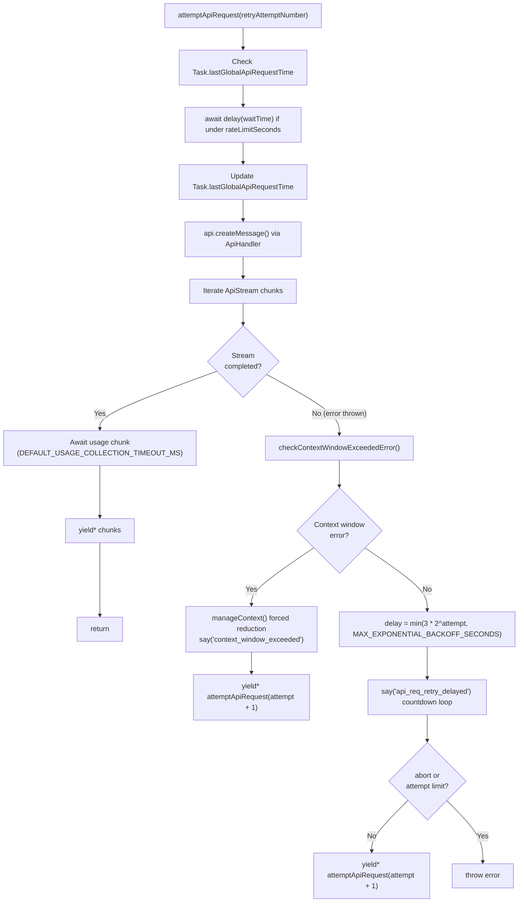
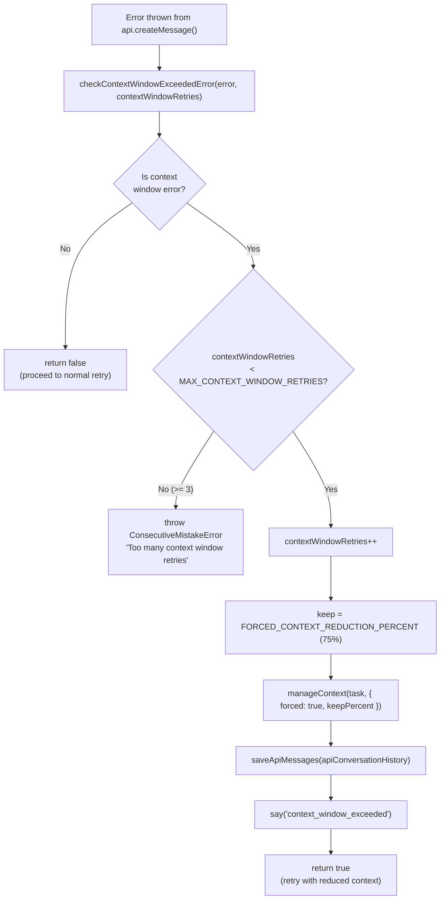
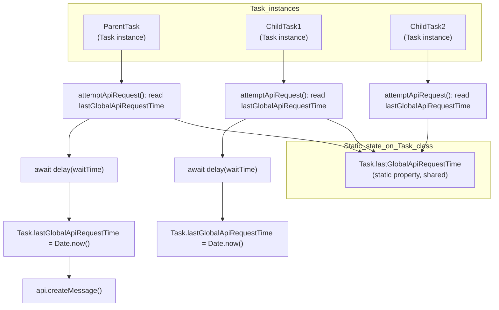
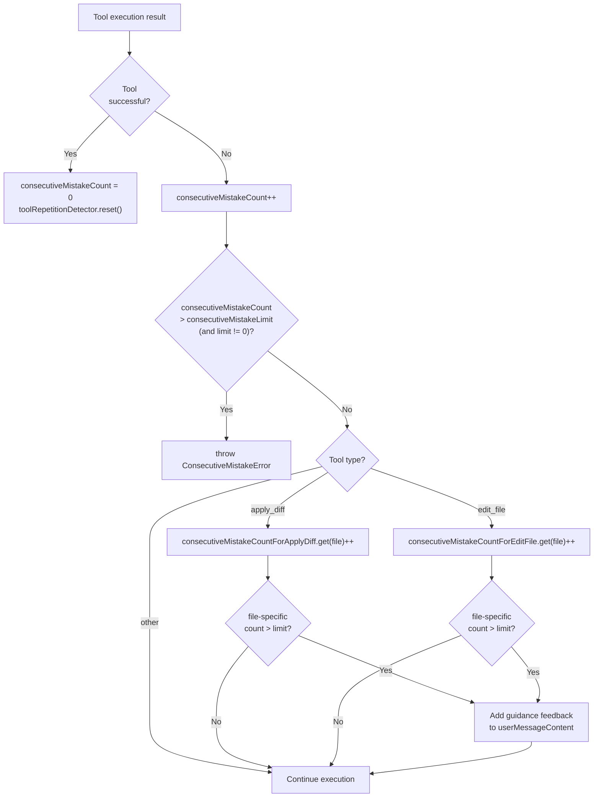
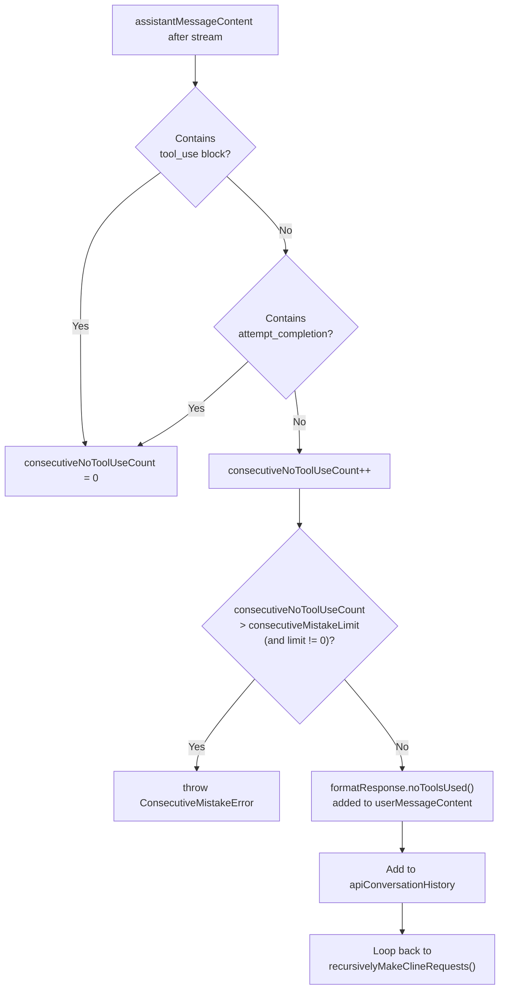

# Error Handling and Retries

Relevant source files

The following files were used as context for generating this wiki page:

- [packages/types/src/message.ts](packages/types/src/message.ts)
- [src/__tests__/command-mentions.spec.ts](src/__tests__/command-mentions.spec.ts)
- [src/api/providers/fireworks.ts](src/api/providers/fireworks.ts)
- [src/api/providers/openai-compatible.ts](src/api/providers/openai-compatible.ts)
- [src/api/providers/sambanova.ts](src/api/providers/sambanova.ts)
- [src/api/transform/__tests__/ai-sdk.spec.ts](src/api/transform/__tests__/ai-sdk.spec.ts)
- [src/api/transform/ai-sdk.ts](src/api/transform/ai-sdk.ts)
- [src/core/mentions/__tests__/processUserContentMentions.spec.ts](src/core/mentions/__tests__/processUserContentMentions.spec.ts)
- [src/core/mentions/index.ts](src/core/mentions/index.ts)
- [src/core/mentions/processUserContentMentions.ts](src/core/mentions/processUserContentMentions.ts)
- [src/core/task-persistence/__tests__/apiMessages.spec.ts](src/core/task-persistence/__tests__/apiMessages.spec.ts)
- [src/core/task-persistence/__tests__/taskMessages.spec.ts](src/core/task-persistence/__tests__/taskMessages.spec.ts)
- [src/core/task/Task.ts](src/core/task/Task.ts)
- [src/core/task/__tests__/Task.spec.ts](src/core/task/__tests__/Task.spec.ts)
- [src/core/task/__tests__/Task.sticky-profile-race.spec.ts](src/core/task/__tests__/Task.sticky-profile-race.spec.ts)
- [src/core/task/__tests__/Task.throttle.test.ts](src/core/task/__tests__/Task.throttle.test.ts)
- [src/core/task/__tests__/flushPendingToolResultsToHistory.spec.ts](src/core/task/__tests__/flushPendingToolResultsToHistory.spec.ts)
- [src/core/task/__tests__/grace-retry-errors.spec.ts](src/core/task/__tests__/grace-retry-errors.spec.ts)
- [src/core/task/__tests__/grounding-sources.test.ts](src/core/task/__tests__/grounding-sources.test.ts)
- [src/core/task/__tests__/reasoning-preservation.test.ts](src/core/task/__tests__/reasoning-preservation.test.ts)
- [src/core/tools/RunSlashCommandTool.ts](src/core/tools/RunSlashCommandTool.ts)
- [src/core/tools/SkillTool.ts](src/core/tools/SkillTool.ts)
- [src/core/tools/__tests__/runSlashCommandTool.spec.ts](src/core/tools/__tests__/runSlashCommandTool.spec.ts)
- [src/services/skills/__tests__/skillInvocation.spec.ts](src/services/skills/__tests__/skillInvocation.spec.ts)

This page documents the error handling and retry mechanisms in the Task execution system. It covers how the `Task` class handles API errors, implements exponential backoff, manages context window limitations, enforces rate limiting, and tracks consecutive mistakes to ensure robust task execution.

For information about the overall task execution lifecycle, see [Task Lifecycle and Execution](). For details on how the Task manages conversation history and context, see [Context Window Management]().

---

## Overview

The `Task` class implements multiple layers of error handling and retry logic to ensure reliable execution despite transient API failures, context window limitations, and model mistakes. These mechanisms work together to provide:

- **Automatic retries** with exponential backoff for transient API errors.
- **Context window management** that automatically reduces context when limits are exceeded.
- **Rate limiting** to prevent API overload across parent and child tasks.
- **Consecutive mistake tracking** with `consecutiveMistakeCount` and the `ToolRepetitionDetector`.
- **Tool execution error handling** with standardized error responses.

### Key Code Entities

| Entity | Role |
| :--- | :--- |
| `Task` | Central orchestrator for execution and error recovery. [src/core/task/Task.ts:162-162]() |
| `ConsecutiveMistakeError` | Thrown when the mistake limit is exceeded. [src/core/task/Task.ts:53-53]() |
| `AskIgnoredError` | Thrown when a user response to an `ask()` call is ignored. [src/core/task/Task.ts:8-8]() |
| `ToolRepetitionDetector` | Detects loops where the AI repeats the same tool calls. [src/core/task/Task.ts:100-100]() |
| `checkContextWindowExceededError` | Utility to detect if an API error is context-length related. [src/core/task/Task.ts:119-119]() |

**Sources:** [src/core/task/Task.ts:8-8](), [src/core/task/Task.ts:49-56](), [src/core/task/Task.ts:100-100](), [src/core/task/Task.ts:119-119](), [src/core/task/Task.ts:136-140](), [src/core/task/Task.ts:162-162]()

---

## Retry Constants and Configuration

The `Task` class defines several constants that control retry behavior:

| Constant | Value | Purpose |
| :--- | :--- | :--- |
| `MAX_EXPONENTIAL_BACKOFF_SECONDS` | 600 (10 minutes) | Maximum delay between retries. [src/core/task/Task.ts:136-136]() |
| `DEFAULT_USAGE_COLLECTION_TIMEOUT_MS` | 5000 (5 seconds) | Timeout for collecting usage data from streaming responses. [src/core/task/Task.ts:137-137]() |
| `FORCED_CONTEXT_REDUCTION_PERCENT` | 75 | Percentage of context to keep when context window is exceeded. [src/core/task/Task.ts:138-138]() |
| `MAX_CONTEXT_WINDOW_RETRIES` | 3 | Maximum number of retries for context window errors. [src/core/task/Task.ts:139-139]() |

**Sources:** [src/core/task/Task.ts:136-139]()

---

## Exponential Backoff Retry System

### `attemptApiRequest` Generator

`attemptApiRequest` is an async generator on `Task` that implements the core retry logic with exponential backoff. It handles transient API errors by automatically retrying with increasing delays.

**`attemptApiRequest` control flow**

**Key implementation details:**

1.  **Exponential backoff formula**: `Math.min(3 * Math.pow(2, retryAttemptNumber), MAX_EXPONENTIAL_BACKOFF_SECONDS)`. [src/core/task/Task.ts:136-136]()
2.  **Countdown display**: During retry delays, the system calls `say('api_req_retry_delayed', ...)` in a 1-second loop to update the UI message in-place.
3.  **Rate limiting enforcement**: Before each API call, the system checks `Task.lastGlobalApiRequestTime` (a static property) and waits if needed based on `apiConfiguration.rateLimitSeconds`.
4.  **Usage collection timeout**: After streaming completes, the system waits up to `DEFAULT_USAGE_COLLECTION_TIMEOUT_MS` (5 seconds) for a trailing `usage` chunk from the provider. [src/core/task/Task.ts:137-137]()

**Sources:** [src/core/task/Task.ts:136-139](), [src/core/task/__tests__/Task.spec.ts:629-748]()

---

## Context Window Error Handling

Context window errors occur when the conversation history exceeds the model's maximum context length. The Task system detects these via `checkContextWindowExceededError` and handles them through forced context reduction.

**Context window error handling flow**

**Context reduction strategy:**

| Attempt | Action |
| :--- | :--- |
| 1st context error | Reduce context to 75% (`FORCED_CONTEXT_REDUCTION_PERCENT`). [src/core/task/Task.ts:138-138]() |
| 2nd context error | Further reduce context. |
| 3rd context error | Further reduce context. |
| 4th context error | Throw `ConsecutiveMistakeError` (limit: `MAX_CONTEXT_WINDOW_RETRIES = 3`). [src/core/task/Task.ts:139-139]() |

The reduction is performed by `manageContext`, which condenses older conversation turns while preserving recent context and the system prompt. [src/core/task/Task.ts:107-107]()

**Sources:** [src/core/task/Task.ts:107-107](), [src/core/task/Task.ts:119-119](), [src/core/task/Task.ts:136-139]()

---

## Rate Limiting System

Rate limiting prevents API overload by enforcing a minimum delay between consecutive API requests. The system uses a **global rate limit** shared across all `Task` instances, including parent-child task relationships, via a static class property.

**`Task.lastGlobalApiRequestTime` shared across all Task instances**

**Implementation details:**

| Property/Method | Description |
| :--- | :--- |
| `Task.lastGlobalApiRequestTime` | Static `number \| undefined`, shared across all instances. |
| `apiConfiguration.rateLimitSeconds` | Per-task configuration for minimum delay between requests. |
| `delay()` | Used to pause execution until the rate limit window passes. [src/core/task/Task.ts:13-13]() |

**Sources:** [src/core/task/Task.ts:13-13](), [src/core/task/__tests__/Task.spec.ts:995-1077]()

---

## Consecutive Mistake Tracking

The `Task` class tracks consecutive mistakes to prevent infinite loops of repetitive errors. Multiple counters work together, and the `ToolRepetitionDetector` class provides pattern detection.

### Mistake Counter Fields

| Field | Type | Purpose |
| :--- | :--- | :--- |
| `consecutiveMistakeCount` | `number` | Global mistake counter for the task. |
| `consecutiveMistakeLimit` | `number` | Max allowed mistakes (default: `DEFAULT_CONSECUTIVE_MISTAKE_LIMIT` = 3). [src/core/task/Task.ts:49-49]() |
| `consecutiveMistakeCountForApplyDiff` | `Map<string, number>` | Per-file counter for diff application errors. |
| `consecutiveMistakeCountForEditFile` | `Map<string, number>` | Per-file counter for file edit errors. |

**Sources:** [src/core/task/Task.ts:49-49](), [src/core/task/__tests__/Task.spec.ts:328-391]()

### Mistake Detection Flow

**Consecutive mistake counter logic**

**Sources:** [src/core/task/Task.ts:49-49](), [src/core/task/Task.ts:53-53]()

### `ToolRepetitionDetector`

`ToolRepetitionDetector` (in `src/core/tools/ToolRepetitionDetector.ts`) provides advanced detection of repetitive tool use patterns. [src/core/task/Task.ts:100-100]()

-   **`isRepetitive(toolName, params)`**: Returns true if the same tool and parameters have been used recently.
-   **`recordInvocation(toolName, params)`**: Records an invocation for loop detection.
-   **`reset(toolName?)`**: Resets tracking for one or all tools.

**Sources:** [src/core/task/Task.ts:100-100](), [src/core/task/Task.ts:537-537]()

---

## No Tool Use Handling

When the model responds without using a tool, the Task system provides automatic feedback and retry logic using `formatResponse.noToolsUsed()`. [src/core/task/Task.ts:95-95]()

**No-tool-use detection and feedback**

**Sources:** [src/core/task/Task.ts:95-95]()

---

## Tool Execution Error Handling

Tool execution errors are standardized through `formatResponse`, which provides consistent error messaging returned to the model as `tool_result` blocks. [src/core/task/Task.ts:95-95]()

### Standard Error Response Helpers

| Function | Trigger | Output |
| :--- | :--- | :--- |
| `formatResponse.toolError(error?)` | Generic tool failure. | Error text with optional message. |
| `formatResponse.rooIgnoreError(path)` | Access denied by `.rooignore`. | Structured error with path and suggestion. |
| `formatResponse.missingToolParameterError(paramName)` | Required param missing. | Instruction to retry with complete response. |

**Sources:** [src/core/task/Task.ts:95-95]()

---

## Mistake Limit Configuration

The consecutive mistake limit is configurable per task via the `TaskOptions` constructor: [src/core/task/Task.ts:141-160]()

| Option | Type | Default | Notes |
| :--- | :--- | :--- | :--- |
| `consecutiveMistakeLimit` | `number` | 3 | Set to `0` for unlimited retries. [src/core/task/Task.ts:49-49]() |

The `ConsecutiveMistakeError` class is what gets thrown when the limit is exceeded — it propagates up through `recursivelyMakeClineRequests` and causes the task to abort with an error message to the user. [src/core/task/Task.ts:53-53]()

**Sources:** [src/core/task/Task.ts:49-49](), [src/core/task/Task.ts:53-53](), [src/core/task/Task.ts:141-160](), [src/core/task/__tests__/Task.spec.ts:328-391]()

---

## Testing Error Handling

The test suite includes comprehensive coverage of error handling scenarios: [src/core/task/__tests__/Task.spec.ts:1-1]()

### Retry and Rate Limit Tests

| Test | Purpose |
| :--- | :--- |
| `should handle API retry with countdown` | Verifies exponential backoff and countdown display. |
| `should enforce rate limiting across parent and subtask` | Tests global rate limit enforcement via static state. |

### Context Window Tests

| Test | Purpose |
| :--- | :--- |
| `should handle context window errors` | Verifies automatic context reduction. |
| `should throw after max retries` | Ensures task fails after `MAX_CONTEXT_WINDOW_RETRIES`. |

**Sources:** [src/core/task/__tests__/Task.spec.ts:629-868](), [src/core/task/__tests__/Task.spec.ts:947-1077]()