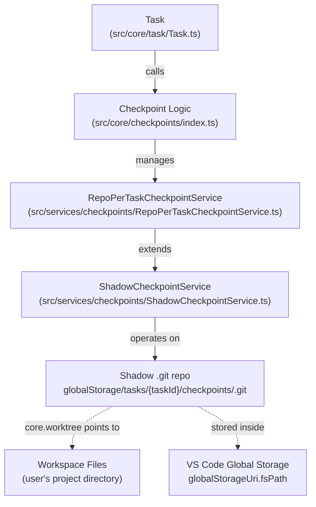
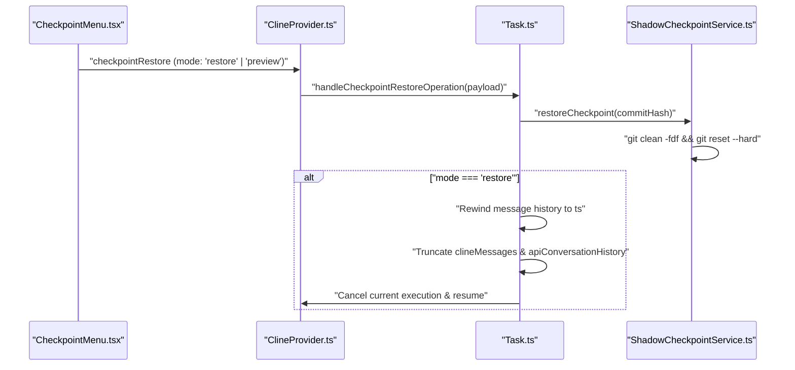

# Checkpoint System

<details>
<summary>Relevant source files</summary>

The following files were used as context for generating this wiki page:

- [apps/web-roo-code/src/app/slack/page.tsx](apps/web-roo-code/src/app/slack/page.tsx)
- [apps/web-roo-code/src/components/slack/slack-thread-demo.tsx](apps/web-roo-code/src/components/slack/slack-thread-demo.tsx)
- [src/__tests__/command-mentions.spec.ts](src/__tests__/command-mentions.spec.ts)
- [src/core/mentions/__tests__/processUserContentMentions.spec.ts](src/core/mentions/__tests__/processUserContentMentions.spec.ts)
- [src/core/mentions/index.ts](src/core/mentions/index.ts)
- [src/core/mentions/processUserContentMentions.ts](src/core/mentions/processUserContentMentions.ts)
- [src/core/task/Task.ts](src/core/task/Task.ts)
- [src/core/task/__tests__/Task.spec.ts](src/core/task/__tests__/Task.spec.ts)
- [src/core/tools/RunSlashCommandTool.ts](src/core/tools/RunSlashCommandTool.ts)
- [src/core/tools/SkillTool.ts](src/core/tools/SkillTool.ts)
- [src/core/tools/__tests__/runSlashCommandTool.spec.ts](src/core/tools/__tests__/runSlashCommandTool.spec.ts)
- [src/services/checkpoints/ShadowCheckpointService.ts](src/services/checkpoints/ShadowCheckpointService.ts)
- [src/services/checkpoints/__tests__/ShadowCheckpointService.spec.ts](src/services/checkpoints/__tests__/ShadowCheckpointService.spec.ts)
- [src/services/checkpoints/index.ts](src/services/checkpoints/index.ts)
- [src/services/checkpoints/types.ts](src/services/checkpoints/types.ts)
- [src/services/skills/__tests__/skillInvocation.spec.ts](src/services/skills/__tests__/skillInvocation.spec.ts)
- [webview-ui/src/components/chat/checkpoints/CheckpointMenu.tsx](webview-ui/src/components/chat/checkpoints/CheckpointMenu.tsx)
- [webview-ui/src/components/chat/checkpoints/CheckpointSaved.tsx](webview-ui/src/components/chat/checkpoints/CheckpointSaved.tsx)
- [webview-ui/src/components/chat/checkpoints/__tests__/CheckpointSaved.spec.tsx](webview-ui/src/components/chat/checkpoints/__tests__/CheckpointSaved.spec.tsx)
- [webview-ui/src/components/chat/checkpoints/schema.ts](webview-ui/src/components/chat/checkpoints/schema.ts)

</details>


This page documents the checkpoint mechanism that saves and restores workspace file state during task execution. The checkpoint system tracks file changes in the workspace by creating commits in a shadow git repository, allowing users to revert the workspace to any previous state.

For settings that enable or configure checkpoints (timeout, enable/disable), see page [11.6](). For the overall Task lifecycle that drives checkpoint creation, see page [5.1]().

---

## Overview

The checkpoint system provides a safety net during AI-assisted edits. As the agent modifies files, periodic checkpoints capture the workspace state as git commits in a hidden repository. Users can restore any checkpoint, reverting all file changes made since that point.

The core design principle is a **shadow git repository**: a separate, isolated git repo stored inside the extension's global storage directory, with its `core.worktree` pointed at the actual workspace. This means the shadow repo tracks workspace files without interfering with any git repository the user has in their workspace.

---

## Architecture

The system bridges the "Natural Language Space" (user messages and history) with the "Code Entity Space" (git commits and file states) by associating specific message timestamps with git commit hashes.

**Shadow Git Repository Architecture**



Sources: [src/services/checkpoints/ShadowCheckpointService.ts:79-127](), [src/services/checkpoints/RepoPerTaskCheckpointService.ts:13-13](), [src/core/task/Task.ts:79-79]()

---

## Service Layer

### `ShadowCheckpointService` (Abstract Base)

Located at [src/services/checkpoints/ShadowCheckpointService.ts](), this is the abstract base class that implements all shadow git operations using the `simple-git` library.

**Key Methods and Logic:**

| Method | Description |
|--------|-------------|
| `initShadowGit(onInit?)` | Initializes or reopens the shadow git repo. It detects nested git repositories using `getNestedGitRepository` and throws an error if found to avoid tracking conflicts [src/services/checkpoints/ShadowCheckpointService.ts:129-146](). |
| `saveCheckpoint(message, options?)` | Stages all files via `stageAll` and commits. It handles empty commits via `allowEmpty` and can flag the UI to hide the checkpoint message via `suppressMessage` [src/services/checkpoints/ShadowCheckpointService.ts:260-331](). |
| `restoreCheckpoint(commitHash)` | Restores workspace files using `git clean -fdf` and `git reset --hard {hash}` [src/services/checkpoints/ShadowCheckpointService.ts:333-356](). |
| `getDiff({from?, to?})` | Returns `CheckpointDiff[]` by comparing two hashes. It extracts file contents before and after changes [src/services/checkpoints/ShadowCheckpointService.ts:358-450](). |

**Constraints:** The constructor explicitly prevents using checkpoints if the workspace is set to protected system paths like the Home directory, Desktop, or Documents [src/services/checkpoints/ShadowCheckpointService.ts:111-119]().

Sources: [src/services/checkpoints/ShadowCheckpointService.ts:79-127](), [src/services/checkpoints/ShadowCheckpointService.ts:129-146](), [src/services/checkpoints/ShadowCheckpointService.ts:260-356]()

---

### `RepoPerTaskCheckpointService`

The concrete implementation that manages the directory lifecycle for checkpoints. Each task is isolated in its own storage path:

```
{globalStorageUri.fsPath}/tasks/{taskId}/checkpoints/
```

It is instantiated via the static `create` factory method, which takes `CheckpointServiceOptions` [src/services/checkpoints/types.ts:16-22]().

Sources: [src/services/checkpoints/ShadowCheckpointService.ts:108-127](), [src/services/checkpoints/RepoPerTaskCheckpointService.ts:13-13]()

---

## Checkpoint Lifecycle

The initialization is orchestrated to ensure that git operations do not block the main extension thread indefinitely.

### Checkpoint Creation Flow

1.  **Trigger:** Checkpoints are triggered automatically after tool executions or manually.
2.  **Service Retrieval:** The system ensures the shadow repo is ready, using a timeout mechanism to warn the user if git operations are taking too long.
3.  **Git Commit:** The service runs `git add .` and `git commit` [src/services/checkpoints/ShadowCheckpointService.ts:290-305]().
4.  **UI Notification:** The service emits a `checkpoint` event. The task listener emits a `say` message of type `checkpoint_saved`, which sends the hash to the webview.

Sources: [src/services/checkpoints/ShadowCheckpointService.ts:260-331](), [src/core/task/Task.ts:162-170]()

---

## Restoration and Rewind Workflow

Restoration is a two-part operation: restoring physical files and (optionally) rewinding the AI's conversation state.

**Checkpoint Restoration Logic Flow**



### Message Rewinding
When a full restoration occurs, the system ensures that the internal state remains consistent. It:
1.  Identifies the cutoff index in the message history based on the checkpoint's timestamp.
2.  Truncates the API conversation history and visual messages to match the restored timeline.
3.  Cancels any in-flight API requests.

Sources: [webview-ui/src/components/chat/checkpoints/CheckpointMenu.tsx:81-84](), [src/core/task/Task.ts:162-170]()

---

## Environment Isolation

The `createSanitizedGit` function ensures that the shadow repository is not corrupted by environment variables from the user's workspace or VS Code's environment (e.g., in Dev Containers). It explicitly unsets variables like `GIT_DIR` and `GIT_WORK_TREE` before creating the git instance.

| Variable | Reason for Removal |
|----------|-------------------|
| `GIT_DIR` | Prevents git from using the user's main repository metadata [src/services/checkpoints/ShadowCheckpointService.ts:37-37](). |
| `GIT_WORK_TREE` | Prevents git from operating on the wrong directory [src/services/checkpoints/ShadowCheckpointService.ts:38-38](). |
| `GIT_INDEX_FILE` | Ensures the shadow repo uses its own index [src/services/checkpoints/ShadowCheckpointService.ts:39-39](). |

Sources: [src/services/checkpoints/ShadowCheckpointService.ts:27-77]()

---

## UI Components

### `CheckpointSaved`
Renders the "Checkpoint" line in the chat view. It uses `checkpointSchema` to validate the metadata associated with the message [webview-ui/src/components/chat/checkpoints/CheckpointSaved.tsx:61-73](). It manages hover states and popover visibility to prevent UI "jumps" when interacting with the menu [webview-ui/src/components/chat/checkpoints/CheckpointSaved.tsx:33-59]().

### `CheckpointMenu`
The dropdown menu providing actions:
- **View Diff:** Triggers `checkpointDiff` in the extension [webview-ui/src/components/chat/checkpoints/CheckpointMenu.tsx:55-60]().
- **Restore Files:** Restores the workspace files but preserves the chat history (`preview` mode) [webview-ui/src/components/chat/checkpoints/CheckpointMenu.tsx:76-79]().
- **Restore Files and Task:** Performs a full rewind (`restore` mode) with a confirmation safety check [webview-ui/src/components/chat/checkpoints/CheckpointMenu.tsx:81-84](), [webview-ui/src/components/chat/checkpoints/CheckpointMenu.tsx:127-164]().

Sources: [webview-ui/src/components/chat/checkpoints/CheckpointSaved.tsx:16-107](), [webview-ui/src/components/chat/checkpoints/CheckpointMenu.tsx:24-201]()

---

## File Exclusions

Checkpoints ignore specific files to maintain performance and avoid bloating the shadow repository. These patterns are written to `.git/info/exclude` within the shadow repository [src/services/checkpoints/ShadowCheckpointService.ts:172-172]().

**Exclusion Categories:**
- **Build Artifacts:** `node_modules/`, `dist/`, `bin/`, `build/`.
- **Media:** Common image and video formats.
- **Caches/Logs:** `*.log`, `*.DS_Store`, `*.cache`.
- **Databases:** `*.sqlite`, `*.db`, `*.parquet`.

Sources: [src/services/checkpoints/ShadowCheckpointService.ts:172-172](), [src/services/checkpoints/ShadowCheckpointService.ts:214-218]()