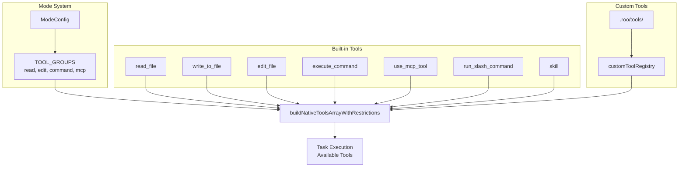
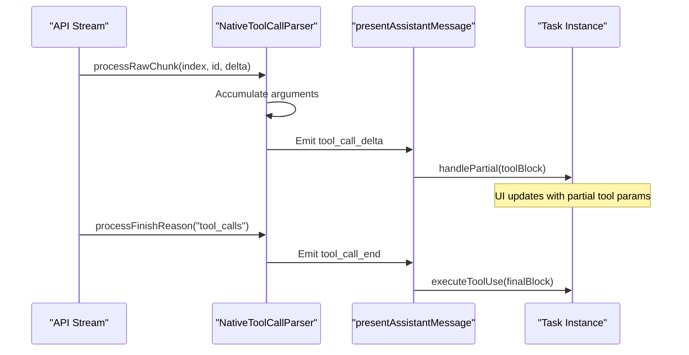
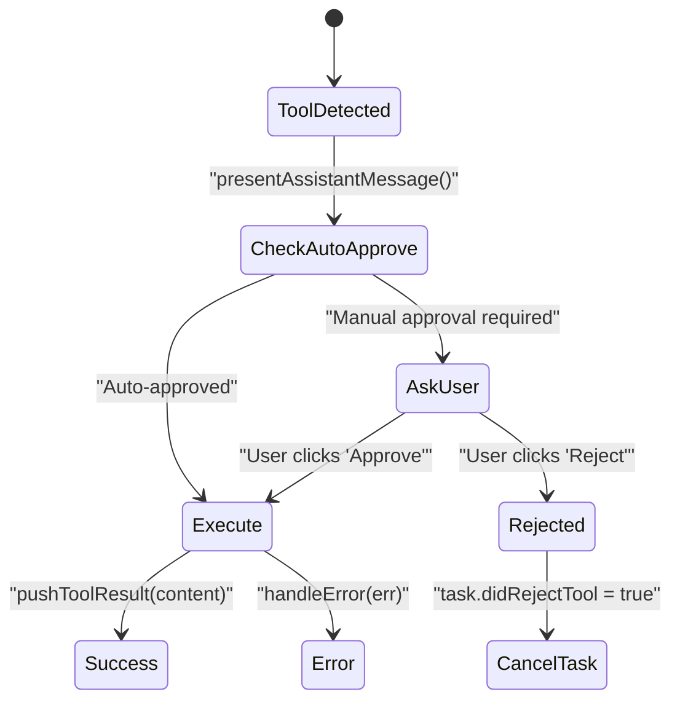

# Tool Execution System

<details>
<summary>Relevant source files</summary>

The following files were used as context for generating this wiki page:

- [packages/cloud/src/__tests__/CloudSettingsService.parsing.test.ts](packages/cloud/src/__tests__/CloudSettingsService.parsing.test.ts)
- [packages/core/src/custom-tools/__tests__/custom-tool-registry.spec.ts](packages/core/src/custom-tools/__tests__/custom-tool-registry.spec.ts)
- [packages/types/src/tool-params.ts](packages/types/src/tool-params.ts)
- [packages/types/src/tool.ts](packages/types/src/tool.ts)
- [src/core/assistant-message/NativeToolCallParser.ts](src/core/assistant-message/NativeToolCallParser.ts)
- [src/core/assistant-message/__tests__/NativeToolCallParser.spec.ts](src/core/assistant-message/__tests__/NativeToolCallParser.spec.ts)
- [src/core/assistant-message/__tests__/presentAssistantMessage-custom-tool.spec.ts](src/core/assistant-message/__tests__/presentAssistantMessage-custom-tool.spec.ts)
- [src/core/assistant-message/__tests__/presentAssistantMessage-images.spec.ts](src/core/assistant-message/__tests__/presentAssistantMessage-images.spec.ts)
- [src/core/assistant-message/__tests__/presentAssistantMessage-unknown-tool.spec.ts](src/core/assistant-message/__tests__/presentAssistantMessage-unknown-tool.spec.ts)
- [src/core/assistant-message/presentAssistantMessage.ts](src/core/assistant-message/presentAssistantMessage.ts)
- [src/core/prompts/tools/__tests__/filter-tools-for-mode.spec.ts](src/core/prompts/tools/__tests__/filter-tools-for-mode.spec.ts)
- [src/core/prompts/tools/filter-tools-for-mode.ts](src/core/prompts/tools/filter-tools-for-mode.ts)
- [src/core/prompts/tools/native-tools/__tests__/read_file.spec.ts](src/core/prompts/tools/native-tools/__tests__/read_file.spec.ts)
- [src/core/prompts/tools/native-tools/edit.ts](src/core/prompts/tools/native-tools/edit.ts)
- [src/core/prompts/tools/native-tools/index.ts](src/core/prompts/tools/native-tools/index.ts)
- [src/core/prompts/tools/native-tools/read_file.ts](src/core/prompts/tools/native-tools/read_file.ts)
- [src/core/task/build-tools.ts](src/core/task/build-tools.ts)
- [src/core/tools/ExecuteCommandTool.ts](src/core/tools/ExecuteCommandTool.ts)
- [src/core/tools/__tests__/executeCommandTool.spec.ts](src/core/tools/__tests__/executeCommandTool.spec.ts)
- [src/core/tools/__tests__/validateToolUse.spec.ts](src/core/tools/__tests__/validateToolUse.spec.ts)
- [src/core/tools/validateToolUse.ts](src/core/tools/validateToolUse.ts)
- [src/shared/__tests__/modes.spec.ts](src/shared/__tests__/modes.spec.ts)
- [src/shared/modes.ts](src/shared/modes.ts)
- [src/shared/tools.ts](src/shared/tools.ts)

</details>


## Purpose and Scope

The Tool Execution System enables the AI to interact with the workspace environment through a standardized interface. Tools provide capabilities for file system operations, terminal command execution, external service integration via MCP (Model Context Protocol), and custom command/skill execution. This system is the primary mechanism by which the AI agent takes actions in the development environment.

For information about how the AI decides which tools to use, see [System Prompt and Modes](#9). For details on message history management and context, see [Context and Message Management](#7). For the overall task execution lifecycle, see [Task Management System](#5).

**Sources:** [src/core/assistant-message/presentAssistantMessage.ts:44-59](), [src/core/task/build-tools.ts:65-80]()

---

## Tool Architecture and Registry

### BaseTool Abstract Class

All tools inherit from the `BaseTool` abstract class, which defines the core interface for tool execution. Each tool must implement:

- `name`: Unique identifier for the tool (e.g., `execute_command`). [src/core/tools/ExecuteCommandTool.ts:42-42]()
- `execute()`: Core execution logic receiving parameters, the `Task` instance, and callbacks. [src/core/tools/ExecuteCommandTool.ts:44-44]()
- `handlePartial()`: Optional handler for processing tool calls while they are still streaming from the model. [src/core/tools/ExecuteCommandTool.ts:149-153]()

**Sources:** [src/core/tools/ExecuteCommandTool.ts:41-42](), [src/core/tools/ExecuteCommandTool.ts:149-153]()

### ToolCallbacks Interface

Tools receive a `ToolCallbacks` object to interact with the task system without being tightly coupled to the `Task` class internals:

```typescript
export interface ToolCallbacks {
    askApproval: AskApproval
    handleError: HandleError
    pushToolResult: PushToolResult
}
```

These callbacks enable:
- **User approval workflow**: Request permission via `askApproval` before executing operations. [src/shared/tools.ts:7-12]()
- **Error handling**: Standardized reporting via `handleError`. [src/shared/tools.ts:14-14]()
- **Result submission**: Sending results back to the conversation via `pushToolResult`. [src/shared/tools.ts:16-16]()

**Sources:** [src/shared/tools.ts:7-16]()

### Tool Discovery and Registration

The system builds the available toolset dynamically based on the current mode, user settings, and experimental flags. The `buildNativeToolsArrayWithRestrictions` function orchestrates this by gathering native tools, MCP tools, and custom tools from `.roo/tools`. [src/core/task/build-tools.ts:82-142]()



**Tool Organization by Groups:**

| Group | Tools | Description |
|-------|-------|-------------|
| `read` | `read_file`, `list_files`, `search_files`, `codebase_search` | Read-only file system operations |
| `edit` | `edit_file`, `apply_diff`, `write_to_file`, `search_replace` | File modification operations |
| `command` | `execute_command`, `read_command_output` | Terminal command execution |
| `mcp` | `use_mcp_tool`, `access_mcp_resource` | MCP server integration |
| `modes` | `switch_mode`, `new_task` | Orchestration and context switching |

**Sources:** [src/core/task/build-tools.ts:82-169](), [packages/types/src/tool.ts:7-49](), [src/shared/tools.ts:92-120]()

For details, see [Tool Architecture and Registry](#6.1).

---

## Native Tool Calling Protocol

### Tool Use Block Structure

Roo Code uses a "Native Protocol" that maps to OpenAI-style function calling. The `ToolUse` interface supports both legacy parameter maps and typed `nativeArgs`. [src/shared/tools.ts:127-147]()

```typescript
export interface ToolUse<TName extends ToolName = ToolName> {
    type: "tool_use"
    id?: string 
    name: TName
    params: Partial<Record<ToolParamName, string>> // Legacy
    nativeArgs?: NativeToolArgs[TName] // Typed arguments
    partial: boolean
}
```

**Sources:** [src/shared/tools.ts:127-147](), [src/core/assistant-message/NativeToolCallParser.ts:28-35]()

### Streaming Tool Call Assembly

During response streaming, the `NativeToolCallParser` assembles tool calls incrementally. It uses `partial-json` to extract arguments from incomplete JSON strings so the UI can show progress. [src/core/assistant-message/NativeToolCallParser.ts:246-248]()



**Key Mechanism - `rawChunkTracker`:**
The `NativeToolCallParser` maintains a static `rawChunkTracker` map [src/core/assistant-message/NativeToolCallParser.ts:66-74]() to handle interleaved chunks from providers that support parallel tool calling.

**Sources:** [src/core/assistant-message/NativeToolCallParser.ts:53-164](), [src/core/assistant-message/presentAssistantMessage.ts:61-102]()

For details, see [Native Tool Calling Protocol](#6.2).

---

## Tool Approval and Safety

### Approval Workflow

The `presentAssistantMessage` function acts as the gatekeeper for tool execution. It checks if a tool requires user approval via the `askApproval` callback. [src/core/assistant-message/presentAssistantMessage.ts:50-50]()



**Sources:** [src/core/assistant-message/presentAssistantMessage.ts:111-127](), [src/core/tools/ExecuteCommandTool.ts:68-72]()

### Mistake Tracking and Circuit Breaking

The system tracks consecutive mistakes to prevent the AI from entering infinite loops (e.g., repeatedly failing to apply a diff). If the `consecutiveMistakeCount` reaches a limit, a `ConsecutiveMistakeError` is triggered. [src/core/assistant-message/presentAssistantMessage.ts:5-5]()

**Sources:** [src/core/assistant-message/presentAssistantMessage.ts:5-5](), [src/core/tools/ExecuteCommandTool.ts:50-53]()

For details, see [Tool Approval and Safety](#6.3).

---

## File Operation Tools

### read_file Tool
**Purpose:** Reads file contents with support for "Slice Mode" (pagination) and "Indentation Mode" (semantic code block extraction). [src/core/prompts/tools/native-tools/read_file.ts:42-55]()
**Parameters:** `path`, `mode`, `offset`, `limit`, `indentation` (anchor_line). [src/core/prompts/tools/native-tools/read_file.ts:111-138]()

### edit_file / search_replace / edit Tools
**Purpose:** Apply precise text replacements. `edit_file` is preferred for multiple occurrences using `expected_replacements`. [src/shared/tools.ts:99-102]()

### apply_diff Tool
**Purpose:** Applies a SEARCH/REPLACE block style diff to a file. [src/shared/tools.ts:98-98]()

**Sources:** [src/core/prompts/tools/native-tools/read_file.ts:41-138](), [src/shared/tools.ts:98-102]()

For details, see [File Operation Tools](#6.4).

---

## Command Execution and Terminal Tools

### execute_command Tool
**Purpose:** Runs shell commands. It integrates with the `TerminalRegistry` to manage persistent terminal sessions. [src/core/tools/ExecuteCommandTool.ts:41-56]()
**Timeout Logic:** Supports both user-configured `commandExecutionTimeout` and model-provided `agentTimeout`. [src/core/tools/ExecuteCommandTool.ts:81-108]()

### TerminalRegistry
Manages a collection of `Terminal` instances, allowing the AI to run background processes or interactive commands while capturing output via an `OutputInterceptor`. [src/integrations/terminal/TerminalRegistry.ts]()

**Sources:** [src/core/tools/ExecuteCommandTool.ts:41-108](), [src/integrations/terminal/TerminalRegistry.ts]()

For details, see [Command Execution and Terminal Tools](#6.5).

---

## MCP Tool Integration

### use_mcp_tool / access_mcp_resource
**Purpose:** Extends Roo Code's capabilities by connecting to external Model Context Protocol servers. [src/shared/tools.ts:117-117]()
**Native MCP Support:** The system supports "native" MCP tool calls where the model calls `mcp_serverName_toolName` directly, which is then parsed into a `McpToolUse` object. [src/shared/tools.ts:155-167]()

**Sources:** [src/shared/tools.ts:117-167](), [src/core/assistant-message/presentAssistantMessage.ts:105-127]()

For details, see [MCP Tool Integration](#6.7).

---

## Tool Result Formatting

The `formatResponse` object provides standardized templates for tool outputs, ensuring the model receives results in a format it can easily parse for the next turn. [src/core/prompts/responses/index.ts]()

| Method | Output Purpose |
|--------|----------------|
| `toolResult` | Standard wrapper for successful tool output |
| `toolError` | Formats error messages for the model |
| `imageBlocks` | Converts image paths/data into API-compatible blocks [src/core/assistant-message/presentAssistantMessage.ts:164-164]() |
| `toolApprovedWithFeedback` | Includes user feedback alongside an approved tool result [src/core/assistant-message/presentAssistantMessage.ts:159-159]() |

**Sources:** [src/core/assistant-message/presentAssistantMessage.ts:158-167](), [src/shared/tools.ts:5-5]()

For details, see [Tool Result Formatting](#6.8).